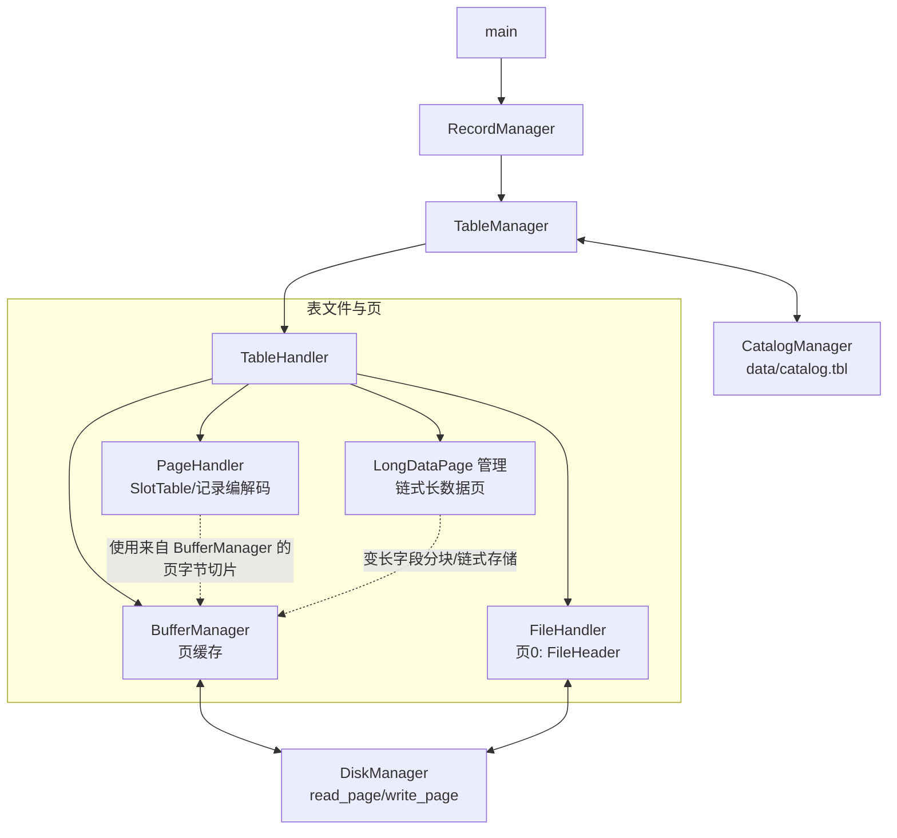
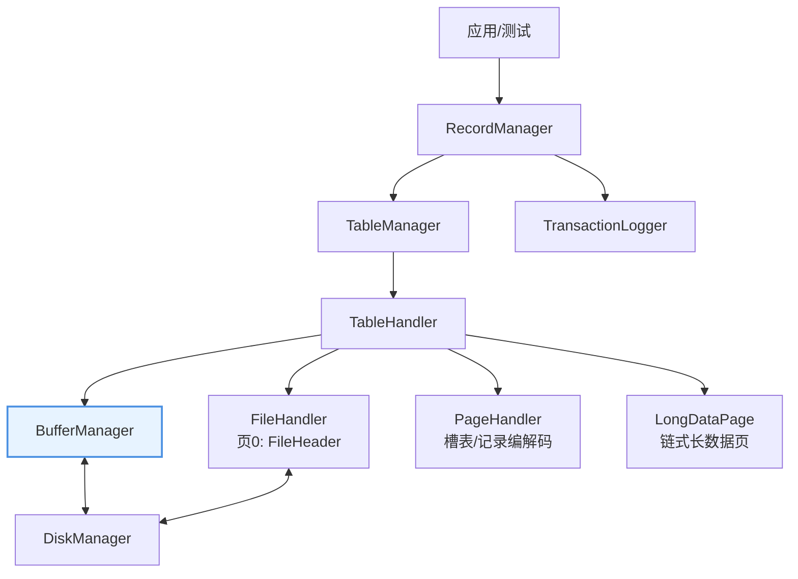

---
title: 设计一个数据库引擎 (1) 内存、外存和记录管理
url: https://blog.kisechan.space/2025/db-engine-1/
type: post
time: '2026-10-21T16:02:14.153Z'
---

**数据库系列笔记**

点击查看系列汇总：

---

Kisechan 的数据库系列笔记
https://blog.kisechan.space/tags/%E6%95%B0%E6%8D%AE%E5%BA%93/

---

- **数据库原理课程笔记部分**：
  - [数据库原理 课程笔记 (1) 数据库、关系代数和 SQL](https://blog.kisechan.space/2025/notes-database-1/)
  - [数据库原理 课程笔记 (2) E-R 模型和关系模式](https://blog.kisechan.space/2025/notes-database-2/)
  - [数据库原理 课程笔记 (3) 存储、索引、事务和并发](https://blog.kisechan.space/2025/notes-database-3/)
  - [数据库原理 课程笔记 (4) 杂项和题目整理](https://blog.kisechan.space/2025/notes-database-4/)
- **手搓数据库** (CS346) **部分**：
  - 设计一个数据库引擎 (1) 内存、外存和记录管理 【**当前阅读**】
  - [设计一个数据库引擎 (2) 索引](https://blog.kisechan.space/2025/db-engine-2/)
  - [设计一个数据库引擎 (3) SQL 处理](https://blog.kisechan.space/2025/db-engine-3/)
- **Oracle 和 NoSQL 课程部分**：
  - ~~Oracle 的学习使用和环境配置~~
  - [NoSQL 的学习使用和环境配置](https://blog.kisechan.space/2026/nosql/)

## 介绍

这是吉林大学软件工程卓越工程师班《_数据库系统应用程序开发_》和《_系统软件综合实践_》两门课程（共 3 学分）综合起来共同完成的课程项目。课程的内容主要是了解 [Stanford CS346 课程](https://web.stanford.edu/class/cs346/2015/redbase-pf.html)的 RedBase 框架，仿照实现一个**数据库引擎**的部分功能。

项目目前已在 GitHub 开源：

<a href="https://github.com/Kisechan/db-engine" name="https://github.com/fluidicon.png" class="LinkCard">db-engine</a>

主要也参考了这位学长的实现！
<a href="https://github.com/XuanchenLi/DBEngine" name="https://github.com/fluidicon.png" class="LinkCard">Xuanchenli/DBEngine</a>

## 项目要求

本文涉及到的项目要求，差不多可以对应 RedBase 项目的 PF 层（文件和分页）和 RM 层（记录管理）两部分。具体的要求如下：

> **任务一：初始化**
>
> - 输入可用的主存空间（可变），转变为主存中缓冲区的块；
>
> - 输入磁盘空间（可变），转变为磁盘中的块；
>
> - 分别向若干表插入若干记录（给表分配块空间）；
>
> 需要考虑的问题：以 `banking` 为例，
>
> - 确定数据字典的内容
>
> - 生成 10000 行 `account` 表的数据存放于文件
>
> - 如何将 `account` 表中的列组织成行？
>
> - 如何以块为单位存放行？
>
> - 如何以块为单位组织预分配的文件？
>
> - 如何以块为单位管理内存？
>
> ---
>
> **任务二：实现 DBMS 的内存管理**
>
> 对服务器内存空间进行划分，至少由三部分组成：最近执行过 SQL 的访问计划、数据字典信息、数据处理缓存、日志缓存；
>
> - 实现内存空间的管理算法：LRU，CLOCK；
>
> - 访问存储在缓冲池中的页面；
>
> - 从磁盘加载一个页面到空槽；
>
> - 将页面从磁盘加载到牺牲者缓冲池插槽；
>
> - 内存管理单位与文件块一致；

## 项目实现

经典的 C++ 工程对于内存管理的混乱和高难度是有目共睹的，外加笔者不甚喜欢 C++ 的环境配置和 `make` ，所以本项目采用的是更安全、更支持并发、更现代的 Rust 语言（环境：WSL Ubuntu 22.04 / macOS）实现。

目前的项目结构如下：

> - `src/` 源代码文件夹
>   - `common/` 存放类型定义、磁盘文件处理逻辑
>     - `disk_manager.rs`
>     - `types.rs`
>   - `fm/` 存放数据库存储文件内组织的逻辑
>     - `file_handler.rs`
>     - `file_header.rs`
>     - `file_manager.rs`
>   - `mm/` 缓冲区和置换算法
>     - `buffer_manager.rs`
>     - `frame.rs`
>     - `replacer.rs`
>   - `pm/` 存放内页结构和槽（Slot）的管理
>     - `page_handler.rs`
>     - `page_header.rs`
>     - `long_data.rs`
>   - `rm/` 存放记录管理（数据字典等）和数据字典缓存、日志缓存、 SQL 查询缓存的逻辑
>     - `catalog_manager.rs`
>     - `query_plan_cache.rs`
>     - `transaction_logger.rs`
>     - `record_manager.rs`
>     - `table_handler.rs`
>     - `table_manager.rs`
>   - `test/` 存放测试代码
>   - **`main.rs`** **主文件**

示意图如下：



### `DiskManager`

`DiskManager` 可以用来实现文件的增删读写，在这里设置了页面的大小，负责磁盘的 I/O。

```rust
const PAGE_SIZE: usize = 4096;
```

使用 Rust 标准库 `fs::File` 实现。

### `fm` 部分

本部分负责管理单个**二进制文件的读写和管理**。

- `FileManager` 负责管理打开/关闭文件，是上层代码的重要接口。提供文件块初始化接口，支持自定义磁盘大小的初始化。

- `FileHeader` 定义了**文件头**（文件头部 4 KB 储存的元信息）和空闲页列表。

- `FileHandler` 负责管理单个文件，包括**文件头的打开、读写**，**文件块的创建和回收**，将信息序列化写入文件或从文件中反序列化读出信息。分配页时从空闲页列表获取，否则扩展文件。

### `pm` 部分

本部分负责管理**内存中的页和槽**，并通过 `mm`，利用 `fm` 的接口将页数据持久化。

- `PageHeader` 定义了**页的头部**，包括空闲槽的起始位置，Slot Table 的大小等信息。

- `PageHandler` 负责**页的操作和具体页的槽管理**，增删改查。
- `LongDataPage` 负责一个专门的大的、变长数据（例如不定长字符串）的单独管理，它**单独分配页进行管理**，普通的数据页内只存有变长数据的指针。

### `mm` 部分

本部分是**缓冲区**的实现，在上层实现和底层 I/O 之间提供一个缓冲。内部完成了页的“钉住”，脏页和页面置换算法逻辑（LRU）。

- `buffer_manager.rs` 定义了页缓冲区和页的替换、脏页的管理逻辑。
- `frame.rs` 定义了缓冲帧。
- `replacer.rs` 负责实现替换逻辑。

LRU 算法使用队列简单实现：

```rust
use std::collections::VecDeque;

pub trait Replacer {
    fn pick_victim(&mut self) -> Option<usize>;
    fn pin(&mut self, frame_id: usize);
    fn unpin(&mut self, frame_id: usize);
}

// LRU 替换策略
pub struct LRU {
    frames: VecDeque<usize>,    // 未被 pin 的 frame 队列
    pinned: std::collections::HashSet<usize>, // 已被 pin 的 frame
}

impl LRU {
    pub fn new(pool_size: usize) -> Self {
        let mut frames = VecDeque::new();
        for i in 0..pool_size {
            frames.push_back(i);
        }
        LRU {
            frames,
            pinned: std::collections::HashSet::new(),
        }
    }
}

impl Replacer for LRU {
    // 选择一个受害者帧（LRU 策略：选择队列前端最久未使用的）
    fn pick_victim(&mut self) -> Option<usize> {
        // 从队列前端获取最久未使用的帧
        self.frames.pop_front()
    }

    // 标记帧被使用（pin）
    fn pin(&mut self, frame_id: usize) {
        self.pinned.insert(frame_id);
    }

    // 取消标记帧（unpin），将其加入队列末尾
    fn unpin(&mut self, frame_id: usize) {
        if self.pinned.remove(&frame_id) {
            self.frames.push_back(frame_id);
        }
    }
}

```

### `rm` 部分

本部分是**记录管理**部分的实现，提供了 CRUD 的高层接口，并实现了管理数据字典、日志和 SQL 查询（暂时没有付诸使用）的缓存。

- `catalog_manager.rs` 负责管理数据字典的缓存
- `query_plan_cache.rs` 负责管理 SQL 查询的缓存
- `transaction_logger.rs` 负责管理日志的缓存
- `record_manager.rs` 负责管理单条记录
- `table_handler.rs` 负责管理单个表文件
- `table_manager.rs` 负责管理所有已打开的表

结构示意图如下：



## 测试

在 `FileManager` 和 `BufferManager` 中，本人实现了专门的按照特定大小实现文件块和内存缓冲块的初始化方法，自动按照要求的大小将块初始化为空。同时也提供了默认的初始化方法，按需初始化内存和磁盘。

为任务一的 `account` 任务编写了专门的测试代码：

```rust
use crate::rm::catalog_manager::CatalogManager;
use crate::rm::record_manager::{Record, RecordManager};
use crate::rm::transaction_logger::TransactionLogger;
use crate::rm::table_manager::TableManager;
use crate::rm::types::*;

use rand::Rng;

use crate::common::RID;
use crate::fm::FileManager;

fn random_name() -> Vec<u8> {
    let mut rng = rand::thread_rng();
    let mut s: Vec<u8> = (0..20)
        .map(|_| rng.gen_range(b'a'..=b'z'))
        .collect();
    s
}

// 序列化为 fixed_part
fn make_account_record(id: u32, name: &[u8]) -> Record {
    let mut fixed = Vec::new();
    fixed.extend_from_slice(&id.to_le_bytes());
    fixed.extend_from_slice(name);
    fixed.extend_from_slice(&0u32.to_le_bytes());
    Record::new(fixed)
}

// 清理旧的数据文件
fn cleanup_old_files() -> Result<(), String> {
    println!("\n===== Cleaning up old files =====");

    let data_dir = "data";

    // 删除整个 data 目录（如果存在）
    if std::path::Path::new(data_dir).exists() {
        std::fs::remove_dir_all(data_dir)
            .map_err(|e| format!("Failed to remove data directory: {}", e))?;
        println!("[Cleanup] Deleted directory: {}", data_dir);
    }

    println!("Cleanup completed.\n");

    std::fs::create_dir(data_dir)
        .map_err(|e| format!("Failed to create data directory: {}", e))?;

    println!("[Init] Created directory: {}", data_dir);

    Ok(())
}

// 确保 data 目录存在
fn ensure_data_dir() -> Result<(), String> {
    let path = "data";
    if !std::path::Path::new(path).exists() {
        std::fs::create_dir(path)
            .map_err(|e| format!("Failed to create data directory: {}", e))?;
        println!("[Init] Created directory: {}", path);
    }
    Ok(())
}

pub fn task1() -> Result<(), String> {
    println!("===== Task1 DB Test Start =====");

    // 确保 data 目录存在
    ensure_data_dir()?;

    // 清理旧文件
    cleanup_old_files()?;

    // 先初始化磁盘映像（写入空页）
    FileManager::init_disk_from_size(disk_bytes, "data")?;
    println!("[Init] Disk initialized from {} bytes", disk_bytes);

    // 初始化主存缓冲池（创建指定页数的空帧）
    let _bm = BufferManager::init_memory_from_size(mem_bytes, "data".to_string());
    println!("[Init] Memory buffer initialized from {} bytes ({} KB)", mem_bytes, mem_bytes / 1024);

    // 初始化 Catalog & TableManager & Logger & RM
    let catalog = CatalogManager::new()?;
    println!("Catalog initialized.");
    let logger = TransactionLogger::new(1024 * 100 * 4);
    println!("Logger initialized.");
    let table_manager = TableManager::new(catalog)?;
    println!("TableManager initialized.");
    let mut rm = RecordManager::new(table_manager, logger);
    println!("RecordManager initialized.");

    // 定义 account 表结构（定长字段）
    let schema = TableSchema {
        table_name: "account".to_string(),
        columns: vec![
            ColumnDef {
                name: "id".to_string(),
                data_type: DataType::Int32,
                nullable: false,
            },
            ColumnDef {
                name: "name".to_string(),
                data_type: DataType::Char(20),
                nullable: false,
            },
            ColumnDef {
                name: "balance".to_string(),
                data_type: DataType::Int32,
                nullable: false,
            },
        ],
        root_pages: vec![],
    };

    println!("Creating table: account");

    rm.create_table(schema)?;
    println!("Table 'account' created in catalog.");

    // 注意：这里使用表名 "account"，不是文件路径
    rm.open_table("account")?;
    println!("Table opened: account");

    // 插入 10k 测试数据
    let total = 10_000;
    rm.begin_transaction()?;

    for i in 0..total {
        let name = random_name();
        let rec = make_account_record(i as u32, &name);
        let bytes = rec.serialize();

        let rid = rm.insert("account", &bytes)?;
        if i % 1000 == 0 {
            println!("Inserted {} rows (RID = {:?})", i, rid);
        }
    }

    rm.commit_transaction()?;
    println!("Inserted {} records successfully!", total);

    // 全表扫描验证
    let mut count = 0;
    rm.scan_all("account", |rid: RID, bytes: &[u8]| {
        let rec = Record::deserialize(bytes).unwrap();
        count += 1;
        if count <= 3 {
            println!("[Example] RID {:?}  fixed bytes = {:?}", rid, rec.fixed_part);
        }
        true
    })?;

    println!("Scanned {} records.", count);

    println!("===== Test Completed Successfully =====");
    Ok(())
}
```

结果输出为：

```text
===== Task1 DB Test Start =====

===== Cleaning up old files =====
[Cleanup] Deleted directory: data
[Cleanup] Deleted: db.log
Cleanup completed.

[Init] Created directory: data
[CatalogManager] Catalog file not found, starting with empty schema
[CatalogManager] Initialized with 0 tables
Catalog initialized.
Logger initialized.
TableManager initialized.
RecordManager initialized.
Creating table: account
[CatalogManager] Added table 'account' to memory cache
[CatalogManager] Flushed 1 tables to disk (114 bytes)
[FileHandler] Flushed header to data/account.tbl: size=12 bytes, total_pages=1, free_list_len=0
[TableManager] Created table file: data/account.tbl with initialized header
Table 'account' created in catalog.
[FileHandler] Loaded header from data/account.tbl: total_pages=1, free_list_len=0
[TableManager] Opened table: account
Table opened: account
[TX1] Transaction started
[FileHandler] Allocated new page 1 (total_pages now: 2)
[FileHandler] Flushed header to data/account.tbl: size=12 bytes, total_pages=2, free_list_len=0
[DiskManager] Page 1 beyond file size (4096), returning zero-filled page
[TX1] Logged INSERT into table 'account' at RID(1, 0)
Inserted 0 rows (RID = RID { page_id: 1, slot_id: 0 })
[TX1] Logged INSERT into table 'account' at RID(1, 1)
[TX1] Logged INSERT into table 'account' at RID(1, 2)
[TX1] Logged INSERT into table 'account' at RID(1, 3)

【中间大约有两万行输出，省略】

[TX1] Logged INSERT into table 'account' at RID(98, 98)
[TX1] Logged INSERT into table 'account' at RID(98, 99)
[TX1] Logged INSERT into table 'account' at RID(98, 100)
[TX1] Logged INSERT into table 'account' at RID(98, 101)
[FileHandler] Allocated new page 99 (total_pages now: 100)
[FileHandler] Flushed header to data/account.tbl: size=12 bytes, total_pages=100, free_list_len=0
[DiskManager] Page 99 beyond file size (4096), returning zero-filled page
[TX1] Logged INSERT into table 'account' at RID(99, 0)
[TX1] Logged INSERT into table 'account' at RID(99, 1)
[TX1] Logged INSERT into table 'account' at RID(99, 2)
[TX1] Logged INSERT into table 'account' at RID(99, 3)
[TX1] Transaction committed
Inserted 10000 records successfully!
[Example] RID RID { page_id: 1, slot_id: 0 }  fixed bytes = [0, 0, 0, 0, 109, 104, 97, 112, 105, 102, 109, 102, 109, 106, 118, 113, 112, 107, 119, 118, 121, 112, 99, 107, 0, 0, 0, 0]
[Example] RID RID { page_id: 1, slot_id: 1 }  fixed bytes = [1, 0, 0, 0, 120, 120, 104, 110, 101, 101, 104, 100, 99, 105, 118, 108, 99, 120, 120, 98, 116, 111, 103, 121, 0, 0, 0, 0]
[Example] RID RID { page_id: 1, slot_id: 2 }  fixed bytes = [2, 0, 0, 0, 113, 121, 122, 101, 111, 122, 101, 110, 119, 120, 109, 116, 101, 101, 101, 100, 121, 97, 120, 112, 0, 0, 0, 0]
Scanned 10000 records.
===== Test Completed Successfully =====

```


