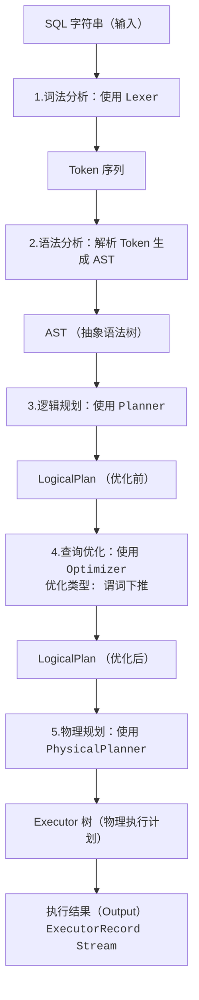
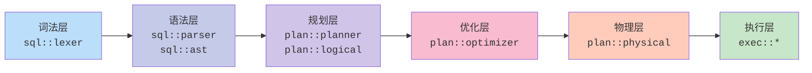

---
title: 设计一个数据库引擎 (3) SQL 处理
url: https://blog.kisechan.space/2025/db-engine-3/
type: post
time: '2026-10-21T16:13:46.163Z'
---

**数据库系列笔记**

点击查看系列汇总：

---

Kisechan 的数据库系列笔记
https://blog.kisechan.space/tags/%E6%95%B0%E6%8D%AE%E5%BA%93/

---

- **数据库原理课程笔记部分**：
  - [数据库原理 课程笔记 (1) 数据库、关系代数和 SQL](https://blog.kisechan.space/2025/notes-database-1/)
  - [数据库原理 课程笔记 (2) E-R 模型和关系模式](https://blog.kisechan.space/2025/notes-database-2/)
  - [数据库原理 课程笔记 (3) 存储、索引、事务和并发](https://blog.kisechan.space/2025/notes-database-3/)
  - [数据库原理 课程笔记 (4) 杂项和题目整理](https://blog.kisechan.space/2025/notes-database-4/)
- **手搓数据库** (CS346) **部分**：
  - [设计一个数据库引擎 (1) 内存、外存和记录管理](https://blog.kisechan.space/2025/db-engine-1/)
  - [设计一个数据库引擎 (2) 索引](https://blog.kisechan.space/2025/db-engine-2/)
  - 设计一个数据库引擎 (3) SQL 处理 【**当前阅读**】
- **Oracle 和 NoSQL 课程部分**：
  - ~~Oracle 的学习使用和环境配置~~
  - [NoSQL 的学习使用和环境配置](https://blog.kisechan.space/2026/nosql/)

## 任务要求

> **实现 SQL 的查询处理**。
>
> - 针对 DML 语句，进行**词法、语法、语义分析**，输出语法分析树；
> - **制定逻辑查询计划**：把语法树转换成一个关系代数表达式，输出分析树对应的逻辑计划和优化后的逻辑计划；
> - **制定物理查询计划**：把优化后的逻辑计划转换成物理查询计划，要求指定操作执行的顺序，每一步使用的算法，操作之间的传递方式等。

## 实现架构

完整的查询处理流程：



模块之间的依赖关系为：



## 设计思路

### 词法分析

词法分析的目的是**将 SQL 字符串转换为 Token 序列**。

**核心实现**:

- 类： `Lexer` (位置: `src/sql/lexer.rs`)
- 方法： `tokenize()` - 返回 `Vec<Token>`

**支持的 Token 类型主要有**：

- 关键字： `SELECT`, `FROM`, `WHERE`, `JOIN`, `INSERT`, `DELETE`, `UPDATE`, etc.
- 标识符： 表名、列名等
- 字面量： 整数、浮点数、字符串
- 操作符： `=`, `!=`, `<`, `>`, `<=`, `>=`, `AND`, `OR`
- 分隔符： `(`, `)`, `,`, `;`

**示例输出**:

```text
SQL: "SELECT id, name FROM users WHERE age > 18"
Tokens: [SELECT, Identifier("id"), Comma, Identifier("name"),
         FROM, Identifier("users"), WHERE, Identifier("age"),
         GreaterThan, Integer(18), Eof]
```

### 语法分析

语法分析的目的是**将 Token 序列转换为抽象语法树 （AST）**。在 `src/sql/ast.rs` 中实现。

**核心实现**:

- `SelectStmt`, `InsertStmt`, `UpdateStmt`, `DeleteStmt`, `CreateTableStmt`, `DropTableStmt`

**`SelectStmt` 的结构**：

```rust
pub struct SelectStmt {
    pub distinct: bool,
    pub fields: Vec<SelectField>,               // 选择的字段
    pub from_table: Option<String>,             // 表名
    pub where_clause: Option<WhereClause>,  // WHERE 条件
    pub group_by: Option<Vec<String>>,      // 分组
    pub order_by: Option<Vec<OrderBy>>,     // 排序
    pub limit: Option<u32>,                 // 限制条件
}
```

**AST 示例**：

```rust
SelectStmt {
    distinct: false,
    fields: [Column("id"), Column("name")],
    from_table: Some("users"),
    where_clause: Some(WhereClause {
        condition: BinaryOp {
            left: Column("age"),
            op: Gt,
            right: Literal(Integer(18))
        }
    })
}
```

---

另外，本项目也实现了一个**完整的递归下降解析器**（`parser.rs`），能使用**运算符优先级爬升算法**，正确处理表达式优先级。例如：

```plaintext
// 优先级层次（从低到高）
parse_or_expression()                     // OR            （优先级 1）
  └─ parse_and_expression()               // AND           （优先级 2）
      └─ parse_comparison()               // =, !=, <, >   （优先级 3）
          └─ parse_additive()             // +, -          （优先级 4）
              └─ parse_multiplicative()   // *, /, %       （优先级 5）
                  └─ parse_unary()        // NOT, -        （优先级 6）
                      └─ parse_primary()  // 字面量, 列名    （优先级 7）
```

### 逻辑规划

逻辑规划的目的是**将 AST 转换为关系代数表达式（逻辑计划树）**。在 `src/plan/planner.rs` 中实现。

**核心实现**:

- 类: `Planner`
- 方法: `plan()` → `LogicalPlan`

**LogicalPlan 枚举**:

```rust
pub enum LogicalPlan {
    Scan {
        table_name: String,
    },
    Filter {
        child: Box<LogicalPlan>,
        predicate: Expression,
    },
    Project {
        child: Box<LogicalPlan>,
        columns: Vec<String>,
    },
    Join {
        left: Box<LogicalPlan>,
        right: Box<LogicalPlan>,
        on_condition: Option<Expression>,
        join_type: JoinType,
    },
}
```

**转换规则**:

| SQL 子句          | 关系代数算子                   | 说明                 |
| ----------------- | ------------------------------ | -------------------- |
| `FROM table`      | `Scan(table)`                  | **表扫描**           |
| `WHERE condition` | `Filter(condition, child)`     | **选择**（$\sigma$） |
| `SELECT columns`  | `Project(columns, child)`      | **投影**（$\Pi$）    |
| `JOIN`            | `Join(left, right, condition)` | **连接**（$\Join$）  |

**示例**:

```SQL
-- SQL 查询
SELECT users.name, orders.amount
FROM users
JOIN orders ON users.id = orders.user_id
WHERE users.age > 18 AND orders.status = 'paid';
```

生成的逻辑计划树：

```plaintext
Project([users.name, orders.amount]) // 查询
  └─ Filter(orders.status = 'paid')  // 条件
      └─ Filter(users.age > 18)      // 插件
          └─ Join(Inner, ON users.id = orders.user_id)  // 连接表
              ├─ Scan(users)   // 搜索
              └─ Scan(orders)
```

### 查询优化

查询优化的目的是**优化逻辑查询计划以提高执行效率**。在 `src/plan/optimizer.rs` 中实现。

**核心实现**:

- 类: `Optimizer`
- 方法: `optimize()` → `LogicalPlan`

**优化技术**主要有：

1. **谓词下推**
2. **外连接处理**

#### 谓词下推

谓词下推就是**将 `WHERE` 条件尽可能下推到 `Scan` 算子**，**将过滤条件尽可能下推到数据源附近**，减少中间结果集的大小。

$$
\sigma_\text{condition}(R \Join S) = \sigma_{\text{condition}_R}(R) \Join \sigma_{\text{condition}_S}(S)
$$

其中：

- $\sigma$ 表示**选择**操作（`WHERE`）
- $\Join$ 表示**连接**操作（`JOIN`）
- $\text{condition}_R$ 是**只涉及 $R$ 表的条件**
- $\text{condition}_S$ 是**只涉及 $S$ 表的条件**

实现算法：

```rust
impl Optimizer {
    pub fn optimize(&self, plan: LogicalPlan) -> Result<LogicalPlan, String> {
        match plan {
            LogicalPlan::Filter { child, predicate } => {
                let optimized_child = self.optimize(*child)?;
                self.push_down_predicate(predicate, optimized_child)
            }
            // ... 其他情况
        }
    }

    fn push_down_predicate(
        &self,
        predicate: Expression,
        child: LogicalPlan
    ) -> Result<LogicalPlan, String> {
        match child {
            LogicalPlan::Scan { table_name } => {
                // 将谓词直接推到 Scan 算子
                Ok(LogicalPlan::Scan {
                    table_name,
                    // 注：实际实现中添加 predicate 字段
                })
            }
            LogicalPlan::Join { left, right, on_condition, join_type } => {
                // 分解谓词，分别推到左右子树
                let (left_preds, right_preds, join_preds) =
                    self.split_predicate(&predicate, &left, &right)?;

                // 递归优化
                let opt_left = self.push_predicates_to_child(left_preds, *left)?;
                let opt_right = self.push_predicates_to_child(right_preds, *right)?;

                // 重建 Join
                Ok(LogicalPlan::Join {
                    left: Box::new(opt_left),
                    right: Box::new(opt_right),
                    on_condition,
                    join_type,
                })
            }
            _ => Ok(child),
        }
    }
}
```

**示例**:

> **优化前**：
>
> ```plaintext
> Filter(age > 18)
>     └─ Scan(users)
> ```
>
> **优化后**：
>
> ```
> Scan(users, predicate=age > 18)
> ```

#### 外连接处理

外连接的查询优化比较复杂，因为外连接需要**保留某一侧的所有行**，所以：

- 不能随意改变连接顺序
- 不能提前过滤
- 不能随便下推谓词

本项目进行外连接处理的规则是**外连接上的 `Filter` 不下推到两个表**，**只推到相关表**。

|    `JOIN` 类型    | 左表条件 | 右表条件 |
| :---------------: | :------: | :------: |
|   `INNER JOIN`    |  可下推  |  可下推  |
|    `LEFT JOIN`    |  可下推  | 不可下推 |
|   `RIGHT JOIN`    | 不可下推 |  可下推  |
| `FULL OUTER JOIN` | 不可下推 | 不可下推 |

> 优化前：
>
> ```plaintext
> Filter(users.status = 1)
>     └─ Join(LEFT, users, orders)
> ```
>
> 优化后：
>
> ```plaintext
> Filter(users.status = 1)
>     └─ Join(LEFT, Scan(users, predicate pushed), Scan(orders))
> ```

**优化示例**:

```plaintext
SQL: "SELECT * FROM users WHERE age > 18"

原始计划:
  Filter(age > 18)
    └─ Scan(users)

优化后:
  Scan(users, age > 18 pushed_down)
```

### 物理规划

物理规划就是**将逻辑计划转换为具体的执行计划（`Executor` 树）**。在 `src/plan/physical.rs` 实现。

本项目采用的是经典的 **Volcano 迭代模型**（也称为 Pipeline 模型）。核心思想是每个算子（operator）都实现一个统一的函数接口：`next()`。

**模型特点**：

- **拉取式**：父算子从子算子拉取数据，调取它的 `next()`
- **流式处理**：一次处理一条记录，这样内存占用小
- **流水线**：多个算子可以并行工作

**核心实现**:

- 类: `PhysicalPlanner`
- 方法: `plan()` → `Box<dyn Executor>`

**逻辑算子到物理算子的映射**:

| 逻辑算子 | 物理算子                 | 位置                 |
| -------- | ------------------------ | -------------------- |
| `Scan`   | `SeqScanExecutor`        | `src/exec/scan.rs`   |
| `Filter` | `FilterExecutor`         | `src/exec/filter.rs` |
| `Join`   | `NestedLoopJoinExecutor` | `src/exec/join.rs`   |

**Executor 基类**（Volcano 模型）：

```rust
pub trait Executor {
    fn init(&mut self) -> Result<(), String>;                                   // 初始化
    fn next(&mut self) -> Result<Option<ExecutorRecord>, String>;   // 获取下一条记录
    fn close(&mut self) -> Result<(), String>;                                  // 关闭
}

pub struct ExecutorRecord {
    pub rid: RID,              // 记录 ID
    pub data: Vec<u8>,         // 二进制数据
}
```

---

主要实现有：

1. `SeqScanExecutor`（顺序扫描）

```rust
pub struct SeqScanExecutor {
    table_handler: TableHandler,
    schema: TableSchema,
    current_page: PageID,
    current_slot: SlotID,
}

impl Executor for SeqScanExecutor {
    fn next(&mut self) -> Result<Option<ExecutorRecord>, String> {
        // 遍历所有数据页
        for page_id in &self.data_pages {
            let page = self.buffer_manager.fetch_page(*page_id)?;
            // 遍历页内所有槽位
            for slot_id in 0..slots_per_page {
                if is_slot_valid(page, slot_id) {
                    return Ok(Some(read_record(page, slot_id)));
                }
            }
        }
        Ok(None)
    }
}
```

2. `FilterExecutor`（过滤）

```rust
pub struct FilterExecutor {
    child: Box<dyn Executor>,
    predicate: Expression,
}

impl Executor for FilterExecutor {
    fn next(&mut self) -> Result<Option<ExecutorRecord>, String> {
        loop {
            match self.child.next()? {
                Some(record) => {
                    if self.evaluate_predicate(&record, &self.predicate)? {
                        return Ok(Some(record));  // 满足条件
                    }
                    // 不满足，继续循环
                }
                None => return Ok(None),  // 子算子耗尽
            }
        }
    }
}
```

---

**物理计划示例**:

```sql
SELECT name FROM users WHERE age > 18;
```

**执行流程**：

**Executor 树**：

```
FilterExecutor(age > 18)
  └─ SeqScanExecutor(users)
```

执行流程：

```plaintext
1. FilterExecutor.init()
   └─ SeqScanExecutor.init()  // 打开表文件

2. FilterExecutor.next()
   ├─ 调用 SeqScanExecutor.next() → {id:1, name:"Alice", age:25}
   ├─ 评估 age > 18? → True
   └─ 返回 {id:1, name:"Alice", age:25}

3. FilterExecutor.next()
   ├─ 调用 SeqScanExecutor.next() → {id:2, name:"Bob", age:16}
   ├─ 评估 age > 18? → False
   ├─ 继续调用 SeqScanExecutor.next() → {id:3, name:"Charlie", age:30}
   ├─ 评估 age > 18? → True
   └─ 返回 {id:3, name:"Charlie", age:30}

4. FilterExecutor.next()
   ├─ 调用 SeqScanExecutor.next() → None
   └─ 返回 None

5. FilterExecutor.close()
   └─ SeqScanExecutor.close()  // 关闭表文件
```

## 测试与验证

本项目为 `task4` 设计了一个**完整的查询处理演示框架**，每个测试用例展示从 SQL 到执行结果的全流程：

```rust
// 核心数据结构：记录每个阶段的输出
#[derive(Debug, Clone, PartialEq)]
struct AnalysisResult {
    sql: String,                    // 原始 SQL
    tokens_summary: String,         // Token 摘要
    ast_summary: String,            // AST 摘要
    original_plan: String,          // 原始逻辑计划
    optimized_plan: String,         // 优化后的逻辑计划
    physical_plan: String,          // 物理计划
}

// 完整的处理流程
fn demonstrate_query_processing(sql: &str) -> Result<AnalysisResult, String> {
    println!("\n[步骤 1] 词法分析");
    let tokens = lexical_analysis(sql)?;

    println!("\n[步骤 2] 语法分析");
    let ast = syntax_analysis(sql)?;

    println!("\n[步骤 3] 逻辑计划生成");
    let (original, optimized) = logical_plan_generation(sql)?;

    println!("\n[步骤 4] 物理计划生成");
    let physical = physical_plan_generation(sql)?;

    Ok(AnalysisResult { sql, tokens, ast, original, optimized, physical })
}
```

### 测试用例设计

完整的测试代码如下：

```rust
// 完整的查询处理演示
fn query(sql: &str) -> Result<AnalysisResult, String> {
    println!("\nQuery Processing: {}", sql);

    println!("\n[步骤 1] 词法分析 (Lexical Analysis)");
    let tokens_summary = lexical_analysis(sql)?;
    println!("{}", tokens_summary);

    println!("\n[步骤 2] 语法分析 (Syntax Analysis)");
    let ast_summary = syntax_analysis(sql)?;
    println!("{}", ast_summary);

    println!("\n[步骤 3] 逻辑计划生成 (Logical Planning)");
    let (original_plan, optimized_plan) = logical_plan_generation(sql)?;
    println!("原始逻辑计划:\n  {}", original_plan);
    println!("优化后的逻辑计划 (谓词下推优化):\n  {}", optimized_plan);

    println!("\n[步骤 4] 物理计划生成 (Physical Planning)");
    let physical_plan = physical_plan_generation(sql)?;
    println!("物理执行计划:\n{}", physical_plan);

    Ok(AnalysisResult {
        sql: sql.to_string(),
        tokens_summary,
        ast_summary,
        original_plan,
        optimized_plan,
        physical_plan,
    })
}

// Task 4 函数
pub fn task4() -> Result<(), String> {
    println!("TASK 4: SQL 查询处理完整演示");

    println!("测试用例 1: 简单 SELECT (Simple SELECT)");
    let _result1 = query("SELECT id, name FROM users")?;

    println!("\n测试用例 2: 带 WHERE 的 SELECT (SELECT with Filter)");
    let _result2 = query("SELECT id, name FROM users WHERE age > 18")?;

    println!("\n测试用例 3: JOIN 查询 (JOIN Query)");
    let _result3 = query(
        "SELECT users.id, users.name, orders.amount FROM users JOIN orders"
    )?;

    println!("\n测试用例 4: 复杂查询 (Complex Query)");
    let _result4 = query(
        "SELECT users.id, users.name FROM users WHERE users.status = 1"
    )?;

    println!("\nTask 4 完成! 所有查询处理流程演示成功\n");

    Ok(())
}
```

#### 简单的 `SELECT`

```sql
SELECT id, name FROM users
```

**处理过程**:

- **词法分析**： `SELECT`, `id`, `name`, `FROM`, `users`
- **语法分析**： `SelectStmt { fields: [id, name], from_table: users }`
- **逻辑规划**： `Scan(users)`
- **优化**： 无优化空间
- **物理规划**： `SeqScanExecutor(users)`

**预期输出**: 返回 `users` 表的所有记录

---

#### 带 `WHERE` 的 `SELECT`

```sql
SELECT id, name FROM users WHERE age > 18
```

**处理过程**：

- **词法分析**： `SELECT`, `id`, `name`, `FROM`, `users`, `WHERE`, `age`, `>`, `18`
- **语法分析**： `SelectStmt { where_clause: BinaryOp(age > 18) }`
- **逻辑规划**： `Filter(age > 18)` → `Scan(users)`
- **优化**： **谓词下推**，`Scan(users, age > 18 pushed_down)`
- **物理规划**： `FilterExecutor` → `SeqScanExecutor`

**优化效果**： 将 `WHERE` 条件推入 `Scan`，减少返回的记录

**预期输出**： 返回 `age > 18` 的用户记录

---

#### `JOIN` 查询

```sql
SELECT users.id, users.name, orders.amount
FROM users JOIN orders
```

**处理过程**：

- **词法分析**： 识别 `JOIN` 关键字
- **语法分析**： `SelectStmt { join： Some(...) }`
- **逻辑规划**： `Join` → `[Scan(users), Scan(orders)]`
- **优化**： 无 `WHERE`，无优化
- **物理规划**： `NestedLoopJoinExecutor` → `[SeqScanExecutor(users), SeqScanExecutor(orders)]`

**执行方式**： 嵌套循环 `JOIN`（笛卡尔积）

**预期输出**： 返回两表的 `JOIN` 结果

---

#### 复杂查询

```sql
SELECT users.id, users.name FROM users WHERE users.status = 1
```

**处理过程**:

- 词法分析： `SELECT`, `users.id`, `users.name`, `FROM`, `users`, `WHERE`, `users.status`, `=`, `1`
- 语法分析： `SelectStmt { where_clause: BinaryOp(status = 1) }`
- 逻辑规划： `Filter(status = 1)` → `Scan(users)`
- 优化： **谓词下推** → `Scan(users, status = 1 pushed_down)`
- 物理规划： `FilterExecutor` → `SeqScanExecutor`

**预期输出**: 返回 `status = 1` 的用户记录

### 测试结果

程序输出实例：

```plaintext
TASK 4: SQL 查询处理完整演示
测试用例 1: 简单 SELECT (Simple SELECT)

Query Processing: SELECT id, name FROM users

[步骤 1] 词法分析 (Lexical Analysis)
Token Stream: Select -> Identifier("id") -> Comma -> Identifier("name") -> From -> Identifier("users")

[步骤 2] 语法分析 (Syntax Analysis)
成功 AST: SelectStmt { from_table: Some(table), where_clause: None }

[步骤 3] 逻辑计划生成 (Logical Planning)
原始逻辑计划:
  Scan(table)
优化后的逻辑计划 (谓词下推优化):
  Scan(table)

[步骤 4] 物理计划生成 (Physical Planning)
物理执行计划:
SeqScanExecutor

测试用例 2: 带 WHERE 的 SELECT (SELECT with Filter)

Query Processing: SELECT id, name FROM users WHERE age > 18

[步骤 1] 词法分析 (Lexical Analysis)
Token Stream: Select -> Identifier("id") -> Comma -> Identifier("name") -> From -> Identifier("users") -> Where -> Identifier("age") -> GreaterThan -> Integer(18)

[步骤 2] 语法分析 (Syntax Analysis)
成功 AST: SelectStmt { from_table: Some(table), where_clause: Some(...) }

[步骤 3] 逻辑计划生成 (Logical Planning)
原始逻辑计划:
  Filter(condition) -> [Scan(table)]
优化后的逻辑计划 (谓词下推优化):
  Scan(table, predicate=pushed_down)

[步骤 4] 物理计划生成 (Physical Planning)
物理执行计划:
FilterExecutor
  └─ SeqScanExecutor

测试用例 3: JOIN 查询 (JOIN Query)

Query Processing: SELECT users.id, users.name, orders.amount FROM users JOIN orders

[步骤 1] 词法分析 (Lexical Analysis)
Token Stream: Select -> Identifier("users") -> Dot -> Identifier("id") -> Comma -> Identifier("users") -> Dot -> Identifier("name") -> Comma -> Identifier("orders")

[步骤 2] 语法分析 (Syntax Analysis)
成功 AST: SelectStmt { from_table: Some(left_table), join: Some(...) }

[步骤 3] 逻辑计划生成 (Logical Planning)
原始逻辑计划:
  Join -> [Scan(left_table), Scan(right_table)]
优化后的逻辑计划 (谓词下推优化):
  Join -> [Scan(left_table), Scan(right_table)]

[步骤 4] 物理计划生成 (Physical Planning)
物理执行计划:
NestedLoopJoinExecutor
  ├─ SeqScanExecutor(left)
  └─ SeqScanExecutor(right)

测试用例 4: 复杂查询 (Complex Query)

Query Processing: SELECT users.id, users.name FROM users WHERE users.status = 1

[步骤 1] 词法分析 (Lexical Analysis)
Token Stream: Select -> Identifier("users") -> Dot -> Identifier("id") -> Comma -> Identifier("users") -> Dot -> Identifier("name") -> From -> Identifier("users")

[步骤 2] 语法分析 (Syntax Analysis)
成功 AST: SelectStmt { from_table: Some(table), where_clause: Some(...) }

[步骤 3] 逻辑计划生成 (Logical Planning)
原始逻辑计划:
  Filter(condition) -> [Scan(table)]
优化后的逻辑计划 (谓词下推优化):
  Scan(table, predicate=pushed_down)

[步骤 4] 物理计划生成 (Physical Planning)
物理执行计划:
FilterExecutor
  └─ SeqScanExecutor

Task 4 完成! 所有查询处理流程演示成功
```


