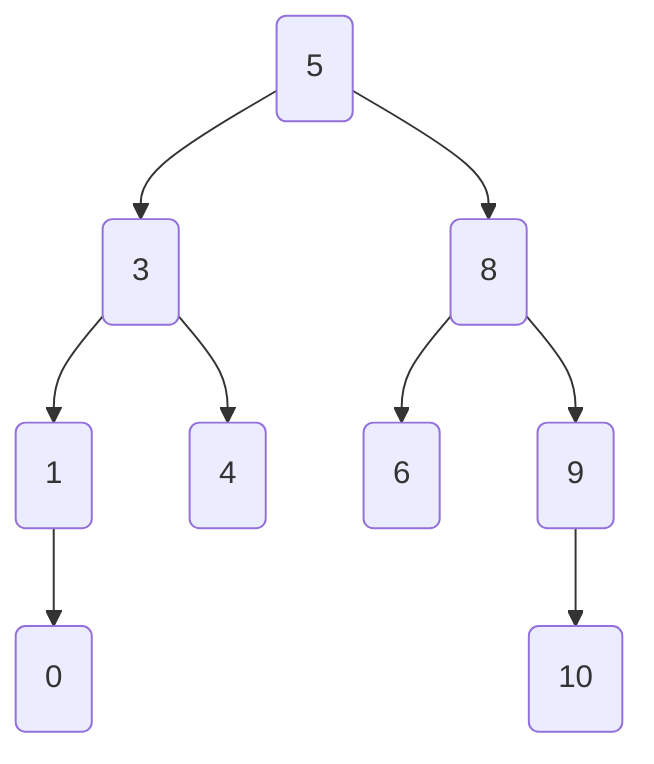
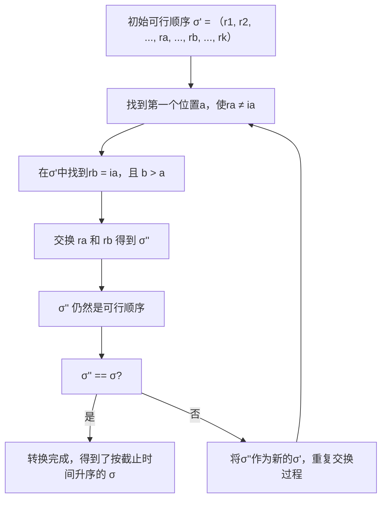
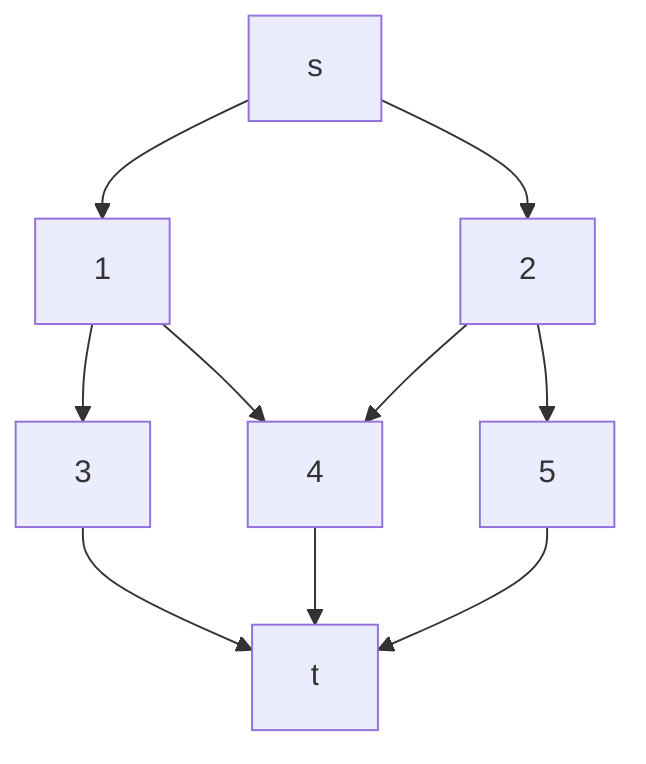
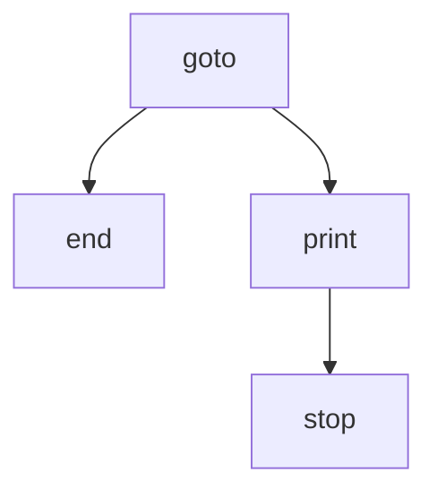
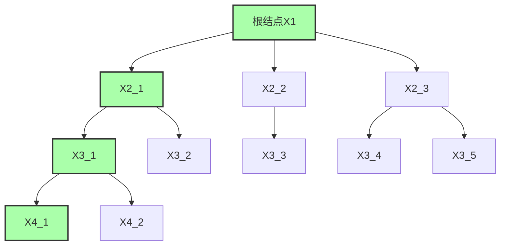

---
title: 算法设计与分析 课程笔记
url: https://blog.kisechan.space/2025/notes-algorithm-analysis/
type: post
time: '2026-10-21T16:02:14.153Z'
---

## 导引

算法是**解决一确定类问题的任意一种特殊的方法**。不是针对个别、偶然出现的问题，而是为了解决具有相同性质的一系列问题；且同一类问题可以拥有很多不同的算法。

- **数值计算方法**：求解数值问题，如插值计算、数值积分等。目的是计算出一个具体的数值结果。

- **非数值计算方法**：求解非数值问题，核心是进行判断比较。

算法的非形式描述：算法就是**一组有穷的规则**，它规定了解决某一特定类型问题的一系列运算。

### 五个重要特性

- **确定性**：每一种运算必须要有确切定义，无二义性。

  - 反例：$5/0$, $1或2+x$

- **能行性**：运算都是基本运算，原理上能用纸和笔在有限时间完成。

- **输入**：有0个或多个输入。在算法开始之前，从特定的对象集合中取值。

- **输出**：一个或多个输出。这些输出和输入有特定关系。

- **有穷性**：在执行了*有穷步运算*后终止。

  - 要在现代计算机上有效

  - **计算过程**可以不满足有穷性

> 例如操作系统，当没有任务时，操作系统并不终止，而是处于等待状态，直到有新的任务启动，因而不是一个算法。

### 算法学习的内容

#### 算法设计

面对具体问题，运用一些基本设计策略，规划算法。

#### 算法表示

采用SPARKS程序设计语言。[^1]

[^1]: 可以参考： https://gxblogs.com/posts/20239/

#### 算法确认

证明该算法对所有可能的合法输入，都能给出正确答案。

有这些方法：

- **穷举法**：测试算法所有可能的合法输入，并验证对于每一个输入，算法的输出是否正确。

- **数学归纳法**：常用于证明涉及自然数或可以按某种规模递增的问题，适用于具有递归结构或可以按规模递增分析的算法，例如证明某个递归算法对于所有非负整数 $n$ 都能正确计算结果。

- **反证法**

- **构造性证明**：直接构造出满足问题要求的解或过程来证明某个命题的正确性，直接展示算法是如何一步步地从输入得到正确输出的。

- **测试**：通过运行算法并检查其在各种输入下的输出是否正确来验证算法的正确性。测试需要精心设计测试用例。

## 算法分析

算法分析就是在最好、最坏、平均情况下对时间复杂度 $T(n)$ 、空间复杂度 $S(n)$ 进行分析， $n$ 是问题的规模。

$$
T_{\max}(n)=\max\{\:T(I)\mid\mathrm{size}(I){=}n\:\}
$$

$$
T_{\min}(n)=\min\{\:T(I)\mid\mathrm{size}(I){=}n\:\}
$$

$$
T_{\mathrm{avg}}(n)=\sum_{\text{size}(I)=n}p(I)T(I)
$$

其中， $I$ 是规模为 $n$ 的实例，$p(I)$ 是该实例出现的概率。

同一条语句在一个算法中的执行次数称为频率计数。由算法直接确定，与所用的机器无关，且独立于程序设计语言。

$$
\text{语句的时间总量}=\text{频率计数} \times \text{执行一次该语句所需要的时间}
$$

算法的执行时间就是构成算法的所有语句的执行时间总量之和。

准确分析出算法数量级的多项式表达式是很困难的，因此一般只对计算时间表达式的最高次项进行渐进表示。

### 时间的渐进表示

$$
f(n)=O(g(n))
$$

$$
f(n)=\Omega(g(n))
$$

$$
f(n)=\Theta(g(n))
$$

$f(n)$ 表示算法运行时需要的时间，它是与机器和语言有关的。

而 $g(n)$ 是我们选择的一个作为基准的函数，通常是一个形式非常简单的函数。

算法的实际运行时间 $f(n)$ 会受到执行它的计算机硬件、编程语言的效率、编译器优化等因素的影响。在不同的机器上或者用不同的语言实现同一个算法，其具体的运行时间可能会有所不同。

算法的**渐进增长率**，即当输入规模 n 趋于无穷大时，运行时间增长的速度，通常是相对稳定的，并且可以用一个与机器和语言无关的简单函数 $g(n)$ 来描述，渐进表示关注的是这种增长趋势。

**常用的求和公式**

$$
\sum_{1\leq i\leq n}1=\Theta(n)\\
\sum_{1\leq i\leq n}i=n(n+1)/2=\Theta(n^2)\\
\sum_{1\leq i\leq n}i^2=n(n+1)(2n+1)/6=\Theta(n^3)
$$

通式：

$$
\sum_{1\leq i\leq n}{i}^k=\frac{n^{k+1}}{k+1}+\frac{n^k}2+\text{低次项}=\Theta(n^{k+1})
$$

---

**比较时间复杂度**

对于两个函数 $f(n)$ 和 $g(n)$，一般通过极限比较它们的增长速度：

$$
\lim_{n \to \infty} \frac{f(n)}{g(n)}
$$

- 如果结果是 $0$：说明 $f(n) = O(g(n))$，即 $f(n)$ 远小于 $g(n)$，**$g(n)$ 更高阶**。
- 如果结果是一个正的有限常数：说明 $f(n) = \Theta(g(n))$，两者**同阶**。
- 如果结果是无穷大：说明 $f(n) = \Omega(g(n))$，即 **$f(n)$ 更高阶**。

---

$$
\begin{align*}
O(1)
&< O(\log \log n) \\
&< O(\log n) \\
&< O((\log n)^k) \quad (k > 1) \\
&< O(n^{\varepsilon}) \quad (0 < \varepsilon < 1) \\
&< O(n) \\
&< O(n \log n) \\
&< O(n^k) \quad (k > 1) \\
&< O(c^n) \quad (c > 1, \text{如 } 2^n) \\
&< O(n!) \\
&< O(n^n)
\end{align*}
$$

另外：

$$
\begin{align*}
O(\alpha(n)) &< O(1), \quad \text{反 Ackermann 函数} \\
O(A(n, n)) &> O(n^n), \quad \text{Ackermann 函数}
\end{align*}
$$

例如：

```pseudocode
count = 0
for i = 1 to log n:
  for j = i to i + 5:
    for k = 1 to i:
      count++
```

总操作次数：

$$
T = \sum_{i=1}^{\log n} \sum_{j=i}^{i+5} \sum_{k=1}^{i} 1 = \sum_{i=1}^{\log n} \sum_{j=i}^{i+5} i = \sum_{i=1}^{\log n} 6i = 6 \sum_{i=1}^{\log n} i
$$

即：

$$
T = 6 \times \frac{\log n (\log n + 1)}{2} = 3 \log n (\log n + 1)
$$

总时间复杂度为：

$$
\boxed{O((\log n)^2)}
$$

#### 上界

$f(n)=O(g(n))$ 表明对于足够大的输入规模 $n$，函数 $f(n)$ 的增长速度**小于等于**函数 $g(n)$ 的增长速度的某个常数倍。它告诉我们算法的运行时间不会比 $g(n)$ 增长得更快。在分析算法的最坏情况时间复杂度时，通常会使用大 $O$ 符号。

$O(g(n))$ 是一个函数的集合。

$O$ 有以下性质：

1. $O(f(n))+O(g(n)) = O(\max(f(n), g(n))$

   - 若 $f'(n) = O(f(n))$，则存在正的常数 $c_1$ 和 $n_1$，使得当 $n \ge n_1$ 时，有 $f'(n) \le c_1 \cdot f(n)$

   - 若 $g'(n) = O(g(n))$，则存在正的常数 $c_2$ 和 $n_2$，使得当 $n \ge n_2$ 时，有 $g'(n) \le c_2 \cdot g(n)$

   - 考虑 $f'(n) + g'(n)$。当 $n \ge \max\{n_1, n_2\}$ 时，以下不等式成立：

$$
f'(n) + g'(n) \le c_1 \cdot f(n) + c_2 \cdot g(n)
$$

- 由于 $p(n) = \max\{f(n), g(n)\}$，我们有 $f(n) \le p(n)$ 且 $g(n) \le p(n)$。因为 $c_1 > 0$ 且 $c_2 > 0$，所以： $c_1 \cdot f(n) \le c_1 \cdot p(n)$ $c_2 \cdot g(n) \le c_2 \cdot p(n)$ 将这两个不等式相加，得到：

$$
c_1 \cdot f(n) + c_2 \cdot g(n) \le c_1 \cdot p(n) + c_2 \cdot p(n) = (c_1 + c_2) \cdot p(n)
$$

- 因此，当 $n \ge n_3 = \max\{n_1, n_2\}$ 时，我们有： $f'(n) + g'(n) \le (c_1 + c_2) \cdot p(n)$ 令 $c_3 = c_1 + c_2$。

- 由于 $c_1$ 和 $c_2$ 都是正的常数，所以 $c_3$ 也是一个正的常数。因此，我们证明了存在正的常数 $c_3$ 和 $n_3$，使得当 $n \ge n_3$ 时，$f'(n) + g'(n) \le c_3 \cdot \max\{f(n), g(n)\}$。

2. $O(f(n))+O(g(n)) = O(f(n)+g(n))$

3. $O(f(n)) O(g(n)) = O(f(n) g(n))$

4. 如果 $g(n) = O(f(n))$ ，则 $O(f(n))+O(g(n)) = O(f(n))$

5. $O(cf(n)) = O(f(n))$ ，其中 $c$ 是一个正的常数

6. $f(n) = O(f(n))$

#### 下界

$\Omega$ 有以下性质：

1. $\Omega(f(n))+ \Omega(g(n)) = \Omega(\min(f(n), g(n))$

2. $\Omega(f(n))+ \Omega(g(n)) = \Omega(f(n)+g(n))$

3. $\Omega(f(n)) \Omega(g(n)) = \Omega(f(n) g(n))$

4. 如果 $g(n) = \Omega(f(n))$ ，则 $\Omega(f(n))+ \Omega(g(n)) = \Omega(f(n))$

5. $\Omega(cf(n)) = \Omega(f(n))$ ，其中 c 是一个正的常数

6. $f(n) = \Omega(f(n))$

#### 渐进函数的性质

如果以 $Q$ 表示渐进函数，则它有以下性质：

1. **传递性**：

$$
\exists f(n)= Q(g(n)), g(n)=Q(h(n)) \Rightarrow f(n)= Q(h(n))
$$

2. **反身性**：

$$
f(n)=Q(f(n))
$$

3. **满足加法和乘法的四则运算**：

$$
Q(f(n)\circ g(n))=Q(f(n))\circ Q(g(n)) \quad (\circ \in \{+, \times\})
$$

例如，证明 $O(f(n))O(g(n))=O(f(n) g(n))$：

- 设 $f_1(n)=O(f(n))$，则存在正整数 $n_1$ 和 $c_1$ ，使得当 $n\ge n_1$ ，有 $f_1(n)\le c_1\times f(n)$
- 设 $f_2(n)=O(g(n))$，则存在正整数 $n_2$ 和 $c_2$ ，使得当 $n\ge n_2$ ，有 $f_2(n)\le c_2\times g(n)$
- 当 $n\geq\max\{n_1,n_2\}$ 时，$O(f(n))O(g(n))=f_1(n)f_2(n)\leq{c}_1f(n)\times{c}_2g(n)={c}_1{c}_2f(n)g(n)$
- $c_0=c_1c_2, n_0=\max\{n_1,n_2\}$ 时， $O(f(n))O(g(n))=O(f(n) g(n))$ 成立

## 分治法

分治法适用于 $n$ **取值相当大**，直接求解往往非常困难，甚至无法求出的问题。

分治法的核心操作在于：

- **分**：将 $n$个输入分解成 $k$ 个不同子集，得到 $k$ 个不同的**可独立求解的子问题**。
- **治**：求出子问题的解。
- **合**：在求出子问题的解之后，能找到适当的方法**把它们合并成整个问题的解**的情况。

**子问题的规模不相近**会影响算法效率：

- 当子问题的规模尽可能**相近**时，递归树会更加平衡，这意味着需要进行的递归层数会更少。
- 如果规模相差很大，会导致工作量分配不均，**导致复杂度退化**。
- 可能影响**合并操作的效率**。

> 考虑**快速排序**。如果每次选择的基准元素都能将数组均匀地分成两半，那么快速排序的平均时间复杂度是 $O(n\log n)$ 。然而，如果每次选择的基准元素都是最小或最大的，**导致子问题规模极不平衡**（一个子问题几乎是原问题的大小减一，另一个为空），那么快速排序的时间复杂度会退化到 $O(n^2)$ ，与直接的插入排序等算法效率相当。

### DANDC 流程

Divide and Conquer，简称 **D&C** 或 DANDC，指的就是**分治策略**或**分治算法**这种算法设计范式。

```pseudocode
procedure DANDC(p,q)

global  n, A(1:n); integer  m, p, q;
if  SMALL(p,q)
    # 如果这个子问题规模够小
    then  return(G(p,q))
    # 求解该规模问题的函数
else  m<-DIVIDE(p,q)
# 规模还很大用某些方式分割成两个子问题
    return(COMBINE( DANDC(p,m), DANDC(m+1,q)))
    # 将两个问题合并
endif
end DANDC
```

若拆分的子问题规模类似，则时间复杂度为：

$$
T(n)=
\begin{cases}
g(n) && n\text{足够小}\\
2T\left(\frac{n}{2}\right) + f(n) && \text{否则}
\end{cases}
$$

- $T(n)$ 是输入规模为 $n$ 的分治策略的计算时间

- $g(n)$ 是对足够小的输入规模能直接计算出答案的时间

- $f(n)$ 是 `COMBINE` 函数合成原问题解的计算时间

### 二分查找

一个**非降序排列**的数组中查找给定的元素 $x$。如果找到，则返回其索引 $j$；否则，将 $j$ 置为 0。

我们将查找问题建模为一个输入实例 $I = (n, a_1, \ldots, a_n, x)$，其中 $n$ 是数组大小，$a_1, \ldots, a_n$ 是已排序的数组，$x$ 是要查找的元素。

- **分**：选取一个下标 $k = \lfloor (1 + n) / 2 \rfloor$，每次将搜索范围大致减半，从而提高效率，可得到三个子问题

  - $I_1 = (k-1, a_1, \ldots, a_{k-1}, x)$：在数组的前 $k-1$ 个元素中查找 $x$。
  - $I_2 = (1, a_k, x)$：检查中间元素 $a_k$ 是否等于 $x$。
  - $I_3 = (n-k, a_{k+1}, \ldots, a_n, x)$：在数组的后 $n-k$ 个元素中查找 $x$。

- **治**：

  - 若 $x = a_k$，则 $j \leftarrow k$，算法结束。
    - 如果中间元素恰好等于要查找的 $x$，那么我们找到了目标元素，记录其位置 $k$ 并结束查找。这是分治的**基本情况**之一（成功找到）。
  - 若 $x < a_k$，则在子问题 $I_1$ 中求解。
  - 若 $x > a_k$，则在子问题 $I_3$ 中求解。

- **合**：

  - **当前子问题的解**就是 $I$ 的解。
    - 在二分查找中，“合”的步骤相对简单。如果我们在子问题中找到了 $x$，那么它的位置就是原问题中 $x$ 的位置。如果我们在子问题中没有找到 $x$（最终搜索范围为空），那么在原问题中也没有找到 $x$。实际上，二分查找更多地体现在“分”和“治”的过程，每次递归（或迭代）都缩小了问题的规模，直到找到答案或搜索范围为空。

```pseudocode
procedure BINSRCH(A, n, x, j)
  integer  low, high, mid, j, n;
  low<-1;    high<-n
  while low≤high do
           mid← ⌊(low+high)/2⌋
           //取中间值
        case
           :x<A(mid):  high<-mid-1 //前一半
           :x>A(mid):  low<-mid+1  //后一半
           :else:   j<-mid;  return;    //查找成功结束
        endcase
    repeat
  j<-0     //查找失败
end BINSRCH
```

#### 正确性证明

1. 检验到参数的**每类取值**，即各类输入：

   - 空数组 ($n=0$)，在数组中找到 $x$，数组中不存在 $x$，以及 $x$ 出现在数组的第一个、最后一个或中间位置等。

2. 检验到算法的**每个分支** $A$ 有 $n$ 个元素，$x$ 和 $A$ 中元素比较

   - **成功查找：$n$ 种情况**
     - 如果 $x$ 存在于数组中，它可能出现在 $n$ 个不同的位置上，每种情况都应该被考虑到。
   - **不成功查找：$n+1$ 种情况**
     - 如果 $x$ 不存在于数组中，那么它可能比所有元素都小，或者比所有元素都大，或者介于数组中任意两个相邻元素之间。
     - 对于一个有 $n$ 个元素的已排序数组，存在 $n+1$ 个可能的不成功查找区间。

#### 时空复杂度分析

时间分析从**成功和不成功查找时的终止性**入手。

- 如果 $n=0$，则**不进入循环**，$j=0$，算法终止。

  - 对于空数组，算法立即返回 $j=0$，正确处理了边界情况。

- **否则就会进入循环**与数组 $A$ 中的元素进行比较。

- **成功情况**：

  - 若 $x = A[mid]$，则 $j = mid$，**查找成功**，算法终止。
    - 最好的情况是第一次比较就找到了 $x$，此时只需要一次比较。
  - 否则，若 $x < A[mid]$，则 $x$ 根本不可能在 $mid$ ~ $high$，查找范围缩小到 $low$ ~ $mid - 1$。反之，若 $x > A(mid)$ 时亦然。

- **不成功情况**：

  - 因为 $low$，$high$ 和 $mid$ 都是整形变量，按算法所述方式缩小查找范围总可以在有限步内使 $low > high$，说明 $x$ 不在 $A$ 中，退出循环，$j = 0$，算法终止。

|    时间复杂度    |     最好情况     |     最差情况     |     平均情况     |
| :--------------: | :--------------: | :--------------: | :--------------: |
|     成功查找     |   $\Theta(1)$    | $\Theta(\log N)$ | $\Theta(\log N)$ |
|     失败查找     | $\Theta(\log N)$ | $\Theta(\log N)$ | $\Theta(\log N)$ |
| **基本二分查找** |   $\Theta(1)$    | $\Theta(\log N)$ | $\Theta(\log N)$ |

二分思想下查找的时间复杂度大体上是 $\Theta(\log N)$。算法细节能不会改变其渐进时间复杂度，而只能影响常数因子。

> ```pseudocode
> procedure BINSRCH1(A, n, x, j)
>   integer  low, high, mid, j, n;
>   low←1;    high←n+1 //high总比可能的取值大1
>   while low<high-1 do
>            mid←⌊(low+high)/2⌋
>            if x<A(mid) //在循环中只比较一次
>                 then high←mid
>                 else low←mid //x>=A(mid)
>            endif
>     repeat
>   if x=A(low) then j←low //x出现
>                     else j←0 //x不出现
> end BINSRCH1
> ```
>
> 考虑这个 `BINSRCH1` 函数，即使它要查找的元素恰好在第一次 `mid` 的位置，算法也不会立即返回。它会继续缩小搜索范围，直到 `low` 和 `high` 相邻。最终的判断 `if x == A(low)` 是**在循环结束后进行的**。所以它的最优时间复杂度也是 $O(\log n)$ 而非 $O(1)$。

在特定条件下，对于在静态的、已排序的数组中进行查找，标准二分查找在基于比较的操作次数上是**渐近最优**的，但是在一些场景下可以进一步优化：

1. **插值查找**：

   - 插值查找是对二分查找的改进。它不是简单地取中间位置，而是根据要查找的值在数组中的**可能位置进行预测**。它假设数组中的元素是均匀分布的。
   - 在**均匀分布**的情况下，插值查找的平均时间复杂度可以达到 $O(\log\log n)$。
   - 如果数据分布不均匀，插值查找的最坏情况时间复杂度会退化到 $O(n)$。因此，它不适用于所有已排序的数组。

2. **硬件特性和缓存优化**：

   - 标准的二分查找在每次迭代中访问的内存位置可能相距较远，这可能导致缓存未命中，影响实际运行速度。
   - 一些优化的二分查找变体（例如，尝试在更小的范围内进行搜索，以提高缓存命中率）可能会在实际应用中表现更好，尤其是在处理非常大的数组时。

3. **对于非常小的数组：**

   - 当数组非常小时，二分查找的优势并不明显，甚至可能因为计算中间索引等额外开销而比线性查找更慢。在实践中，对于小规模问题，可以直接使用线性查找。

4. **如果查找操作非常频繁，且数组内容不经常变化：**

   - 可以考虑构建更复杂的数据结构来优化查找，例如 Hashmap（如果不需要有序性）或更高级的树结构（如 B 树或 Trie 树）。

**定理**：若 $n$ 在区域 $[2^{k-1}, 2^k)$ 中，则：

- 对于一次**成功的查找**，二分查找算法至多作 $k$ 次比较。
- 对于一次**不成功的查找**，或者作 $k-1$ 次比较或者作 $k$ 次比较。

当数组大小 $n$ 介于 $2^{k-1}$（包含）到 $2^k$（不包含）之间时，比较树的深度为 $k$。成功查找在**内结点**终止，不成功查找在**外结点**终止。

当 $2^{k-1} \le n < 2^k$ 时，内结点级数 $\le k$ (根在 1 级)， 外结点级数在 $k$ 和 $k+1$ 级（通常的定义根在第 0 级时，内节点深度 $\le k-1$，外节点深度为 $k$）。

- **内部路径长度** $I$：根到所有内节点的距离之和。
- **外部路径长度** $E$：根到所有外节点的距离之和。
- $n$ 是**内节点数**，因为可以搜到的数一定在内结点。
  - $E = I + 2n$；
  - $I=\Theta(n\log n)$
  - $E=\Theta(n\log n)$
  - **成功查找的平均比较次数** $S(n) = (I/n) + 1$；
  - **不成功查找的平均比较次数** $U(n) = E / (n + 1)$；
  - $S(n) = \Theta(U(n)) = \Theta(\log n)$

算法用了 $n$ 个位置存放数组 $A$ ，还有 $low$, $high$, $mid$, $x$, $j$ 五个变量需要存储，共需空间 $n+5=\Theta(n)$ 。

#### 二元比较树

在二分查找算法中，最核心也是决定时间复杂度的基本运算是——将要查找的元素 $x$ 与数组中间元素 $A[mid]$ 进行**比较**。

其他的操作，例如加法、除法、赋值等，其执行次数与比较次数相比是同阶或更低的。可以用二元比较树模拟比较的过程：

二元比较树中的每个**内结点**代表一次将 $x$ 与数组中的某个元素 $A[mid]$ 的比较。根据比较的结果 ($x < A[mid]$ 或 $x > A[mid]$)，算法会进入左子树或右子树继续查找。

- **内结点**记录一个 $mid$ 值，表示一次元素的比较。

- **外结点**（通常用方框表示）代表查找不成功的情况，即搜索范围最终为空。

从根节点到任何一个节点的路径表示了**查找过程中进行的一系列比较**。算法的执行过程实质上就是 $x$ 与一系列中间元素 $A(mid)$ 的比较过程。



#### 以比较为基础查找的时间下界

对于已排序的 $n$ 个元素，查找某元素 $x$ 是否出现时，**不存在以比较为基础的查找算法**，**在最坏情况下该算法的计算时间比二分查找算法的计算时间更低**。

任何以比较为基础的查找算法，在最坏情况下至少需要 $\lceil \log_2 (n+1) \rceil=O(\log n)$ 次比较。

|   类型    | 以比较为基础解决的时间下界 |
| :-------: | :------------------------: |
| 检索/查找 |  $\boxed{\Omega(\log n)}$  |
| 排序/分类 | $\boxed{\Omega(n \log n)}$ |

**三分或多分查找不会带来更优的时间复杂度**。

**定理**：设 $A(1:n)$ 含有 $n (n \ge 1)$ 个不同的元素，排序为 $A(1) < A(2) < … < A(n)$。又设以比较为基础去判断是否 $x \in A(1:n)$ 的任何算法在最坏情况下所需的最小比较次数是 $\text{FIND}(n)$，那么 $\text{FIND}(n) \ge \lceil \log_2(n+1)\rceil$，即 $\text{FIND}(n)=\Omega(\log n)$ 。

**证明**：

1. **模拟算法的比较树**： 任何基于比较的查找算法都可以用一棵二元比较树来表示其执行过程。
2. **内节点与比较**： 每个内节点代表一次对 $x$ 和 $A$ 中某个元素的比较。比较的结果有三种可能 ($x < A[i]$, $x > A[i]$, $x = A[i]$)。为了简化为二叉树，通常将一次三路比较转化为两次二路比较（例如，先比较 $x < A[i]$，如果不是，再比较 $x > A[i]$）。或者，我们可以考虑决策树，每个节点代表一个比较，分支代表比较结果。
3. **叶子节点与结果**：
   - **成功查找：** 如果 $x$ 在 $A$ 中，有 $n$ 种可能的成功结果（$x$ 等于 $A[1], A[2], \ldots, A[n]$ 中的某一个）。这些对应于比较树中的某些叶子节点。
   - **不成功查找：** 如果 $x$ 不在 $A$ 中，由于 $A$ 是已排序的，有 $n+1$ 种可能的不成功结果（$x < A[1]$, $A[1] < x < A[2]$, $\ldots$, $A[n] < x$）。这些也对应于比较树中的某些叶子节点。
4. **最坏情况比较次数与树的深度**： 算法在最坏情况下所需的比较次数等于从根节点到最深的叶子节点的路径长度（树的高度）。因此，$\text{FIND}(n)$ 不小于树中从根到一个叶子的最长路径的距离。
5. **内节点数量**： 定理的证明中提到有 $n$ 个内节点与 $x$ 在 $A$ 中可能的 $n$ 种出现情况相对应。这有点简化了，更准确地说，成功和不成功的查找结果都对应于决策树的叶子节点。总共有 $n$ 种成功结果和 $n+1$ 种不成功结果，因此决策树至少要有 $n + (n+1) = 2n+1$ 个叶子节点（如果每次比较都是二路比较）。
6. **二叉树的性质**： 如果一棵二叉树的高度为 $k$（从根到叶子的最长路径的边数），那么它最多有 $2^k$ 个叶子节点。
7. **应用到查找树**： 为了区分 $n+1$ 种可能的结果（$x$ 在 $n$ 个位置或不在），比较树（决策树）必须至少有 $n+1$ 个叶子节点。
8. **高度下界**： 如果一棵二叉树有至少 $n+1$ 个叶子节点，那么它的高度 $k$ 必须满足 $2^k \ge n+1$，即 $k \ge \log_2 (n+1)$。由于比较次数是整数，最坏情况下的比较次数 $\text{FIND}(n)$ 必须大于等于其最小整数值，即 $\lceil \log_2 (n+1) \rceil$。

### 归并排序

给定一个含有 $n$ 个元素的集合，要求**把它们按非降次序排列**。

---

一般方法 （**直接插入法**）：

```pseudocode
for j ← 2 to n do
    将 A(j) 放入已排序 A(1:j-1) 中
repeat
```

直接插入排序的思想是将未排序的元素逐个插入到已排序的序列中，保持已排序序列的有序性。

- **最好情况**：$O(n)$ - 当输入数组已经是排序好的时候，内层循环只需要进行常数次比较，外层循环执行 $n-1$ 次。
- **最坏情况**：$O(n^2)$ - 当输入数组是逆序的时候，每个元素都需要与已排序的所有元素进行比较并移动，导致内层循环执行次数与已排序部分的长度成正比。

---

**分治策略设计归并排序算法**：

- **分**：将 $A(1),…,A(n)$ 平均分为 2 个子集：$A(1),…,A(\lceil n/2\rceil)$ 和 $A(\lceil n/2\rceil +1),…,A(n)$，将待排序的数组从中间一分为二。

- **治**：递归调用，将 2 个子集排序。对分解得到的两个子数组分别递归地应用归并排序，直到子数组的长度为 1（长度为 1 的数组自然是有序的），达到递归的基准情况。

- **合**：将 2 个排好序的子集合并为一个有序集合。这是分治策略的关键一步。将两个已经排序好的子数组合并成一个更大的有序数组。`MERGE` 算法负责完成这个合并操作.

```pseudocode
Procedure MERGESORT(low,high)
int  low, high, mid;
if  low<high
    then   mid= ⌊(low+high)/2⌋
               call  MERGESORT(low,mid)
               call  MERGESORT(mid+1,high)
               call  MERGE(low,mid,high)
endif
end  MERGESORT
```

---

**`MERGESORT` 函数是归并排序的递归实现**。它以数组的起始索引 `low` 和结束索引 `high` 作为输入。

- **递归终止条件**： 当 `low >= high` 时，表示子数组的长度为 0 或 1，此时不需要排序，递归结束。

* **分解**： 计算中间索引 `mid`，将数组分为 `[low, mid]` 和 `[mid+1, high]` 两个子数组。
* **递归求解**： 递归调用 `MERGESORT` 对这两个子数组进行排序。
* **合并**： 调用 `MERGE` 函数将排序好的两个子数组 `A[low...mid]` 和 `A[mid+1...high]` 合并成一个有序的子数组 `A[low...high]`。

```pseudocode
integer h, i, j, k, low, mid, high; global A(low : high);  local B(low : high)
h ← low;  i ← low;  j ← mid+1;
// 处理两个已排好序的集合
while h ≤ mid and j ≤ high do
    if A(h) ≤ A(j) then B(i) ← A(h); h ← h+1
                    else  B(i) ← A(j);  j ← j+1; endif
    i ← i+1
repeat
//剩余元素处理过程
if h > mid then for k ← j to high do B(i) ← A(k); i ← i+1; repeat
            else for k ← h to mid do B(i) ← A(k); i ← i+1; repeat
for k ← low to high do   A(k) ← B(k)
end  MERGE
```

1. 如果 `h <= mid` 且 `j <= high`，那么 `B(i) <- min(A(h), A(j))`
2. 如果 `h > mid` 且 `j <= high`，那么 `B(i) <- A(j)`
3. 如果 `h <= mid` 且 `j > high`，那么 `B(i) <- A(h)`

`Merge` 描述了合并两个已排序子数组的基本逻辑。使用两个指针 `h` 和 `j` 分别指向两个子数组的起始位置，比较它们指向的元素，将较小的元素放入临时数组 `B` 中，并移动相应的指针。

---

归并排序的算法调用过程（`MERGESORT` 的递归调用）**不受输入数组的具体内容**（问题实例）**的影响**。无论输入数组是已经排序的、逆序的还是随机的，`MERGESORT` 都会始终将数组对半分割，并进行相同次数的递归调用，直到子数组长度为 1。

然而，`MERGE` 函数内部的比较操作次数会受到问题实例的影响。例如，如果两个子数组的元素交错排列，`MERGE` 中 `A[h] <= A[j]` 的比较结果会交替变化。但这并不改变 `MERGE` 函数的时间复杂度，它始终是 $O(high - low + 1)=O(n)$，即与待合并的元素个数成正比。

归并排序算法消耗的时间：

$$
T(n)=
\begin{cases}
a&&n=1,a为常数\\
2T(n/2)+cn&&n>1,c为常数
\end{cases}
\\
\\
\Rightarrow \boxed{T(n)=O(n\log n)}
$$

- 当数组只有一个元素时 ($n=1$)，**排序所需的时间是一个常数** $a$。

* 当数组有 $n > 1$ 个元素时，排序需要的时间包括：
  - **解决两个规模为** $n/2$ **的子问题的时间**，即 $2\times T(n/2)$。
  - **合并两个已排序的子数组的时间**，即 $cn$，其中 $c$ 是一个常数，代表每次合并操作所需的时间与合并的元素个数成正比。（归并 2 个子数组所需的元素比较次数在 $\frac{n}{2}$ 到 $n-1$ 之间）

> 在最坏情况下（例如，两个子数组的元素交错排列），需要进行接近 $n-1$ 次比较。在最好情况下（例如，第一个子数组的所有元素都小于第二个子数组的所有元素），只需要比较第一个子数组的元素个数次（当 `h` 超过 `mid` 时）。但这仍然是 $O(n)$ 的。

归并排序的递归处理会带来一定的开销（函数调用的压栈和出栈），当子集合的元素个数很少时，继续递归分割可能不如直接使用简单的排序算法，如插入排序更有效，插入排序在小规模数据上通常具有较小的常数因子。这种优化称为**切换到插入排序**。

同时，归并排序需要额外的 $O(n)$ 空间来存储临时合并的元素（在数组 `B` 中）。每次合并后还需要将 `B` 中的内容复制回 `A`。消耗了一部分时间。用一个链接数组 `LINK(1:n)` 代替 `B`，`LINK` 中元素为 `A` 中元素的指针，它指向下一个元素所在的下标位置。

- 使用**链接数组**是一种尝试减少额外空间和复制开销的优化思路。通过维护一个指向下一个元素的指针数组，可以在不实际移动元素的情况下实现有序链表的效果。合并操作可以通过修改指针来实现。这种方法可以减少元素的物理移动，但会引入额外的指针操作和空间来存储链接数组。这种优化在实践中可能更复杂，并且不一定总是比使用辅助数组更高效，尤其是在现代具有良好缓存机制的计算机上，连续内存访问通常更快。

思考：**能否采用自底向上的设计方式来取消对系统栈空间的需要**？

- **理解**： 递归实现的归并排序需要使用系统栈来保存函数调用的上下文。这在处理非常大的数组时可能导致栈溢出。
- **自底向上的归并排序**是一种非递归的实现方式。它从将每个元素视为一个长度为 1 的已排序子数组开始，然后逐步合并相邻的长度为 1 的子数组，得到长度为 2 的已排序子数组，再合并长度为 2 的子数组得到长度为 4 的，以此类推，直到整个数组都被排序。
- **优点**： 自底向上的归并排序不需要使用递归，因此避免了系统栈的开销，并且通常在某些情况下具有更好的迭代性能。
- **空间复杂度**： 自底向上的归并排序仍然需要 $O(n)$ 的辅助空间用于合并操作。

**定理**：任何以关键字比较为基础的排序算法，**最坏情况下的时间下界都是** $\Omega(n\log n)$，因此从数量级角度看, 归并算法是最坏情况下的最优算法。

**证明**：

- 已知 $n$ 个关键字有 $n!$ 种排列。
- 观察二元比较树从根到外节点的每一条路径，分别与一种唯一的排列相对应。则比较树必定至少有 $n!$ 个外节点。且最坏情况下比较次数等于树高 $T(n)$。
- $n\ge4$ 时必有：[^2]

$$
2^{T(n)}\ge n! \ge (\frac{n}{2})^{\frac{n}{2}}  \Rightarrow T(n)=O(n\log n)
$$

[^2]: 也可以使用斯特林公式放缩： $n! \approx \sqrt{2\pi n} (\frac{n}{e})^{n} \Rightarrow \log n! = \Theta(n\log n)$。

### 斯特拉森矩阵问题

矩阵 $A_{n×n}$ 和 $B_{n×n}$ 的乘积矩阵 $C_{n×n}$ 中的元素 $C[i,j]$ 定义为:

$$
C[i][j]=\sum_{k=1}^{n}A[i][k]B[k][j]
$$

$C$ 有 $n^2$ 个元素，一个元素需要做 $n$ 次乘法和 $n-1$ 次加法，总时间复杂度为 $O(n^3)$。

如果是将矩阵直接切割成子矩阵，实际上是不能优化的，因为并没有减少子问题的实际数量。


斯特拉森在分治法的基础上，利用技巧减少了子问题的个数。它用 7 个乘法和 10 个加(减)法来算出 7 个 $\frac{n}{2}\times\frac{n}{2}$ 的中间矩阵，用 8 个加(减)法算出子问题的解 $C[i][j]$，让时间复杂度从 $T(n)=8T(\frac{n}{2})+cn^2$ 减少到了 $T(n)=7T(\frac{n}{2})+cn^2$，时间复杂度 $O(n^{\log 7})$。

### 二维极大点问题

给定一个包含 $n$ 个二维平面上的点的集合 $S = \{(x_1, y_1), (x_2, y_2), \ldots, (x_n, y_n)\}$。一个点 $p_i = (x_i, y_i) \in S$ 被称为**极大点**，当且仅当不存在另一个点 $p_j = (x_j, y_j) \in S$ ($i \neq j$) 支配 $p_i$ ，即使得 $x_j \ge x_i$ 并且 $y_j \ge y_i$。

如果直接比较每一对点，时间复杂度$O(n^2)$。递归优化：

- **分**：设计中位线 $l$，将整个点集**递归分为两个子集** $S_L$ 和 $S_R$。

- **治**：分别找出 $S_L$ 和 $S_R$ 的极大点。

- **合**：基于支配规则合并 $S_L$ 和 $S_R$ 的极大点。只需将 $L$ 中被 $R$ 中某点支配的点去掉（因为 $R$ 中所有点的 $x$ 坐标都大于 $L$）。

  - **中位线**：

    - 垂直于 $x$ 轴的中位线 $L$。

    - 对集合 $S$ 中的所有点**按** $x$ **值排序**后，寻找第 $\frac{n}{2}$ 点位置。

  - 递归出口：

    - 如果集合 $S$ 中只有一个点，那么该点为极大点

  - 基于支配规则合并：

    - 对于 $S_L$ 中的极大点 $p$，如果 $y_p$ 小于 $S_R$ 中极大点的 $y$ 值，则 $p$ 被支配，舍弃掉，因为 $S_L$ 中的点的 $x$ 值总是小于 $S_R$ 中的点的 $x$ 值

使用排序优化后的解法时间复杂度 $O(n \log n)$。

采用分治策略求解二维极大点问题，给出下面实例的求解过程及结果：$(1,2), (2,8), (3,5), (4,1), (5,4), (6,7), (7,6), (8,3)$。

首先将所有点按照 $x$ 值排序（如果 $x$ 值相等再按 $y$ 值排序）可得如下结果：

$$
(1,2), (2,8), (3,5), (4,1), (5,4), (6,7), (7,6), (8,3)
$$

- **分**：找出垂直于 $x$ 轴的中位线 $l$，将整个点集分为两个子集 $S_L$ 和 $S_R$ ;
- **治**：分别找出 $S_L$ 和 $S_R$ 的极大点；
- **合**：对于 $S_L$ 中的极大点 $\mathbf{p}$ ,如果 $\mathbf{p}_x$ 小于 $S_R$ 中任一极大点 $\mathbf{y}$ 的值，则 \mathbf{p} 被支配，舍弃掉。

据此可得到如下过程：


### 主定理

设 $\textcolor{red}{a} \geq 1, \textcolor{green}{b} > 1$ 为常数，$f(n)$ 为函数，且 $f(n)\in \Theta(n^{\textcolor{blue}{m}})$ （注意接下来用到的都是这个函数的**阶数**），$T(n)$ 为非负整数，且满足：

$$
T(n) = \textcolor{red}{a} T(\frac{n}{\textcolor{green}{b}}) + \Theta(n^{\textcolor{blue}{m}})
$$

其中 $\textcolor{red}{a}$ 表示子问题数量， $\textcolor{green}{b}$ 表示子问题的规模是原问题的 $\frac{1}{\textcolor{green}{b}}$ ， $f(n)\in \Theta(n^{\textcolor{blue}{m}})$ 表示处理子问题消耗的时间规模。则有：

$$
T(n)=
\begin{cases}
\Theta(n^{\textcolor{blue}{m}})&&\log_{\textcolor{green}{b}} \textcolor{red}{a}<{\textcolor{blue}{m}}, \text{非递归成本占主导}\\
\Theta(n^{\textcolor{blue}{m}} \log n)&&\log_{\textcolor{green}{b}} \textcolor{red}{a}={\textcolor{blue}{m}}, \text{平衡点}\\
\Theta(n^{\log_{\textcolor{green}{b}} \textcolor{red}{a}})&&\log_{\textcolor{green}{b}} \textcolor{red}{a}>{\textcolor{blue}{m}}, \text{递归成本占主导}
\end{cases}
$$

或者：

$$
\boxed{T(n)=
\begin{cases}
\Theta(n^{\max(\log_{\textcolor{green}{b}} \textcolor{red}{a}, {\textcolor{blue}{m}})})&&\log_{\textcolor{green}{b}} \textcolor{red}{a} \ne {\textcolor{blue}{m}}\\
\Theta(n^{\textcolor{blue}{m}} \log n)&&\log_{\textcolor{green}{b}} \textcolor{red}{a}={\textcolor{blue}{m}}\\
\end{cases}}
$$

注意：

- 子问题规模必须为 $\frac{n}{\textcolor{green}{b}}$
- $f(n)$ 必须是正的多项式增长函数，即 $f(n) = \Theta(n^{\textcolor{blue}{m}})$
- 即使在 $n$ 足够小时， $T(n)$ 不是一个常数，**主定理仍然是成立的**

---

对 $T(n)$ 展开 $k$ 层（递归 $k$ 次）：

$$
T(n) = a^k T\left(\frac{n}{b^k}\right) + \sum_{i=0}^{k-1} a^i f\left(\frac{n}{b^i}\right)
$$

当 $\frac{n}{b^k} = 1$ 时，即 $k = \log_b n$，递归到底：

$$
T(1) = \Theta(1)
$$

于是得到完整的递归展开式：

$$
T(n) = \Theta(n^{\log_b a}) + \sum_{i=0}^{\log_b n - 1} a^i f\left(\frac{n}{b^i}\right)
$$

> 其中 $a^k = a^{\log_b n} = n^{\log_b a}$。

设 $i \in [0, \log_b n - 1]$，记 $n_i = \frac{n}{b^i}$，那么：

$$
T(n) = \Theta(n^{\log_b a}) + \sum_{i=0}^{\log_b n - 1} a^i f(n_i)
$$

记这个求和为：

$$
S(n) = \sum_{i=0}^{\log_b n - 1} a^i f\left(\frac{n}{b^i}\right)
$$

这个求和项决定了整个递归的**主导成本**，我们将根据 $f(n)$ 的增长与 $n^{\log_b a}$ 的比较关系来估计 $S(n)$ 的大小。

---

**情形一**：

如果 $f(n) = O(n^{\log_b a - \epsilon})$，即比主项 $n^{\log_b a}$ 增长慢，那么每一项

$$
a^i f\left(\frac{n}{b^i}\right) \leq a^i \cdot C \cdot \left(\frac{n}{b^i}\right)^{\log_b a - \epsilon} = C n^{\log_b a - \epsilon} \cdot \left(\frac{a}{b^{\log_b a - \epsilon}}\right)^i
$$

因为 $a = b^{\log_b a}$，所以：

$$
\frac{a}{b^{\log_b a - \epsilon}} = b^{\epsilon} > 1
$$

说明是一个**等比数列**，但总和仍是 $O(n^{\log_b a})$，因此最终主导项为：

$$
T(n) = \Theta(n^{\log_b a})
$$

---

**情形二**：

如果 $f(n) = \Theta(n^{\log_b a})$，那么：

$$
S(n) = \sum_{i=0}^{\log_b n - 1} a^i \left( \frac{n}{b^i} \right)^{\log_b a} = \sum_{i=0}^{\log_b n - 1} n^{\log_b a} = \Theta(n^{\log_b a} \log n)
$$

于是：

$$
T(n) = \Theta(n^{\log_b a} \log n)
$$

---

**情形三**：

如果 $f(n) = \Omega(n^{\log_b a + \epsilon})$，并且满足**正则性条件**：

$$
\exists c < 1, \text{使得} \quad a f\left(\frac{n}{b}\right) \leq c f(n)
$$

那么可以证明 $S(n) = \Theta(f(n))$，也就是总和被最后一项主导，于是：

$$
T(n) = \Theta(f(n))
$$

## 贪心

贪心法适用于这样的**优化问题**：

- **输入**：有 $n$ 个元素（或选择项）
- **目标**：从中选出一个**子集**，使它在满足某些**约束条件**的前提下，目标函数最优（最大或最小）

贪心法的核心思路是：**每一步都做出当前看来最优的选择**，希望通过一系列局部最优来得到全局最优：

1. **选标准**：根据目标函数定义一个“优先选择”的量度标准
2. **逐个选择输入**：在未处理的输入中，按标准选一个当前最优的元素（局部最优）
3. **判断能不能加**：如果当前这个元素加到部分解中后还满足约束，就加进去
4. **重复直到结束**

贪心法只是**局部最优策略**，它不回溯、不考虑整体，某一步选的局部最优可能错失了全局最优。所以它并不一定能得到最优解。贪心法的核心难点是选一个“可保证最优”的**量度标准**。

```pseudocode
Procedure GREEDY(A, n)
   solution ← 空集
   for i = 1 to n
       x ← SELECT(A) // 选当前“最好”的元素
       if FEASIBLE(solution, x)
           solution ← UNION(solution, x)
   return solution
```

- `SELECT`: 按贪心标准从输入中选最优
- `FEASIBLE`: 检查当前加入是否违背约束
- `UNION`: 加入解中并更新状态

贪心法的**优点**有：

- 简单、直观
- 时间效率高，常是线性或近线性
- 在某些问题上确实能得最优解

**缺点**是：

- **不是所有问题都适用**
- **量度标准不一定存在**或不好找
- 必须通过数学**证明该标准能保证最优解**

### 小数背包

给你 $n$ 种物品，每种物品有：

- 重量 $w_i > 0$

- 单位重量的价值 $p_i > 0$

- 背包最多可装 $M$ 重量的物品

- 每种物品可以只装一部分（即 $0 \le x_i \le 1$）

**目标**：选择一组 $x_i$，使得

- **约束条件**：总重量 $\sum w_i x_i \le M$
- **目标函数**：总价值 $\sum p_i x_i$ 最大

- **按性价比 $p_i/w_i$ 降序排列物品**依次从头开始装入背包：
  - 如果能装满当前整个物品（还剩空间 ≥ 当前物品重量），就全装进去；
  - 否则装一部分，正好填满剩余空间，之后退出

这个策略每次都选择“当前最划算”的物品（单位重量价值最大），符合贪心思想。

```plaintext
GREEDY-KNAPSACK(P, W, M, X, n):
1. 将X初始化为0向量（表示还未装任何物品）
2. cu ← M（背包剩余容量）
3. for i = 1 to n:
      if W(i) > cu: break（当前装不下整件，跳出）
      X(i) ← 1（整件装入）
      cu ← cu - W(i)
4. 若还有空间，X(i) ← cu / W(i)（装部分物品填满剩余空间）
5. 返回X作为解
```

**时间复杂度**：

- 排序阶段：$O(n \log n)$
- 主循环阶段：最多遍历 $n$ 个物品，复杂度 $O(n)$

**定理**：如果 $p_1/w_1 \ge p_2/w_2 \ge\ldots \ge p_n/w_n$，则算法 `GREEDY-KNAPSACK` 对于给定的背包问题实例生成一个最优解。

可以通过**构造法证明**：贪心算法得到的解 $X$ 与任意最优解 $Y$ 相比，不会差；换句话说，可以通过一步步替换，把 $Y$ 变成 $X$，**并且总价值不变或变大**。

---

**假设**：

- **贪心解**为 $X = (x_1, \dots, x_n)$
- 有一个**最优解** $Y = (y_1, \dots, y_n)$，价值比 $X$ 更大，即 $\sum p_i y_i > \sum p_i x_i$

但这是不可能的：

1. 贪心算法会按单位价值从高到低装满物品。

2. 假设 $X$ 和 $Y$ **第一个不一样的地方**是第 $k$ 个物品：

   - 对于前 $k-1$ 个物品，有 $x_i = y_i = 1$（都装满）
   - 第 $k$ 个物品，贪心装了一部分 $x_k$，而 $Y$ 装得比 $X$ 少，即 $y_k < x_k$

3. 因为背包总容量一样，可以从 $Y$ 中 $x_k > y_k$ 的部分往前补回来一些容量，从后面的低性价比物品（即第 $k+1$ 到 $n$ 项）中减去相同的重量，再分配给第 $k$ 个高性价比物品。

4. 这样构造一个新解 $Z$，满足：

   - 总容量仍为 $M$
   - 总价值 $\sum p_i z_i \ge \sum p_i y_i$

5. 重复上述操作，最终将 $Y$ 变成与 $X$ 完全一样，而价值至少没有减少，说明 $X$ 是最优解。


### 作业调度问题

有一台机器（每次只能处理一个作业）和 $n$ 个作业，每个作业：

- 只能运行 **1 个单位时间**；
- 有一个**截止时间** $d_i$（整数，表示必须在 $d_i$ 之前完成）；
- 若在截止前完成，就可以获得 **利润 $p_i > 0$**，否则利润为 0。

从 $n$ 个作业中选出一部分作业，使它们能在各自截止时间前完成，并**使总利润最大**。

**优先选择利润最大的作业**，然后尽可能安排一个时间片让它完成，且在不违反其他作业截止时间的前提下。

```plaintext
按 p_i 降序排列作业；
初始化 J ← 空（用于存储被选中的作业集合）

for i ← 1 to n:
    if 作业 i 可以加入 J （即存在调度方式，使加入后所有作业都在截止前完成）:
        J ← J ∪ {i}
```

**证明这个方式是最优的**，需要构造两个解：

- $J$ 是贪心算法求得的一个作业集合，调度可行
- $I$ 是假设的总收益最大的最优解

假设 $J \neq I$，说明它们有些作业不同。令 $a \in J$ 但 $a \notin I$，并且在所有这样“ $J$ 独有”的作业中，$a$ 是 **收益最大** 的那个。

贪心选择作业 $a$，说明对所有 $b \in I \setminus J$，有：

$$
p_a \ge p_b
$$

因为如果存在某个 $b$ 的收益比 $a$ 高（$p_b > p_a$），贪心算法早就选了 $b$，而不会轮到 $a$。

设：

- $S_I$ 是 $I$ 的调度表（任务-时间的映射）
- $S_J$ 是 $J$ 的调度表

将两个调度表相同的作业放在相同的时间片执行：


我们用 $a$ 替换 $I$ 中执行的某个作业 $b$（此时间槽是 $a$ 可接受的），构造新的作业集合：

$$
I' = I \setminus \{b\} \cup \{a\}
$$

此时：

- 由于 $p_a \ge p_b$，收益没有变差；
- 由于时间槽合法（因为 $J$ 安排成功），调度仍然合法；
- $I'$ 与 $J$ 的差异减少了一个作业。

**重复替换**，直至 $I$ 变成 $J$。最终得到：

$$
\text{收益}(J) \ge \text{收益}(I)
$$

所以 $J$ 也是最优解。

**定理**，_判断排列是否可行_：对于作业集合 $J = \{i_1, i_2, \dots, i_k\}$，若将其按截止时间升序排列，即 $d_{i_1} \leq d_{i_2} \leq \cdots \leq d_{i_k}$，则：

- 如果按照这个顺序安排这些作业，且所有作业在其截止时间前完成，**那么这个集合是可行解**；
- **反过来**，如果集合 $J$ 是可行解，那么存在一种安排顺序（可以通过交换变换成这个升序排列）满足每个作业都能及时完成。

> 即：作业集合 $J$ 是可行的，**当且仅当**这些作业可以按照 $\sigma$ 的顺序安排，且每个作业在其截止时间前完成。

在判断一个作业集合是否**可行**时，其实不用把所有排列都试一遍，**只需要验证一个非常特殊的顺序就可以了**——**按截止时间升序安排**（按 $d_i$ 非降序）是否能完成。

---

**证明**：

- **充分性**：如果能按照 $\sigma$ 排列执行而不违背任何作业的截止时间，那么 $J$ 是一个可行解。

  - 按照 $\sigma = (i_1, i_2, \ldots, i_k)$ 顺序执行作业，每个作业执行时间为 1。
    第 $j$ 个作业将在时间 $j$ 完成。显然成立。

- **必要性**：如果 $J$ 是可行解，那么一定可以调整它的执行顺序，使它变为按截止时间升序排列（即 $\sigma$），且仍然不违背任何截止时间。

  - 假设 $J$ 是可行解，存在某个排列 $\sigma' = (r_1, r_2, \ldots, r_k)$，使得按这个顺序执行作业，每个作业也都能在截止时间前完成，即 $\text{在位置 } j \text{ 执行作业 } r_j \Rightarrow j \leq d_{r_j}$。

  - 现在要说明：我们可以通过“交换操作”将 $\sigma'$ 转换成 $\sigma$（即按截止时间升序排列的排列），而不会破坏可行性。

  - 设 $\sigma = (i_1, i_2, \ldots, i_k)$ 是按截止时间升序排列的目标顺序，从当前可行排列 $\sigma' = (r_1, r_2, \ldots, r_k)$ 出发。如果 $\sigma' = \sigma$，显然成立；否则：

    - 找出最小的下标 $a$，使得 $r_a \neq i_a$，因为 $r_a \neq i_a$，而 $i_a$ 肯定在某个后面位置 $b > a$ 上（因为它属于集合 $J$ 中），设： $r_b = i_a$。

    - 现在**交换** $r_a$ 和 $r_b$，得到一个新的排列 $\sigma''$，往证这个新的顺序仍然是可行的。

    - 原排列中，作业 $r_a$ 在位置 $a$，截止时间满足：$d_{r_a} \geq a$，作业 $r_b = i_a$ 在位置 $b > a$，截止时间满足：$d_{r_b} = d_{i_a} \geq b$

    - 交换后，$r_a$ 移到位置 $b$，原本它在位置 $a$ 时 $d_{r_a} \geq a$，因为 $b > a$，只要 $d_{r_a} \geq b$ 成立也能按时完成。

    - 重复这个交换过程，我们最终就可以把原来任意一个可行的执行顺序转换成按截止时间升序排列的顺序 $\sigma$，且**中间每一步都不会破坏可行性**。

> 换句话说：我们每次交换时，是让一个更早截止的作业向前，保证排序越来越接近 $\sigma$，且不会让任何作业迟到。



运用上面的定理，**就可以检验序列是否可行**。

假设当前已经选了 $J(1), J(2), \dots, J(k)$ 作业，并且它们的**截止时间**满足：

$$
D[J(1)] \leq D[J(2)] \leq \cdots \leq D[J(k)]
$$

现在来了一个新作业 $i$，把它也放进 $J$ 中，让新的 $J$ 仍然满足：

1. **按截止时间升序排列**；
2. **每个作业的执行时间 ≤ 它的截止时间**

要将作业 $i$ 插入到正确的位置 $r+1$，就要检查新作业插入后是否仍满足：对于序列中位置 $l>r$，要求有 $D[J(l)] \geq l$，也就是说当前这个作业的截止时间比它的位置编号还要大，有往后挪而不延期的余地。然后将 $r+1$ 到 $k$ 这所有的作业往后挪一位。


---

**直接插入法求解**：

1. 将所有作业按收益 $p_j$ **从大到小排序**；
2. 依次考虑每个作业，尝试安排在 **不晚于它截止时间的最晚空闲时间点**；
   - 尝试找到一个位置 $r$，使得把作业 $i$ 插入 $r+1$ 位置不会影响前面作业的截止时间。
   - 把作业 $i$ 插入到位置 $r+1$ 上，并将 $r+1$ 之后的所有作业往后挪一个。
3. 如果存在这样的时间点，就安排作业；否则跳过。

```mermaid
gantt
    dateFormat  x
    section 作业
    作业1  :a1, 0, 1
    作业3  :a3, 1, 1
```



尝试插入作业 $i=5$，假设 $D[5]=2$（截止时间是第 2 个时间片）

我们向前找，发现 $J[2]=3$， $D[3]>D[5]$（作业3截止晚于作业5）

再往前找，$J[1]=1$， $D[1]≤D[5]$，于是可以在位置 2（也就是 $J[1]$ 之后）插入作业5：

```mermaid
gantt
    dateFormat  x
    section 作业
    作业1  :a1, 0, 1
    作业5  :a5, 1, 1
    作业3  :a3, 2, 1

```



```cpp
#include <iostream>
#include <vector>
using namespace std;

// 输入：截止时间数组 D[1..n]
// 输出：最大可调度作业集合 J[1..k]，返回值是 k
int JS(const vector<int>& D, vector<int>& J) {
    int n = D.size() - 1;  // D[0]不使用
    J[0] = 0;  // 哨兵
    J[1] = 1;  // 首个作业放入
    int k = 1; // 当前可行作业个数

    for (int i = 2; i <= n; ++i) {
        int r = k;
        // 从后往前查找合适插入点，保持J按截止时间递增
        while (D[J[r]] > D[i] && D[J[r]] != r) {
            r--;
        }
        if (D[J[r]] <= D[i] && D[i] > r) {
            // 插入 i 到 J 的 r+1 位置，右移其他元素
            for (int l = k; l >= r + 1; --l) {
                J[l + 1] = J[l];
            }
            J[r + 1] = i;
            k++;
        }
    }
    return k;
}
```

时间复杂度为 $O(n^2)$。

- $n=7$
- $(p_1,\dots,p7)=(3,5,20,18,1,6,30)$
- $(d_1,\dots,d7)=(1,3,4,3,2,1,2)$

按照 $p$ 从大到小排序：

$$
(p_7, p_3, p_4, p_6, p_2, p_1, p_5)=(30,20,18,6,5,3,1)
$$

对应期限为 $(2, 4, 3, 1, 3, 1, 2)$。

按这个顺序安排即可。


---

可以用**并查集**优化上面的算法，即让每个时间片 $t$ 成为一个集合。并且用于快速查找 **当前最晚的可用时间点**。

对于一个作业，其截止时间是 $d$：

- 使用 `FIND(t)` 找出最晚的空闲时间点
- 如果这个时间点 $t$ 是正数，安排作业于 $t$ 时刻，并将 $t$ 和 $t-1$ 合并（即时间点 $t$ 被占用，下一次只能找 $t-1$，也就是距离这个目标时间片最近的，未被占用的且安排在这个地方不会超时的时间片）。

```cpp
#include <iostream>
#include <vector>
using namespace std;

int FIND(vector<int>& P, int x) {
    if (P[x] < 0) return x;
    return P[x] = FIND(P, P[x]);
}

void UNION(vector<int>& P, int i, int j) {
    if (P[i] < P[j]) {
        P[i] += P[j];
        P[j] = i;
    } else {
        P[j] += P[i];
        P[i] = j;
    }
}

int FJS(const vector<int>& D, vector<int>& J) {
    int n = D.size() - 1;
    int b = 0;
    for (int i = 1; i <= n; ++i)
        b = max(b, D[i]);
    b = min(n, b); // 最大时间片

    vector<int> F(b + 1), P(b + 1);
    for (int i = 0; i <= b; ++i) {
        F[i] = i;
        P[i] = -1;
    }

    int k = 0;
    for (int i = 1; i <= n; ++i) {
        int j = FIND(P, min(n, D[i]));
        if (F[j] != 0) {
            J[++k] = i;
            int l = FIND(P, F[j] - 1);
            UNION(P, l, j);
            F[j] = F[l];
        }
    }
    return k;
}
```

时间复杂度分析：

- 排序： $O(n \log n)$
- 并查集的 `find` 和 `union`[^3]： $O(\alpha(n))\approx O(1)$

总时间复杂度 $O(n \log n)$。

[^3]: **路径压缩+按秩合并**的并查集进行 `find` 和 `union` 操作的时间复杂度是反 Ackermann 函数 $O(\alpha(n))$，如果只用一个优化，最坏和平均情况下复杂度是 $O(\log n)$，若无优化，复杂度为 $O(n)$。

- $n=7$
- $(p_1,p_2,\dots,p_7)=(40, 12, 30, 20, 7, 15, 10)$
- $(d_1,d_2,\dots,d_7)=(2, 4, 4, 3, 2, 1, 6)$

按 $p$ 值排序：

- $(p_1, p_3, p_4, p_6, p_2, p_7, p_5)=(40, 30, 20, 15, 12, 10 , 7)$
- 对应的期限为 $(2, 4, 3, 1, 4, 6, 2)$
- $b = \min\{ n, \max\{d(i)\} \} = \min\{7, 6\}= 6$


> 这个图画错了，看并查集数组的值。

#### 区间选取问题

是作业调度问题的变式，给定若干个开区间 $(a, b)$，要选择若干个尽可能数量多的开区间，并让它们两两没有交集。

按区间的右端点（即 $b$）从小到大排序，依次遍历选取不让集合相交的区间即可。

复杂度 $O(n\log n)$。（预排序）

### 最小生成树问题

最小生成树 (MST) 问题定义如下：

- **原始图**：

  - 图 $G=(V,E)$ 是一个**加权无向连通图**。

  - 顶点集 $V$，边集 $E$。

  - 每条边 $e\in E$ 有一个权值 $w(e)$。

- **生成树**：

  - 从原图中取部分边形成的树 $T=(V,E')$。

  - $T$ 是一个包含所有顶点（ $|V|$ 个），但仅包含 $n-1$ 条边，且无环的无向连通图。

  - 最小生成树就是在所有可能的生成树中，**总边权和最小**的那一棵树。

**权值从小到大排列**就是最优量度标准：因为如果跳过了更小的边，那就会用更大的边连接某些连通分支，造成全局代价上升。

1. 初始化一个空边集 $T = \emptyset$，用来存储最终结果。

2. 将所有边按照权重从小到大排序 。

   - 从边数看，复杂度 $O(e \log e)$。
   - 从点数看，复杂度 $e\le n(n-1)/2 \Rightarrow O(n^2\log n)$。

3. 依次取权值最小的边 $(u,v)$：

   - 如果这条边不会使得 $T$ 中形成一个环，就加入它，否则跳过。
   - 判环用**并查集**判点，路径压缩+按秩合并复杂度大致为 $O(\alpha(n))$ ，近似常数。

4. 重复，直到 $T$ 中有 $n-1$ 条边为止。

总复杂度近似 $O(e \log e)$。

**证明**： Kruskal 算法构造出的生成树 $T$ 是最小生成树——**交换法 + 反证法**。

1. 假设 $T$ 是 Kruskal 构造出的生成树，$T'$ 是某棵真正的最小生成树。
2. 若 $T ≠ T'$，则存在一条边 $e \in T$ 但 $e \notin T'$。
3. 把 $e$ 加入 $T'$ 会形成一个环（因为 $T'$ 是树，加边一定成环）。
4. 在这个环中，必定存在一条边 $e_j \in T'$ 且 $e_j \notin T$。
5. 如果 $e_j$ 的权小于 $e$，那么 Kruskal 本应先选 $e_j$，但 $e$ 被先选中，矛盾。
6. 所以 $c(e_j) ≥ c(e)$，我们可以删去 $e_j$，保留 $e$，得到新的树 $T''$，它的成本不大于 $T'$。
7. 重复这个过程，最终可以把 $T'$ 变成 $T$ 而不增加代价，即 $T$ 也是最小生成树。

### 旅行商问题的贪心解法

旅行商问题 (TSP) 即：给定一组城市以及任意两城市之间的距离（或代价），一位售货员需要：

- 从一个城市出发；
- 每个城市恰好访问一次；
- 最后回到出发城市；
- **使得路径总和最短**。

本质是一个**最短哈密顿回路**问题，属于 **NP 完全问题**。

- 当前在城市 `i`；
- 选择距离 `i` 最近、**尚未访问**的城市 `j`；
- 重复这个过程，直到所有城市访问一次；
- 最后返回起点城市。

总体复杂度 $O(n^2)$。

贪心法在 TSP 问题中，得到的是一个**次优解**。

## 动态规划

动态规划适用于 **多阶段决策优化问题**，这类问题一般具有如下几个特点：

1. **多阶段性**：问题可以被划分为多个阶段，每个阶段需要做一个决策。

2. **每阶段的状态只依赖前一阶段**：也就是说，第 $i$ 阶段的最优解，只依赖于第 $i-1$ 阶段的状态，**不依赖于更早的阶段**，这点是和回溯的区别。

3. **存在重叠子问题**：问题的子结构重复出现，所以可以用数组或表格把中间结果存下来，避免重复计算。
   - 注意：**不是所有多阶段决策问题都有重叠子问题特性**。

4. **子问题的最优解能构成原问题的最优解**，也就是最优性原理。**这是一定满足的**。

---

动态规划的设计核心是这几个步骤：

1. 确定阶段、状态和决策：当前所处的**情形**，可以做出的**选择**。
2. 设计**递推关系式**（状态转移方程）。
3. 确定**初始状态和边界条件**。
4. 迭代方法**自底向上[^4]求解**。

[^4]: *自顶向下*和*自底向上*“顶”和“底”，分别指的是问题的**整体**和小的**子问题**。自顶向下一般代表的是递归+记忆化，把大问题拆分成小问题；自底向上则是循环+数组迭代，把小的方案组合成大的答案。

动态规划一般采用的就是迭代方法，因为递归时间空间复杂度都很高，会重复计算子问题；而迭代采用数组保存数据，不会导致子问题重复计算，比递归快很多。

### 最优性原理

如果一个问题的最优解包含了它的子问题的最优解，那么这个问题就满足**最优性原理**。

> 也就是说最优解**可以通过子问题的最优解一步步构建出来**。

如果一个问题的子问题不包含最优解，则原问题不满足最优性原理。

如果要证明一个问题可以用动态规划解，一般需要就证明它满足最优性原理：

1. **写出原问题的最优解形式**

   - 比如：最优路径 = 从起点到 A 的最优路径 + 从 A 到终点的最优路径

2. **设定初始状态和初始决策**

   - 比如：从点 1 开始选择走向点 2 还是点 3

3. **分析初始决策后的状态变化**

   - 比如：从点 1 走向点 2，剩下的问题是从点 2 到终点

4. **证明后续路径必须是该子问题的最优解**

   - 否则可以替换掉，不符合“最优”的定义

**辨析**：任意子问题的最优决策序列，都是原问题的部分最优解吗？

只有**原问题的最优解所用到的那些子问题**，它们的最优解才是原问题的“部分最优解”。

**不满足最优性原理的例子**：

- 若多段图问题，**以乘法为路径长度，当含有负权时，全局最优解不依赖于子问题的最优解**，最优性原理不成立；
- 包含**负长度环的任意两点间最短路径问题**，最优性原理也不成立。

### 0/1 背包问题

- $n$ 个物品，每个物品有价值 $p_i$ 和重量 $w_i$
- 一个背包，最大容量为 $M$
- 每个物品只能 **选或不选**，不能选一半

即在满足 $\sum w_i x_i \leq M$ 的条件下，找出一组 $x_i \in \{0,1\}$ 使 $\sum p_i x_i$ 最大。

> 用 $\text{KNAP}(i,j,X)$ 来表示这个问题，函数值表示最大效益和。对于n个物品，容量为M的背包，就可表示为 $\text{KNAP}(1,n,M)$。

用贪心法是**得不到最优解的**。

$n=3, M=6, (p_1,p_2,p_3)=(3,4,8),(w_1,w_2,w_3)=(1,2,5)$ 时，按 $p_i/w_i$ 的非增排列得到：

$$
(p_1/w_1,p_2/w_2,p_3/w_3)=(3,2,1.6)
$$

其解是 $(1, 1, 0)$，但是最优解是 $(1, 0, 1)$。

---

**更简单的例子**：

$$
M=5, \{(p, w)\}=\{(5, 5), (2, 1), (2, 1)\}
$$

用贪心法得到的解是 $(0, 1, 1)$，但是最优解显然是 $(1, 0, 0)$。

---

问题的**最优性原理**：

- 假设物品序列 $x_1, x_2, \dots, x_n$ 是最优的。

  - 如果 $x_1 = 0$，那么剩下的最优解就是子问题 $\text{KNAP}(2,n,M)$，**且必须最优**

  - 如果 $x_1 = 1$，那么剩下的子问题就是 $\text{KNAP}(2,n,M-w_1)$，**且必须最优**

如果后面不是用最优方案，那整个结果就会比用子问题最优解来得差。毕竟在 0/1 背包问题里面，要得到的效益是两个子问题直接加起来组合起来的，要注意其他问题不一定是这样。

即满足最优解的一部分子问题也必须是最优的，说明可以用动态规划来解决。

1. **向后处理法**

从前往后。

设 $f[i][j]$ 表示前 $i$ 个物品、容量为 $j$ 时的最大价值。

状态转移方程为：

$$
f[i][j] = \begin{cases}
f[i-1][j] & \text{不选第 } i \text{ 个物品} \\
f[i-1][j - w_i] + p_i & \text{选第 } i \text{ 个物品} \\
\end{cases}
$$

即：

$$
f[i][j] = \max\left( f[i-1][j],\ f[i-1][j - w_i] + p_i \right)
$$

边界条件：

- $f[0][j] = 0$：没有物品时，最大价值是 0。

```python
def knapsack_01(weights, values, M):
    n = len(weights)
    dp = [[0] * (M + 1) for _ in range(n + 1)]

    for i in range(1, n + 1):  # 遍历物品
        for j in range(M + 1):  # 遍历容量
            if j >= weights[i - 1]:
                dp[i][j] = max(dp[i-1][j], dp[i-1][j - weights[i-1]] + values[i-1])
            else:
                dp[i][j] = dp[i-1][j]

    return dp[n][M]
```

可以看到状态转移方程**只有第二维影响结果**，所以可以简化为：

$$
f[j] = \max\left( f[j],\ f[j - w_i] + p_i \right)
$$

2. **向前处理法**

从后往前，理论上可行，但编程不常用。

向前处理强调：
从 $j+1$ 开始向前推，设 $g_j(X) = \text{KNAP}(j+1, n, X)$

推导形式为：

$$
g_j(X) = \max(g_{j+1}(X),\ g_{j+1}(X - w_{j+1}) + p_{j+1})
$$

这个其实和向后处理是对称的，只是方向相反，主要用于理论推导。

---

时间复杂度 $O(nM)$。

空间复杂度 $O(nM)\to O(M)$。如果还需要知道最优决策序列，那么还需要 $O(nM)$，因为需要回溯以前的决策。具体的思路可以参考下面的序偶对法。

```cpp
// 回溯得到选择路径
int w = W;
vector<int> selected_items;
for (int i = n; i >= 1; --i)
{
    if (dp[i][w] != dp[i - 1][w])
    {
        selected_items.push_back(i - 1); // 选择了第 i-1 个物品
        w -= items[i - 1].weight;
    }
}
```

#### 序偶对法解法

序偶对法的核心思想是迭代地构建一个集合，集合中的元素是 **(效益 , 重量)** 序偶对。在每一步迭代中，考虑是否将当前物品放入背包，并根据一定的规则（支配规则、容量限制）来更新和筛选这些序偶对。

- **$(p_i, w_i)$**: 第 $i$ 个物品的效益值和重量。
- **$M$**: 背包的最大容量限制。
- **序偶对**: 表示为 $(P, W)$，其中 $P$ 是当前组合的总效益， $W$ 是当前组合的总重量。

---

**集合的定义**

1. **$S^{i-1}$**： 表示只考虑前 $i-1$ 个物品时，**所有满足约束条件且非支配的**序偶对 $(P, W)$ 的集合。每个序偶对代表了一种可能的效益和重量组合。可以理解为 $f_{i-1}$ 的所有有效状态。

2. **$S^i_1$**： 表示在 $S^{i-1}$ 的基础上，将第 $i$ 个物品 $(p_i, w_i)$ 加入到 $S^{i-1}$ 中**每一个可能的序偶对**后形成的新序偶对的集合。

   - 具体地，如果 $(P', W') \in S^{i-1}$，那么通过加入物品 $i$ 得到的新序偶对是 $(P'+p_i, W'+w_i)$。所以，$S^i_1 = \{ (P,W) | (P-p_i, W-w_i) \in S^{i-1} \text{ and } W \le M \}$。
   - 简单来说，就是将 $(p_i, w_i)$ 加到 $S^{i-1}$ 的每一对序偶上（并确保重量不超过 $M$）。

3. **$S^i$**： 表示考虑前 $i$ 个物品时的最终有效序偶对集合。它是由 $S^{i-1}$ (代表不选择第 $i$ 个物品的情况) 和 $S^i_1$ (代表选择第 $i$ 个物品的情况) 通过“归并”操作得到的。归并时会应用**支配规则**（选性价比更好的）和**容量约束**。

---

支配规则用于去除那些**肯定不会导致最优解的序偶对**，从而减少计算量。例如，已知两个序偶对 $(P_j, W_j)$ 和 $(P_k, W_k)$：如果 $W_j \ge W_k$ **且** $P_j \le P_k$，那么称序偶 $(P_k, W_k)$ **支配** $(P_j, W_j)$。这意味着 $(P_k, W_k)$ 用**更少（或相等）的重量获得了更高（或相等）的效益**，因此 $(P_j, W_j)$ 是一个较差的选择，可以被放弃。

在归并 $S^{i-1}$ 和 $S^i_1$ 形成 $S^i$ 的过程中，会不断应用此规则。

在生成 $S^i$（包括 $S^i_1$）的过程中，任何总重量 $W > M$ 的序偶对 $(P,W)$ 都会被去掉，因为它们违反了背包的**容量限制**。

---

算法的具体步骤是：

1. **初始化**： $S^0 = \{(0,0)\}$。表示不选择任何物品时，总效益为 $0$ ，总重量为 $0$ 。

2. **迭代**： 对于 $i = 1, 2, \dots, n$：

   - **生成 $S^i_1$**： $S^i_1 = \{ (p',w') | (p'-p_i, w'-w_i) \in S^{i-1} \text{ and } w' \le M \}$。
     即，对于 $S^{i-1}$ 中的每一个序偶 $(P,W)$，如果 $W+w_i \le M$，则将 $(P+p_i, W+w_i)$ 加入到 $S^i_1$ 中。
   - **归并生成 $S^i$**： 将 $S^{i-1}$ 和 $S^i_1$ 合并。在合并过程中：
     - 去除 $S^i_1$ 中已经被 $S^{i-1}$ 中元素支配的序偶。
     - 去除 $S^{i-1}$ 中已经被 $S^i_1$ 中元素支配的序偶。
     - 去除合并后集合内部互相支配的序偶。
     - 确保所有序偶的重量 $W \le M$。
       最终得到 $S^i$。

3. **最优解**： $S^n$ 中**效益值 $P$ 最大的那个序偶对**，其 $P$ 值就是问题的最优效益值。如果存在多个效益值相同的最大序偶对，通常选择重量较小的那个。在给定的描述中，是 “$S^n$ 中最末序偶对的P值”，这通常指在按某种排序（如重量升序，效益升序）后，选择最后一个符合条件的，或者就是简单指代具有最大效益的那个。

---

如果需要**确定决策序列**（回溯），即为了找出哪些物品被选中，需要从 $S^n$ 中的最优序偶 $(P^_, W^_)$ 开始回溯：

- 对于第 $n$ 个物品：
  - 如果 $(P^_, W^_) \in S^{n-1}$ ，也就意味着这个状态可以不选第 $n$ 个物品得到，则 $x_n=0$ （不选物品 $n$）。此时，继续在 $S^{n-1}$ 中寻找 $(P^_, W^_)$。
  - 如果 $(P^_, W^_) \notin S^{n-1}$，但 $(P^_-p_n, W^_-w_n) \in S^{n-1}$，则 $x_n=1$ （选择物品 $n$）。此时，继续在 $S^{n-1}$ 中寻找 $(P^_-p_n, W^_-w_n)$。
- 依此类推，从 $S^{k}$ 中的选定序偶判断 $x_k$ 的取值，并找到其在 $S^{k-1}$ 中的来源序偶，直到 $S^0$。

$n=3$, 物品效益 $(p_1,p_2,p_3)=(1,2,5)$, 物品重量 $(w_1,w_2,w_3)=(2,3,4)$, 背包容量 $M=6$.

1. $S^0 = \{(0,0)\}$

2. $i=1$, $(p_1,w_1)=(1,2)$

   - $S^0 = \{(0,0)\}$
     - $S^1_1 = \{(0+1, 0+2)\} = \{(1,2)\}$ (因为 $2 \le 6$)
     - $S^1 = \text{merge}(S^0, S^1_1) = \text{merge}(\{(0,0)\}, \{(1,2)\})$.
       - $(0,0)$ vs $(1,2)$: $W_0=0 \not\ge W_1=2$. $W_1=2 \ge W_0=0$ 且 $P_1=1 \ge P_0=0$, $(1,2)$ 不支配 $(0,0)$ (因为$W_0 \neq W_1$ 时，需要 $P_1 P_0$ 且 $W_1 < W_0$ 才可能发生支配)。这里无支配。
     - $S^1 = \{(0,0), (1,2)\}$
   3. $i=2$, $(p_2,w_2)=(2,3)$

      - $S^1 = \{(0,0), (1,2)\}$

        - $S^2_1$:
          - 从 $(0,0) \in S^1$: $(0+2, 0+3) = (2,3)$ (因为 $3 \le 6$)
            - 从 $(1,2) \in S^1$: $(1+2, 2+3) = (3,5)$ (因为 $5 \le 6$)

      - $S^2_1 = \{(2,3), (3,5)\}$

        - $S^2 = \text{merge}(S^1, S^2_1) = \text{merge}(\{(0,0), (1,2)\}, \{(2,3), (3,5)\})$.
          - 比较 $(0,0)$ 与 $S^2_1$ 中元素: 无支配。
            - 比较 $(1,2)$ 与 $S^2_1$ 中元素:
              - $(1,2)$ vs $(2,3)$: $W_{(1,2)}=2 \not\ge W_{(2,3)}=3$.
              - $(1,2)$ vs $(3,5)$: $W_{(1,2)}=2 \not\ge W_{(3,5)}=5$.
            - 比较 $S^2_1$ 中元素与 $S^1$ 中元素 (反向):
              - $(2,3)$ vs $(0,0)$: $W_{(2,3)}=3 \ge W_{(0,0)}=0$ 且 $P_{(2,3)}=2 \ge P_{(0,0)}=0$. (不构成支配的条件 $W_j \ge W_k$ 且 $P_j \le P_k$ 导致 $j$ 被支配)
              - $(2,3)$ vs $(1,2)$: $W_{(2,3)}=3 \ge W_{(1,2)}=2$ 且 $P_{(2,3)}=2 \ge P_{(1,2)}=1$.
            - 内部无支配。

      - $S^2 = \{(0,0), (1,2), (2,3), (3,5)\}$

   4. $i=3$, $(p_3,w_3)=(5,4)$

      - $S^2 = \{(0,0), (1,2), (2,3), (3,5)\}$

        - $S^3_1$:
          - 从 $(0,0) \in S^2$: $(0+5, 0+4) = (5,4)$ (因为 $4 \le 6$)
          - 从 $(1,2) \in S^2$: $(1+5, 2+4) = (6,6)$ (因为 $6 \le 6$)
          - 从 $(2,3) \in S^2$: $(2+5, 3+4) = (7,7)$ (因为 $7 6$, 舍弃)
          - 从 $(3,5) \in S^2$: $(3+5, 5+4) = (8,9)$ (因为 $9 6$, 舍弃)

      - $S^3_1 = \{(5,4), (6,6)\}$

        - $S^3 = \text{merge}(S^2, S^3_1) = \text{merge}(\{(0,0), (1,2), (2,3), (3,5)\}, \{(5,4), (6,6)\})$.
          - 应用支配规则:
            - $(P_j,W_j) = (3,5) \in S^2$
            - $(P_k,W_k) = (5,4) \in S^3_1$
            - 这里 $W_j=5 \ge W_k=4$ 并且 $P_j=3 \le P_k=5$。因此，$(5,4)$ 支配 $(3,5)$。$(3,5)$ 被放弃。

      - $S^3 = \{(0,0), (1,2), (2,3), (5,4), (6,6)\}$
        最优解为 $S^3$ 中 $P$ 值最大的 $(6,6)$，所以最大效益是 $6$。

**空间复杂度**

最坏情况下，如果没有序偶被支配规则清除， $|S^i| \approx 2|S^{i-1}|$。由于 $|S^0|=1$, 所以 $|S^n| \approx 2^n$。总的空间复杂度是 $O(\sum |S^i|) = O(2^n)$。

---

**时间复杂度**

由 $S^{i-1}$ 生成 $S^i$ (包括生成 $S^i_1$ 和归并) 的时间与 $|S^{i-1}|$ 成正比。最坏情况下，总时间复杂度也是 $O(\sum |S^{i-1}|) = O(2^n)$。

> 如果序偶 $(P_i, W_i)=(2^i, 2^i)$，那么就是这种最坏的情况。

如果效益 $P$ 和重量 $W$ 都是整数，则 $|S^i|$ 也受限于 $1 + \sum_{j=1}^{i} P_j$ 和 $1 + \min\{\sum_{j=1}^{i} W_j, M\}$。

因此，时间复杂度可以更精确地表示为:

$$
O(\min\{2^n, n \sum P_j, nM\})
$$

当 $M$ 相对较小时，复杂度主要受 $nM$ 影响，这使其成为一种**伪多项式时间算法**。

---

**序偶对法的改进** （试探法/Probing Method）

为了进一步提高效率，特别是当 $n$ 较大时，可以使用一个**最优解的估计下界 $L$** 来提前剪枝。

$L$ 是一个预估的最优效益值，满足 $f_n(M) \ge L$ ，即真实最优解不会低于 $L$ 。$L$ 可以通过贪心算法等启发式方法获得。

用 $\text{PLEFT}(i)$ 表示剩余物品 $i+1, \dots, n$ 可能贡献的最大效益总和。即 $\text{PLEFT}(i) = \sum_{j=i+1}^{n} p_j$。

**剪枝规则**: 在生成 $S^k$ 的过程中，如果对于某个序偶 $(p,w) \in S^k$ (或将要加入 $S^k$ 的候选序偶)，有 $p + \text{PLEFT}(k) < L$，那么这个序偶 $(p,w)$ 就可以被安全地清除。因为即使后续所有未处理的物品都选上，其总效益 $p + \text{PLEFT}(k)$ 仍然小于已知的下界 $L$，所以这条路径不可能通向比 $L$ 更好的解，更不可能是全局最优解。

**改进后算法流程中剪枝的应用：**

在形成 $S^i$ (即 $S^{i-1}$ 和 $S^i_1$ 归并、应用支配规则和容量约束之后) 后，对 $S^i$ 中的每一个元素 $(p,w)$ 应用剪枝规则：如果 $p + \text{PLEFT}(i) < L$，则从 $S^i$ 中移除 $(p,w)$。使用这个修剪后的 $S^i$ （我们称之为 $S^i_{\text{pruned}}$） 来生成下一阶段的 $S^{i+1}_1$ 和 $S^{i+1}$。

### 多段图问题

多段图是一个**有向图**，具有以下特点：

- 顶点集合被划分为 $k \geq 2$ 个**不相交的层次**：

  $$
  V = V_1 \cup V_2 \cup \dots \cup V_k
  $$

  其中：

  - $V_1 = \{s\}$：起点（源点）
  - $V_k = \{t\}$：终点（汇点）

- 边的方向只允许从第 $i$ 层的某个结点指向第 $i+1$ 层的某个结点（即只能前进，不允许回退）

- 每条边 $\langle u, v \rangle$ 都有一个**非负权值** $c(u, v)$，表示从 $u$ 到 $v$ 的成本

目标：**得到从源点 $s$ 到汇点 $t$ 的权最小路径**。



---

问题的**最优性原理**：

- 设已经找到了从 $s$ 到 $t$ 的一条**最短路径**：

$$
s \rightarrow v_2 \rightarrow v_3 \rightarrow \dots \rightarrow v_{k-1} \rightarrow t
$$

- 假设已经做出了到 $v_2$ 的决策，那么接下来的路径从 $v_2$ 到 $t$ 也必须是**最短路径**。

- 如果不是，就存在一条更短的路径 $v_2 \rightarrow q_3 \rightarrow \dots \rightarrow t$，那么整条路径：

$$
s \rightarrow v_2 \rightarrow q_3 \rightarrow \dots \rightarrow t
$$

也会更短，**与假设矛盾**。

所以**多段图问题满足最优性原理**，可以用动态规划解决。

1. **向前处理法**（从终点往回推）

   - 定义 $\text{COST}(i, j)$：从第 $i$ 层中结点 $j$ 到终点 $t$ 的最小路径成本。

   - 递推关系：

     $$
     \text{COST}(i, j) = \min_{l \in V_{i+1}} \{ c(j, l) + \text{COST}(i+1, l) \}
     $$

   - 边界条件：

     $$
     \text{COST}(k-1, j) = \begin{cases}
     c(j, t) & \text{若 } \langle j, t \rangle \in E \\
     \infty & \text{否则}
     \end{cases}
     $$

2. **向后处理法**（从起点往后推）

- 定义 $\text{BCOST}(i, j)$：从起点 $s$ 到第 $i$ 层结点 $j$ 的最小路径成本。
- 递推关系：

$$
\text{BCOST}(i, j) = \min_{l \in V_{i-1}} \{ \text{BCOST}(i-1, l) + c(l, j) \}
$$

- 边界条件：

$$
\text{BCOST}(s, j) = \begin{cases}
c(s, j) & \text{若 } \langle s, j \rangle \in E \\
\infty & \text{否则}
\end{cases}
$$

#### 多段图的应用：资源分配问题

假设有 $n$ 个资源，需要分配给 $r$ 个项目。

- 定义：

  - $N(i, j)$：给项目 $i$ 分配 $j$ 个资源获得的利润。
  - 图中的一个状态 $V(i, j)$：前 $i-1$ 个项目一共用了 $j$ 个资源。
  - 边：从 $V(i, j)$ 到 $V(i+1, l)$，表示第 $i$ 个项目用了 $l - j$ 个资源。

最终问题转化为：从起点 $V(1,0)$ 到 $V(r+1, n)$ 的最大利润路径。


### 旅行商问题

问题的**最优性原理**：若一条路径是最短的整条 TSP 路径，那么其任意子路径也必须是最短路径。

- 设最优路径为：$1 \to \dots \to i \to \dots 1$
- 如果从 $i$ 回到 $1$ 的子路径不是最优的，那我们可以替换它，整条路径就能更短
- 这**与最优假设矛盾**

所以，TSP 满足最优子结构，可以用 **动态规划** 求解。

**状态表示**：

- 设 $g(i, S)$：表示从城市 $i$ 出发，经过集合 $S$ 中所有城市，最终回到起点 1 的**最短路径长度**

  - $i \notin S$，且 $1 \in S$
  - $S \subseteq V - \{1, i\}$

- **初始条件**：

  - $g(i, \emptyset) = c_{i1}$，表示从城市 $i$ 直接回到起点

**状态转移方程**：

$$
g(i, S) = \min_{j \in S} \{ c_{ij} + g(j, S - \{j\}) \}
$$

最终答案：

$$
g(1, V - \{1\}) = \min_{k \in V-\{1\}} \{ c_{1k} + g(k, V - \{1,k\}) \}
$$

---

**时间复杂度分析**：

- 对于每一个子集 $S$（最多 $2^{n-1}$ 个），每一个起点 $i$（最多 $n$ 个），都要计算 $g(i, S)$
- 每个状态转移要枚举 $S$ 中的所有元素（最坏 $O(n)$）

总复杂度是：

$$
O(n^2 \cdot 2^n)
$$

比暴力法的 $O(n!)$ 好得多。

---

例题：状压 dp [吃奶酪](https://www.luogu.com.cn/problem/P1433)

题解可以看[这一篇博客](https://blog.kisechan.space/2025/algo-state-dp/)。

```cpp
#include <bits/stdc++.h>
#define endl '\n'
using namespace std;
typedef long long ll;
const int N=20;
double x[N],y[N];
double dis[N][N]={0};
double f[N][40000];
int n;
double ans;
inline double cal(int u,int v)
{
	return sqrt((x[u]-x[v])*(x[u]-x[v])+(y[u]-y[v])*(y[u]-y[v]));
}
int main()
{
    scanf("%d",&n);
    memset(f,127,sizeof(f));
    //赋极大值
    ans=f[0][0];
    for(int i=1;i<=n;i++)
    {
    	scanf("%lf%lf",x+i,y+i);
    }
    for(int i=0;i<=n;i++)
    {
    	for(int j=i+1;j<=n;j++)
    	{
    		dis[j][i]=cal(i,j);
    		dis[i][j]=dis[j][i];
    	}
    }
    for(int i=1;i<=n;i++)
    {
    	f[i][1<<(i-1)]=dis[i][0];
    }
    for(int i=1;i<=n;i++)
    {
    	for(int k=1;k<(1<<n);k++)
    	{
    		if((k&(1<<(i-1)))==0)
				continue;
			for(int j=1;j<=n;j++)
			{
				if(i==j)
					continue;
				if((k&(1<<(j-1)))==0)
					continue;
				f[i][k]=min(f[i][k],f[j][k-(1<<(i-1))]+dis[i][j]);
			}
    	}
    }
    for(int i=1;i<=n;i++)
    {
    	ans=min(ans,f[i][(1<<n)-1]);
    }
    printf("%.2lf",ans);
}
```

### 可靠性设计

该问题旨在设计一个由 $n$ 个不同设备串联组成的系统

$$
D_1 \rightarrow D_2 \rightarrow \dots \rightarrow D_n
$$

- 每个设备 $D_i$ 本身具有一个正常运转的概率 $r_i$（即可靠性）。
- 串联系统的总可靠性是所有设备可靠性的乘积 $\prod r_i$。
- 为了提高系统可靠性，可以为每个设备 $D_i$ 配置多台相同的设备，形成并联备份。如果设备 $D_i$ 有 $m_i$ 台，只要其中至少一台正常工作，该部分就正常。那么这 $m_i$ 台 $D_i$ 同时出现故障的概率是 $(1-r_i)^{m_i}$。因此，配置 $m_i$ 台设备 $D_i$ 后的可靠性变为 $\phi_i(m_i) = 1 - (1-r_i)^{m_i}$。

**最优化问题**：在给定的最大总成本 $C_\text{total}$ 约束下，如何确定每种设备 $D_i$ 的配置台数 $m_i$，使得整个系统的总可靠性 $\prod_{i=1}^n \phi_i(m_i)$ 最大。

每种设备至少需要一台。设一台设备 $D_j$ 的成本是 $c_j$。设备 $D_j$ 允许配置的台数上限 $u_j$ 为：

$$
u_j = \lfloor (C_\text{total} + c_j - \sum_{k=1}^{n} c_k) / c_j \rfloor
$$

这个公式确保了在配置 $u_j$ 台设备 $D_j$ 的同时，还能为其他所有设备 $D_k (k \neq j)$ 各配置一台。实践中，更直接的 $u_j$ 计算方式（如示例中采用的）可能是：$u_j = \lfloor (C_{total} - \sum_{k \neq j} c_k) / c_j \rfloor$，即总预算减去其他设备各一台的成本后，剩余预算能买多少台设备 $D_j$。

---

此问题可以使用动态规划解决，其思想类似于0/1背包问题中的序偶对法。

定义状态序偶为 **(当前累积可靠性, 当前累积成本)**，即 $(f, x)$。

- **支配规则**：对于两个序偶 $(f_1, x_1)$ 和 $(f_2, x_2)$，如果 $f_1 \ge f_2$ 且 $x_1 \le x_2$，则称 $(f_1, x_1)$ **支配** $(f_2, x_2)$。这意味着 $(f_1, x_1)$ 用更少或相等的成本获得了更高或相等的可靠性，因此 $(f_2, x_2)$ 可以被舍弃。

- **初始化**：$S^0 = \{(1,0)\}$。表示在考虑任何设备之前，系统的“基础”可靠性为1（乘法单位元），成本为 $0$。

- **迭代构造**：
  设 $S^{i-1}$ 是考虑了前 $i-1$ 种设备后得到的所有非支配的 (可靠性, 成本) 序偶的集合。
  为了构造 $S^i$ (考虑前 $i$ 种设备)，我们对于第 $i$ 种设备，尝试配置 $j$ 台 (其中 $1 \le j \le u_i$):

  1. 对 $S^{i-1}$ 中的每一个序偶 $(f', x') \in S^{i-1}$：

  2. 计算配置 $j$ 台设备 $D_i$ 后的新序偶：
     $f_\text{new} = \phi_i(j) \times f'$
     $x_\text{new} = x' + c_i \times j$

  3. **可行性检查**：这个新状态 $(f_\text{new}, x_\text{new})$ 必须是可行的。一个关键的检查是确保当前已花费的成本 $x_{new}$ 加上未来必需的成本（即为剩下的设备 $D_{i+1}, \dots, D_n$ 各配置一台的成本）不超过总预算 $C_\text{total}$。即：
     $x_{new} + \sum_{k=i+1}^{n} c_k \le C_\text{total}$。
     (如果 $x_\text{new}$ 已经超过 $C_\text{total}$，则自然不可行)。

  4. 所有这样生成的、满足可行性条件的新序偶形成了候选集合。

  5. 将所有 $j$ (从 $1$ 到 $u_i$) 产生的候选序偶合并，然后应用**支配规则**去除被支配的序偶，最终得到 $S^i$。

设计一个三级系统 $D_1, D_2, D_3$。成本 $c_1=30, c_2=15, c_3=20$ 元。可靠性 $r_1=0.9, r_2=0.8, r_3=0.5$。总投资 $C_{total} \le 105$ 元。

首先计算 $u_j$ (每种设备至少一台，剩余预算能买多少台该设备):
$u_1 = \lfloor (105 - c_2 - c_3) / c_1 \rfloor = \lfloor (105 - 15 - 20) / 30 \rfloor = \lfloor 70/30 \rfloor = 2$
$u_2 = \lfloor (105 - c_1 - c_3) / c_2 \rfloor = \lfloor (105 - 30 - 20) / 15 \rfloor = \lfloor 55/15 \rfloor = 3$
$u_3 = \lfloor (105 - c_1 - c_2) / c_3 \rfloor = \lfloor (105 - 30 - 15) / 20 \rfloor = \lfloor 60/20 \rfloor = 3$

计算各设备不同台数时的可靠性 $\phi_i(m_i) = 1-(1-r_i)^{m_i}$:

- $D_1 (r_1=0.9)$: $\phi_1(1)=0.9$, $\phi_1(2)=1-(0.1)^2=0.99$
- $D_2 (r_2=0.8)$: $\phi_2(1)=0.8$, $\phi_2(2)=1-(0.2)^2=0.96$, $\phi_2(3)=1-(0.2)^3=0.992$
- $D_3 (r_3=0.5)$: $\phi_3(1)=0.5$, $\phi_3(2)=1-(0.5)^2=0.75$, $\phi_3(3)=1-(0.5)^3=0.875$

**迭代过程：**
$S^0 = \{(1,0)\}$

**阶段 $i=1 (D_1)$:** (最小未来成本 $c_2+c_3 = 15+20=35$)

- $m_1=1$: $(\phi_1(1) \times 1, 0 + 30 \times 1) = (0.9, 30)$.
  可行性: $30+35=65 \le 105$. (可行)
- $m_1=2$: $(\phi_1(2) \times 1, 0 + 30 \times 2) = (0.99, 60)$.
  可行性: $60+35=95 \le 105$. (可行)
- $S^1_{\text{candidate}} = \{(0.9,30), (0.99,60)\}$. 无支配。
  $S^1 = \{(0.9,30), (0.99,60)\}$

**阶段 $i=2 (D_2)$:** (最小未来成本 $c_3 = 20$)

临时集合 $S^2_{\text{temp}}$:

- $m_2=1 (\phi_2(1)=0.8, \text{cost}=15)$:
  - 从 $(0.9,30) \in S^1$: $(0.8 \times 0.9, 30+15) = (0.72, 45)$. $45+20=65 \le 105$. (可行)
  - 从 $(0.99,60) \in S^1$: $(0.8 \times 0.99, 60+15) = (0.792, 75)$. $75+20=95 \le 105$. (可行)
- $m_2=2 (\phi_2(2)=0.96, \text{cost}=30)$:
  - 从 $(0.9,30) \in S^1$: $(0.96 \times 0.9, 30+30) = (0.864, 60)$. $60+20=80 \le 105$. (可行)
  - 从 $(0.99,60) \in S^1$: $(0.96 \times 0.99, 60+30) = (0.9504, 90)$. $90+20=110 > 105$. (不可行)
- $m_2=3 (\phi_2(3)=0.992, \text{cost}=45)$:
  - 从 $(0.9,30) \in S^1$: $(0.992 \times 0.9, 30+45) = (0.8928, 75)$. $75+20=95 \le 105$. (可行)
  - 从 $(0.99,60) \in S^1$: $(0.992 \times 0.99, 60+45) = (0.98208, 105)$. $105+20=125 > 105$. (不可行)
- $S^2_{\text{candidate}} = \{(0.72,45), (0.792,75), (0.864,60), (0.8928,75)\}$.
- 应用支配规则：$(0.8928,75)$ 支配 $(0.792,75)$ (因 $0.8928 > 0.792$ 且 $75=75$).
  $S^2 = \{(0.72,45), (0.864,60), (0.8928,75)\}$

**阶段 $i=3 (D_3)$:** (最小未来成本 $0$)

临时集合 $S^3_{\text{temp}}$:

- $m_3=1 (\phi_3(1)=0.5, \text{cost}=20)$:
  - 从 $(0.72,45) \in S^2$: $(0.5 \times 0.72, 45+20) = (0.36, 65)$. $65 \le 105$. (可行)
  - 从 $(0.864,60) \in S^2$: $(0.5 \times 0.864, 60+20) = (0.432, 80)$. $80 \le 105$. (可行)
  - 从 $(0.8928,75) \in S^2$: $(0.5 \times 0.8928, 75+20) = (0.4464, 95)$. $95 \le 105$. (可行)
- $m_3=2 (\phi_3(2)=0.75, \text{cost}=40)$:
  - 从 $(0.72,45) \in S^2$: $(0.75 \times 0.72, 45+40) = (0.54, 85)$. $85 \le 105$. (可行)
  - 从 $(0.864,60) \in S^2$: $(0.75 \times 0.864, 60+40) = (0.648, 100)$. $100 \le 105$. (可行)
  - 从 $(0.8928,75) \in S^2$: $(0.75 \times 0.8928, 75+40) = (0.6696, 115)$. $115 > 105$. (不可行)
- $m_3=3 (\phi_3(3)=0.875, \text{cost}=60)$:
  - 从 $(0.72,45) \in S^2$: $(0.875 \times 0.72, 45+60) = (0.63, 105)$. $105 \le 105$. (可行)
  - 从 $(0.864,60) \in S^2$: $(0.875 \times 0.864, 60+60) = (0.756, 120)$. $120 > 105$. (不可行)
  - 从 $(0.8928,75) \in S^2$: $(0.875 \times 0.8928, 75+60) = (0.7812, 135)$. $135 > 105$. (不可行)
- $S^3_{\text{candidate}} = \{(0.36,65), (0.432,80), (0.4464,95), (0.54,85), (0.648,100), (0.63,105)\}$.
- 应用支配规则：(在此集合中，没有元素互相支配)。
  $S^3 = \{(0.36,65), (0.432,80), (0.4464,95), (0.54,85), (0.648,100), (0.63,105)\}$

**最优解与回溯**：
在 $S^3$ 中，可靠性最高的序偶是 $(0.648, 100)$。

1. 该序偶 $(0.648, 100)$ 是通过为 $D_3$ 配置 $m_3=2$ 台得到的 (因为 $S^3_2$ 中生成了它，且 $\phi_3(2)=0.75$)。
   其前一状态是 $(f', x')$ 满足 $0.75 \times f' = 0.648 \Rightarrow f'=0.864$，且 $x' + 20 \times 2 = 100 \Rightarrow x'=60$。所以前一状态是 $(0.864, 60) \in S^2$。
2. 序偶 $(0.864, 60)$ 是通过为 $D_2$ 配置 $m_2=2$ 台得到的 (因为 $S^2_2$ 中生成了它，且 $\phi_2(2)=0.96$)。
   其前一状态是 $(f'', x'')$ 满足 $0.96 \times f'' = 0.864 \Rightarrow f''=0.9$，且 $x'' + 15 \times 2 = 60 \Rightarrow x''=30$。所以前一状态是 $(0.9, 30) \in S^1$。
3. 序偶 $(0.9, 30)$ 是通过为 $D_1$ 配置 $m_1=1$ 台得到的 (因为 $S^1_1$ 中生成了它，且 $\phi_1(1)=0.9$)。
   其前一状态是 $(f''', x''')$ 满足 $0.9 \times f''' = 0.9 \Rightarrow f'''=1$，且 $x''' + 30 \times 1 = 30 \Rightarrow x'''=0$。所以前一状态是 $(1,0) \in S^0$。

决策序列为 $(m_1, m_2, m_3) = (1,2,2)$，最大可靠性为 $0.648$，总成本为 $1 \times 30 + 2 \times 15 + 2 \times 20 = 30+30+40 = 100 \le 105$。

### 最优二分检索树 (OBST)

给定一个已排序的标识符（键）集合 $A = \{a_1, a_2, \dots, a_n\}$，其中 $a_1 < a_2 < \dots < a_n$。

- $P(i)$ 是成功检索到键 $a_i$ 的概率。
- $Q(i)$ 是不成功检索的概率，其中要查找的值 $X$ 落在 $a_i < X < a_{i+1}$ 的范围内（$0 \le i \le n$, $a_0 = -\infty, a_{n+1} = +\infty$）。
- 所有概率之和为1: $\sum_{i=1}^n P(i) + \sum_{i=0}^n Q(i) = 1$。

**目标**：构造一棵二分检索树 (BST)，使其预期检索成本（平均比较次数）最小。

#### 二分检索树的预期成本

对于一棵给定的BST $T$:

- 如果根节点是 $a_k$，其层号 $\text{level}(a_k)=1$。
- 成功检索 $a_i$ 的成本是 $P(i) \times \text{level}_T(a_i)$。
- 不成功检索（落入区间 $E_i$，即方构节点）的成本是 $Q(i) \times (\text{level}_T(E_i)-1)$ (因为不成功检索到叶子节点的父节点那一层就确定了)。
  - 或者，如果定义外部节点的层级，并且比较次数是到外部节点的层级，则为 $Q(i) \times \text{level}_T(E_i)$ (如果外部节点层级算做比较次数)。
  - 公式为: $\sum P(i) \cdot \text{level}(a_i) + \sum Q(i) \cdot (\text{level}(E_i)-1)$。

如果一个子树 $T_{ij}$ (包含键 $a_{i+1}, \dots, a_j$ 和外部节点 $E_i, \dots, E_j$) 以 $a_k$ 为根，那么 $T_{ij}$ 中所有节点的层级相对于 $T_{ij}$ 的根 $a_k$ 会增加1。这个增加的成本贡献是子树中所有键和间隙的概率总和。

所以定义 $W(i,j) = \sum_{l=i+1}^{j} P(l) + \sum_{l=i}^{j} Q(l)$，表示子树 $T_{ij}$ （键 $a_{i+1}\dots a_j$，间隙 $E_i\dots E_j$） 中所有元素的概率总和。

---

令 $C(i,j)$ 为包含键 $a_{i+1}, \dots, a_j$ 和外部节点 $E_i, \dots, E_j$ 的最优二分检索树的最小期望成本。

如果选择 $a_k$ ($i < k \le j$) 作为子树 $T_{ij}$ 的根，则：

- 左子树 $T_{i,k-1}$ 包含键 $a_{i+1}, \dots, a_{k-1}$ 和外部节点 $E_i, \dots, E_{k-1}$。其最优成本是 $C(i,k-1)$。
- 右子树 $T_{k,j}$ 包含键 $a_{k+1}, \dots, a_j$ 和外部节点 $E_k, \dots, E_j$。其最优成本是 $C(k,j)$。
  - 当 $a_k$ 成为根时，左右子树中所有节点的层级都增加1。这部分增加的成本是 $W(i,j)$（因为 $P(k)$ 已经贡献了其在根节点的层级1，而 $W(i,j)$ 包含了 $P(k)$ 以及其他所有 $P(l)$ 和 $Q(l)$）。

递推关系式为：

$$
C(i,j) = \min_{i<k \le j} \{ C(i,k-1) + C(k,j) + W(i,j) \}
$$

其中 $W(i,j) = W(i,j-1) + P(j) + Q(j)$ 可以递推计算。

**边界条件**：

- $C(i,i) = 0$ (表示不包含任何内部节点（键）的树，其成本为0。其对应的 $W(i,i)=Q(i)$ 会在上一层被加上)。
- $W(i,i) = Q(i)$ (只包含外部节点 $E_i$)

$R(i,j)$ 用于记录使 $C(i,j)$ 达到最小值的根 $a_k$ 的下标 $k$。

---

**问题求解过程**（自底向上）：

1. **初始化** （子树中包含0个或1个内部节点）:

对于 $j=i$ 的序列（可忽略）：

$$
\begin{align*}
W(i,i) &= Q(i)\\
C(i,i) &= 0\\
R(i,i) &= \inf \text{ or } 0\\
\end{align*}
$$

对于 $j=i+1$ 的序列：

$$
\begin{align*}
W(i,i+1) &= \sum_{l=i+1}^{i+1} P(l) + \sum_{l=i}^{i+1} Q(l) \\
&=\boxed{Q(i) + P(i+1) + Q(i+1)}\\
C(i,i+1) &= C(i,i) + C(i+1,i+1) + W(i,i+1) \\
&= 0 + 0 + W(i,i+1) \\
&= \boxed{W(i,i+1)}\\
R(i,i+1) &= \boxed{i+1}
\end{align*}
$$

> $j=i+1$ 时，根节点必须是 $a_{i+1}$，也只有可能是它。

2. **迭代**：对于子树中内部节点数量 $j-i = 2, \dots, n$:

```pseudocode
令 j = i + m。
计算 W(i, j) = W(i, j - 1) + P(j) + Q(j)。
找到 k (i < k \le j) 使得 C(i, k - 1) + C(k, j) 最小。
C(i, j) = (C(i, k - 1) + C(k, j)) + W(i, j)。
R(i, j) = k。
```

最终，$C(0,n)$ 就是整个标识符集 $\{a_1, \dots, a_n\}$ （以及外部节点 $E_0, \dots, E_n$）的最优二分检索树的最小期望成本。树的结构可以通过 $R(i,j)$ 表回溯构造。

---

**时间复杂度分析**：

- 有 $O(n^2)$ 个 $C(i,j)$需要计算。
- 对于每个 $C(i,j)$，在朴素实现中，需要尝试 $m = j-i$ 个可能的根 $k$。
- 总时间复杂度 $O(n^3)$。

对于标识符集 $(a_1,a_2,a_3,a_4)=(\text{end}, \text{goto}, \text{print}, \text{stop})$，已知成功检索概率为 $P(1)=1/20, P(2)=1/5, P(3)=1/10, P(4)=1/20$，不成功检索概率为 $Q(0)=1/5, Q(1)=1/10, Q(2)=1/5, Q(3)=1/20, Q(4)=1/20$。

用构造最优二分检索树的算法 `OBST`，对其计算 $W(i ,j)$， $R(i, j)$ 和 $C(i, j)$， $(0\le i, j\le 4)$，并画出所构造的最优二分检索树的结构

---

按公式迭代计算即可，注意细节。





#### Knuth的优化方法

Knuth 发现，使得 $C(i,j)$ 最优的根 $k$ （即 $R(i,j)$） 具有单调性：

$$
R(i,j-1) \le R(i,j) \le R(i+1,j)
$$

这意味着在计算 $C(i,j)$ 时，寻找最优 $k$ 的范围可以从 $j-i$ 个选择缩小到 $R(i+1,j) - R(i,j-1) + 1$ 个选择，**而这个选择范围一般很小很小，无需遍历**，这一层的维度就降下来了。

利用这个性质，可以将计算所有 $C(i,j)$ 的总时间复杂度优化到 $O(n^2)$。

### 矩阵链乘积问题

这个问题**不是斯特拉森矩阵乘法问题**！

给定一个由 $n$ 个矩阵组成的序列（矩阵链） $A_1, A_2, \dots, A_n$。我们的任务是计算这个链的乘积 $A_1 A_2 \dots A_n$。由于矩阵乘法满足结合律，我们可以按不同的顺序进行乘法运算（即采用不同的加括号方式），而不同的运算顺序会导致不同的计算代价（总的标量乘法次数）。

**目标**：找到一种最优的加括号方式，使得计算矩阵链乘积所需的总标量乘法次数最少。

**计算代价**：假设矩阵 $A$ 的维度是 $p \times q$，矩阵 $B$ 的维度是 $q \times r$。那么计算乘积 $AB$ (结果是一个 $p \times r$ 的矩阵) 所需的标量乘法次数是 $p \times q \times r$。

- **穷举法**：尝试所有可能的加括号方式。可能的加括号方式数量与 Catalan 数有关，呈指数级增长，对于较大的 $n$ 不可行。
- **动态规划法**：此问题适合用动态规划解决，因为它具备以下两个核心性质：
  1. **最优子结构**：一个问题的最优解包含其子问题的最优解。如果计算 $A_i \dots A_j$ 的最优加括号方式是在 $A_k$ 和 $A_{k+1}$ 之间进行最后一次乘法，即 $((A_i \dots A_k)(A_{k+1} \dots A_j))$，那么计算子链 $(A_i \dots A_k)$ 和 $(A_{k+1} \dots A_j)$ 的方式也必须分别是它们各自的最优加括号方式。
  2. **重叠子问题**：在求解过程中，许多子问题会被多次重复计算。例如，计算 $A_1 A_2 A_3 A_4$ 时，可能会多次需要计算 $A_2 A_3$ 的最优代价。动态规划通过存储这些子问题的解来避免重复计算。

---

**递推关系式设计**
设 $A_t$ 是一个 $p_{t-1} \times p_t$ 的矩阵。我们计算的是 $A_i A_{i+1} \dots A_j$ 的乘积。
令 $m[i, j]$ 表示计算矩阵子链 $A_i \dots A_j$ 所需的最小标量乘法次数。

- **基本情况**：如果 $i=j$，子链只包含一个矩阵 $A_i$，不需要进行任何乘法。
  $m[i, i] = 0$

- **递归情况**：如果 $i < j$，我们需要在某个位置 $k$（其中 $i \le k < j$）将子链 $A_i \dots A_j$ 分割成两个子链 $(A_i \dots A_k)$ 和 $(A_{k+1} \dots A_j)$。

  - 计算 $(A_i \dots A_k)$ 的最小代价是 $m[i, k]$。

  - 计算 $(A_{k+1} \dots A_j)$ 的最小代价是 $m[k+1, j]$。

  - 将这两个结果矩阵相乘的代价：
    $(A_i \dots A_k)$ 的结果是一个 $p_{i-1} \times p_k$ 的矩阵。
    $(A_{k+1} \dots A_j)$ 的结果是一个 $p_k \times p_j$ 的矩阵。
    相乘的代价是 $p_{i-1} \cdot p_k \cdot p_j$。

    我们需要遍历所有可能的分割点 $k$ ($i \le k < j$)，并选择使总代价最小的那个 $k$。
    $m[i, j] = \min_{i \le k < j} \{ m[i, k] + m[k+1, j] + p_{i-1} \cdot p_k \cdot p_j \}$

**总结递推式**：

$$
m[i, j] = \begin{cases}
0, & \text{if } i=j \\
\min_{i \le k < j} \{m[i, k] + m[k+1, j] + p_{i-1} p_k p_j\}, & \text{if } i<j
\end{cases}
$$

我们还需要一个辅助表 $s[i,j]$ 来记录使得 $m[i,j]$ 达到最小值的分割点 $k$。这有助于后续构造最优的加括号方案。

---

自底向上实现
我们按照子链长度 $L$ 从短到长计算 $m[i,j]$ 的值。

1. **$L=1$** (单个矩阵，如 $A_i$):
   $m[i,i] = 0$ for $i=1, \dots, n$.
2. **$L=2$** (两个矩阵的乘积，如 $A_i A_{i+1}$):
   $m[i,i+1] = m[i,i] + m[i+1,i+1] + p_{i-1} p_i p_{i+1} = p_{i-1} p_i p_{i+1}$ for $i=1, \dots, n-1$.
   $s[i,i+1] = i$.
3. **$L=3, \dots, n$**:
   对于每个长度 $L$，我们计算所有可能的起始位置 $i$ (从 $1$ 到 $n-L+1$)。结束位置 $j = i+L-1$。
   然后，对于每个 $(i,j)$ 对，我们尝试所有可能的分割点 $k$ (从 $i$ 到 $j-1$)，并使用递推式计算 $m[i,j]$ 和 $s[i,j]$。

最终，$m[1,n]$ 将给出计算整个矩阵链 $A_1 \dots A_n$ 的最小代价。

### 其他例题

#### 找零钱问题

已知有 $m$ 种面值的硬币，其面值 $d_1<d_2<\dots<d_m$，且 $d_1=1$，每种数量
无限。现需找零钱的金额为 $n$，问至少需要多少枚上述硬币。

记 $n$ 是金额， $F(n)$ 是找该金额需要的零钱数量：

- $F(0)=0$，找 $0$ 元不需要任何硬币
- $F(1)=1$

状态转移方程：

$$
F(n)=\min{F(n-d_j)}+1
$$

```python
coins = [1, ..., m]

def solve(coins, n):
    dp = [float('inf')] * (n + 1)
    dp[0] = 0

    for coin in coins:
        for i in range(0, n + 1):
            dp[i] = min(dp[i], dp[i - coin] + 1)

    return dp[n]
```

#### 回文字符串

将字符串表示为 $C_1C_2\dots C_n$，不失一般性，问题范围从 $C_i$ 到 $C_j$，$n(i,j)$ 表示需要增加的最小字符个数。

- 若 $C_i=C_j$，则不需添加字符，考虑 $C_{i+1}\dots C_{j-1}$
- 否则，考虑 $C_(i+1)\dots C_j$ 和 $C_(i)\dots C_(j-1)$。这两种情况，从中选优：
  - 对于前者：需要在 $C_j$ 之后插入 $C_i$
  - 对于后者：需要在 $C_i$ 之前插入 $C_j$

递推关系式：

- 当 $j-i\ge 1$ 时
  - 若 $C_i=C_j$，则 $n(i,j)=n(i+1,j-1)$
  - 若 $C_i\ne C_j$ ，则 $n(i,j)=\min\{n(i+1,j),n(i,j-1)\}+1$
- 当 $j-i<1$ 时（初值）
  - $n(i,j)=0$

### LCS 问题

[**最长公共子序列问题**](https://oi-wiki.org/dp/basic/#%E6%9C%80%E9%95%BF%E5%85%AC%E5%85%B1%E5%AD%90%E5%BA%8F%E5%88%97)。给定一个长度为 $n$ 的序列 $A$ 和一个 长度为 $m$ 的序列 $B$（$n,m \leq 5000$），求出一个最长的序列，使得该序列既是 $A$ 的子序列，也是 $B$ 的子序列。

### LNDS 问题

[**最长不下降子序列问题**](https://oi-wiki.org/dp/basic/#%E6%9C%80%E9%95%BF%E4%B8%8D%E4%B8%8B%E9%99%8D%E5%AD%90%E5%BA%8F%E5%88%97)。

## 回溯法

回溯法是一种**系统地搜索问题所有可能解或最优解**的算法策略。

当问题可以被分解为一系列步骤，并且在每一步都有多种选择时，回溯法会尝试每一种选择。如果发现当前选择不能导致一个有效的解（或者不是最优解），它就会“回溯”到上一步，尝试其他的选择。

相关概念如下：

1. **多阶段决策问题**（组合问题）：问题的解决过程可以看作是一系列决策的结果。例如，在 $N$ 皇后问题中，每一步决策是在棋盘的某一行放置一个皇后。

2. **解向量表示**：问题的解可以用一个元组（向量）来表示，例如 $(x_1, x_2, \dots, x_n)$。

   - **固定长度元组**：解向量的长度是固定的，例如 $N$ 皇后问题中，解向量的长度就是 $N$ ，表示 $N$ 个皇后分别放在哪一列。
   - **不定长度元组**：解向量的长度是不确定的，例如子集和问题中，找到的子集包含的元素个数是不固定的。

3. **约束条件**：问题的解必须满足一定的约束条件。

   - **显式约束**：对解向量中每个分量的取值范围的限制。例如，在 0-1 背包问题中，物品要么选（$x_i=1$），要么不选（$x_i=0$）。
     - **可能与问题实例有关，也可能无关**。
   - **隐式约束**：对解向量中不同分量之间关系的限制，或者对整个解向量的限制。例如， $N$ 皇后问题中，任意两个皇后不能在同一行、同一列或同一斜线上。
     - 描述了 $x_i$ 彼此相关的情况，**与问题实例有关**。

4. **多米诺性质**：这是回溯法能够高效工作的关键特性。

   - 多米诺性质指的是，如果一个部分构造的解向量 $(x_1, \dots, x_i)$ 已经不满足问题的某种性质（通常是约束条件或导致无法达到最优解），那么任何在这个部分解基础上继续构造的更长的解向量 $(x_1, \dots, x_i, x_{i+1}, \dots, x_n)$ 也一定不满足该性质。
   - **提前剪枝**：根据多米诺性质，如果发现当前正在构建的部分解 $(x_1, \dots, x_i)$ 已经不合法或不可能导向一个（更好的）解，那么就不需要再考虑后续 $x_{i+1}, \dots, x_n$ 的取值了。这可以大大减少搜索的空间，从而提高算法效率。
   - **限界函数**：在回溯法中，我们通常会定义一个限界函数 $B(x_1, \dots, x_i)$。这个函数用来判断当前的部分解是否还有可能扩展成一个完整的解（或者一个比当前已知最优解更好的解）。如果 $B$ 为假，则进行剪枝。
   - 相比于**硬性处理**，即生成所有可能的解向量，然后逐一检查它们是否满足所有约束条件（如果每个 $x_i$ 有 $m_i$ 种取值，那么总共需要检查 $m_1 \times m_2 \times \dots \times m_n$ 个元组，效率很低）， 回溯法**可以利用多米诺性质**：通过限界函数在构造过程中提前判断，如果发现部分解 $(x_1, \dots, x_i)$ 不满足条件，则直接放弃后续 $m_{i+1} \times \dots \times m_n$ 个元组的构造和检查，显著减少了计算量。

5. **搜索目标**：

   - **组合搜索**：寻找满足约束条件的一个解或所有解。

   - **组合优化**：在满足约束条件的解中，寻找使得某个目标函数达到最优（最大或最小）的解。

### 解空间树

回溯法解决问题的过程可以看作是在一个“解空间树”上进行搜索。

- **解空间**：满足**显式约束**条件的所有元组构成的集合。这些元组是潜在的解。
- **可行解**：解空间中满足**隐式约束**条件的元组。
- **解空间树**：将解空间中的元组以及它们的构造过程用树形结构表示出来。
  - **解空间树的结构**：
    - 树的根节点通常表示初始状态（例如一个空的部分解）。
    - 树的内部节点表示正在构造中的部分解。
    - 树的叶子节点通常表示一个完整的（可能但不一定满足所有隐式约束的）解。
  - **问题状态**：解空间树中的**所有节点**。
  - **解状态**：从根节点到解空间树中某个节点 $X$ 的路径，这条路径所确定的元组满足了**显式约束**条件。**也就是叶子结点的数目**。
  - **答案状态**：一个解状态节点 $X$，如果从根到该节点的路径所确定的元组不仅满足显式约束，还同时满足了所有的**隐式约束**，那么这个节点 $X$ 就是一个答案状态，**对应的元组就是问题的一个解**。

回溯法解决问题的过程就是**在解空间树上搜索答案状态结点**的过程。

---

在回溯法搜索解空间树的过程中，树是动态生成的。

- **静态树**：指**解空间树的完整结构**。这个结构在问题实例给定后理论上是确定的，**与具体的问题实例无关**。
- **动态树**：指在回溯搜索过程中，算法实际生成和访问过的那部分解空间树。树的节点是根据搜索的进展逐步生成的，**与实例相关**。
  - **活结点**：一个已经被生成，但其所有子节点尚未全部生成的节点。
  - **E-结点** (Expanding Node)：当前正在处理的活结点，算法正在尝试生成它的子节点。一个时刻通常只有一个 E-结点。
  - **死结点**：一个不再需要进一步扩展的节点。这可能是因为它所有的子节点都已经被生成和检查过了，或者是因为根据限界函数判断出从这个节点出发不可能找到解（或更好的解），于是**被剪枝了**。

---

在解空间树中如何选择下一个E-结点，即搜索策略，就涉及到问题状态的生成的相关问题。

1. **第一种状态生成方法** (DFS)：
   - 当当前的E-结点 $R$ 生成一个新的子节点 $C$ 后，这个子节点 $C$ 立刻成为新的E-结点。
   - 算法会沿着 $C$ 继续向下探索（深化）。
   - 只有当子树 $C$ 被完全探索完毕（或者 $C$ 被剪枝）后，算法才会回溯到 $R$ ，使 $R$ 再次成为E-结点，去生成 $R$ 的下一个子节点。
   - **这是回溯法通常采用的策略**。

2. **第二种状态生成方法**：

   - 一个E-结点会一直保持为E-结点，直到它生成了它所有的子节点，然后它才变成死结点。接下来再从活结点列表中选择下一个E-结点。
   - 组织活结点列表的方法有：
     - **BFS**：如果活结点列表用**队列**来管理（先进先出），那么节点是按层生成的。这对应的是**分支限界法** 的一种常见策略。
     - **D-检索生成法**：如果活结点列表用**栈** 来管理（后进先出），其效果类似于深度优先搜索。实际上，递归实现的回溯法隐式地使用了一个系统栈，行为就非常像 D-Search 或 DFS。

---

设计一个回溯算法通常遵循以下设计思想：

1. **定义解空间树结构**：
   - 明确问题的解可以用什么形式的**元组**来表示（固定长度还是可变长度）。
   - 定义**显式约束条件**（每个分量的取值范围）。
   - 定义**隐式约束条件**（分量之间或整体解需要满足的条件）。
2. **检验问题满足多米诺性质**：
   - 思考并确认，如果一个部分解已经不满足某些条件，那么继续扩展它也无法得到有效解。这是设计有效限界函数的基础。
3. **深度优先搜索**：
   - 以深度优先的方式遍历解空间树。这意味着算法会尽可能深地探索树的一条分支。
4. **使用限界函数剪枝**：
   - 在搜索过程中，每扩展到一个新的节点（即构造出一个新的部分解），就使用限界函数进行判断。
   - 如果限界函数表明从当前节点出发不可能得到问题的解（或者不可能得到比当前已找到的最优解更好的解），则不再继续扩展该节点（即剪枝），直接回溯。

**具体步骤**：

1. 从根节点开始，根节点成为第一个活结点，也是当前的扩展结点 (E-结点)。
2. 沿着当前 E-结点向下（纵深方向）选择一个子节点，使其成为新的活结点和新的E-结点。
3. 重复步骤 2 ，不断深入。
4. 如果当前的E-结点不能再向纵深方向移动（即它没有未生成的子节点，或者所有子节点都被尝试过或剪枝了），那么这个E-结点就变成死结点。
5. 此时，算法**回溯**到该死结点的父节点（最近的一个活结点），并使该父节点成为新的E-结点，尝试扩展它的其他分支。
6. 这个过程（深入、遇到死胡同、回溯、尝试其他路）一直持续，直到找到所要求的解（一个、所有或最优），或者整个解空间树中已没有活结点（意味着所有可能性都已探索完毕）。

### 回溯法效率分析

回溯算法解决组合问题时，效率受多个因素影响，包括：

1. 生成下一个 $X(k)$ 的时间：**生成一个结点的时间**

   - 即每次扩展解空间树中一个结点时所需的时间。

   - 比如在八皇后问题中，尝试将第 $k$ 个皇后放置在合法位置上的操作。

2. 满足显式约束条件的 $X(k)$ 的数目：**子结点的数量**

   - 满足这些约束的子结点越多，回溯树越宽。

3. 限界函数 $B_i$ 的计算时间：**检验结点的时间**

   - 限界函数用于剪枝，能有效减少需要扩展的结点数。

   - 但限界函数本身的计算也要耗时，因此**需要在"剪枝效果"和"计算开销"之间做权衡**。

4. 对所有 $i$，满足 $B_i$ 的 $X(k)$ 的数目：**通过检验的结点数量**

   - 即使显式约束满足，也可能被限界函数剪掉。限界函数能大大减少结点的数量。

   - **这是决定同一问题在不同实例上结点数差异的关键因素。**

---

回溯算法的解空间可能非常大：

- 如子集问题，解空间为 $2^n$
- 如排列问题，解空间为 $n!$

所以回溯法在**最坏情况下时间复杂度**为： $O(p(n) \cdot 2^n)$ 或 $O(q(n) \cdot n!)$，其中 $p(n), q(n)$ 是多项式，是限界函数的开销。

> 但在实际中，很多实例的**剪枝效果很好**，导致实际运行非常快。

#### 蒙特卡罗方法

蒙特卡罗方法的核心思想是：

- 假定限界函数固定
- 随机走一条路径（每层随机选择一个未被限界的子结点）
- 记录这条路径中每层的子结点数 $m_1, m_2, m_3, \dots$
- 推导出**树上大致结点数**估计为：

$$
m = 1 + m_1 + m_1 \cdot m_2 + m_1 \cdot m_2 \cdot m_3 + \cdots
$$

$m_i$ 表示第 $i$ 层结点**平均没受限界**的儿子结点数。

```python
def estimate(root, generate_children, bound_function):
    """
    使用蒙特卡罗方法估算状态树中未被限界的结点总数

    参数：
    - root: 根节点的状态
    - generate_children(state): 返回所有可能的子状态列表
    - bound_function(state): 判断某个状态是否被限界（返回 True 表示通过限界）

    返回：
    - m: 估算的未被限界结点总数
    """

    m = 1
    r = 1
    state = root
    level = 1

    while True:
        # 生成所有合法的子状态
        children = [child for child in generate_children(state) if bound_function(child)]

        if not children:
            break

        r *= len(children)
        m += r
        state = random.choice(children)
        level += 1

    return m
```



---

蒙特卡罗方法的特点：

- 优点：

  - 适用于估算**整个状态空间中的结点数**，例如 $N$-皇后问题，我们的目标是估计他有多少个解
  - **限界函数固定**时，每层同样处理，简单高效，如果需要用到估值等方法，那么效率会很低很低

- 缺点：

  - 只求一个解时不够精确，它是从统计角度去实现的，**并不擅长于找一个解**
  - 蒙特卡罗方法使用一个**固定的限界函数**，但在现实中随着状态的推进，对哪些路径有希望其实知道得越来越多，如果**限界函数不随状态推进而动态增强**，就会导致仍然尝试很多其实没希望的路径，使得估计值 $m$ 变得更大，偏离实际；所以需要实现一个逐步愈来愈强的限界函数，但蒙特卡罗方法默认不实现这一步

### 子集和问题

给定一组不同的正整数 $W = (w_1, w_2, \dots, w_n)$ 和一个目标和 $M$，要求找出所有子集，其元素之和恰好等于 $M$。

- **输入**：正整数数组 $W(1:n)$，目标值 $M$

- **输出**：所有满足 $\sum_{i=1}^n w_i x_i = M$ 的 $n$-元组 $X = (x_1,\dots,x_n)$，其中 $x_i \in \{0,1\}$

  - $x_i = 1$：选择 $w_i$
  - $x_i = 0$：不选择 $w_i$

---

**解空间建模**：

- 每一个解可表示为一个 $n$-元组 $X = (x_1, x_2, \dots, x_n)$，其中 $x_i \in \{0,1\}$
- 总的解空间大小为 $2^n$
- 显式约束：每个 $x_i \in \{0,1\}$
- **隐式约束**：当前选择的元素之和必须恰好为 $M$

---

**限界函数**：

设：

- 当前考虑到第 $k$ 个元素（即 $x_1, x_2, \dots, x_{k-1}$ 已经设定）
- $s = \sum_{i=1}^{k-1} w_i x_i$：当前部分解的和
- $r = \sum_{i=k}^{n} w_i$：剩余元素的总和

**必要条件**： $s + r \geq M$，否则即便选择所有剩余元素，也无法达到 $M$，可以剪枝。

**上限条件**： $s + w_k \leq M$，如果违反则表示这个解不合法。

若不对 $W$ 进行**排序**：

- 无法有效判断下一步是否可能超过 $M$，限界函数判断失效
- 会导致大量冗余搜索，剪枝效果大打折扣
- **效率从近线性下降为指数级增加**，搜索树接近完整 $2^n$

子集和问题最坏时间复杂度 $O(2^n)$。

例子：$n=4, (w_1, w_2, w_3, w_4) = (11, 13, 24, 7), M=31$

可行解1：$\{11, 13, 7\}$
可行解2：$\{24, 7\}$

**1. 固定长元组表达**

- 元组形式：$(x_1, x_2, x_3, x_4)$

  - 可行解1：$(1, 1, 0, 1)$ (因为 $11 \cdot 1 + 13 \cdot 1 + 24 \cdot 0 + 7 \cdot 1 = 11+13+7 = 31$)

  - 可行解2：$(0, 0, 1, 1)$ (因为 $11 \cdot 0 + 13 \cdot 0 + 24 \cdot 1 + 7 \cdot 1 = 24+7 = 31$)

- 显式约束：$x_i \in {0, 1}$ for $i=1,2,3,4$。

- 隐式约束：$11x_1 + 13x_2 + 24x_3 + 7x_4 = 31$。

- 多米诺性质：如果当前部分和 $\sum w_i x_i \> M$，则剪枝。

- 解空间大小：$2^4 = 16$ 个可能的元组。

- **子集和问题的4-元组表达的解空间树** (这是一个二叉树，每个节点代表对一个 $w_i$ 是否选择的决策)

  - **问题状态**：树中的所有节点（包括中间节点和叶节点）。对于一个深度为4的完整二叉树，节点总数是 $2^{n+1}-1 = 2^5-1 = 31$ 个。
  - **解状态**：所有叶节点（共 $2^4 = 16$ 个）。每个叶节点代表一个完整的4元组。
  - **答案状态**：在16个叶节点中，满足隐式约束 $\sum w_i x_i = M$ 的节点。在这个例子中是2个。

**2. 可变长元组表达**

- 元组形式：$(x_1, \dots, x_k)$，其中 $x_i$ 是选中元素的下标。为了避免重复并保证唯一性，通常要求 $x_1 < x_2 < \dots < x_k$。

- 可行解1：$(1, 2, 4)$ (表示选择了 $w_1, w_2, w_4$)

- 可行解2：$(3, 4)$ (表示选择了 $w_3, w_4$)

- 显式约束：$x_i \in {1, 2, 3, 4}$，且 $x_1 < x_2 < \dots < x_k$。

- 隐式约束：$\sum_{j=1}^{k} w_{x_j} = M$。

- 多米诺性质：同上，如果当前部分和已大于 $M$，则剪枝。

- 解空间大小：所有可能的子集个数，即 $2^n = 16$ 个。

- 子集和问题的 $n=4$ 时，$k$-元组表达的解空间树 (这棵树的结构与固定长度的不同，每个节点代表选择一个元素，其子节点代表选择后续的、下标更大的元素)

  - **问题状态**：树中的所有节点。
  - **解状态**：树中的所有节点都可以看作一个（部分或完整的）解状态，因为它们都代表了一个合法的子集（满足显式约束，即元素不重复且有序）。
  - **答案状态**：在所有节点中，其路径代表的子集元素之和等于 $M$ 的节点。在这个例子中是2个。

### 八皇后问题

> $\forall n\ge 4$，$n$-皇后问题存在解。

在一个 $n×n$ 棋盘上放置 $n$ 个皇后，使得它们 **互不攻击**：
即，任何两个皇后之间不能在：

- 同一行
- 同一列
- 同一条斜对角线上

**解的表示形式**：一个 $n$ 元组 $(x₁, x₂, \dots, xₙ)$，其中 $xᵢ$ 表示第 $i$ 行皇后放置在第 $xᵢ$ 列上。

**显式约束条件**（变量范围）：

- 每个皇后只能在某一列：$x_i \in \{1, 2, \dots, n\}, 1 \le i \le n$
- 所有组合形成一个 **$n^n$ 的原始解空间**

**隐式约束条件**（合法解筛选）：

1. 所有 $x_i$ 互不相同（不能在同一列）
2. 不在同一对角线，即满足：$|x_i - x_j| \ne |i - j|$

> 可通过判断 $(i - x_i) \ne (j - x_j)$ 且 $(i + x_i) \ne (j + x_j)$ 实现。

满足隐式约束的才是合法解，则解空间缩小为 **$n!$**

---

**状态空间树**结构：

- 每层表示一个皇后的放置（即第 $k$ 行放置）
- 每个结点表示当前行皇后放在某列
- 树的路径 $(x_1, x_2, \dots, x_k)$ 代表已放好的前 $k$ 个皇后

**解空间遍历策略**（回溯）：

- 类似 DFS，递归深入每一层
- 使用限界函数（$\text{PLACE}(k)$）判断当前放置是否合法
- 如果冲突，则跳过/回溯到上一层

```pseudocode
procedure PLACE(k)
    for i from 1 to k-1
        if X(i) == X(k) or |X(i) - X(k)| == |i - k|
            return false
    return true
end PLACE

procedure NQUEENS(n)
    X(1) ← 0; k ← 1
    while k > 0:
        X(k) ← X(k) + 1
        while X(k) ≤ n and not PLACE(k):
            X(k) ← X(k) + 1
        if X(k) ≤ n:
            if k == n:
                print(X) // 找到一个解
            else:
                k ← k + 1
                X(k) ← 0
        else:
            k ← k - 1 // 回溯
end
```

#### 效率估计

状态空间总规模：

- 原始空间（不剪枝）：$1 + n + n^2 + \dots + n^n$
- 排除列冲突（每列仅用一次）：$n!$ 个解
- 8 皇后状态树结点数约为 69281（即最多访问这么多结点）

使用限界函数后：

- 剪掉非法状态，**极大减少搜索空间**

- 蒙特卡罗估计：实际遍历的“**不受限结点数**”[^5]约为 1625

- 占比：

  $$
  \frac{1625}{69281} ≈ 2.34\%
  $$

[^5]: **不受限结点**指的是满足隐式约束和**限**界函数 $B$ 的结点，也就是不会被剪枝剪掉的结点。

最坏情况下八皇后问题复杂度为 $O(n!)$。

### 图着色问题

给定一个**无向图** $G=(V,E)$，我们希望为每个顶点 $v \in V$ 分配一个颜色，使得 **任何两个相邻的顶点颜色不同**。给定 $m$ 种颜色，判定能否为图着色使得任意两个相邻顶点颜色不同？

**解向量表示**：用一个 $n$ 元组 $X = (x_1, x_2, \dots, x_n)$ 表示对每个顶点的着色，其中 $x_i$ 是顶点 $i$ 的颜色编号，$1 \leq x_i \leq m$。

- **显式约束**： $x_i\in [1,m]$。

- **隐式约束**：如果 $\langle i,j\rangle\in E$，则 $x_i \ne x_j$（邻接点不能同色）。

整个问题可以看成是在一个 $m^n$ 的**完全 $m$ 叉树**中搜索满足条件的解。

用回溯法解决 3 个顶点的 3 种颜色的图着色问题，在最坏情况下将生成 **?** 个结点？

$n$ 个顶点， $m$ 种颜色的图着色问题。 $m$ 意味着 $m$ 叉树， $n$ 代表有几层。

3 个顶点，3 种颜色，所以共有 $1+3+3\times3+3\times3\times3=\boxed{40}$ 个结点。

---

**限界函数** `OK(k)`：判断当前顶点 $k$ 的颜色是否与已着色的相邻顶点冲突。

```pseudocode
procedure OK(k)
  for i = 1 to k-1
    if 顶点i与k相邻 and C(i) == C(k)
       return false
  return true
```

回溯求解 $m$-着色判定问题：

```pseudocode
procedure MCOLORING(V,E,C,n,m)
  C(1:n) ← 0 // 初始化所有顶点未着色
  k ← 1      // 从第1个顶点开始

  while k ≥ 1
    C(k) ← C(k) + 1  // 给第k个顶点尝试下一个颜色
    while not OK(k) and C(k) ≤ m
      C(k) ← C(k) + 1  // 如果冲突，继续尝试下一个颜色

    if C(k) ≤ m then
      if k == n then
        print(C)      // 成功着色全部顶点，输出方案
        return true
      else
        k ← k + 1
        C(k) ← 0       // 着色下一个顶点
    else
      k ← k - 1        // 无法为当前顶点k合法着色，回溯到前一个顶点
  return false
```

最坏情况时间复杂度是 $O(m^n)$。

**二分+回溯**可求图的最小染色数。

## 分支限界法

分支限界法是一种系统地搜索**问题解空间树**的算法，常用于**组合优化问题**。**适用问题特点：**

- 解空间庞大（组合问题）
- 需要找到**最优解**
- 有“剪枝”条件（约束函数）
- 可用元组表示解

|                            |          回溯法          |                分支限界法                |
| :------------------------: | :----------------------: | :--------------------------------------: |
|            目标            |   找到一个或全部可行解   |              找到**最优解**              |
|          剪枝依据          |          可行性          | **可行性 + 最优性**（使用成本估计函数）  |
| 活结点选择方式（主要区别） |         深度优先         |     **按策略选择**（队列/优先队列）      |
|         选择子节点         | 如何选下一个扩展结点 $E$ | 更聪明的选择：如选代价最小的活结点（LC） |

```pseudocode
Procedure BB(T)
    if T 是答案结点 then
        输出 T
        return
    endif

    E ← T // 当前扩展结点
    初始化活结点表

    loop:
        for 每个儿子结点 X of E:
            if X 是答案结点 then
                输出从根到 X 的路径
                return
            endif
            if B(X) 满足约束 then
                添加 X 到活结点表
                设置 PARENT(X) ← E
            endif
        endfor

        if 活结点表为空 then
            print "no answer node"
            return
        endif

        选择下一个扩展结点 E ← LEAST()
    endloop
end BB
```

---

**活结点表的管理方式**：

1. **FIFO 检索** (BFS)：

   - 活结点按“生成顺序”处理

   - 使用**队列**

   - 对于找“某个”解较快，但不是最优解

2. **LC 检索**（Least Cost，优先队列）：

   - 使用**优先队列**，依据**估计代价函数** $\hat{c}(X)$ 最小者优先扩展

   - 用于求最优解

   - 更“聪明”：优先扩展看起来“有希望”的结点

### 成本函数

使用成本函数 $c(X)$ 给那些可能导致答案结点的活结点**赋以优先次序**，其定义关注最小成本：

1. 基于 $X$ 在生成一个答案结点之前需要生成的结点数定义，以**寻找生成最小数目的答案结点**
2. 基于距离 $X$ 最近的那个答案结点的路径长度定义，**寻找路径长度最短的答案结点**
3. 基于问题描述中的目标函数定义，**寻找使目标函数取极值的答案节点**

如果不存在目标函数定义，那么一般采用方法 2。

用 $\text{cost(X)}$ 表示根到达**答案结点** $X$ 的真实成本/代价，如路径长度、目标函数值等，那么就可以从上帝视角对状态空间树里面的任何结点 $X$ 定义成本函数 $c(X)$：

$$
c(X)=
\begin{cases}
\text{cost(X)} && X\text{ 是答案结点}\\
\min\{\text{cost}(P)\mid\text{答案结点} P \in \text{子树} X\} && \text{子树} X \text{中包含答案结点}\\
\infty && \text{子树} X \text{不包含答案结点}\\
\end{cases}
$$

但是要得到函数 $c$ 很困难：

- $c(X)$ 基于答案结点的真实成本定义，为求出该值，需要生成状态空间树。
- $c(X)$ 的计算工作量与原问题具有相同的复杂度。

基于 $c$ ，可定义一个易于计算的**成本估计函数** $\hat{c}$，来替代 $c$ 对活结点表进行检索。

定义$\hat{c}(X)$时：

- 明确根到 $X$ 已经产生的成本（很容易）
- 估计 $X$ 到一个答案结点可能会产生的成本

> |           项目            |              说明              |
> | :-----------------------: | :----------------------------: |
> |   **成本函数** ${c}(X)$   |    真正的最优代价（很难求）    |
> | **估计函数** $\hat{c}(X)$ | 对 $c(X)$ 的下界估计（容易算） |
>
> 需要满足： $\hat{c}(X) \le c(X)$ ，且当 $X$ 是答案节点时 $\hat{c}(X) = c(X)$。

$\hat{c}$ 的定义是：

$$
\hat{c}(X) = h(X) + \hat{g}(X)
$$

其中：

- $h(X)$：从根到 $X$ 的实际代价（已知）
- $\hat{g}(X)$：$X$ 到某个可能的**最小成本答案结点**的估计代价（设计的关键）

> 例如，旅行商问题中，$h(X)$ 是已走的路径成本，$\hat{g}(X)$ 是估计剩下路径的最小成本。

#### LC 检索过程

LC 检索使用 **优先队列**，每次扩展**估计总代价** $\hat{c}(X)$ **最小**的活结点。

1. 初始化优先队列（根结点入队，$f=0$，$\hat{g}$ 由当前状态算出）

2. 重复以下操作直到找到目标状态：

   - 从队列中取出 $\hat{c}(X)$ 最小的结点 $X$

   - 若 $X$ 是目标状态，结束，输出路径

   - 否则，扩展所有合法子状态 $Y$

     - 对每个 $Y$，计算 $f(Y) = f(X) + 1$，$\hat{g}(Y)=当前估计$
     - 插入队列中

3. 若队列空了还没找到，说明无解

BFS 就是 LC 检索过程中， $\hat{g}(X)=0$ 的特殊情况。

LC 检索适用于求解最优解问题。

### 15-谜问题

给定一个 $4×4$ 的棋盘，有 15 张编号为 1\~15 的方块和 1 个空格，初始状态为乱序。目标是通过一系列合法移动（某张牌向相邻空格滑动）将初始状态变为目标状态：

```plaintext
 1  2  3  4
 5  6  7  8
 9 10 11 12
13 14 15 [空]
```

**状态空间树的建模**：

- **结点表示一个棋牌布局状态**
- **边表示一次合法移动**（即空格向上、右、下、左移动一次）
- 初始状态是根结点，目标状态是一个特定的叶结点。
- 每个状态最多有 4 个子结点（根据空格能移动的方向）

**可达性判定定理**

按下图方式编号：

```plaintext
 1  2  3  4
 5  6  7  8
 9 10 11 12
13 14 15 16
```

- $\text{POSITION}(i)$：表示初始状态中牌 $i$ 所在的格子编号（1\~16）。

- $\text{LESS}(i)$：牌面上所有编号小于 $i$ 的牌 $j$ 中，$\text{POSITION}(j) > \text{POSITION}(i)$ 的个数，即逆序数。

> 例如，如果牌 5 在第 2 行，但 1\~4 中有两个排在它之后，那 $\text{LESS}(5)=2$。

- $X$：空格所在位置的“行号”，从上到下：1\~4。

设总逆序数为 $S = \sum \text{LESS(}i)$，则**若 $S + X$ 是偶数，则初始状态可以到达目标状态；否则，不可达**。

如果使用深度优先搜索或 FIFO 检索，效率不高：


---

定义 $c(X)$ ：从初始排列到达目标排列时，棋牌最少移动次数

基于 $c(X)$ 定义**启发式**的估价函数 $\hat{c}$：

$$
\hat{c}(X) = f(X) + \hat{g}(X)
$$

- $f(X)$：从初始状态到当前状态 $X$ 所花的步数

- $\hat{g}(X)$：从当前状态 $X$ 到目标状态的估计代价，它可以是：

  - 当前状态中位置不正确的牌数（不包括空格）
  - 或者更复杂地，所有非空牌的“曼哈顿距离”之和


```plaintext
 1  2  3  4
 5  6  7  8
 9 10 11 12
13 15 14  _
```

- 计算逆序对数 $\text{LESS}(i)$（15 和 14 反了）
- $\text{LESS}(15) = 1$，$\text{LESS}(14) = 1$，其余为 $0$
- $\sum \text{LESS}(i)=2$
- 空格在第 4 行 ($X=4$)

所以：$S + X = 2 + 4 = 6$， $2|6$ ，是偶数，这个状态**是可达状态**。

### 求最小成本的分支限界法

很多组合优化问题不仅需要**找到可行解**，而且要找出**具有最小代价或最大收益的最优解**。这类问题可以建模为在**解空间树**中搜索**具有最小成本的答案结点**。

先前的算法中：算法一旦判断出儿子结点 $X$ 是答案结点，则打印路径，操作结束。但基于 LC 检索，**并不一定能得到最优解**。


因为估计函数 $\hat c (X)$ 更小，有可能它真实的成本反而会变大，这就要求追加对估计函数的条件：

$$
\forall X, Y,\text{if } c(X)<c(Y) \text{ s.t. } \hat c(X)< \hat c(Y)
$$

那么估计函数现在需要满足的条件有：

- 易于计算
- $\hat{c}(X) \le c(X)$：对任何结点 $X$ ，其估计值不能超过真实最小成本
- $\hat{c}(X) = c(X)$：当 $X$ 是答案结点时，估计值等于真实值
- $\hat{c}(X) < \hat{c}(Y)$：当 $c(X) < c(Y)$ 时，这一条难满足但理想

> 前三条是必要条件，第四条是附加条件。

```pseudocode
procedure LC(T, ĉ)
    E ← T
    初始化活结点表为空
    loop:
        if E 是答案结点:
            输出路径; return

        for 每个儿子结点X:
            if B(X): //满足约束
                ADD(X) 到活结点表
                记录父子关系

        if 活结点表空:
            输出“no answer node”; return

        E ← 活结点表中 ĉ 值最小的结点（LEAST）
```

在算法 `LC` 中，我们得到的一定是成本最小的解：

- 对于活结点表中的每一个结点 $L$ ，一定有 $\hat c(E)\le \hat c(L)$。由 $\hat c$ 定义， $E$ 是答案结点时 $c(E)=\hat c(E)$，则 $c(E)=\hat c(E)\le\hat c(L)\le c(L)$
- 因此，算法 `LC` 选中的是成本最小的答案结点

若答案结点 $E$ 不满足 $\hat c(E)=c(E)$，则**算法 `LC` 也不能给出成本最小的答案结点**。

#### 加速寻找最小成本

为**加速搜索并减少无效分支扩展**，引入**最小成本上界** $U$。$U$ 是目前发现的所有**答案结点的最小成本**。

在一开始 $U=\infty$，或通过启发式方法得到用**最小成本答案结点的成本给它赋值**。它会随着结点的访问不断改小。

$U$ **界定当前结点的死活，并通过剪枝加快找到最优解**。如果某个结点的估计值 $\hat{c}(X) \ge U$，那么以 $X$ 为根的子树**不可能产生更优解**，可以剪枝。

为提高 $U$ 的剪枝能力，希望能不断减小 $U$ 值。 $U$ 可以通过**成本上界函数** $u(X)$ 加速减小，它是对成本 $c(X)$ 的上界估计。它要求：

- 易于计算
- $c(X)\le u(X)$
- 当叶结点 $X$ 是答案结点时，$c(X)=u(X)$
- 对于结点 $X$ ，有 $\hat c(X)\le c(X)\le u(X)$


可以看出， $\hat c(X)$ 和 $u(X)$ 都是对于**子树** $X$ 的**所有答案结点成本最小值** $c(X)$ 的估计，只不过

$$
\hat c(X)<c(X)<u(X)
$$

---

算法在生成状态结点时，当 $X$ 是答案结点且$\text{cost}(X)<U$ 时，也可以**改小** $U$ 值

- 发现一个答案结点 $X$，有更小的真实成本 $\text{cost}(X)$，修改 $U$
- 发现一个状态结点 $X$，有更小的成本上界 $u(X)$，修改 $U$

接下来就可以根据 $U$ 剪枝：

- 若 $U$ 值来自一个真实成本， $\hat c(X)\textcolor{red}{\ge} U$ 的活结点 $X$ 都可以被杀死，此时 $U$ 记录当前最小成本的答案结点，想找更小成本的答案结点。
- 若 $U$ 值来自一个成本上界， $\hat c(X)\textcolor{red}{>} U$ 的所有活结点 $X$ 都可以被杀死，此时能确定存在，但还没有找到一个成本小于等于 $U$ 的答案结点。

如果答案结点 $X$ 非叶节点，如果 $\text{cost}(X)$ 和 $u(X)$ 都优于当前 $U$ 值，那么选值更小的那个进行更新。

---

像上面说的一样， $U$ 值来源不同的话，**剪枝策略会不同**，那么为方便剪枝，当 $U$ 将从一个 $u(X)$ 获取数值时， $U$ 值稍微调高一点。

定义一个足够小的正常数 $\epsilon$，对任意结点 $X, Y$，当 $u(X)<u(Y)$ 时，有 $u(X)<u(X)+\epsilon<u(Y)$。

- 当 $U$ 从一个 $u(X)$ 获得数值时，再**追加**一个 $\epsilon$。即 $U\leftarrow u(X)+\epsilon$
- 当 $U$ 从一个 $\text{cost}(X)$获得数值时，无需调整。即 $U\leftarrow\text{cost}(X)$

改进后的 $U$ 剪枝规则则是：当前结点 $X$ 若满足 $\hat c(X)\le U$，$X$ 将被杀死。

改进后的最小成本 `BB` ：使用上下界。定义函数 $\text{UB}(X, \epsilon, U, ans)$：

```pseudocode
if ĉ(X) ≥ U:
    return false  // X被剪枝

if X是答案结点 且 cost(X) < U:
    U ← min(cost(X), u(X)+ε)   // 改小上界
    ans ← X

else if u(X)+ε < U:
    U ← u(X)+ε // 用估计上界改小U

return true
```

- $\text{cost}(X)$：从根到X的真实成本（仅对答案结点有意义）
- $u(X)$：上界估计值，$c(X) \le u(X)$
- $\epsilon$ 是一个很小的数，用于区分近似相等的估计值

---

下面是一些完整算法示例：

1. **FIFO 分支限界算法**

```pseudocode
FIFOBB(T, ĉ, u, ε, cost)
    E ← T; PARENT(E) ← 0
    U ← ∞; ans ← 0
    UB(E, ε, U, ans)
    初始化队列为空
    loop:
        for E 的每个儿子 X:
            if B(X) and UB(X, ε, U, ans):
                ADDQ(X) 到队列

        loop:
            if 队列空:
                输出 U 和路径; return
            DELETEQ(E)
            if ĉ(E) < U: break // 找到可扩展结点
```

2. **LC 分支限界算法**，用最小堆维护活结点表，始终扩展 $\hat{c}$ 最小的结点：

```pseudocode
LCBB(T, ĉ, u, ε, cost)
    E ← T; PARENT(E) ← 0
    U ← ∞; ans ← 0
    UB(E, ε, U, ans)
    初始化堆为空
    loop:
        for E 的每个儿子 X:
            if B(X) and UB(X, ε, U, ans):
                ADD(X) 到堆
        if 堆为空 or 堆顶 ĉ ≥ U:
            输出 U 和路径; return
        E ← 堆中 ĉ 最小的结点
```

---

遇到极大化问题如何处理？

- **反转目标函数**，把目标函数 $f(X)$ 变为 $-f(X)$，转化为极小化问题。
- **镜像修改问题**，成本函数仍为 $c(X)=f(X)$。此时定义 $\hat{c}(X)$ 为上界估计，$u(X)$ 为下界估计，需要满足：$u(X) \le c(X) \le \hat{c}(X)$。

#### 核心机制

|   组成部分   |                 作用                 |
| :----------: | :----------------------------------: |
|    $B(X)$    |            剪掉不可行结点            |
| $\hat{c}(X)$ |   估算最小可能成本，辅助排序/剪枝    |
|    $u(X)$    |   推动上界 $U$ 收紧，提高剪枝效率    |
|     $U$      | 当前已知最优解的成本，界定活/死结点  |
|  $\epsilon$  | 防止浮点误差或相等值比较中的剪枝失误 |

> - **回溯法**中能否用 $\hat{c}(X)$ 和 $U$ 剪枝？
>
> - **能**！在搜索树回溯时，如果 $\hat{c}(X) \ge U$，也可以立即回溯而不进入子树。相当于为回溯法引入了“限界”的概念，提高效率。

### 带有期限的作业调度问题

有一台机器和 $n$ 个作业。每个作业 $i$ 用一个三元组表示 $(p_i, d_i, t_i)$：

- $p_i$: 未完成作业的罚款
- $d_i$: 作业的截止时间（deadline）
- $t_i$: 作业的处理时间

目标：从中选择一个子集 $J$，使得它们可以**按顺序安排在机器上，且都能在各自截止时间前完成**，剩下那些不能完成的作业，求它们的总罚款最小（极小化罚款总数）。

解空间表示：

- 用不定长的 $k$-元组表示解 $(X_1, X_2, \dots, X_k)$，表示选中的作业集合
- **显式约束**： $X_i \le X_{i+1}$
- **隐式约束**：这些作业必须能在各自的 $d_i$ 前完成

成本估计函数 $\hat{c}(X)$：

- 定义一个 **乐观估计**（小于等于真实罚款），以指导分支限界法。
- 令 $Sx$ 是从根到当前结点 $X$ 的作业集合。
- 定义 $m = \max\{i \in S_x\}$。那么：
  - 如果 $X$ 可行：$\hat{c}(X) = \sum p_i, i<m \text{且} i \notin S_x$
  - 如果 $X$ 不可行：$\hat{c}(X) = \infty$ （直接剪枝）

定义 $u(X) = \sum p_i, i\notin S_x$ 是当前分支下所有未被选作业的总罚款（最差情况）。

- 初始时 $U$ 为所有作业罚款和，即最大可能罚款。
- 若某个结点的估值 $\hat{c}(X) \ge \text{当前最优} U$，可剪枝。

---

由于只有在叶子节点才能得到真正的罚款值 $c(X) = \hat{c}(X)$，因此**LC（最小成本优先）策略并不适用**，应使用：

- FIFO + 剪枝（BB-FIFO）
- LCBB（成本限界+最小估价）


### 0/1 背包问题的分支限界法解

**解空间**：

- 每个结点是 $n$ 元向量 $(x_1, x_2, \dots, x_n)$。
- 状态树中每个结点表示当前选与不选的路径。
- 共 $2^n$ 个叶节点。

可以用**贪心解辅助估价**：物品按单位效益 $p_i/w_i$ 非增排序。

- 对于物品 $k+1$ 到 $n$，逐个加入直到满为止
- 最后一个可能放部分，定义 $\Delta$ 为比例系数
- $\text{贪心解估价} = \text{当前收益 } p + \text{ 额外可放收益 } pp + \Delta p_j$

---

关于**成本估计函数** $\hat{c}(X)$ 与 $u(X)$，设：

- $p = \sum p_i x_i$（当前收益）
- $pp = \sum p_i$（后续全部选时收益）
- $\Delta p_j$：部分放入的物品收益

那么：

- 成本估计函数：$\hat{c}(X) = p + pp + \Delta p_j$（乐观）
- 成本下界函数：$u(X) = p + pp$（悲观）

三者关系：

$$
u(X) \le c(X) \le \hat{c}(X)
$$

$X$ 为叶节点时，三者值相等。

---

**约束函数** $B$（剪枝）：

- 若$\text{当前路径选中的物品重量} > M$，立即剪枝。

### 回溯和分支限界总结

#### 状态空间生成方式

- 回溯法: 当前的 E-结点 $R$ 一旦生成一个新的儿子结点 $C$，这个 $C$ 结点就变成一个新的 E-结点，当检测完了子树 $C$ 后， $R$ 结点就再次成为 E-结点，生成下一个儿子结点。
- 分支限界法：当前结点一旦成为 E-结点，就一直处理到变成死结点为止。其生成的儿子结点加入到活结点表中，然后再从活结点表中选择下一个新的 E-结点。

#### 基本思想对比

- 回溯法从根结点出发，按深度优先策略搜索解空间树。判断 E-结点是否包含问题的解。如果不包含，则跳过以该结点为根的子树，逐层向其祖先结点回溯。否则就进入该子树，继续按深度优先的策略进行搜索。
- 分支限界法从根结点出发，生成当前 E-结点全部儿子之后，再选择新的活结点成为 E-结点，重复上述过程。为提高算法效率，会使用限界函数和成本估计函数等进行剪枝。

## NP-完全问题

### 什么是“好算法”

- **运行时间**是评价算法优劣的重要标准。
- 一般来说，**运行时间越短越好**。
- 不同算法处理同一问题，解决的**问题规模** ($n$) 不同。

**多项式时间算法**时间复杂度为 $O(n^k)$，例如 $O(1)$、$O(\log n)$、$O(n)$、$O(n \log n)$、$O(n^2)$ 等，一般认为**可接受或高效**，属于 **P 类问题**。

**非多项式时间算法**（指数级）时间复杂度如 $O(2^n)$、$O(n!)$、$O(n^n)$，运行时间增长迅猛，被视为“**不可接受**”的算法。

> **算法复杂性**指的是**某个特定算法的执行时间**，例如冒泡排序是 $O(n^2)$。
>
> **问题复杂性**是解决某类问题所需的**最优算法的时间复杂度**，例如排序问题的复杂性是 $O(n \log n)$，即所有排序算法中最优者的时间复杂度。

|    现实问题类型    |                                描述与例子                                |
| :----------------: | :----------------------------------------------------------------------: |
|    多项式级问题    |                有高效算法，例如排序、最小生成树、最短路径                |
|    不可计算问题    |                   根本无法求解，如希尔伯特第十问题[^6]                   |
|     指数级问题     |                  已证明无多项式解，例如带幂的正则表达式                  |
| 未确定多项式级问题 | 目前没有找到多项式解，且尚未证明不存在，如图着色、TSP、0/1背包、最大团等 |

[^6]: 希尔伯特第十问题指的是：是否存在一个通用的算法，**能够判定任意一个给定的丢番图方程是否存在整数解**，即形如 $P(x_1, x_2, \dots, x_n) = 0$ 的方程，其中 $P$ 是一个系数为整数的多项式，是否存在整数 $x_1, x_2, \dots, x_n$ 满足这个方程。

---

**优化问题与判定问题**：

- **优化问题**：求最优解，如最大值/最小值。
- **判定问题**：只需回答“是/否”。

优化问题 ⇄ 判定问题 **是可相互转化的**。若判定问题可多项式求解 ⇔ 优化问题也可。

- 优化 → 判定：直接比较最优解与 $k$。
- 判定 → 优化：不断尝试 $k = n, n-1, \dots$，直到找到最大的 $k$。

将优化问题转为判定问题有利于输出统一（是/否），便于分类、比较和复杂性分析，也是进行 **NP 复杂性分类**的基础。

### 不确定的判定问题

与确定性算法不同，不确定算法允许存在**猜测**，并允许`choice(S)` 函数，从 `S` 中**瞬间猜中**答案。

```pascal
choice(S)  // 从集合 S 中选一个元素
success    // 表示“选择成功”
failure    // 表示“选择失败”
```

`choice(S)` 是一种“魔法选择”，总能选中正确解。

这种能力存在于理论模型“**不确定机**”中，是 NP 概念的基础。

不确定算法的结构是：

1. **猜测阶段**（非确定阶段），用 `choice()` 猜一个潜在的解。
2. **验证阶段**（确定阶段），检查猜测是否正确。验证阶段的时间复杂度必须是**多项式级**，所以 $整体算法时间复杂度 = 猜测 + 验证 = O(多项式)$。

---

为了统一度量不同判定问题的算法时间复杂度，不同算法的输入参数均转换为二进制形式，算法时间复杂度基于**二进制输入长度**来考虑。

> 例如最大团问题中图 $G$ 用邻接矩阵表示，则总位数为：
>
> $$
> m = n^2 + \lfloor \log_2 k\rfloor + \lfloor\log_2n\rfloor + 2
> $$
>
> 分别每一项对应邻接矩阵，待判定的结点数，结点数。
>
> 则最大团判定方法 $\text{DCK}(G, n, k)$ 的时间复杂度为 $O(n^2)=O(m)$。

### P 问题和 NP 问题

**P 问题**（Polynomial-time problems）指**能在多项式时间内由确定性算法（即普通程序）解决**的判定问题集合。即：

$$
\mathbf{P} = \{ L \mid \text{存在多项式时间算法 A，使得 } \forall x, A(x) \text{ 能在多项式时间内判定 } x \in L \}
$$

**NP 问题**（Nondeterministic Polynomial-time problems）指**可以在多项式时间内由不确定算法“猜测”并“验证”解是否成立**的问题集合。

> 也就是说，对于一个 NP 问题，我们可以在**多项式时间内验证一个候选解是否正确**。

$$
\mathbf{P} \subseteq \mathbf{NP}
$$

目前仍然**无法证明** $\mathbf{P = NP}$ 或 $\mathbf{P \ne NP}$。

#### 归约

归约是一种在研究问题之间难度关系时使用的转换方式。

$L_1$ 归约到 $L_2$ （写作 $L_1 \leq L_2$ 或 $L_1 \propto L_2$）等价于存在**转换函数** $T(x)$，使得对于 $\forall x$， $x \in L_1 \iff T(x) \in L_2$。也就是说，若能解 $L_2$，就能解 $L_1$。

如果 $L_1 \leq L_2$，说明 $L_1$ 的难度不高于 $L_2$。

**归约具有传递性**：若 $L_1 \leq L_2$ 且 $L_2 \leq L_3$，则 $L_1 \leq L_3$。

---

若归约函数 $T$ 的计算在多项式时间内完成，则称为 **多项式时间归约**，记为：

$$
L_1 \leq_p L_2
$$

- 如果 $L_2$ 在多项式时间可解，则 $L_1$ 也可解。
- 反之，如果 $L_1$ 是难解的，那么 $L_2$ 至少也不容易解。

> 一般而言，规约都需要的是多项式规约。如果一个“规约”是超多项式规约的，那么两个问题就不能够比较它们的难度了，因为规约难度就很大。
>
> 规约很多时候都是指“多项式规约”。
>
> （这部分不太确定）

### NP-完全问题和 NP-难问题

**NP-完全问题** (NPC, NP-Complete) 必须同时满足：

- $L \in \mathbf{NP}$
- $\forall L' \in \mathbf{NP}$，有 $L' \leq_p L$

即：**$L$ 是最“难”的 NP-问题**

#### 证明一个问题是 NP-完全问题

1. 证明该问题 $L \in \mathbf{NP}$，即可以在多项式时间内验证一个解；
2. 从某个已知的 NP-完全问题（如 SAT、3-SAT、CLIQUE、SUBSET SUM 等）出发；
3. 构造一个**多项式时间归约**：将已知问题的任意实例转化为当前问题的实例；
4. 说明：**如果新问题可解，则原问题也可解**，从而说明当前问题至少和已知问题一样难。

---

**NP-难问题** (NP-Hard) 满足 $\forall L' \in \mathbf{NP}$，有 $L' \leq_p L$，它不要求 $L \in \mathbf{NP}$，甚至可能不是判定问题。

$$
\mathbf{NPC} \subseteq \mathbf{NP-Hard}
$$

#### SAT 问题

**SAT 问题**（**布尔可满足性问题**，又叫**可满足性问题**），即给定布尔公式（合取范式 CNF, Conjunctive Normal Form），判断是否存在一种赋值使公式为真。

$$
F = C_1 \land C_2 \land \cdots \land C_k
$$

其中每个子句 $C_j$ 是一些变量或其否定的“或”： $C_j = (\sigma_1 \lor \sigma_2 \lor \cdots)$。

> 例如：
>
> - $F_1 = (x_1 \lor x_2) \land (\lnot x_1 \lor x_2 \lor x_3) \land \lnot x_2$ 存在一组解：$(1,0,1)$
> - $F_2 = (x_1 \land \lnot x_2 \land x_3) \land (\lnot x_1 \lor \lnot x_2 \lor x_3) \land x_2 \land \lnot x_3$ 无解，不可满足

**Cook定理**：

任何 NP-问题都可以归约为 SAT 问题，即：

$$
\forall L \in \mathbf{NP}, \exists T: L \leq_p \text{SAT}
$$

#### 常见的 NP-完全问题

- **恰好覆盖问题**：

  给定集合 $A = \{a_1, a_2, \dots, a_n\}$，子集集合 $W = \{S_1, S_2, \dots, S_m\}$
  问：是否存在若干子集构成集合 $U \subseteq W$，使得：

  - 所有 $S \in U$ **互不相交**
  - 并集等于 $A$

- **子集和问题**：

  给定整数集合 $X = \{x_1, x_2, \dots, x_n\}$ 和目标和 $N$，
  问：是否存在某个子集 $T \subseteq X$，使得：

  $$
  \sum_{x \in T} x = N
  $$

  可通过下面的归约证明：

  $$
  \text{Exact Cover} \leq_p \text{Subset Sum}
  $$

- **旅行商问题的判定问题**：

  给定一组城市及城市之间的距离，以及一个距离上限 $K$，是否存在一条路径，从一个城市出发，访问所有城市一次且仅一次，最后回到起点，使得总路径长度 不超过 $K$？

  要验证给定的一条路径是否合法、且总距离是否小于等于 $K$ 的话，它是能在多项式时间内完成判定的。

  另外，它可以规约为一个哈密顿回路问题，而后者是一个 NPC 问题。

---


## 参考和注解
