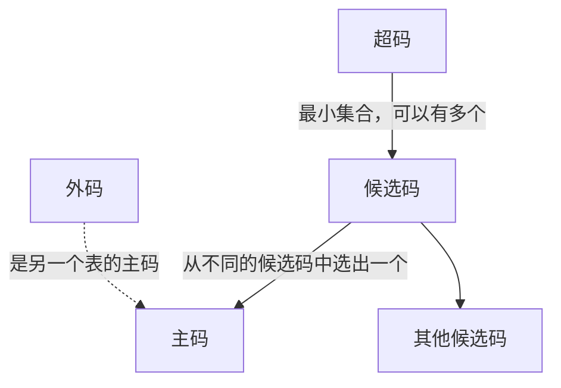
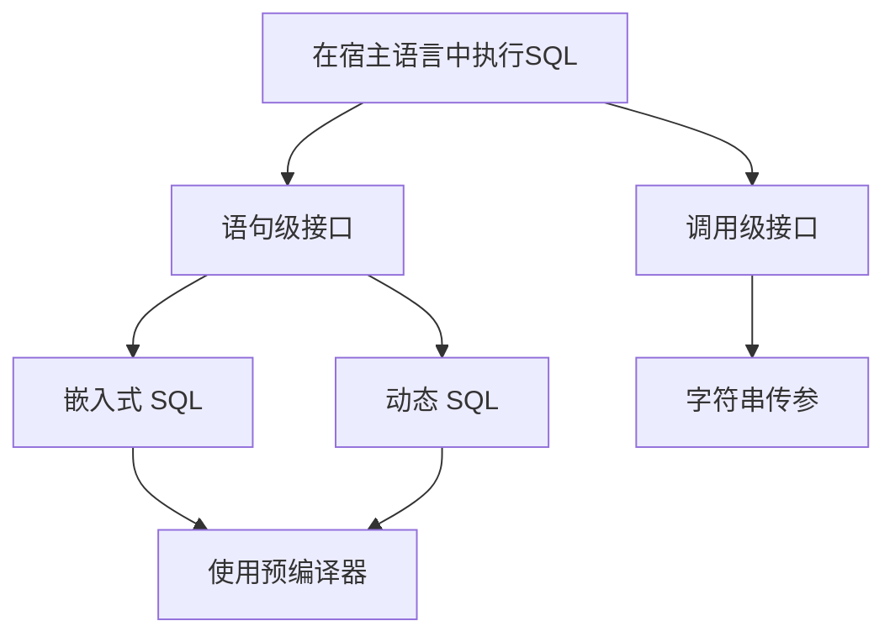

---
title: 数据库原理 课程笔记 (1) 数据库、关系代数和 SQL
url: https://blog.kisechan.space/2025/notes-database-1/
type: post
time: '2026-10-21T16:13:46.163Z'
---

**数据库系列笔记**

点击查看系列汇总：

---

Kisechan 的数据库系列笔记
https://blog.kisechan.space/tags/%E6%95%B0%E6%8D%AE%E5%BA%93/

---

- **数据库原理课程笔记部分**：
  - 数据库原理 课程笔记 (1) 数据库、关系代数和 SQL 【**当前阅读**】
  - [数据库原理 课程笔记 (2) E-R 模型和关系模式](https://blog.kisechan.space/2025/notes-database-2/)
  - [数据库原理 课程笔记 (3) 存储、索引、事务和并发](https://blog.kisechan.space/2025/notes-database-3/)
  - [数据库原理 课程笔记 (4) 杂项和题目整理](https://blog.kisechan.space/2025/notes-database-4/)
- **手搓数据库** (CS346) **部分**：
  - [设计一个数据库引擎 (1) 内存、外存和记录管理](https://blog.kisechan.space/2025/db-engine-1/)
  - [设计一个数据库引擎 (2) 索引](https://blog.kisechan.space/2025/db-engine-2/)
  - [设计一个数据库引擎 (3) SQL 处理](https://blog.kisechan.space/2025/db-engine-3/)
- **Oracle 和 NoSQL 课程部分**：
  - ~~Oracle 的学习使用和环境配置~~
  - [NoSQL 的学习使用和环境配置](https://blog.kisechan.space/2026/nosql/)

## 关于

**数据库管理系统**（DBMS）是：

- 一组相关数据的集合
- 一组用于访问这些数据的**程序的集合**

**数据库**则是相关**数据的集合**，是存放数据的地方。

数据库的发明是为了填补原有文件系统的缺陷。

### 文件系统的缺陷

1. **数据的冗余和冲突**

   - 多个人创建不同的文件包含相同的文件。
   - 一个数据的不同副本不一致。

2. **数据访问困难**

   - 不同的人建立的文件格式五花八门
   - 缺乏标准化

3. **数据孤岛**

   - 数据分散在不同格式的文件中
   - 难以编写检索程序，因为数据是割裂的

4. **完整性问题**
   - 不能维护一致性约束——不能存在统一的机制让数据合法

5. **原子性问题**
   - 传统文件系统不能保证事务的完整性，容易造成半成品数据

6. **并发访问**
   - 传统文件系统不能协调并发访问，只能让程序员自己加锁

7. **安全性问题**
   - 不能精细管理谁能看哪些数据，修改哪些数据

### 数据视角

数据视角就是**从不同的角度去看待和管理数据**。数据本身是一样的，但不同的人 / 层次看它的重点不同。

|   视角   |                     关注点                     |               例如               |
| :------: | :--------------------------------------------: | :------------------------------: |
| 物理视角 |        数据**怎么存在磁盘上**，存储细节        |  文件组织、索引结构、磁盘块管理  |
| 逻辑视角 |       数据**怎么组织、联系**，结构化表示       |           表、列、外键           |
| 用户视角 | **用户需要看到什么数据**，怎样屏蔽不相关的信息 | 只显示学生姓名和成绩，不显示学号 |

#### 数据抽象

数据抽象就是**数据视角的不同表达方式**，也是指通过不同层次的抽象来隐藏数据的存储和实现细节，**仅向用户展示必要的信息**，从而简化数据库的设计、使用和维护。

数据抽象使得用户可以在不同层次上操作数据，**而不必关心底层的物理存储结构或复杂的逻辑关系**。

数据抽象有三层（ANSI/SPARC 架构）：

- **物理层**
  - 数据在物理存储介质上的组织架构，涉及文件组织、索引、存储结构（B+ 树等），优化存储效率和访问速度。
- **逻辑层**
  - 描述数据的完整组织逻辑，如表、关系、约束等。
- **视图层**
  - 针对用户，屏蔽掉一部分数据细节的层，例如规定哪些人可以看什么，哪些人不能看什么。

#### 数据模型

数据模型是描述**数据、数据联系、数据意义、一致性约束**的工具。

数据模型有**数据结构**（数据实体和它们的关系）、**数据操作**（CRUD）、**数据约束**三部分。

数据模型主要有：

|          数据模型           |                            解释                            |
| :-------------------------: | :--------------------------------------------------------: |
| **关系模型**<br/>（最常用） |      数据存在表格里（行和列），比如 MySQL、PostgreSQL      |
|      **实体-联系模型**      |     画图表示实体和它们之间的关系，常用于数据库设计阶段     |
|   **基于对象的数据模型**    |     数据看成对象（有属性、有方法），比如面向对象数据库     |
|    **半结构化数据模型**     |          数据不是固定表格的，比如 JSON、XML 这种           |
|      **网状数据模型**       |           数据通过复杂指针联系在一起，很像网络图           |
|      **层次数据模型**       | 数据是树状层级，比如父-子结构（早期的 IBM IMS 数据库用的） |

#### 实例和模式

- **实例**指的是**存储的数据的集合**，也叫快照。

- **模式**指的是数据库中**存储和描述数据的格式**，分为物理模式和逻辑模式两类，对应物理层和逻辑层。
  - 物理数据具有**独立性**，修改物理模式不会影响逻辑模式。例如把原本顺序存储的表，改成了用 B+ 树索引存储，但是上层应用（比如写 SQL 查学生表）完全不用改。

| 概念 |                                          解释                                          |
| :--: | :------------------------------------------------------------------------------------: |
| 模式 | **数据库的结构设计图**。比如有哪些表、字段是什么类型、外键怎么关联（是“固定的结构”）。 |
| 实例 |                **某一时刻数据库里实际存放的数据内容**（是“活的数据”）。                |

### 数据库语言

数据库语言是用来**与数据库系统进行交流的语言**，主要作用有两个：

1. 定义数据结构（表、字段、约束等）
2. 操作数据内容（CRUD）

数据库语言由 DDL 和 DML、 DCL 组成。 SQL 是使用最广泛的数据库语言，包括了这三种语言。

- **DDL** 指的是 Data Definition Language ，**数据定义语言**。用于定义数据模式，规定一致性约束，授权用户。
- **DML** 指的是 Data Manipulation Language ， **数据操纵语言**。用于数据的 CRUD。
- **DCL** 指的是 Data Control Language，**数据控制语言**。用于用户权限、访问机制等。

### 用户和管理员


数据库用户不负责建结构、配置系统，他们主要分为：

|     类型     |              说明               |                举例                |
| :----------: | :-----------------------------: | :--------------------------------: |
|  无经验用户  |     不懂数据库，靠界面操作      |      电商APP用户、取款机客户       |
|  应用程序员  |    编写应用程序与数据库交互     |   开发银行软件、ERP系统的工程师    |
| 富有经验用户 | 会写 SQL，直接用 DML 做复杂查询 |        数据分析师、科研人员        |
|   专业用户   |    设计特殊用途的数据库系统     | 机器学习、图数据库、CAD 系统开发者 |

数据库管理员（DBA, Database Administrator）是数据库的“管家”，负责整体管理、优化、维护、安全性等**系统性任务**：

|      DBA 职责      |                说明                |
| :----------------: | :--------------------------------: |
|      定义模式      |  创建数据库结构（表、字段、关系）  |
|    定义存储结构    |  决定用什么索引、分区、压缩策略等  |
| 修改模式和物理组织 |      随业务变化调整数据库结构      |
|    设置访问权限    | 决定谁能访问什么数据，保证数据安全 |
|   监控性能和空间   |     优化查询速度，防止磁盘爆满     |
|   数据备份与恢复   |   防止意外丢失数据，支持灾难恢复   |

区分用户系统是为了防止危险操作、权责分明。

### 中国自主研发的数据库

- openGauss（华为）
- oceanbase（蚂蚁集团）
- TiDB
- GaussDB（华为云）
- polarDB（阿里云）

## 关系模型

**数据**是对客观事物的归纳，是记录或鉴别事物的符号，为事实或观测结果：

- 归纳出**共性**
- 抽象出**个性**

数据的基本结构有：

- **属性**
  - 名字
  - 取值域
  - 空值
  - 原子性
- **关系**
  - 一个关系是若干**属性域**的**笛卡尔积的子集**。

### 关系数据库的结构

#### 表

关系数据库用“表”的形式来存储数据，每一个“表”就是一个“**关系（Relation）**”。

表是存储数据的二维结构，由**表头** (Schema)，列名和数据类型和**表体** (Instance)，具体的**数据行**组成。

#### 关系模式

关系模式是表的结构定义，包括：

- 表名
- 属性名和数据结构
- 完整性约束

#### 关系实例

是某一时刻表中的具体数据，是表的快照。

---

|    概念    |                     含义                     |             举例              |
| :--------: | :------------------------------------------: | :---------------------------: |
|    关系    |                一个**二维表**                |        学生表、员工表         |
|  关系模式  |  表的**结构定义**（字段名、数据类型、约束）  |    学生(学号, 姓名, 年龄)     |
|  关系实例  |    表中某个时间点的**数据内容**（若干行）    | 某一时刻，学生表中有 5 条记录 |
|     表     | **实际存储数据的结构**；就是“关系”的表现形式 |         `Student` 表          |
| 关系数据库 |       **一组相关的表组成的**数据库系统       |  有学生表、课程表、选课表等   |

#### 码

码是用于**唯一标识或建立关系的属性**（列），主要有：

- **超码**
  - 一个或多个属性的集合，其中可能包含冗余属性
  - 可在一个关系中唯一标识一个元组
- **候选码**
  - 标识一个元组的最小属性集合
  - 一个表可以有多个候选码
- **主码**
  - 候选码中选出的唯一标识符
  - 不能为 `NULL` ，且值唯一
- **外码**
  - 本关系/表中的某个属性恰好是另外一个关系里的主码
  - 建立表间关系

---

|  名称  |             定义             |           说明           |
| :----: | :--------------------------: | :----------------------: |
|  超码  | 能唯一标识元组的属性**集合** |    可以是多个字段组成    |
| 候选码 | **最小的超码**，不能去掉字段 |        可能有多个        |
|  主码  |    从候选码中选出的“主键”    |     唯一、非空、不变     |
|  外码  |   指向另一个关系主码的属性   | 用于建立表与表之间的联系 |



#### 模式图

模式图是一个 **图形化工具**，表示一个关系数据库中各个关系（表）之间的结构与联系。

要素包括：

- 每个矩形代表一个关系（表）；
- 每个矩形中列出该表的**属性**（字段）；
  - 主码一般加下划线；
  - 外码一般用箭头指向它所引用的主码；
- 箭头用于表示外码 → 主码的**引用关系**。


### 关系代数

数据库查询语言是**描述和访问数据库的功能**。分为：

- **非过程化语言/描述式语言**
  - 只需要声明想要的结果，不需要过程。
  - 用户只需要描述所需要的数据，查询系统会根据系统的优化器自动选择执行策略。
  - **SQL** 是最典型的**非过程化语言**，你只需要描述你想要查询的数据，数据库系统会负责如何执行这个查询。
- **过程化语言**
  - 需要精确控制操作。
  - **关系代数** 就是**过程化语言**的一种。你需要通过一系列操作来获取数据，比如选择、投影、联接等。

关系代数有六种基本运算和一些附加运算：

| 运算 |   符号   |                 描述                 |                     示例                     |                功能说明                |
| :--: | :------: | :----------------------------------: | :------------------------------------------: | :------------------------------------: |
| 选择 | $\sigma$ |   从关系中选出满足条件的元组（行）   | $\sigma_{\text{age} > 30}(\text{Employee})$  |          选出年龄大于30的员工          |
| 投影 |  $\Pi$   | 从关系中选出特定的属性（列）（去重） | $\Pi_{\text{name, salary}}(\text{Employee})$ |          只显示姓名和薪水字段          |
| 并集 |  $\cup$  |  取两个关系中所有的元组（去重合并）  |                ${R} \cup {S}$                |         合并两个结构相同的关系         |
| 差集 |   $-$    |      得到只属于第一个关系的元组      |                 ${R} - {S}$                  |     从$R$中去除所有也属于$S$的元组     |
| 乘积 | $\times$ |       将两个关系的元组两两组合       |               ${R} \times {S}$               |              用于构造连接              |
| 换名 |  $\rho$  |         给关系或属性重新命名         |             $\rho_{S(a, b)}(R)$              | 将关系$R$重命名为$S$，属性改为$a$和$b$ |

#### 选择

$$
\sigma_p(r)=\{t|t\in r\quad\text{且}\quad p(t)\quad\text{成立}\}
$$

其中 $p$ 为查询条件，由**项目**及项目之间的逻辑运算组成。其中，项目指的是：属性大于、小于（等）属性或常数。

#### 投影

$$
\Pi_{A_1,A_2,...,A_k}(r)
$$

其中， $A_i$ 为属性名。它的结果是：

- 只包含给出的属性的一张 $k$ 列的表
- **去掉了重复行**

#### 并集

$$
r\cup s=\{t|t \in r\quad\text{或}\quad t\in s\}
$$

要求：

- **属性个数相同**
- **对应属性域相同或兼容**（也就是得对应，数据对数据字符串对字符串）


#### 差集

$$
r-s=\{t|t \in r\quad\text{且}\quad t\notin s\}
$$

要求同并集。

#### 笛卡尔积

$$
r\times s=\{tq|t\in r\quad\text{且}\quad q\in s\}
$$

要求：

- $r\cap s=\emptyset$
- 否则就要把交叉共有的那个属性换名


#### 换名

$$
\rho_{x(A_1,A_2,...,A_n)}(E)
$$

将结果的名字换为 $x$ ，且各个属性换名为 $A_i$ 。

以下是**扩展的关系运算**。

增加了算术运算和空值处理的能力。

#### 交集

$$
r\cap s=\{t|t \in r\quad\text{且}\quad t\in s\}
$$

要求同并集。

关系代数表达式里**中括号** $[]$ 表达的意思大约**可以理解成数组取值**。

#### 自然连接

$$
\begin{align*}
r\Join s&=\{tq|t\in r\quad\text{且}\quad q\in s\quad\text{且}\quad t[R\cap S]=s[R\cap S] \} \\
&= \boxed{\Pi_{R\cup S}(\sigma_{\sum r.A_i=s.A_i}(r\times s))}
\end{align*}
$$

其中， $R$ 、 $S$ 为关系模式。

就是自动合并两张列属性**完全相同**的表。

它**不会产生**含 `null` 的记录。

> 对于两张表：
>
> - Employee（员工）
>
> | emp_id | name  | dept_id |
> | :----: | :---: | :-----: |
> |   1    | Alice |   10    |
> |   2    |  Bob  |   20    |
> |   3    | Carol |   10    |
>
> - Department（部门）
>
> | dept_id | dept_name |
> | :-----: | :-------: |
> |   10    |   Sales   |
> |   20    |    HR     |
> |   30    |    IT     |
>
> 使用自然连接操作：
>
> $$
> \text{Employee} \Join \text{Department}
> $$
>
> 合并的结果是：
>
> | emp_id | name  | dept_id | dept_name |
> | :----: | :---: | :-----: | :-------: |
> |   1    | Alice |   10    |   Sales   |
> |   2    |  Bob  |   20    |    HR     |
> |   3    | Carol |   10    |   Sales   |

#### $\theta$ 连接

$$
r\Join_\theta s=\sigma_\theta (r\times s)
$$

按照给出的 $\theta$ 条件将两张表合并。

> 延续上面的例子，如果对两张表采用操作：
>
> $$
> \text{Employee} ⨝_{\text{Employee}.\text{dept\_id} \ne \text{Department}.\text{dept\_id}} \text{Department}
> $$
>
> 这个操作即**找出所有员工和部门编号不一样的组合**（而不是一样），并将它们合并。
>
> 结果是：
>
> | emp_id | name  | dept_id (Employee) | dept_id (Department) | dept_name |
> | :----: | :---: | :----------------: | :------------------: | :-------: |
> |   1    | Alice |         10         |          20          |    HR     |
> |   1    | Alice |         10         |          30          |    IT     |
> |   2    |  Bob  |         20         |          10          |   Sales   |
> |   2    |  Bob  |         20         |          30          |    IT     |
> |   3    | Carol |         10         |          20          |    HR     |
> |   3    | Carol |         10         |          30          |    IT     |
>
> 可以注意到它并没有将相同的列名合并。

---

|          |                自然连接                |              $\theta$ 连接               |
| :------: | :------------------------------------: | :--------------------------------------: |
| 连接条件 | **自动**基于**相同名字的属性**进行匹配 |           人工**指定任意条件**           |
|   结果   |    **合并两表相同列，避免重复显示**    | 直接按指定条件连接，**两表列通常全保留** |
|   符号   |               $\bowtie$                |            $\bowtie_{\theta}$            |
|   理解   |           自动对相同字段合并           |             手动指定如何连接             |

#### 赋值

$$
\gets
$$

字面意思。

#### 除

$$
\begin{align*}
r\div s &=\{t|t\in \Pi_{R-S} (r)\quad\text{且}\quad \forall u\in s,tu\in r \}\\
&=\boxed{\Pi_{R-S}(r)-\Pi_{R-S}\left(\textcolor{red}{(\Pi_{R-S}(r)\times s)}-\textcolor{green}r\right)}
\end{align*}
$$

就是找出所有 $r$ 中满足 $s$ 的部分，实现方法是：

- 找出**所有组合情况**（红色部分）
- 减去**当前有的情况**（绿色部分）
- 这样得到的就是所有**没有满足所有条件的元组**
- 用所有元组减掉这部分就是**满足了所有条件的元组**

**常用于查询类似于“选了所有的课的学生”等情况**。


**除的 SQL 等价写法**：

- 等价于 **`NOT EXISTS B EXCEPT A`**
- 也可以用两层 **`NOT EXISTS`** 子查询

#### 广义投影

$$
\Pi_{F_1,F_2,\cdots,F_n}(E)
$$

其中， $F_i$ 指的是符合这个条件的算术表达式。

> 信用卡能透支多少钱：
>
> 
>
> $$
> \Pi_{\text{customer\_name}, \text{limit} - \text{credit\_balance}}(\text{credit\_info})
> $$
>
> 

#### 聚集运算

关系运算中的聚集运算是指在关系数据库中对一组元组（行）进行统计或计算，用以**提取整体性质的运算**，例如：计数、求和、最大值、最小值、平均值等：

$$
_{G_1, G_2, ..., G_n} \mathcal{G}_{F_1(A_1), F_2(A_2), ..., F_n(A_n)}(E)
$$

- $E$ 是关系代数表达式
- $G_n$ 是用于分组的属性[^1]
- $A_n$ 是属性
- $F_n$ 是聚集函数，如 `COUNT`, `SUM`, `MAX`, `MIN`, `AVG` 等
- $\mathcal{G}$ 是聚集操作[^2]

[^1]: 分组就是“**按字段值划分子集**”。不过它既可以按照单字段分组，也可以按多字段（例如对于一个存在“地区”、“产品”和“价格”的表，如果按照“地区”和“产品”分组统计“价格”的平均值，那么就会分别按照【东部、铅笔】，【东部、钢笔】，【西部、铅笔】这样分别进行统计）。也可以通过表达式（例如提取日期字段中的年份）和区间进行分组。 `NULL` 会被单独分成一组。分好组了以后，聚集函数就会在组内进行运算。

[^2]: $\mathcal{G}$ 符号就是花体的 $\text G$ ，$\LaTeX$ 代码 `\mathcal{G}` 。

> 分别统计各个银行的员工收入：
>
> $$
> _\text{branch\_name}\mathcal{G}_{\textbf{sum}(\text{salary})}(\text{pt\_works})
> $$
>
> 

#### 外连接

外连接用于在**连接操作**中**保留未匹配的元组**。这对于避免在查询时遗漏重要信息（比如主表中有但从表中没有的记录）非常有用。

有三种外连接：

|   类型   | 符号  |          保留元组          |       不匹配部分处理方式       |
| :------: | :---: | :------------------------: | :----------------------------: |
| 左外连接 | ⟕[^3] | 左表全部保留（即使没匹配） |  右表对应列填补空值（`NULL`）  |
| 右外连接 | ⟖[^3] | 右表全部保留（即使没匹配） |  左表对应列填补空值（`NULL`）  |
| 全外连接 | ⟗[^3] | 左右表都保留（即使没匹配） | 缺失一侧的用空值（`NULL`）填补 |

[^3]: $\LaTeX$ 不支持这三个符号，解决方案可以参考：https://tex.stackexchange.com/questions/20740/symbols-for-outer-joins 或 https://lancelotshire.me/notebook/latex.html 。

> **Employees 表**：
>
> | emp_id |  name   | dept_id |
> | :----: | :-----: | :-----: |
> |   1    |  Alice  |   10    |
> |   2    |   Bob   |   20    |
> |   3    | Charlie |   30    |
>
> **Departments 表**：
>
> | dept_id | dept_name |
> | :-----: | :-------: |
> |   10    |    HR     |
> |   20    |    IT     |
> |   40    |  Finance  |
>
> ---
>
> 1. `Employees ⟕ Departments` 的结果是：
>
> | emp_id |  name   | dept_id | dept_name |
> | :----: | :-----: | :-----: | :-------: |
> |   1    |  Alice  |   10    |    HR     |
> |   2    |   Bob   |   20    |    IT     |
> |   3    | Charlie |   30    |  `NULL`   |
>
> Charlie **没有匹配的**部门信息，所以 `dept_name` 用 `NULL` 填充。
>
> ---
>
> 2. `Employees ⟖ Departments` 的结果是：
>
> | emp_id |  name  | dept_id | dept_name |
> | :----: | :----: | :-----: | :-------: |
> |   1    | Alice  |   10    |    HR     |
> |   2    |  Bob   |   20    |    IT     |
> | `NULL` | `NULL` |   40    |  Finance  |
>
> **Finance 部门** 没有员工，所以 `emp_id` 和 `name` 用 `NULL` 填充。
>
> ---
>
> 3. `Employees ⟗ Departments` 的结果是：
>
> | emp_id |  name   | dept_id | dept_name |
> | :----: | :-----: | :-----: | :-------: |
> |   1    |  Alice  |   10    |    HR     |
> |   2    |   Bob   |   20    |    IT     |
> |   3    | Charlie |   30    |  `NULL`   |
> | `NULL` | `NULL`  |   40    |  Finance  |
>
> 同时保留了 Charlie（**没有部门**） 和 Finance（**没有员工**）。

#### 空值 `NULL`

`NULL `表示“**未知值**”、“**缺失值**”或“**不适用的值**”，它不是零 (`0`)、不是空字符串 (`''`)、也不是布尔 `false`。

`NULL` 不等于任何值，包括另一个 `NULL`。

关于 `NULL` 的运算可参考：

|   运算类型   |                                                   含 `NULL` 的行为                                                   |
| :----------: | :------------------------------------------------------------------------------------------------------------------: |
|   算术运算   |                                    任何与 `NULL` 相加减乘除的结果都是 **`NULL`**                                     |
|   比较运算   | 任何与 `NULL` 比较（`=`、`<>` （SQL 中， `<>` 用得比 `!=` 更广泛）、`>` 等）结果是 **`unknown`**，包括 `NULL = NULL` |
|   聚集函数   |                                     **忽略** `NULL`（如 `SUM`, `AVG`, `COUNT`）                                      |
| 三值逻辑[^4] |                                          `NULL` 会被视为 `unknown` （见下）                                          |

[^4]: 三值逻辑是一种非古典逻辑系统，它允许命题有三个可能的真值：真（True）、假（False）和未确定（Unknown）。

`NULL` 的逻辑运算不是简单的布尔逻辑，而是引入 `unknown` 后的三值逻辑：

|      逻辑表达式       |   结果    |
| :-------------------: | :-------: |
|  `true AND unknown`   | `unknown` |
|  `false AND unknown`  |  `false`  |
| `unknown AND unknown` | `unknown` |
|   `true OR unknown`   |  `true`   |
|  `false OR unknown`   | `unknown` |
| `unknown OR unknown`  | `unknown` |
|     `NOT unknown`     | `unknown` |

在 `WHERE` 子句中，**只有逻辑值为 `true` 的元组**才会被选中。所以如果结果为 `unknown`，就 不会被选中。

`NULL` 和 `unknown` 在关系运算中的表现：

| 操作类别 |                      表现方式                       |
| :------: | :-------------------------------------------------: |
|   连接   |  如果连接条件中的某一属性为 `NULL`，则不会匹配成功  |
|   选择   |         条件值为 `unknown` 的记录不会被选中         |
|   投影   |        去重操作中将 `NULL` 值看作“相等”处理         |
| 集合运算 | `NULL` 被视为可以参与相等性比较（虽然不等于任何值） |
| 聚集运算 |          `NULL` 会被 **忽略**，不参与计算           |
| 分组属性 |     `NULL` 会被视为一个独立的分组键（即可分组）     |

#### 关系代数例题

1. 删除 $\text{takes}$ 表中，非 $\text{students}$ 学生选过的课程的信息。

$$
\sigma_\text{students.ID=takes.ID} ( \sigma_\text{dept\_name='计算机'}(\text{students}\times \text{takes}))
$$

2. 选出工资最高的老师。

$$
\Pi_\text{salary}(\text{instructor})-\Pi_\text {instructor.salary}(\sigma _{\text{instructor.salary}<\text{d.salary}}(\text{instructor}\times \rho_\text{d}(\text{instructor})))
$$

3. 选出选了计算机系所有课程的学生的 $\text{ID}$。

$$
\Pi_{\text{course\_\text{id}}, \text{ID}} (\text{takes})\div(\Pi_\text{course\_id} (\sigma_{\text{department}=\text{'计算机'}} (\text{course})))
$$

### 修改数据库内容

#### 插入

向关系模式 $r$ 中插入来自关系表达式 $E$ 的元组：

$$
r \gets r\cup E
$$

#### 删除

从关系 $r$ 中删除属于 $E$ 的元组集合。

$$
r \gets r-E
$$

#### 更改

有两种方式。

- 对关系 $r$ 的每个元组都只选择 $F_i$ 属性，重建这个关系模式：

$$
r \gets\Pi_{F_1,F_2,...,F_n}(r)
$$

- **更普适的更改操作**。

$$
r\gets\Pi_{F_1,F_2,...,F_n}(\sigma_p(r)\cup(r-\sigma_p(r)))
$$

> 
>
> 1. 删除贷款额度在0到50之间的所有贷款记录：
>
> $$
> \text{loan}\leftarrow \text{loan}-\sigma_{\text{amount}\geq0\wedge \text{amount}\leq50}(\text{loan})
> $$
>
> 2. 删除坐落在 _Needham_ 的所有银行的存款记录：
>
> $$
> \text{account}\leftarrow \text{account}-\Pi_{\text{account\_number},\text{branch\_name},\text{balance}}(\sigma_{\text{branch\_city}=\text{"Needham"}}(\text{account}\Join \text{branch}))
> $$
>
> $$
> \text{depositor}\leftarrow\text{depositor}-\Pi_{\text{customer\_name},\text{acount\_number}}(\Pi_{\text{account\_number},\text{branch\_name},\text{balance}}(\sigma_{\text{branch\_city}=\text{"Needham"}}(\text{account}\Join \text{branch}))\Join\text{depositor})
> $$
>
> 3. _Perryridge_ 银行赠送每位贷款客户 200 美元，并存入与贷款账号相同的存款账户：
>
> $$
> r\leftarrow\sigma_{\text{branch\_name}=\text{"Perryidge"}}(\text{borrower}\Join\text{loan})
> $$
>
> $$
> \text{account}\leftarrow \text{account}\cup\Pi_{\text{loan\_number},\text{branch\_name},200}(r)
> $$
>
> $$
> \text{depositor}\leftarrow \text{depositor}\cup\Pi_{\text{customer\_name},\text{loan\_number}}(r)
> $$
>
> 4. 余额不超过 10000 元的按 5% 计息，其余按 6% 计息：
>
> $$
> \text{account}\leftarrow\Pi_{\text{account\_number},\text{branch\_name},\text{balance}^*1.06}(\sigma_{\text{balance}\gt 10000}(\text{account}))\cup\Pi_{\text{account\_number},\text{branch\_name},\text{balance}^*1.05}(\sigma_{\text{balance}\leq10000}(\text{account}))
> $$

## SQL

SQL, Structed Query Language 是应用最广泛的数据库语言，它是一个**功能完备的数据库语言体系**，被划分为多个子语言（子功能）：

- **数据定义**

  - 用于定义数据库结构（模式、表、视图、索引等）。
  - 常见命令有：

    - `CREATE`：创建数据库、表、视图、索引等。

    - `ALTER`：修改表结构（如添加/删除列）。

    - `DROP`：删除数据库对象（如表、视图）。

- **数据操纵**

  - 用于对数据库中的数据进行 CRUD 。
  - 常见命令有：

    - `INSERT`：插入数据。

    - `UPDATE`：更新已有数据。

    - `DELETE`：删除数据。

    - `SELECT`：查询数据。

- **完整性定义**

  - 用于定义和维护数据的合法性和一致性。
  - 常见的完整性约束有：
    - **实体完整性**：如主键不能为 `NULL`。
    - **参照完整性**：如外键必须引用自已有记录。
    - **自定义完整性**：如 `Salary > 0` 等。

- **视图定义**

  - 创建虚拟表（视图），简化复杂查询，增强安全性。
    - 视图是基于一个或多个表的查询结果，并不实际存储数据。
    - 可以对视图查询，就像表一样。

- **事务控制**

  - 用于管理事务的边界，确保数据一致性、持久性和隔离性（ACID）。

  - 常见命令有：

    - `BEGIN` / `START TRANSACTION`：开始事务。

    - `COMMIT`：提交事务，永久保存更改。

    - `ROLLBACK`：回滚事务，撤销更改。

    - `SAVEPOINT`：设置事务中的回滚点。

- **嵌入式和动态 SQL**

  - 使 SQL 能嵌入到高级语言（如 C/C++、Java）中执行，或在运行时构造 SQL 语句。
    - **嵌入式 SQL**：SQL 语句直接写入程序中，通过宿主语言控制执行流程。
    - **动态 SQL**：在运行时动态构造 SQL 语句，常用于用户输入或复杂查询。

- **授权**

  - 控制用户对数据库中数据和对象的访问权限。
  - 常见命令有：
    - `GRANT`：授予权限。
    - `REVOKE`：撤销权限。

### 数据定义

数据定义是 SQL **定义数据库结构及其元信息**的能力，是数据库设计的第一步，涉及表的结构、数据类型、约束规则、存储策略等。

#### 数据定义的职能

- **关系模式**
  - 描述一张表的结构：表名 + 属性（列名）+ 属性的数据类型。
  - 是数据库逻辑结构的基本单位。

> ```sql
> CREATE TABLE Student (
>     ID INT PRIMARY KEY,
>     Name VARCHAR(50),
>     Age INT
> );
> ```

- **属性值域**
  - 指定列中可以存储哪些类型的数据，是否有取值范围、精度限制等。
  - 值域通过**数据类型**来表达，也可以使用 `CHECK` 约束自定义限制。

> ```sql
> Age INT CHECK (Age BETWEEN 0 AND 150);
> ```

- **完整性约束**

  - 确保数据的合法性和一致性。

  - 主要包括：

    - 主键（`PRIMARY KEY`）

    - 唯一约束（`UNIQUE`）

    - 非空（`NOT NULL`）

    - 外键（`FOREIGN KEY`）

    - 检查条件（`CHECK`）

> ```sql
> CREATE TABLE Course (
>     CourseID INT PRIMARY KEY,
>     CourseName VARCHAR(100) NOT NULL,
>     TeacherID INT,
>     FOREIGN KEY (TeacherID) REFERENCES Teacher(ID)
> );
> ```

- **索引**
  - 提高查询效率，用于加速搜索。
  - 可以对主键自动创建，也可以手动创建索引。

> ```sql
> CREATE INDEX idx_student_name ON Student(Name);
> ```

- **安全性**
  - 定义哪些用户可以访问数据库中的哪些数据（见授权部分）。
  - 尽管授权通常单独归为 SQL 安全控制功能，但也可以视为数据定义的一部分。

> ```sql
> GRANT SELECT ON Student TO teacher_user;
> ```

- **物理组织**
  - 一些数据库允许在创建表时指定其底层物理结构，比如：
    - 表空间（tablespace）
    - 存储引擎（如 InnoDB vs MyISAM）
    - 分区策略
  - 这部分通常是数据库厂商扩展功能，标准 SQL 提及不多。

#### 基本类型

数据类型规定了值的取值范围、精度和运算。

|      数据类型      |                   含义                    |
| :----------------: | :---------------------------------------: |
|     `CHAR(n)`      | 固定长度字符串，占用 n 个字符，不足补空格 |
|    `VARCHAR(n)`    |       可变长度字符串，最大长度为 n        |
|  `INT`, `INTEGER`  |            整数（通常 4 字节）            |
|     `SMALLINT`     |           小整数（通常 2 字节）           |
|   `NUMERIC(p,d)`   |    精确小数，总位数为 p，小数位数为 d     |
|       `REAL`       |          单精度浮点数（近似值）           |
| `DOUBLE PRECISION` |               双精度浮点数                |
|     `FLOAT(n)`     |   精度为 n 的浮点数，n 是二进制有效位数   |

**完整性约束**是指数据库在**逻辑层面**上为保证数据正确性、合法性和一致性而设置的**规则**。主要类型包括：

- **实体完整性**：
  - 主键（`PRIMARY KEY`）不能为 `NULL`，唯一标识一条记录。

- **参照完整性**：
  - 外键（`FOREIGN KEY`）必须引用主表中存在的记录，防止“悬挂指针”。

- **域完整性**：
  - 每个字段的数据类型、取值范围（如 `CHECK`, `NOT NULL`, 数据类型本身）。

- **用户定义的完整性**：
  - 开发者自己规定的业务规则（如工资必须大于 0）。

例如：

```sql
CREATE TABLE Student (
    ID INT PRIMARY KEY,               -- 实体完整性
    Age INT CHECK (Age >= 0),         -- 域完整性
    ClassID INT,
    FOREIGN KEY (ClassID) REFERENCES Class(ID) -- 参照完整性
);
```

**一致性约束**通常是指在**数据库操作前后**，数据要保持**符合数据库的所有完整性约束**的规则——数据库处于一个“**一致状态**”。它强调的是数据库整体状态在事务执行前后不会出现非法或冲突数据。

- 它并不是一种“单独的约束类型”，而是指**多个完整性约束共同作用的结果**。
- 一致性约束强调的是**事务操作**对数据一致性的维护。

---

|     对比项     |                        完整性约束                        |                              一致性约束                              |
| :------------: | :------------------------------------------------------: | :------------------------------------------------------------------: |
|    概念本质    |                    一种具体的规则机制                    |                   一种结果状态（是否满足全部约束）                   |
|   作用时间点   |          约束规则在建表/修改表时定义并持续生效           |            通常在事务前后判断数据库是否仍然满足完整性约束            |
| 是否可单独定义 | 可以明确写出（如 `PRIMARY KEY`, `CHECK`, `FOREIGN KEY`） |         不能单独定义，是对多个完整性规则是否被违反的总体评估         |
|      举例      |            `CHECK (age >= 0)`、`FOREIGN KEY`             |   插入一个不存在外键值时，破坏一致性约束（即违反特定的完整性约束）   |
|      关系      |                 完整性约束是**具体规则**                 | 一致性约束是**整体状态结果**，是否“违反”完整性约束决定一致性是否成立 |

#### 基本模式定义

1. **创建关系模式**

```sql
CREATE TABLE r (
    A1 D1,
    A2 D2,
    ...
    An Dn,
    -- 完整性约束
    完整性约束1,
    完整性约束2,
    ...
);
```

|  完整性约束   |              语法例子              |          用途          |
| :-----------: | :--------------------------------: | :--------------------: |
|  `NOT NULL`   |         `age INT NOT NULL`         |        禁止空值        |
|   `UNIQUE`    |          `UNIQUE (email)`          |       保证列唯一       |
|    `CHECK`    |        `CHECK (age >= 18)`         |     自定义条件限制     |
|   `DEFAULT`   |            `DEFAULT 0`             |       赋予默认值       |
| `FOREIGN KEY` | `FOREIGN KEY (...) REFERENCES ...` | 参照完整性，引用其他表 |

2. **删除关系模式**

```sql
drop table r
```

3. **修改关系模式**

```sql
alter table r add A D
-- 添加一个名为 A 类型为 D 的字段
alter table r drop A
-- 删除字段 A
```

### 数据查询

SQL 查询的一般方式是：

```sql
SELECT A FROM r WHERE p
```

等价于

$$
\Pi_A(\sigma_p(r))
$$

|   关键词   |                                含义                                 |
| :--------: | :-----------------------------------------------------------------: |
| `SELECT A` | 指定要查询的列（字段）$A$，可以是一个列，也可以是多个列、表达式等。 |
|  `FROM r`  |                 指定查询的数据来源表（或视图）$r$。                 |
| `WHERE p`  |               指定筛选条件 $p$，只保留满足条件的行。                |

完整版的 SQL 查询语句如下：

```sql
SELECT [DISTINCT|ALL] column_list
FROM table_list
[WHERE condition]
[GROUP BY group_columns]
[HAVING group_condition]
[ORDER BY sort_columns [ASC|DESC]]
[LIMIT n]   -- 有些方言如 MySQL 支持，限制查询数量
```

|    子句    |                                功能描述                                 |
| :--------: | :---------------------------------------------------------------------: |
| `DISTINCT` |                         去重，只保留唯一结果。                          |
|   `ALL`    |                     不去重，保留所有结果。（默认）                      |
| `GROUP BY` | 分组，将结果按某一列归类，通常与聚合函数（如 `SUM`, `COUNT`）配合使用。 |
|  `HAVING`  |       对分组后的结果进行筛选（类似 `WHERE`，但作用于分组之后）。        |
| `ORDER BY` |             指定结果排序顺序（升序 `ASC` / 降序 `DESC`）。              |
|  `LIMIT`   |          限制返回的行数（如 `LIMIT 10` 表示最多返回 10 行）。           |

#### `SELECT` 子句

每条 `SELECT` 语句的执行结果是一个**关系**（逻辑上的表），可以看作一个临时的二维表。

可以在语句中的 `SELECT` 后使用 `DISTINCT` 和 `ALL` 查找出去重后和去重前的数据。

#### `FROM` 子句

`FROM` 子句用于指定**查询的数据来源表或视图**，是 SQL 查询中最基础的组成部分。

- 决定**从哪张表或哪些表**中提取数据。

- 多个表可以组合在一起（常见的是使用笛卡尔积或 $\Join$ 连接）。

- 表可以指定别名，以便简化引用。

#### `WHERE` 子句

`WHERE` 子句用于过滤数据行，即**只保留满足条件的记录**。

- 添加逻辑判断（如：`=`, `>`, `<`, `<>`, `BETWEEN`, `LIKE`, `IN`, `IS NULL` 等）。
- 可以使用逻辑运算符（`AND`, `OR`, `NOT`）连接多个条件。
- `WHERE` 是在 `FROM` 指定的表或组合表上进行行级筛选。

#### `AS` 关键字

`AS` 是一个**别名定义**的关键字，用于给**列名或表名**起一个临时的新名字，让查询结果更具有可读性。

`AS` 其实是可选的关键字，下面两条语句是等价的：

```sql
SELECT amount AS loan_amount FROM loan;
-- 有 AS
SELECT amount loan_amount FROM loan;
-- 无 AS
```

|     场景     |             示例              |           说明           |
| :----------: | :---------------------------: | :----------------------: |
| 给列或表起名 |     `SELECT name AS 姓名`     | 改善结果展示，常用于报表 |
| 给表达式命名 | `SELECT price * qty AS total` |        避免无名列        |
| 多表连接简写 |     `FROM employee AS e`      |   简化引用如 `e.name`    |
|  子查询别名  |  `FROM (SELECT ...) AS temp`  |     子查询必须起别名     |

#### 元组变量

元组变量就是一个**为表或子查询起的别名**，用来：

- 引用表中的属性（字段）
- 区分多个同名属性
- 支持自连接或多表连接

#### 字符串运算

字符串常量用单引号扩起。

字符串中包含单引号时需双写单引号：

```sql
SELECT 'Hello World'; -- 正常字符串
SELECT 'It''s OK';     -- 字符串中包含单引号
```

---

`LIKE` 运算符是用来**在字符串中做模糊匹配**的，常用于 `WHERE` 子句中。

`LIKE` 运算符使用通配符进行字符串匹配。

| 通配符 |              作用              |                                     示例                                     |
| :----: | :----------------------------: | :--------------------------------------------------------------------------: |
|  `%`   | 匹配任意长度的子串（包括空串） | `'A%Z'` 可匹配 `'AZ'`, `'AbcZ'`<br/>`'%A%Z%'` 可匹配 `'天下トーイツA to Z☆'` |
|  `_`   |        匹配任意一个字符        | `'A_Z'` 可匹配 `'ABZ'`, `'ACZ'` 但不匹配 `'AABZ'` 和 `'天下トーイツA to Z☆'` |

例如：

```sql
-- 查找地址中含有“Main”的顾客
SELECT customer_name
FROM customer
WHERE customer_street LIKE '%Main%';

-- 查找名字为三个字母，且中间字母是"a"的顾客
SELECT customer_name
FROM customer
WHERE customer_name LIKE '_a_';
```

---

如果要匹配 `%` 或 `_` 本身，而不是作为通配符用，可以使用 `ESCAPE` 关键字定义一个转义字符。

例如：

```sql
-- 查找包含文字 "ab%cd%" 的字段
SELECT col
FROM table
WHERE col LIKE 'ab#%cd#%' ESCAPE '#';
-- # 是自定义的转义字符，这样 #% 就会被解释为实际的 % 字符，而不是通配符。
```

---

SQL 中用 `||` 把两个字符串拼接起来（注意，不是加号）：

```sql
SELECT 'Hello' || ' ' || 'World';
-- 结果：Hello World
```

---

大小写转换函数有：

|   函数    |        作用        |           示例           |
| :-------: | :----------------: | :----------------------: |
| `UPPER()` | 把字符串转换为大写 | `UPPER('aBc')` → `'ABC'` |
| `LOWER()` | 把字符串转换为小写 | `LOWER('AbC')` → `'abc'` |

#### `ORDER BY` 子句

`ORDER BY` 子句用于**对查询结果进行排序**。

它是 `SELECT` 语句中**最后执行**的步骤。

|    关键字     |            含义            |
| :-----------: | :------------------------: |
| `ASC`（默认） | **升序**：从小到大、从A到Z |
|    `DESC`     | **降序**：从大到小、从Z到A |

当对多个属性排序时，它遵从以下规则：

1. 先按第一个字段排

2. 若第一个字段值相等，则按第二个字段排

3. 依此类推

例如：

```sql
ORDER BY branch_name ASC, amount DESC

-- 先按 branch_name 升序排列；
-- 如果多个记录的 branch_name 相同，再按 amount 降序排列。
```

#### 数据重复问题

在标准关系代数中，**关系是集合**，不允许有重复的元组；但在 SQL 中，默认查询结果是一个**多重集**（Multiset），也称**袋**（bag），是允许重复数据的。

```sql
SELECT branch_name FROM loan;

-- 如果表 loan 中有多个贷款来自同一家银行，比如 "Perryridge" 出现了 3 次，那么这个查询结果就会返回 3 个 "Perryridge"，不会自动去重。
-- 只有使用 DISTINCT 关键字才会去重
```

---

多重集与集合类似，也是一组元素的集合，但它**允许元素重复**。若 $A$ 是一个元素的集合，定义 $f: A \to \mathbb{N}$ 表示每个元素的出现次数，则一个多重集 $M$ 可表示为：

$$
M = \{ (a, f(a)) \mid a \in A \}
$$

> 例如：
>
> - 集合 $S = \{ a, b \}$ 表示 $a$、$b$ 各出现一次
> - 多重集 $M = \{ a, a, b \}$ 可以形式化为：
>
> $$
> M = \{ (a, 2), (b, 1) \}
> $$

我们可以将多重集扩展到关系代数中。

1. **投影**

如果一个关系 $R$ 是多重集，投影后的结果也可能包含重复。

$$
\pi_A(R) = \text{只保留属性 }A\text{ 后的多重集}
$$

> $$
> R = \{ (1,a), (2,a) \}
> \Rightarrow \pi_B(R) = \{ (a), (a) \}
> $$

2. **选择**

如果某元组满足谓词 $p$，那么它的所有重复都保留。

$$
\sigma_p(R) = \{ t \in R \mid p(t) \text{ 为真} \}
$$

3. **笛卡尔积**

假设 $R$ 和 $S$ 是两个多重集关系，元组 $t_R$ 和 $t_S$ 出现次数分别为 $c_1$ 和 $c_2$，那么：

$$
t_R \in R, \quad t_S \in S \Rightarrow (t_R, t_S) \in R \times S \text{ 出现 } c_1 \cdot c_2 \text{ 次}
$$

> $$
> R = \{ (1,a), (2,a) \}, \quad S = \{ (3), (3) \}
> \Rightarrow R \times S =
> \begin{cases}
> (1,a,3) &\times 2\\
> (2,a,3) &\times 2\\
> \end{cases}
> $$
>
> 总共 4 个元组。

#### 集合运算

SQL 的**集合运算**（`UNION`、`INTERSECT`、`EXCEPT`）和数学集合一样默认去重，但也提供了 `ALL` 版本用于保留重复。

---

1. `UNION`

```sql
SELECT ... FROM R
UNION
SELECT ... FROM S;
```

等价于集合运算 $R \cup S$ 。

---

2. `INTERSECT`

```sql
SELECT ... FROM R
INTERSECT
SELECT ... FROM S;
```

等价于集合运算 $R \cap S$ 。

---

3. `EXCEPT`

```sql
SELECT ... FROM R
EXCEPT
SELECT ... FROM S;
```

等价于集合运算 $R - S$ 。

---

如果希望保留重复数据，必须显式使用 `ALL` 关键字。

|      操作       |                         解释                         |
| :-------------: | :--------------------------------------------------: |
|   `UNION ALL`   |                   保留所有重复结果                   |
| `INTERSECT ALL` | 保留重复次数为两个集合中相同元组出现次数的**最小值** |
|  `EXCEPT ALL`   |                按出现次数**逐个剔除**                |

> 给定两个查询结果：
>
> - 查询 1 返回：`{a, a, b}`
> - 查询 2 返回：`{a, b, b}`
>
> |      操作       |       结果        |                         解释                          |
> | :-------------: | :---------------: | :---------------------------------------------------: |
> |     `UNION`     |     `{a, b}`      |                       去重合并                        |
> |   `UNION ALL`   | `{a, a, a, b, b}` |                     保留全部重复                      |
> |   `INTERSECT`   |     `{a, b}`      |               `a` 、 `b` 都出现过，去重               |
> | `INTERSECT ALL` |     `{a, b}`      |               `a` 最小次数是1，`b` 是1                |
> |    `EXCEPT`     |        `∅`        |      先对查询去重得到两个 `{a, b}`，取差集为 `∅`      |
> |  `EXCEPT ALL`   |       `{a}`       | 一个 `a` 被保留（`a` 有两个，第二个有一个，保留差值） |

#### 分组聚合

SQL 提供了一些聚集函数，它们用于对一组数据做运算，返回一个**单一值**：

|    函数    |         含义          |
| :--------: | :-------------------: |
|  `AVG(x)`  |        平均值         |
|  `MIN(x)`  |        最小值         |
|  `MAX(x)`  |        最大值         |
|  `SUM(x)`  |         总和          |
| `COUNT(*)` | 总行数（包括 `NULL`） |
| `COUNT(x)` |  非 `NULL` 值的个数   |

---

`GROUP BY` 子句可以将结果按字段进行**分组**：

- 它将结果按某些字段分组，每组**分别计算**聚集函数。
- 通常和聚集函数一起使用。

```sql
SELECT branch_name, AVG(balance)
FROM account
GROUP BY branch_name;

-- 每个 branch_name 是一个组
-- 每组分别计算平均 balance
```

---

`HAVING` 子句用于对分组后的结果进行筛选。

|   子句   |       生效阶段       |       作用对象       |
| :------: | :------------------: | :------------------: |
| `WHERE`  | 分组前（原始表数据） |       单条记录       |
| `HAVING` | 分组后（每组为单位） | 聚集结果、分组字段等 |

```sql
SELECT branch_name, AVG(balance)
FROM account
GROUP BY branch_name
HAVING AVG(balance) > 1200;

-- 首先 GROUP BY 将 account 表按 branch_name 分组
-- 再用 HAVING 过滤掉平均余额不大于 1200 的组
```

#### 空值 `NULL`

先前提到的关系代数中的 `NULL` 和 SQL 中的 `NULL` 行为类似。

但有几个特殊的补充用法：

- `IS [NOT] NULL` ：判断是否为 `NULL` 。
- `COUNT(*)` ：是唯一一个对 `NULL` 计数的聚集函数。
- 支持多重集重复。

### 嵌套子查询

SQL 的嵌套子查询是指在一个 SQL 查询中，把另一个完整的 `SELECT` 语句**作为子句嵌入到主查询中**。

这种用法让 SQL 更加强大，支持层层筛选和复杂条件表达，这些子查询的主要作用也是为 `WHERE` 条件提供动态的过滤条件。

```sql
SELECT ...
FROM ...
WHERE 某列 OPERATOR (SELECT ... FROM ... WHERE ...);

-- 其中的 (SELECT ...) 就是一个 子查询。
```

主要起到下面几种作用

- **标量子查询**，子查询返回一个单一值（标量）用于聚集函数等的比较
- **成员测试**，子查询返回一个集合，进行 `IN` 子查询，主查询判断某值是否属于这个集合
- **存在性测试**，使用 `EXIST` 判断是否存在结果行
- **比较所有或任意值**，使用 `ALL` 和 `ANY` 进行判断
- **相关子查询**，子查询*引用外层查询的属性*，每次执行依赖当前外层行

#### 集合子查询

集合子查询的核心在于：子查询返回一个值的集合（多行一列），而主查询用这些集合来做判断。

---

`IN` 和 `NOT IN` 关键字用于进行属于和不属于运算。

> ```sql
> -- 有贷款但无存款的顾客
> SELECT DISTINCT customer_name
> FROM borrower
> WHERE customer_name NOT IN (
>     SELECT customer_name
>     FROM depositor
> );
> ```

`NOT IN` 在处理子查询时，如果结果中包含 `NULL`，**整个判断可能变成 `UNKNOWN`**，导致该值被排除。

---

`SOME`（或 `ANY`）与 `ALL` 这些运算用于和**子查询结果中的所有或任意值**进行比较。

> ```sql
> -- 找出资产比Brooklyn任意一家银行都高的银行
> SELECT branch_name
> FROM branch
> WHERE assets > ALL (
>     SELECT assets
>     FROM branch
>     WHERE branch_city = 'Brooklyn'
> );
> ```

---

`EXISTS` 用来判断**子查询的结果是否非空**（存在）。

$$
\text{EXISTS}(R) \iff R \neq \emptyset
$$

$$
\text{NOT EXISTS}(R) \iff R = \emptyset
$$

`EXISTS `的子查询通常依赖于外层查询的某些值（相关子查询），每一行主查询记录都会执行一次子查询。

> 找出既有存款又有贷款的顾客：
>
> ```sql
> SELECT DISTINCT customer_name
> FROM borrower AS R
> WHERE EXISTS (
>     SELECT *
>     FROM depositor AS S
>     WHERE S.customer_name = R.customer_name
> );
> ```

---

> 找出在 _Brooklyn_ 所有银行都有存款的顾客：
>
> ```sql
> SELECT DISTINCT S.customer_name
> FROM depositor AS S
> WHERE NOT EXISTS (
>     (SELECT branch_name
>      FROM branch
>      WHERE branch_city = 'Brooklyn')
>
>     EXCEPT
>
>     (SELECT R.branch_name
>      FROM depositor AS T, account AS R
>      WHERE T.account_number = R.account_number
>        AND S.customer_name = T.customer_name)
> );
> ```

---

`UNIQUE` 用来**判断子查询的结果是否包含重复的元组**。如果子查询返回的结果中所有元组都不重复（即结果集是一个集合而不是多重集），则 `UNIQUE` 为 `TRUE`；否则为 `FALSE`。

> 找出在 _Perryridge_ 拥有多个存款账户的顾客。
>
> ```sql
> SELECT T.customer_name
> FROM depositor AS T
> WHERE NOT UNIQUE (
>     SELECT R.customer_name
>     FROM account AS S, depositor AS R
>     WHERE T.customer_name = R.customer_name
>       AND R.account_number = S.account_number
>       AND S.branch_name = 'Perryridge'
> );
> ```

现代 SQL 很少使用 `UNIQUE`，因为更常用的是 `GROUP BY ... HAVING` 或聚集函数，如对于上面的例子：

```sql
SELECT customer_name
FROM depositor D, account A
WHERE D.account_number = A.account_number
  AND A.branch_name = 'Perryridge'
GROUP BY customer_name
HAVING COUNT(*) = 1;  -- 只有一个账户
```

#### 派生关系

在 `FROM` 子句中使用一个**完整的** `SELECT` 查询，把它看作一张“临时表”或“中间表”。这就是派生关系，其语法结构如下：

```sql
SELECT ...
FROM (SELECT ... FROM ...) AS 别名(列名1, 列名2, ...)

-- 也可以写成：

SELECT ...
FROM (SELECT ... FROM ...) AS 别名
```

> 选出平均存款额超过1200元的银行
>
> ```sql
> SELECT branch_name, avg_balance
> FROM (
>     SELECT branch_name, AVG(balance) AS avg_balance
>     FROM account
>     GROUP BY branch_name
> ) AS branch_avg
> WHERE avg_balance > 1200;
> ```

这种方式将**复杂计算逻辑封装为临时表**，逻辑清晰，且更容易进行多层分析，比如：先聚合，再排序，再筛选。

必须给子查询**起别名**（如 `branch_avg`），否则 SQL 会报错。

---

`WITH` 子句是 SQL 中的一种重要特性，叫做**公共表表达式**（Common Table Expression, CTE）。它的核心目的是：**在查询中定义临时的、具有名字的中间结果表**，并在同一条查询中引用这些临时表，让 SQL 更加清晰、结构化。

```sql
WITH 临时表名(列名1, 列名2, ...) AS (
    子查询
)
主查询;

-- 也可以定义多张临时的表：
WITH 表1 AS (...),
     表2 AS (...)
SELECT ...
FROM 表1, 表2
WHERE ...

```

> 查询存款总额超过平均值的银行：
>
> ```sql
> WITH branch_total(branch_name, value) AS (
>     SELECT branch_name, SUM(balance)
>     FROM account
>     GROUP BY branch_name
> ),
> branch_total_avg(value) AS (
>     SELECT AVG(value)
>     FROM branch_total
>     -- 这个表只有一行一列
> )
> SELECT branch_name
> FROM branch_total, branch_total_avg
> WHERE branch_total.value > branch_total_avg.value;
> ```
>
> 1. `branch_total`：计算每个银行的存款总额。
> 2. `branch_total_avg`：计算所有银行存款总额的平均值。
> 3. 外层查询筛选出大于平均值的银行名称。

|       优点       |                             描述                             |
| :--------------: | :----------------------------------------------------------: |
|     可读性强     |          逻辑清晰，避免嵌套太深，结构更像“步骤拆解”          |
|      可复用      |        如果多个子查询依赖相同的中间结果，不需要写多次        |
|   支持递归查询   | `WITH RECURSIVE` 可用于图、层级结构等场景（如祖先/子代查询） |
| 仅在当前查询有效 |       作用域局限，生命周期短，不污染数据库全局命名空间       |

### 数据删除

使用 `DELETE` 语句进行数据删除：

```sql
DELETE FROM 表名
[WHERE 条件];
-- 如果忽略掉 WHERE 子句就会把整张表的内容全删了，只留下框架
```

> 删除位于 _Brooklyn_ 的银行的所有账户
>
> ```sql
> DELETE FROM account
> WHERE branch_name IN (
>   SELECT branch_name
>   FROM branch
>   WHERE branch_city = 'Brooklyn'
> );
> ```

1. `DELETE `是逐行删除的，事务安全，可以配合 `ROLLBACK` 撤销；
2. 删除操作不会自动影响关联表（如外键引用），除非设置了 `ON DELETE CASCADE`；
3. **不能跨表同时删除**：一次只能删除一个表中的数据；
4. 大量删除操作可能会触发大量写操作和锁表，建议批量或分页删除。

|           操作           |             描述             |
| :----------------------: | :--------------------------: |
|   `DELETE FROM WHERE`    |        删除一行或多行        |
| `DELETE FROM (无 WHERE)` | 删除整个表内容，但保留表结构 |
|        `TRUNCATE`        | 更快的方式清空表（不可回滚） |
|       `DROP TABLE`       |       删除整个表和数据       |

### 数据插入

使用 `INSERT INTO VALUES` 语句将数据元组插入表中。

```sql
INSERT INTO 表名 VALUES (值1, 值2, 值3, ...);

-- 也可以用下面更清晰的写法，显式指定列名：

INSERT INTO 表名 (列1, 列2, 列3, ...)
VALUES (值1, 值2, 值3, ...);
```

也可以用 `INSERT INTO SELECT` **子查询语句**插入多条数据元组。

> 给 _Perryridge_ 分行的所有贷款客户送 200 美元并新建账户。
>
> ```sql
> INSERT INTO account
> SELECT loan_number, branch_name, 200
> FROM loan
> WHERE branch_name = 'Perryridge';
> ```

---

插入数据需要符合以下条件：

- **列数和指定类型匹配**
- 满足主键唯一约束，**保证主键不重复**

对于**未指定的列**，插入动作会有以下行为：

- 若定义了默认值，则用默认值插入当前列
- 否则会被赋空值 `NULL`

### 数据更新

使用 `UPDATE` 语句进行数据更新。

```sql
UPDATE 表名
SET 列名 = 新值
[WHERE 条件];

-- 如果省略 WHERE 语句，则会更新整张表的所有记录
```

`CASE` 语句用于条件分支：

```sql
CASE
    WHEN 条件1 THEN 结果1
    WHEN 条件2 THEN 结果2
    ...
    ELSE 默认值
END
```

> 分情况加息（余额 ≤ 10000 按 5%，否则 6%）
>
> ```sql
> UPDATE account
> SET balance = CASE
>     WHEN balance <= 10000 THEN balance * 1.05
>     ELSE balance * 1.06
> END;
> ```

### 视图

视图是一个**虚拟表**，它是由一个 **SQL 查询语句的结果定义的表**。视图本身不存储数据，而是依赖于底层表的数据。

```sql
CREATE VIEW 视图名 AS
SELECT ...
FROM ...
WHERE ...;
```

视图本质上是一个**查询的别名或封装**。当你在查询中使用一个视图时，SQL 引擎并不会直接从某个表中读取数据，而是将视图的定义**展开**成原始查询语句，再执行，这就叫**视图展开**：

1. 查询一个视图 `v1`；
2. SQL 系统会查找 `v1` 的定义（一个查询表达式 `e1`）；
3. 如果 `e1` 中还引用了另一个视图 `v2`，则继续展开 `v2`；
4. 直到最终表达式中只包含基础表。

---

视图的主要作用包括：

1. **简化复杂查询**：将复杂的多表连接或聚合查询封装成一个视图，后续查询更简洁。
2. **提高重用性**：可以在多个查询中使用视图，提高开发效率。
3. **数据安全**：通过视图只暴露部分列或部分行，限制用户访问敏感数据。
4. **逻辑抽象**：屏蔽底层表的结构变化，对上层应用提供稳定接口。

---

在定义完视图后，可以在任何地方像使用普通表一样使用它：

- 在 `FROM` 子句中使用；
- 可以对视图做 `JOIN`、`GROUP BY`、`ORDER BY`、嵌套子查询等；
- 也可以基于视图创建新视图（多层嵌套）；

* **视图中的数据是动态的**：每次查询视图时，系统都会执行它背后的查询语句。
* 对于需要频繁使用的复杂查询，视图可以提升开发效率，但不要滥用（尤其在高性能场景中）。

---

与普通视图不同，**物化视图**是将视图的结果**物理存储在数据库**中的，就像一张表一样。

这意味着查询物化视图不需要重新计算底层查询。

需要注意，标准 SQL 中不直接支持 `MATERIALIZED VIEW`，但许多数据库支持它，如：

- PostgreSQL
- Oracle
- MySQL（通过触发器/临时表实现）
- SQL Server（用 indexed views）

#### 视图更新

- 有些视图是可以更新的（称为 **可更新视图**）。
- 有些视图不可以更新（称为 **不可更新视图**）。

是否可更新，取决于视图的结构是否能**唯一映射**到其底层基表的数据，需要满足以下条件：

- `FROM` 子句中 **只涉及一个基表**
- `SELECT` 中 **不包含聚合函数**（如 `SUM`、`AVG` 等）
- `SELECT` 中 **没有表达式**（如 `a + b`、`COUNT(*)`）
- **没有 `DISTINCT`**
- **没有 `GROUP BY`、`HAVING`**
- **视图列不包含空值或派生列**（特别是缺少主键的情况）
- **没有使用 `UNION`、`JOIN` 等多表操作**（或这些操作能被推导）

> ```sql
> CREATE VIEW loan_branch AS
> SELECT loan_number, branch_name FROM loan;
>
> INSERT INTO loan_branch VALUES ('L-37', 'Perryridge');
> ```
>
> 该视图缺少 `amount` 字段，视图只包含两个列，但底层表 `loan` 有三个字段：`loan_number`, `branch_name`, `amount`。
>
> 可能导致插入时，系统无法知道 `amount` 应该是多少，因此会将其设为 `NULL`，而这可能违反表的约束（如 `NOT NULL`）。

---

> ```sql
> CREATE VIEW loan_info AS
> SELECT customer_name, amount
> FROM borrower, loan
> WHERE borrower.loan_number = loan.loan_number;
>
> INSERT INTO loan_info VALUES ('Johnson', 1900);
> ```
>
> 该视图来自于两个表 `borrower` 和 `loan` 的连接。插入时，系统无法判断这条记录应该插入哪个表、哪些字段，尤其是关联键（如 `loan_number`）也缺失。

多表连接视图基本是**不可更新的**。

---

> ```sql
> CREATE VIEW loan_downtown AS
> SELECT loan_number, branch_name, amount
> FROM loan
> WHERE branch_name = 'Downtown';
>
> INSERT INTO loan_downtown VALUES ('L-37', 'Perryridge', 800);
> ```
>
> 定义的视图只显示 `Downtown` 分行的记录，但却插入了 `Perryridge`。
>
> 违反了视图的 `WHERE` 逻辑：如果视图只接受 `branch_name = 'Downtown'`，却插入了别的分行，这条记录在视图里根本不会被看到。
>
> 就算语法允许，这类插入会造成**逻辑上的自我矛盾**。

---

> ```sql
> CREATE VIEW all_customer AS
> (
>   SELECT branch_name, customer_name FROM depositor, account WHERE ...
>   UNION
>   SELECT branch_name, customer_name FROM borrower, loan WHERE ...
> );
>
> INSERT INTO all_customer VALUES ('Perryridge', 'John');
> ```
>
> 这是一个 `UNION` 组成的视图。插入数据时，系统无法判断应该插入哪个表、通过哪个路径（_depositor/account or borrower/loan?_）。
>
> 具有 `UNION`、`JOIN` 的视图一般是**不可更新的**，除非使用 `INSTEAD OF TRIGGER` 来手动实现插入逻辑（高级特性）。

### 事务

事务是用户定义的一个**操作序列**，这个序列中的所有操作要么全部成功执行，要么全部不执行。

事务有四大特性，简称 ACID ：

|                 |  含义  |                                    解释                                     |
| :-------------: | :----: | :-------------------------------------------------------------------------: |
|  **A**tomicity  | 原子性 |  事务中所有操作是一个整体，**不可分割**，要么全部执行成功，要么全部失败。   |
| **C**onsistency | 一致性 |     事务执行前后，数据库都处于**一致状态**，不会破坏数据的完整性约束。      |
|  **I**solation  | 隔离性 | 多个事务并发执行时，彼此操作**互不干扰**。如 A 在转账，B 不能看到中间过程。 |
| **D**urability  | 持久性 |       事务一旦提交，所做的修改**永久生效**，即使断电或崩溃也能恢复。        |

事务的语法如下（一种语法）：

```sql
BEGIN ATOMIC
   -- 一组语句
   UPDATE ...;
   INSERT ...;
END;
```

如果事务在执行的任一语句中出错，则：

```sql
ROLLBACK;
```

进行回滚，回到最初状态。

### 连接

和关系代数中连接的概念类似，连接是把两个或多个关系表通过某种匹配条件组合在一起查询的操作。通常用于：

- **组合多个表中的数据**（如客户信息和账户信息）
- **通过外键关系查找关联数据**
- **过滤符合某些联合条件的数据**

|        类型        |                       描述                       |
| :----------------: | :----------------------------------------------: |
|    `INNER JOIN`    |          只保留**两个表中匹配的记录**。          |
| `LEFT OUTER JOIN`  | 返回左表所有记录，右表匹配不到的用 `NULL` 填充。 |
| `RIGHT OUTER JOIN` | 返回右表所有记录，左表匹配不到的用 `NULL` 填充。 |
| `FULL OUTER JOIN`  |   返回左右表所有记录，未匹配的用 `NULL` 填充。   |
|    `CROSS JOIN`    |  返回笛卡尔积，也就是所有组合，不含任何过滤条件  |

---

连接条件有以下几种：

|      方式      |                     说明                     |
| :------------: | :------------------------------------------: |
|      `ON`      |  指定连接条件，常见写法：`ON A.key = B.key`  |
| `USING(列名)`  |   当两个表有**相同列名**时，自动以该列连接   |
| `NATURAL JOIN` | 自动根据两个表中**名字相同的列**进行等值连接 |

---

如果只是使用最普通的多表查询：

```sql
SELECT * FROM A, B;
```

则执行的是在笛卡尔积中查询。

---

> 查找有存款无贷款的客户
>
> ```sql
> SELECT d_CN
> FROM (
>     depositor LEFT OUTER JOIN borrower
>     ON depositor.customer = borrower.customer
> ) AS db1(d_CN, account_number, b_CN, loan_number)
> WHERE b_CN IS NULL;
> ```
>
> **解释**：
>
> - 用左连接保留 `depositor` 的所有记录；
> - `b_CN` 是 `borrower.customer`；
> - 如果某客户没有贷款，`b_CN` 就是 `NULL`；
> - 所以筛选出只有存款、**没有贷款**的客户。

---

> 查找只有贷款或只有存款的客户
>
> ```sql
> SELECT customer_name
> FROM (
>  depositor NATURAL FULL OUTER JOIN borrower
> )
> WHERE account_number IS NULL OR loan_number IS NULL;
> ```
>
> **解释**：
>
> - 使用 `FULL OUTER JOIN` 保留两个表所有客户；
> - `account_number IS NULL` 表示没有存款；
> - `loan_number IS NULL` 表示没有贷款；
> - 所以筛选的是 **只有一种关系的客户**。

### SQL 例题

1. **不用聚集函数**，找到 `instructor` 中的最高工资。

```sql
(SELECT DISTINCT salary FROM instructor)
EXCEPT
(SELECT DISTINCT T.salary FROM instructor AS T, instructor AS S WHERE T.salary < S.salary)

-- 用 EXCEPT 除去了所有低于最高工资的值
```

2. Find the total number of instructors who teach a course in the Spring 2010 semester.

```sql
SELECT COUNT (distinct ID)
FROM teaches
WHERE semester = 'Spring' AND year = 2010;
```

3. Find courses offered in Fall 2009 and in Spring 2010.

```sql
SELECT DISTINCT course_id
FROM section
WHERE semester = 'Fall' AND YEAR = 2009 AND
	course_id IN (SELECT course_id
		FROM section
		WHERE semester = 'Spring'
		AND year= 2010);
```

4. 找到比生物学院所有老师工资都高的老师的姓名。

```sql
SELECT name
FROM instructor
WHERE salary > ALL (SELECT salary
	FROM instructor
	WHERE dept name = 'Biology');
```

5. 输出学院内老师的平均年薪大于 42000 元的学院和他们的平均工资。

```sql
SELECT dept_name, avg_salary
FROM (SELECT dept_name, avg (salary) AS avg_salary
      FROM instructor
      GROUP BY dept_name)
WHERE avg_salary > 42000;
```

6. 找到最大的学院预算。

```sql
WITH max_budget (value) AS
	(select max(budget)
	from department)

SELECT department.name
FROM department, max_budget
WHERE department.budget = max_budget.value;
```

7. 在 `students` 表中，用 SQL 语句查询名字中包含 `'g'` 学生的学号、姓名。

```sql
SELECT id, name
FROM students
WHERE name LIKE '%g%';
```

8. 使用关系代数和 SQL 语句对所有存款余额大于平均存款额的账户增加 3% 的利息。

关系代数：

$$
\text{account}\leftarrow\Pi_{\text{account\_number}, \text{branch\_name}, \text{balance}\times 1.03}(\sigma_{\text{balance}>\text{avg}(\text{balance})}(\text{account}))\cup\Pi_{\text{account\_number}, \text{branch\_name}, \text{balance}}(\sigma_{\text{balance}\le\text{avg}(\text{balance})}(\text{account}))
$$

SQL 语句：

```sql
UPDATE account
SET balance = balance * 1.03
WHERE balance > (SELECT
	AVG(balance)
	FROM account);
```

## 高级 SQL

### 高级数据类型

#### 内建数据类型

除了 **基本数据类型** ， SQL 还支持其他的一些类型，例如：

|    类型     |             含义             |          示例           |
| :---------: | :--------------------------: | :---------------------: |
|   `DATE`    |     表示日期（年-月-日）     |     `'2025-04-29'`      |
|   `TIME`    |     表示时间（时:分:秒）     |      `'14:30:00'`       |
| `TIMESTAMP` | 表示完整的日期时间（含毫秒） | `'2025-04-29 14:30:00'` |

#### 大对象类型

用于存储 **大量数据** ，如文件、图片、音频等，通常不可直接用于计算，而是作为二进制或字符流处理：

|  类型  |               含义               |            用于            |
| :----: | :------------------------------: | :------------------------: |
| `BLOB` |  Binary Large Object（字节流）   |  二进制数据，如图片、音频  |
| `CLOB` | Character Large Object（字符流） | 文本数据，如文档、大段文字 |

#### 用户定义类型

在某些 SQL 标准支持的数据库中，可以自定义类型以提高代码的**可读性**和**数据安全性**：

> ```sql
> CREATE TYPE Dollars AS NUMERIC(12, 2) FINAL;
> CREATE TYPE Pounds AS NUMERIC(12, 2) FINAL;
>
> CREATE TABLE account (
>   account_number CHAR(10),
>   branch_name CHAR(15),
>   balance Dollars
> );
> ```
>
> **理解**：
>
> - `Dollars` 和 `Pounds` 都是以 `NUMERIC(12,2)` 为基础定义的别名类型。
> - `FINAL` 表示该类型不可被继承或扩展。
> - 在表定义中使用 `Dollars`，更清楚地表示这个字段是“以美元计的金额”，提高了**语义清晰度**，便于维护。

#### 类型转换

SQL 提供 `CAST()` 函数用于显式地将一个值转换为另一种数据类型：

```sql
CAST(expression AS target_type)
```

#### 自定义域

可以用 `CREATE DOMAIN` 语句定义一个自定义的“逻辑类型”，也就是域。

> ```sql
> CREATE DOMAIN DDollars AS NUMERIC(12,2)
> CHECK (VALUE >= 0)
> DEFAULT 0.00
> ```
>
> 可以像这样定义约束、默认值以及它的底层逻辑。

---

自定义域的优点在于：

- **统一规范**：以后多个表用 `DDollars` 类型就自动带有精度、默认值、范围限制；
- **增加语义性**：代码更清晰，知道该字段代表“货币”；
- **集中修改**：若想变更规则，只需改一次 domain 定义。

#### SQL 类型系统

SQL 的类型系统是弱类型的，也就是说：

- SQL 会**自动进行隐式转换**，如字符串 `'123'` 自动转为整数；
- 类型冲突不一定导致编译错误（如比较 `VARCHAR` 与 `INT` 可能可行）；
- 某些数据库（如 MySQL）甚至允许插入错误类型的数据（比如把字母插进数值字段）。

所以重要字段应使用 `CAST()` 或 `DOMAIN` 等方法明确其类型。

### 完整性约束

#### 单个关系上的约束

这些约束作用于**单个**关系（表）内部，确保表中的数据满足基本逻辑。又叫本地约束。主要有：

- `NOT NULL` 表示该字段**不能为 NULL**（即不能为空）。

- `UNIQUE` 表示字段（或字段组合）的值**必须唯一**（允许 `NULL` 值）。通常用于定义**候选键**。

- `CHECK` 用于指定某个**逻辑条件**必须成立。可以用于：

  - 字段级（作用于某一列）

  - 表级（作用于整个元组）

`CHECK` 关键字**不支持使用** `SELECT` 子查询作为判断条件。

#### 参照完整性约束

`FOREIGN KEY`（外键约束）用于**跨表约束**，确保一个表中的某字段引用另一个表中已有的数据。

```sql
FOREIGN KEY (branch_name) REFERENCES branch(branch_name)

-- account.branch_name 的值必须在 branch.branch_name 中存在
-- 防止“孤立数据”或“失联引用”
```

---

**级联操作**用于自动传播更新或删除操作：

```sql
FOREIGN KEY (branch_name) REFERENCES branch(branch_name)
ON DELETE CASCADE
ON UPDATE CASCADE
```

含义：

- `ON DELETE CASCADE`：如果分支被删除，该分支的内容也会被自动删除；
- `ON UPDATE CASCADE`：如果分支名被修改，引用它的表中的名字也会自动跟着改。

#### 断言

断言用于定义**跨多个关系或整库级别**的数据一致性约束。

```sql
CREATE ASSERTION 断言名
CHECK (谓词表达式)
```

> 每个分行的贷款总额不能大于它的存款总额：
>
> ```sql
> CREATE ASSERTION sum_constraint
> CHECK (
>   NOT EXISTS (
>     SELECT *
>     FROM branch
>     WHERE (
>       SELECT SUM(amount)
>       FROM loan
>       WHERE loan.branch_name = branch.branch_name
>     ) >= (
>       SELECT SUM(balance)
>       FROM account
>       WHERE account.branch_name = branch.branch_name
>     )
>   )
> )
> ```
>
> 这是一个跨表比较（`loan` 与 `account`），`CHECK` 无法实现，只能用断言。

在实际数据库中（如 MySQL、PostgreSQL、SQL Server），**很多并不支持断言**，就算支持也是阉割版的。

### 在宿主语言中执行 SQL

指的是将 SQL 语句**直接写入宿主语言**中，如 C、C++、Java 等，并通过专门机制与数据库交互。

- **宿主语言**指的是用来编程的主语言。



---

**语句级接口** 通过 **嵌入式 SQL** 或 **动态 SQL** 实现。

- 它的特点是 SQL 语句嵌入在宿主语言中，需要用 **预编译器** 处理 SQL。
- 常用于 C、COBOL、Pascal 等传统编程语言中。

|    概念    |                                                                特点和用途                                                                |
| :--------: | :--------------------------------------------------------------------------------------------------------------------------------------: |
| 嵌入式 SQL | SQL 写在宿主语言源代码中，编译前通过预处理器提取和转换为函数调用。例如 `EXEC SQL SELECT ... END-EXEC` （C）或 `#SQL{...}`（Java SQLJ）。 |
|  动态 SQL  |                                SQL 语句在运行时拼接和执行，仍需预处理器支持，用于无法预知语句结构的情况。                                |

> 嵌入式 SQL
>
> ```C
> EXEC SQL SELECT balance INTO :bal FROM account WHERE id = :id;
> ```
>
> 需使用 **预编译器**（如 Pro*C）将其转成函数调用代码。

---

> 动态 SQL
>
> ```C
> char *query = "SELECT balance FROM account WHERE id = ?";
> EXEC SQL PREPARE stmt FROM :query;
> EXEC SQL EXECUTE stmt USING :id;
> ```
>
> 同样嵌入式，但 SQL 是运行时构造的，适用于 SQL 不确定的情况。

---

**调用级接口** 不需要预编译器。

- SQL 语句在程序中作为**字符串参数**传递给数据库函数（运行时绑定）。
- 使用 **ODBC、JDBC** 等标准接口。
- 现代语言如 Java、C++、Python 中常用此方式。

> JDBC
>
> ```java
> PreparedStatement ps = conn.prepareStatement("SELECT balance FROM account WHERE id = ?");
> ps.setInt(1, id);
> ResultSet rs = ps.executeQuery();
> ```
>
> 完全用 Java API 编写，不嵌入 SQL，运行时通过 **JDBC 驱动程序**传给数据库。

---

#### C 语言嵌入式 SQL

可以用嵌入式的方法将 SQL 语句直接嵌入到 C 程序中，通过预编译器（如 Pro*C）将 SQL 翻译为数据库 API 函数调用。

基本用法是：

```C
EXEC SQL <SQL语句> END-EXEC;
// 某些实现可能省略 END-EXEC
```

1. **连接数据库**

```C
EXEC SQL connect to [server] user [user_name] END-EXEC;
/*
* server 是数据库的服务名或连接标识
* user_name 是登录用户
* 可使用密码（根据数据库实现）
*/
```

2. **声明游标**

```C
EXEC SQL
declare c cursor for
// cursor （游标）是用于处理多行查询结果的机制
select customer_name, customer_city
from depositor, customer, account
where depositor.customer_name = customer.customer_name
  and account.account_number = depositor.account_number
  and account.balance > :amount
END-EXEC;
// 变量 :amount 是 C 中的变量（冒号表示绑定变量）
```

3. **打开游标**

```c
EXEC SQL open c END-EXEC;
// 启动游标，执行 SQL 查询，准备开始遍历结果
```

4. **提取数据**

```c
EXEC SQL fetch c into :cn, :cc END-EXEC;

// 从游标中提取一行数据并存入 C 变量中
// :cn 和 :cc 分别对应 SQL 查询的两个字段
```

5. **关闭游标**

```c
EXEC SQL close c END-EXEC;
```

---

> 连接数据库，查询余额大于指定金额的账户持有人姓名和城市信息：
>
> ```c
> /* 文件名: query_customers.pc */
>
> #include <stdio.h>
> #include <string.h>
>
> /* 嵌入式 SQL 使用变量需声明 */
> EXEC SQL BEGIN DECLARE SECTION;
>     char username[20] = "scott";
>     char password[20] = "tiger";
>     float amount = 1000.00;
>     char customer_name[50];
>     char customer_city[50];
> EXEC SQL END DECLARE SECTION;
>
> EXEC SQL INCLUDE sqlca;
>
> int main() {
>     /* 连接数据库 */
>     EXEC SQL CONNECT :username IDENTIFIED BY :password;
>     if (sqlca.sqlcode != 0) {
>         printf("连接失败: %ld\n", sqlca.sqlcode);
>         return 1;
>     }
>
>     printf("连接成功。\n");
>
>     /* 声明游标 */
>     EXEC SQL DECLARE c CURSOR FOR
>         SELECT customer_name, customer_city
>         FROM depositor, customer, account
>         WHERE depositor.customer_name = customer.customer_name
>           AND depositor.account_number = account.account_number
>           AND account.balance > :amount;
>
>     /* 打开游标 */
>     EXEC SQL OPEN c;
>
>     printf("查询余额大于 %.2f 的客户:\n", amount);
>     printf("-------------------------------------\n");
>
>     /* 提取数据 */
>     while (1) {
>         EXEC SQL FETCH c INTO :customer_name, :customer_city;
>         if (sqlca.sqlcode != 0) break;
>         printf("姓名: %s, 城市: %s\n", customer_name, customer_city);
>     }
>
>     /* 关闭游标 */
>     EXEC SQL CLOSE c;
>
>     /* 断开连接 */
>     EXEC SQL COMMIT WORK RELEASE;
>
>     printf("操作完成，退出程序。\n");
>     return 0;
> }
> ```
>
> 编译方式（Oracle Pro*C）：
>
> - 需要先使用 proc 编译器将 `.pc` 文件预编译为 `.c`：
>
> ```bash
> proc query_customers.pc
> ```
>
> - 然后再用 C 编译器编译生成的 `.c` 文件：
>
> ```bash
> gcc query_customers.c -o query_customers -L$ORACLE_HOME/lib -lclntsh
> ```

### 函数和过程化结构

SQL 不只是查询语言，它也支持**模块化编程**，主要包括：

- **函数**：有返回值，适合用于查询中直接调用
- **过程**：无返回值，但可通过参数传入/传出信息，适合复杂的数据操作流程
- **触发器**：无返回值，当某些事件（如插入、更新、删除）发生在某个表上时，自动执行的一段代码

#### 函数

函数的主要特点有：

- **有返回值**

- 一般用于**查询操作**，可以在 `SELECT` 语句等地方直接调用

- 不能对数据库进行“修改”操作（如 `INSERT`, `UPDATE`）

> 给定顾客名字，返回其拥有的存款账户数目：
>
> ```sql
> CREATE FUNCTION account_count (customer_name varchar(20))
> RETURNS integer
> BEGIN
>     DECLARE acount integer;
>     SELECT COUNT(*) INTO acount
>     FROM depositor
>     WHERE depositor.account_name = customer_name;
>     RETURN acount;
> END;
> ```
>
> 调用函数：
>
> ```sql
> SELECT customer_name, customer_street, customer_city
> FROM customer
> WHERE account_count(customer_name) > 1;
> ```

#### 过程

过程的主要特点有：

- **无返回值**
- **可以通过参数**来“传入”和“传出”信息
- **可以修改数据库内容**，也可以做查询
- 适合封装复杂逻辑和批处理操作

> 给定顾客名字，返回其拥有的存款账户数目：
>
> ```sql
> CREATE PROCEDURE accounts_count_proc (
>     IN customer_name varchar(20),
>     OUT a_count integer
>     -- 通过 in 和 out 分别传入和传出参数
> )
> BEGIN
>     SELECT COUNT(*) INTO a_count
>     FROM depositor
>     WHERE depositor.account_name = customer_name;
> END;
> ```
>
> 调用方式：
>
> ```sql
> DECLARE a_count integer;
> CALL accounts_count_proc('Smith', a_count);
> ```

#### 触发器

触发器的主要特点有：

- **无返回值**
- **不需要手动调用**，由数据库事件自动触发
- 常用于数据校验、日志记录、自动更新字段等
- 可以绑定在 `INSERT`、`UPDATE`、`DELETE` 上
- 每个触发器与具体的表、操作类型相关联

> 插入用户时，`created_at` 字段会自动设置为当前时间。
>
> ```sql
> CREATE TRIGGER before_insert_user
> BEFORE INSERT ON users
> FOR EACH ROW
> BEGIN
>     SET NEW.created_at = NOW();
> END;
> ```

#### 函数、过程、触发器的总结

|        特性        |         函数         |              过程               |                 触发器                 |
| :----------------: | :------------------: | :-----------------------------: | :------------------------------------: |
|     **返回值**     |    必须返回一个值    | 可无返回，或用 `OUT` 返回多个值 |                无返回值                |
|  **是否自动执行**  |   否（需手动调用）   |        否（需手动调用）         |          是（由事件自动触发）          |
|    **使用场景**    | 计算、转换、数据处理 |      批处理、业务逻辑封装       |        数据变化监听、日志、审计        |
| **是否能修改数据** | 否（多数数据库限制） |               是                |                   是                   |
|      调用方式      |  `SELECT`、表达式中  |           `CALL` 语句           | 自动触发（`INSERT`/`UPDATE`/`DELETE`） |

### 过程化结构

SQL 引入了类似编程语言的控制流程结构，即过程化结构，如：

- 循环
- 分支
- 复合语句

这些结构使得 SQL 不只是查询语言，还可以实现复杂的逻辑控制。

---

它的特性有：

- **支持控制结构**：如 `if-then-else`、`while`、`repeat` 等
- **可组合语句块**：使用 `begin...end` 包含多条语句
- **可用于存储过程、触发器等**模块中
- **支持变量声明与赋值**
- 属于**持久存储模块**：代码可以保存在数据库中并长期使用

#### 循环语句

- `while` 循环

```sql
declare n integer default 0;
while n < 10 do
    set n = n + 1;
end while;
-- 当满足条件时重复执行
```

---

- `repeat` 循环

```sql
declare n integer default 10;
repeat
    set n = n - 1;
until n = 0
end repeat;
-- 先执行，后判断，直到满足条件为止
```

---

- `for` 循环

```sql
declare n integer default 0;
for r as select balance from account
where branch name = 'Perryridge'
do
	set n = n + r.balance;
end for
```

#### 分支语句

```sql
if r.balance < 1000 then
    set l = l + r.balance;
elseif r.balance < 5000 then
    set m = m + r.balance;
else
    set h = h + r.balance;
end if;
```

#### 复合语句

SQL 很多地方要求只能写一条语句，但是一般的逻辑往往是要写很多句语句的，此时就可以用 `BEGIN...END` 来组合它们，把它变成一条语句。

相当于大括号 `{}` 的用法。

```sql
begin
    -- 声明变量、赋值、条件判断、循环等都可以写在这里
end;
```

---

循环不变[^5]式是指：**在循环执行过程中始终为真的条件**，形式写作：

```text
{I} while (B) S {I ∧ ¬B}
```

其中：

- `{I}`：**循环开始前**就成立的条件（不变式）
- `B`：**循环继续的条件**
- `S`：**循环体**
- `{I ∧ ¬B}`：**循环结束时**，不变式依然成立，并且 `B` 不再成立

[^5]: 所谓“不变”其实不是说变量值不变，而是**某种逻辑关系一直不变**。比如求和时， $\text{Sum}=\sum x_i$ 这个关系是不变的。

#### 外部语言例程

外部语言例程是数据库的一个扩展机制，它允许使用 **数据库原生 SQL 之外的编程语言**（如 C、C++、Java、C# 等）来定义函数或过程，并将其集成到数据库中调用。

以 C/C++ 为例，使用外部语言例程的理由如下：

|      原因      |                        说明                        |
| :------------: | :------------------------------------------------: |
|      性能      |         SQL 不适合复杂的计算，C/C++ 更高效         |
|    功能扩展    | SQL 不支持某些特定操作，如图像处理、操作系统调用等 |
|    语言生态    |     使用已有的库，比如图像识别、加密、压缩等库     |
| 与外部系统集成 |       C/C++ 可访问文件系统、设备、硬件接口等       |

SQL 可以使用外部过程和外部函数：

- **外部过程**

> ```sql
> CREATE PROCEDURE account_count_proc (
>     IN customer_name VARCHAR(20),
>     OUT account INTEGER
> )
> LANGUAGE C
> EXTERNAL NAME '/usr/user1/bin/account_count_proc';
> -- 表示这个过程是用 C 语言 编写的
> -- 在路径 /usr/user1/bin/account_count_proc 中找对应的函数
>
> -- 调用时就像普通 SQL 过程一样使用 CALL account_count_proc(...)
> ```

- **外部函数**

> ```sql
> CREATE FUNCTION account_count (
>     customer_name VARCHAR(20)
> )
> RETURNS INTEGER
> LANGUAGE C
> EXTERNAL NAME '/usr/user1/bin/account_count';
> ```

**需要注意以下几点**：

|                    |                              说明                               |
| :----------------: | :-------------------------------------------------------------: |
| 外部代码必须预编译 |              通常编译为 `.so`、`.dll` 等共享库文件              |
|      安全问题      |      可能造成系统调用、数据泄露等问题，数据库会做权限限制       |
|      注册机制      | 需数据库支持，如 PostgreSQL 用 `CREATE FUNCTION ... LANGUAGE C` |
|    数据类型转换    |           SQL 类型 ↔ 外部语言类型 之间要做匹配和转换            |

### 递归查询

递归查询是一种 **查询结构层次化或多层依赖数据** 的方式。

任何递归查询都由两部分组成（使用 `UNION` 合并）：

1. **基查询**：
   - 先找出“最底层”的直接关系
   - 不包含递归引用，例如：`select employee_name, manager_name from manager`
2. **递归查询**：
   - 在前一次结果的基础上，继续往上查
   - 自己调用自己（通过递归视图）

> 查询员工的所有上级：
>
> | employee_name | manager_name |
> | :-----------: | :----------: |
> |     Alon      |   Barinsky   |
> |   Barinsky    |   Estovar    |
> |    Estovar    |    Jones     |
> |    Duarte     |    Jones     |
> |     Jones     |   Klinger    |
>
> ```sql
> WITH RECURSIVE empl(employee_name, manager_name) AS (
>     -- 基查询：直接管理关系
>     SELECT employee_name, manager_name FROM manager
>
>     UNION
>
>     -- 递归查询：间接管理关系
>     SELECT m.employee_name, e.manager_name
>     FROM manager m, empl e
>     WHERE m.manager_name = e.employee_name
> )
>
> SELECT * FROM empl;
> ```

---

为了避免死循环或逻辑混乱，递归查询有以下**限制**：

|                        限制项                        |               原因               |
| :--------------------------------------------------: | :------------------------------: |
|                   必须是**单调的**                   | 结果只能“增加”不能“反转”或“删除” |
| 不允许使用 `GROUP BY`、`SUM()`、`COUNT()` 等聚合函数 |        聚合与递归逻辑冲突        |
|       不能在子查询中对递归视图用 `NOT EXISTS`        |            非单调逻辑            |
|      不允许在递归视图右边使用集合差集 `EXCEPT`       |     结果会“减少”，违反单调性     |

## 参考和注解
