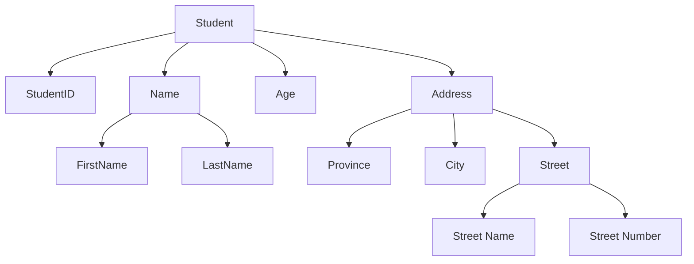
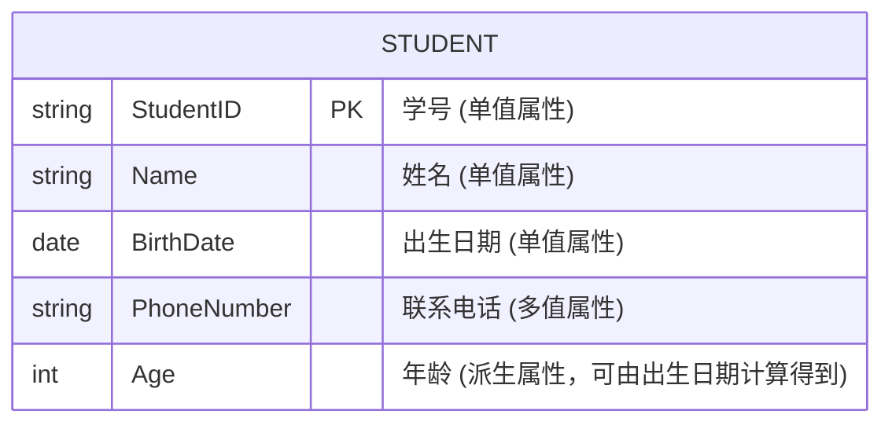
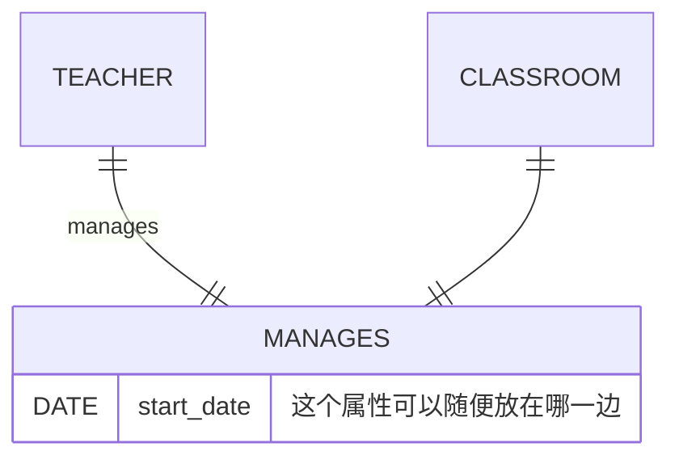
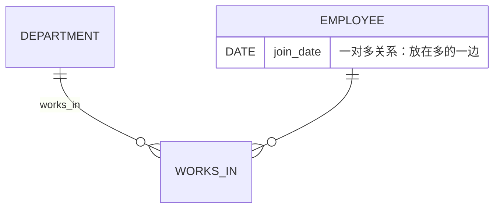
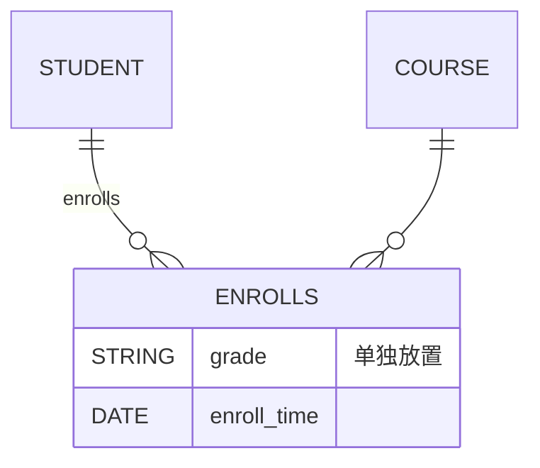

---
title: 数据库原理 课程笔记 (2) E-R 模型和关系模式
url: https://blog.kisechan.space/2025/notes-database-2/
type: post
time: '2026-10-23T15:19:31.963Z'
---

**数据库系列笔记**

点击查看系列汇总：

---

Kisechan 的数据库系列笔记
https://blog.kisechan.space/tags/%E6%95%B0%E6%8D%AE%E5%BA%93/

---

- **数据库原理课程笔记部分**：
  - [数据库原理 课程笔记 (1) 数据库、关系代数和 SQL](https://blog.kisechan.space/2025/notes-database-1/)
  - 数据库原理 课程笔记 (2) E-R 模型和关系模式 【**当前阅读**】
  - [数据库原理 课程笔记 (3) 存储、索引、事务和并发](https://blog.kisechan.space/2025/notes-database-3/)
  - [数据库原理 课程笔记 (4) 杂项和题目整理](https://blog.kisechan.space/2025/notes-database-4/)
- **手搓数据库** (CS346) **部分**：
  - [设计一个数据库引擎 (1) 内存、外存和记录管理](https://blog.kisechan.space/2025/db-engine-1/)
  - [设计一个数据库引擎 (2) 索引](https://blog.kisechan.space/2025/db-engine-2/)
  - [设计一个数据库引擎 (3) SQL 处理](https://blog.kisechan.space/2025/db-engine-3/)
- **Oracle 和 NoSQL 课程部分**：
  - ~~Oracle 的学习使用和环境配置~~
  - [NoSQL 的学习使用和环境配置](https://blog.kisechan.space/2026/nosql/)

## 实体-联系模型

**实体-联系模型** (Entity-Relationship / E-R 模型) 是一种语义建模方法——**以意义/语意为核心**来描述现实世界事物和它们之间关系的方法——力图描述真实世界的含义。

数据库建模则主要包含两方面：

- 实体的联系

- 实体集合

### 概念

- **实体**指的是现实世界中可区别于其他对象的事物或对象。

- **属性**描述实体的性质或特征。实体的每个属性都有一个值。

- **实体集**则表示相同类型或性质的实体集合。

- **联系**指的是多个实体间的相互关联。

- **联系集**则是同类联系的集合。

### 属性

属性分为**简单属性和复合属性**。

- 简单属性不能再分为更小的部分。

  - 如 `StudentID` 。

- 复合属性可以再分，由其他属性组合构成。
  - 如 `Address` 。



- 针对特定的实体，属性只能取单一值的叫**单值属性**。

- 若属性可以对应多个值的叫**多值属性**。

- 若该属性的值可以通过其他属性或派生属性计算或推导得出的叫**派生属性**。



### 映射基数

映射基数 (Mapping Cardinalities) 指的是**一个实体通过联系集能同时联系实体的数量**。

讨论实体集 `A` 和 `B` 之间的二元关系集，有以下几种可能：

- 一对一
- 一对多
- 多对一
- 多对多

```mermaid
erDiagram
    PERSON ||--|| ID_CARD : owns
    DEPARTMENT ||--o{ EMPLOYEE : has
    CLASS ||--o{ STUDENT : includes
    STUDENT }o--o{ COURSE : selects
```

参与约束指的是**一个实体集中的实体是否“必须”参与到某个关系集**中：

- **全部参与**：实体集中的每一个实体都至少参与到联系集中的一个联系。
- **部分参与**：实体集中只有部分实体参与到联系集合的联系中。

### 绘制

符合标准：

|   图形符号   |      表示含义      |                描述说明                |
| :----------: | :----------------: | :------------------------------------: |
|   **矩形**   |       实体集       |  表示一个实体集合，如 Student、Course  |
|  **双矩形**  |      弱实体集      |       没有主键，依赖其他实体存在       |
|   **椭圆**   |        属性        |          表示实体或联系的属性          |
|  **双椭圆**  |      多值属性      | 一个实体可能有多个该属性的值（如电话） |
| **虚线椭圆** |      派生属性      |     可由其他属性计算得出（如年龄）     |
|   **菱形**   |       联系集       |       表示两个或多个实体间的联系       |
|   **线段**   | 属性或联系的连接线 |      连接属性和实体，或实体和联系      |
|   **双线**   |      全部参与      |         表示该实体参与某个关系         |

在联系集和实体集间存在的线段中**用箭头表示关系**，箭头指向的是**一对多或一对一关系中的“一”**。

另一种绘图方式是使用方框型 ER 图，也就是 Mermaid 提供的那一种。

#### 绘图示例


### 设计 ER 模型

#### 使用实体集还是属性 / 联系集

|      判断类型       |                        问题含义                        |
| :-----------------: | :----------------------------------------------------: |
|  **属性 / 实体集**  |   某个信息应该建成一个属性？还是建成一个独立的实体？   |
| **联系集 / 实体集** | 某个“中间对象”是两个实体的关系？还是应该单独建成实体？ |

- 如果信息**简单**、**不参与其他关系** → 用属性

- 如果信息**复杂**、**有结构性**、**可能会被引用或扩展** → 用实体集

- 如果某个“关系”中本身包含**额外信息 / 属性**，或是可以单独管理的内容 → 也可以提升为实体集

#### 联系集的元数和布局

联系集的“元数”指的是一个联系集**涉及的实体集数量**：

|    类型    |                      定义                      |                  举例                  |
| :--------: | :--------------------------------------------: | :------------------------------------: |
| 一元联系集 | 只涉及**一个**实体集（即自己和自己之间自关联） | 员工管理员工（一个员工是另一个的上司） |
| 二元联系集 |               涉及**两个**实体集               |         学生选课、员工属于部门         |
| 多元联系集 |            涉及**三个或以上**实体集            |        医生给病人在某时间开处方        |

布局问题则涉及的是**关系本身的属性**，不属于参与的某一方，而是属于“联系”本身：

| 映射基数类型 |           联系属性放置位置           |            示例            |
| :----------: | :----------------------------------: | :------------------------: |
|  **一对一**  | 放在任意一侧的实体集中（通常选一侧） |  老师负责教室：责任人姓名  |
|  **一对多**  |        放在“多”一侧的实体集中        | 部门管理多个员工：入职时间 |
|  **多对多**  |         放在**联系集本身**中         |    学生选课：成绩、评价    |







#### 强弱实体集

|   概念   |                       定义                       | 是否有主码？ | 是否独立存在？ |
| :------: | :----------------------------------------------: | :----------: | :------------: |
| 强实体集 |  可以**独立存在**的实体，有自己的主属性（主码）  |      是      |       是       |
| 弱实体集 | **依赖于其他实体**才能存在，本身**没有完整主码** |      否      |       否       |

> 例如**学生成绩表**，它与**学生**和**科目**有关，没有自己的主码，是弱实体集。

|    术语    |                                                含义                                                |
| :--------: | :------------------------------------------------------------------------------------------------: |
|   分辨符   | 是弱实体集中的**一组属性**，用来辅助标识其实体，必须依靠它来分辨自己，例如单订单项目中的订单号属性 |
| 标识实体集 |                               强实体集，**提供主码**，帮助标识弱实体                               |
|  识别关系  |                             弱实体集与标识实体集之间的关系（常一对多）                             |

### 扩展 ER 特性

扩展 ER 特性（Extended ER Features, EER）是在基本 ER 模型的基础上，**引入面向对象思想**，来表达更复杂的现实世界结构。

#### 特殊化

特殊化是将一个通用实体集划分为多个更具体的子类实体集的过程。自顶向下。

> 员工是个**超类**，而经理和工程师是**子类**。
>
> ```mermaid
> erDiagram
>     Engineer ||--o{ Employee : "can be"
>     Manager  ||--o{ Employee : "can be"
>
> ```

子类继承超类的属性，也可以拥有自己的属性。

#### 一般化

特殊化的反过程，提取共性。自底向上。

#### 聚集

将**一个联系集和它涉及到的实体集**整体当作一个新的高层实体来使用。

> 将教授-学生-指导打包成一个聚集的实体。
>
> ```mermaid
> graph TB
> subgraph Guides
> Professor --> Student
> end
> Professor --> Project
> Student --> Project
>
> ```

### 转换为关系模式

#### 强实体集

**直接对应一个关系模式**。


#### 弱实体集

**分辨符和关联的强实体集的主码**作为主码，和其他属性一同构成一个关系模式。


#### 联系集

可以参考上文联系集的布局：

|  联系类型  |               转换方式               |
| :--------: | :----------------------------------: |
| **一对一** |      合并到任一实体中或单独建表      |
| **一对多** |            外键加到“多”方            |
| **多对多** | 建一个独立关系表，包含两个外键和属性 |

联系集包含了自身的属性，还需要包含**参与该联系的属性集的主码**：


#### 复合属性

可以为子属性的每一个属性，都建一个单独的属性**合并到父属性中**。


#### 多值属性

单独为它创建一个模式，包括**所属实体集的主码和它自己的属性**。

## 关系模式设计

ER 模型和关系模式一脉相承：

- ER 模型**面向现实世界**，用于建模实际业务数据结构。强调的是实体、属性和关系。
- 关系模式面向计算机实现，用于**逻辑层面**的数据表示，使用**关系**（表）来存储数据。

---

关系数据库的设计中的核心问题就是——如何处理**数据冗余**带来的各种问题。数据冗余指的就是**相同的数据在数据库中被重复存储了多次**。

包括：

- **更新异常**：修改一条记录时，**必须修改多个地方**，否则数据会不一致。

> 学生选课表 `Enrollments` ：
>
> | student_id | student_name | course_id | course_name |
> | :--------: | :----------: | :-------: | :---------: |
> |    1001    |    Alice     |   C101    |    Math     |
> |    1001    |    Alice     |   C102    |   English   |
>
> 现在 Alice 改名成 “Alicia”，我们就得修改 **多行记录中的名字**，漏改会导致数据不一致。

- **插入异常**：想插入一条数据时，由于设计的不好，**必须插入不必要的信息**，否则无法插入。

> 例如选课表中如果要录入 `Physics` 课程，但目前没有人选，所以必须要插入垃圾信息。

- **删除异常**：删除一条数据时，**意外地删除了不该删除的信息**。

> 如果删除 Alice 选修 English 的信息：
>
> ```sql
> DELETE FROM Enrollments WHERE student_id = 1001 AND course_id = C102;
> ```
>
> 因为表中只有这一门 English 课，删除它就会导致我们失去了所有 English 课程的信息。

那么在设计表时，应该选择**更大的表还是更小的表**（模式）？

|            |            特点            |             问题              |
| :--------: | :------------------------: | :---------------------------: |
| 更大的模式 | 一个大表，包含多个实体信息 |        冗余多、异常多         |
| 更小的模式 |  拆分成多个小表（规范化）  | 查询要连接多个表（JOIN 效率） |

- 分解成更小的模式是更好的
- 但是有些分解会带来代价


### 模式分解的目标

|                 目标                 |                             解释                              |
| :----------------------------------: | :-----------------------------------------------------------: |
|         每个子模式都是“好”的         |    拆出来的每个表都不应该有数据冗余或异常（达到某种范式）     |
| 分解是**无损连接的** (Lossless Join) | 多个子表 $\Join$ 回去，**不能丢失原始数据**，也不能多出假数据 |

### 第一范式 (1NF)

一个关系模式如果其**每个属性值都是不可再分的原子值**，那么这个关系模式就满足第一范式[^1] (1NF)。

也就是说表中的每个**单元格**只能存**一个值**，**不能是列表、集合、数组**这类可以再拆分的东西。

[^1]: “范”：模范、规范、标准。“式”：形式、格式。所以在这里范式就是用来规范 **关系型数据库表结构设计** 的一系列**规则和标准** 。

### 函数依赖

在关系模式 $R$ 中，如果两个元组在属性 $A$ 上的值相同，**那么它们在属性 $B$ 上的值也必须相同**——这个依赖关系叫做：$B$ **函数依赖**于 $A$，或记为 $A \rightarrow B$ 。

> | 学号（A） | 姓名（B） |
> | :-------: | :-------: |
> |   1001    |   张三    |
> |   1002    |   李四    |
> |   1001    |   张三    |
>
> 我们可以说：`学号 -> 姓名` 成立，因为只要学号一样，姓名就一定一样（都是张三）。但反过来 `姓名 -> 学号` **不成立**，因为多个学生可能同名。

#### 函数依赖集的闭包

给定函数依赖集 $F$，某个属性集 $X$ 的闭包[^2] $X^+$ 是：在 $F$ 的逻辑蕴含下，可以从 $X$ 推导出的所有属性集合。

[^2]: “闭包”这个词就是“闭合”+“包含”的意味，也就是给定一组起点，所有能“推导”出来的东西，最终形成一个完整的、封闭的集合。

$X^+$ 则可以理解为——从 $X$ 出发，**能推理出的所有一定会相同的属性**。

> 给定关系模式：$R(A, B, C, D)$ 和函数依赖集：$F = \{ A \rightarrow B, B \rightarrow C \}$ ，那我们来求 $A^+$（ $A$ 的闭包）：
>
> 1.  开始闭包：$A^+ = \{A\}$
> 2.  $A \rightarrow B$，加入 $B$ ：$A^+ = \{A, B\}$
> 3.  以此类推加入 $C$ ：$A^+ = \{A, B, C\}$
> 4.  没别的可推了
>
> 所以：$A^+ = \{A, B, C\}$

---

函数依赖可以有以下的作用：

- **设计主码**：一个候选码就是能唯一决定所有其他属性的属性集（即 `候选码 → 所有属性`）

- **做规范化**：通过分析函数依赖决定哪些属性属于哪个表

#### 逻辑蕴含

如果函数依赖集 $F$ 推导出某个依赖 $f$，即所有满足 $F$ 的关系也都满足 $f$，则称：$F$ 逻辑蕴含 $f$，记作 $F \vDash f$ 。

> 给定关系模式：$R(A, B, C, D)$ 和函数依赖集：$F = \{ A \rightarrow B, B \rightarrow C \}$ ，求证：$F$ 逻辑蕴含 $A \rightarrow C$ 。
>
> - 因为 $A \rightarrow B$
> - 且 $B \rightarrow C$
> - 所以 $A \rightarrow C$ （通过**传递律**）
>
> 综上所述，$F \vDash A \rightarrow C$，这个过程也叫 **推导** 或 **逻辑蕴含判断**。

#### Armstrong 公理

Armstrong 公理是三条**用于函数依赖推导的基本规则**，可以用它们来证明某些依赖是否被逻辑蕴含。

|            |                              规则                               |
| :--------: | :-------------------------------------------------------------: |
| **自反律** |           如果 $B \subseteq A$，则 $A \rightarrow B$            |
| **增广律** |        若 $A \rightarrow B$，则 $AC \rightarrow BC$ [^3]        |
| **传递律** | 若 $A \rightarrow B$ 且 $B \rightarrow C$，则 $A \rightarrow C$ |

> 证明 $X \rightarrow Y$ 是否能从 $F$ 推出的一般方式：
>
> 1. 求 $X^+$（在 $F$ 下求闭包）
> 2. 看 $Y \subseteq X^+$ 是否成立
>
> 若成立，则 $F \vDash X \rightarrow Y$ 成立

[^3]: $AC$ 等效于 $A\cup C$。增广律其实是表达：如果你原来知道 $A$ 就能唯一决定 $B$， 那你**多知道点信息** （也就是 $C$ ）也没问题， 你还是能决定 $B$（甚至带上 $C$ 一起决定）。

---

$F$ 是一个函数依赖集， $F$ 蕴含的所有函数依赖的集合称为 $F$ 的闭包，记作 $F^+$ 。

> 给定关系模式：
>
> $$
> R = (A, B, C, G, H, I)
> $$
>
> 给定函数依赖集：
>
> $$
> F = \{ A \rightarrow B,\ A \rightarrow C,\ CG \rightarrow H,\ CG \rightarrow I,\ B \rightarrow H \}
> $$
>
> **推导一：$A \rightarrow H$**
>
> - 已知：$A \rightarrow B$，$B \rightarrow H$
> - 运用传递律：
>   $$
>   A \rightarrow B \rightarrow H \Rightarrow A \rightarrow H
>   $$
>
> ---
>
> **推导二：$CG \rightarrow HI$**
>
> - 已知：$CG \rightarrow H$，$CG \rightarrow I$
> - 可组合为：
>   $$
>   CG \rightarrow HI
>   $$
>
> 也可通过增广推导形式：
>
> - $CG \rightarrow H$ 增广得：$CGCG \rightarrow HCG$
> - 已知 $HCG \rightarrow HI$（通过组合依赖）
> - 运用传递律：
>   $$
>   CGCG \rightarrow HI
>   $$
>
> 但由于本例中 $CG \rightarrow H$ 和 $CG \rightarrow I$ 已知，直接合并即可：
>
> $$
> CG \rightarrow HI
> $$
>
> ---
>
> **推导三：$AG \rightarrow I$**
>
> - 已知：$A \rightarrow C$，因此 $AG \rightarrow CG$（增广律）
> - 已知：$CG \rightarrow I$
> - 运用传递律：
>
> $$
> AG \rightarrow CG \rightarrow I \Rightarrow AG \rightarrow I
> $$

另外还有三条拓展规则：

|              |                                                     规则                                                      |                                                                                                                                解释                                                                                                                                 |
| :----------: | :-----------------------------------------------------------------------------------------------------------: | :-----------------------------------------------------------------------------------------------------------------------------------------------------------------------------------------------------------------------------------------------------------------: |
|  **合并律**  | 若 $\alpha\rightarrow\beta \quad$ 且 $\quad \alpha \rightarrow \gamma$ ，则有 $\alpha\rightarrow\beta\gamma$  | 如果 $\alpha$ 可以分别决定 $\beta$ 和 $\gamma$，**那么它就可以同时决定它们两个**。<br/>利用**增广律**证明 $\alpha\to\alpha\beta$ 且 $\textcolor{green}{\alpha}\textcolor{red}{\beta}\to\textcolor{green}{\gamma}\textcolor{red}{\beta}$ ，则 $\alpha\to\beta\gamma$ |
|  **分解律**  |    若 $\alpha\rightarrow\beta\gamma$ 则 $\alpha\rightarrow\beta\quad$ 且 $\quad \alpha \rightarrow \gamma$    |                                             如果 $\alpha$ 可以决定 $\beta$ 和 $\gamma$，**那它也可以单独决定每一个**。<br/>利用**自反律**证明， $\alpha\rightarrow\textcolor{red}{\beta\gamma\rightarrow\beta}$，证毕。                                             |
| **伪传递律** | 若 $\alpha\rightarrow\beta\quad$ 且 $\quad \gamma\beta\rightarrow \delta$则 $\alpha\gamma \rightarrow \delta$ |                                                                         如果 $\alpha$ 能决定 $\beta$，而 $\gamma$ 和 $\beta$ 能决定 $\delta$，那么 $\alpha$ 和 $\gamma$ 就能决定 $\delta$。                                                                         |

> 给定关系模式：
>
> $$
> R = (A, B, C, G, H, I)
> $$
>
> 函数依赖集：
>
> $$
> F = \{ A \rightarrow B,\ A \rightarrow C,\ CG \rightarrow H,\ CG \rightarrow I,\ B \rightarrow H \}
> $$
>
> ---
>
> **推导 1：$A \rightarrow H$**
>
> - 已知：$A \rightarrow B$，$B \rightarrow H$
> - 运用传递律：
>   $$
>   A \rightarrow B \rightarrow H \Rightarrow A \rightarrow H
>   $$
>
> ---
>
> **推导 2：$CG \rightarrow HI$**
>
> - 已知：$CG \rightarrow H$，$CG \rightarrow I$
> - 运用合并律：
>   $$
>   CG \rightarrow H,\ CG \rightarrow I \Rightarrow CG \rightarrow HI
>   $$
>
> ---
>
> **推导 3：$AG \rightarrow I$**
>
> - 已知：$A \rightarrow C$
> - 构造 $\gamma = G$，$\beta = C$
> - 得到：$AG \rightarrow CG$（增广律）
> - 已知：$CG \rightarrow I$
> - 运用伪传递律：
>
> $$
> A \rightarrow C,\ G \cdot C \rightarrow I \Rightarrow AG \rightarrow I
> $$

### Boyce-Codd 范式 (BCNF)

#### 超码

设关系模式为 $R$，属性集 $K \subseteq R$。若满足：

$$
K \rightarrow R
$$

则称 $K$ 是 $R$ 的一个**超码**。用 $K$ 的值可以**唯一标识**关系中的每一个元组。

#### 候选码

$K$ 是关系模式 $R$ 的一个**候选码**，当且仅当：

1. $K \rightarrow R$ （即 $K$ 是超码）
2. $K$ 是**最小的**（不可再简化），即不存在真子集 $A \subset K$ 满足 $A \rightarrow R$

且满足：

$$
K^+=R\quad\text{且}\quad\forall K^{\prime}\subset K,\:K^{\prime+}\neq R
$$

#### 平凡函数依赖

若函数依赖 $A \rightarrow B$ 中，$B \subseteq A$，则称该依赖为**平凡的**。

> 设关系模式 $R = (\text{学号}, \text{姓名}, \text{班级})$，其中有函数依赖：
>
> - `学号 -> 姓名`
>
> 这个依赖是**不平凡的**，因为：
>
> - `学号` 是决定因素
> - `姓名` 不是 `学号` 的子集
> - 所以这个依赖是非平凡的（不平凡）
>
> 而`学号, 姓名 -> 姓名` 就是平凡的，因为右边的 `姓名` 是左边的子集。

---

关系模式 $R$ 属于 **BCNF**，当且仅当对于每一个非平凡函数依赖：

$$
\alpha \rightarrow \beta
$$

若该依赖在 $R$ 上成立，则：

$$
\alpha \quad\text{是}\quad R \quad\text{ 的超码}
$$

即：BCNF 不允许任何非超码属性决定其他属性，**除非它是候选码或超码**。

#### BCNF 分解

BCNF 范式要求——对于关系 $R$ 中的每一个非平凡函数依赖 $\alpha\rightarrow\beta$ ，**必须满足 $\alpha$ 是 $R$ 的候选码**。如果一个关系模式违背了 BCNF 范式，那就要将它分解。

> 对于关系 `Employee(ID, Name, Dept, Manager)` ，它存在依赖：
>
> - `ID -> Name, Dept, Manager`
>
> - `Dept -> Manager`
>
> 根据候选码的概念（能唯一标识所有属性的最小属性集合），可以看出来：
>
> - `EID` 能唯一标识员工 → 能推出全部信息，是候选码。
>
> - `Dept` 不能唯一标识员工，只能推出 `Manager` ，不是候选码。
>
> 但是发现：
>
> - `Dept -> Manager` 中，`Dept` 不是候选码 → **不符合 BCNF**
> - 因此需要 **BCNF 分解** 为：
>   1.  `DeptManager(Dept, Manager)` — 反映每个部门的管理者
>   2.  `Employee(EID, Name, Dept)` — 员工的基本信息

---

> 对于关系 `Student(SID, Email, Name)` ，存在依赖：
>
> - `SID -> Email, Name`（学号能确定邮箱和姓名）
> - `Email -> SID, Name`（邮箱也能确定学号和姓名）
>
> 所以两者都是候选码：
>
> |      函数依赖       | 是平凡的吗？ | 是候选码？ | 满足 BCNF 吗？ |
> | :-----------------: | :----------: | :--------: | :------------: |
> | `SID → Email, Name` |      否      |     是     |       是       |
> | `Email → SID, Name` |      否      |     是     |       是       |
>
> 这个例子是符合 BCNF 的，所以不需要分解。

BCNF 分解的流程如下：

1. 找出关系中的所有**候选码**
2. 检查所有依赖 $X\rightarrow Y$ 中，是否 $X$ 是候选码
3. 若有违反 BCNF 的依赖，进行分解
4. 构造两个子关系：
   - $R_1=X\cup Y$
   - $R_2=R-Y+X$
   - **也就是在原依赖集中将 $Y$ 移除，让 $X$ 和 $Y$ 重新构建一个子关系**
   - 注意，_双方都保留了_ $X$
5. 递归处理子关系，直到都满足 BCNF

---

通常，**BCNF 分解是无损的分解**[^4]。因为在 BCNF 分解中，每次分解都会保证一个**关键属性**（候选码的某一部分）出现在分解后的关系中。

对于任何违反 BCNF 的关系，我们通过将包含**所有依赖属性的候选码部分**分解成两个新的关系来保证数据的完整性，并且通过它们的自然连接能恢复出原来的关系。

在数据库范式分解过程中，**关系依赖闭包** \( $F^+$ \) 起到了非常重要的作用。具体来说，\( $F^+$ \) 是函数依赖集 \( $F$ \) 的**闭包**，它包含了所有由 \( $F$ \) 推导出来的函数依赖。理解 \( $F^+$ \) 在分解过程中的作用，可以帮助我们保证分解后的子关系不仅满足目标范式（如 BCNF 或 3NF），而且能够确保数据的一致性和无损性。

1. **检查分解后的关系模式的完整性**  
   在对一个关系模式 \( $R$ \) 进行分解时，我们要确保分解后的各个子关系能够保持原始关系的所有依赖。此时，\( $F^+$ \) 就会派上用场。通过计算依赖闭包 \( $F^+$ \)，我们可以确认分解后是否会丢失任何依赖关系，或者是否存在不必要的冗余依赖。
2. **帮助判断分解是否符合目标范式**  
   分解过程中的一个关键目标是确保分解后的子关系满足所要求的范式（如 BCNF 或 3NF）。使用 \( $F^+$ \)，我们可以检查每个子关系是否符合目标范式的定义。具体地说，我们可以验证：
   - 如果一个子关系的函数依赖不满足范式要求（如 BCNF 中要求左边是候选码），我们可以通过计算闭包 \( $F^+$ \) 来识别问题。
3. **确定候选码和分解后的依赖关系**  
   在分解过程中，我们需要确保每个子关系的候选码是可以恢复的，而不是丢失。在使用 \( $F^+$ \) 时，我们可以：
   - 通过计算候选码的闭包，确认每个候选码是否能够唯一标识分解后的子关系。
   - 确保在分解后的关系模式中，候选码不丢失，并且能够通过自然连接 ($\Join$) 恢复出原始关系。
4. **防止生成有损分解**  
   如果不考虑 \( $F^+$ \)，可能会进行有损分解。通过使用闭包，我们可以确保分解是**无损的**。因为 \( $F^+$ \) 能够提供关于属性之间所有可能的依赖信息，如果我们在分解过程中考虑到所有闭包中的依赖关系，我们就能避免因遗漏某些依赖关系而导致有损分解的情况。

[^4]: 有损分解是指分解后的子关系**无法通过自然连接恢复出原始的关系**，意味着数据在分解过程中可能会丢失，或出现不一致的结果。例如关系 $R(A, B, C, D)$ ，存在依赖 $A \to B$ 和 $C \to D$。如果将它们分解成 $R_1(A, B)$ 和 $R_2(C, D)$ 。如果通过自然连接 $R_1$ 和 $R_2$，我们无法恢复原始关系，因为没有交集属性，所以这是**有损分解**。

### 第三范式 (3NF)

给定关系模式 $R$ 和函数依赖集合 $F$，如果 $R$ 的所有非平凡函数依赖 $X \to A$ 都满足以下**至少一个**条件，则称 $R$ 满足 **3NF**：

1. $X \to A$ 是平凡依赖（即 $A \in X$）
2. $X$ 是一个**超码**
3. $A-X$ 是**均属于某个候选码**，但不要求这些属性同属于一个候选码

**注意：超码、候选码都可以不是一个属性**。

#### 3NF 和 BCNF

|   标准   | 要求依赖左部 |     对右部的要求     |
| :------: | :----------: | :------------------: |
| **BCNF** |  必须是超码  |        无要求        |
| **3NF**  | 不是超码也可 | 只要右部在某候选码中 |

所以，比起 BCNF ，3NF 更宽松，允许有用但不规范的依赖存在，可以保持依赖。

|   特性   | BCNF | 3NF |
| :------: | :--: | :-: |
| 无损分解 |  ✅  | ✅  |
| 保持依赖 |  ❌  | ✅  |
| 消除冗余 |  ✅  | ❌  |

3NF 更宽松，允许一定冗余以保留依赖。

**一个满足 3NF 但不满足 BCNF 的例子**

例子来自 [https://blog.csdn.net/qq_31636495/article/details/135537131](https://blog.csdn.net/qq_31636495/article/details/135537131)

$$
R=(ABC)\\ \{AB \to C, C \to B\}
$$

候选码为 $\{(AB), (AC)\}$

- 检查 3NF
- $AB \to C$， $AB$ 在候选码中**满足 3NF**
- $C \to B$， $C$ 在候选码中**满足 3NF**
- $AB \to C$， $AB$ 是超码**满足 BCNF**
- $C \to B$， $C$ **不是超码**，**不满足 BCNF**

#### 保持依赖

设：

- 关系模式为 $R$，函数依赖集为 $F$
- 分解后的关系为 $R_1, R_2, \dots, R_n$
- $F_i$ 是 $F$ 在每个 $R_i$ 上的**投影**

如果：

$$
(F_1 \cup F_2 \cup \dots \cup F_n)^+ = F^+
$$

则称该分解是**保持依赖的**。

> 保持依赖的分解
>
> 对于关系模式 $R = (A, B, C)$ ，和函数依赖集 $F = \{ A \rightarrow B, B \rightarrow C \}$
>
> 候选码是 $A$ ，**这个关系模式不符合 BCNF**，因为$B \rightarrow C$中$B$不是超码。
>
> ---
>
> 我们将其分解为：
>
> - $R_1 = (A, B)$
> - $R_2 = (B, C)$
>
> 对应的函数依赖：
>
> - 在$R_1$上：$A \rightarrow B$
> - 在$R_2$上：$B \rightarrow C$
>
> 这两个依赖可以直接在两个表中检查，而且：
>
> $$
> \{ A \rightarrow B, B \rightarrow C \}^+ = F^+
> $$
>
> 因此，这个分解是：
>
> - 无损的（满足连接恢复原始关系）
> - 保持依赖的
>
> ---
>
> 仍然使用关系$R = (A, B, C)$，函数依赖集$F = \{ A \rightarrow B, B \rightarrow C \}$
>
> 我们尝试另一个分解：
>
> - $R_1 = (A, C)$
> - $R_2 = (A, B)$
>
> 现在：
>
> - 在$R_1$中，无法检测$B \rightarrow C$
> - 在$R_2$中也无法检测$B \rightarrow C$
>
> 因此，$B \rightarrow C$这个依赖丢失了，不能直接验证，只有在 `join `后才能恢复。
>
> 这就属于：**不保持依赖**的分解。

---

判定保持依赖有两个方法：

- 标准做法，**基于闭包**：

```text
计算 F+；
对每个分解后的关系 Ri：
    计算 Fi := F+ 在 Ri 上的限制（只保留依赖 α->β 中 α∪β ⊆ Ri）；
F' = ∅；
对每个限定 Fi：
    把 Fi 加入 F' 中；
计算 F'+；
如果 F'+ == F+，说明分解保持依赖，返回 true；
否则，返回 false；
```

- 简化做法，**基于传播法**：

```text
对于每个 α->β in F:
    result = α
    while result 发生变化:
        对每个 Ri:
            t = (result ∩ Ri)+ 在 Ri 上的闭包 ∩ Ri
            result = result ∪ t
    若 β ⊆ result，说明该依赖可以在分解中恢复；
    否则，说明该依赖丢失；
```

> 对于关系模式：
>
> $$
> R = (A, B, C)
> $$
>
> 和函数依赖集：
>
> $$
> F = \{A \to B, B \to C\}
> $$
>
> 假设分解方案为：
>
> $$
> R_1 = (A, B), \quad R_2 = (A, C)
> $$
>
> ---
>
> **方法一：闭包法**
>
> 1. 步骤 1：求 $F^+$
>
> $$
> F^+ = \{A \to B, B \to C, A \to C\}
> $$
>
> 2. 步骤 2：求每个 $F_i$
>
> - 在 $R_1 = (A, B)$ 上：
>
>   $$
>   F_1 = \{A \to B\}
>   $$
>
> - 在 $R_2 = (A, C)$ 上：
>   $$
>   F_2 = \{A \to C\}
>   $$
>
> 3. 步骤 3：合并 $F_i$
>
> $$
> F' = F_1 \cup F_2 = \{A \to B, A \to C\}
> $$
>
> 4. 步骤 4：计算 $F'^+$
>
> $$
> F'^+ = \{A \to B, A \to C\}
> $$
>
> 5. 步骤 5：比较 $F^+$ 与 $F'^+$
>
> $$
> F^+ \neq F'^+ \quad \Rightarrow \quad \text{不保持依赖（缺少 } B \to C\text{）}
> $$
>
> ---
>
> **方法二：简易传播法**
>
> 1. 对 $A \to B$
>
> - $\text{result} = \{A\}$
> - 在 $R_1$: $A \to B$ ⟹ $\text{result} = \{A, B\}$
> - 在 $R_2$: 没有变化
> - 故 $B \subseteq \text{result}$
>
> ---
>
> 2. 对 $B \to C$
>
> - $\text{result}= \{B\}$
> - 在 $R_1$: 无法推出 $C$
> - 在 $R_2$: $B \notin R_2$，无法操作
> - 故 $C \not\subseteq \text{result}$
>
> ---
>
> 3. 对 $A \to C$
>
> - $\text{result}= \{A\}$
> - 在 $R_1$: 无变化
> - 在 $R_2$: $A \to C$ ⟹ $\text{result}= \{A, C\}$
> - $C \subseteq \text{result}$
>
> ---
>
> **结论**：
>
> - **闭包法判断**：不保持依赖（丢失 $B \to C$）
> - **简易传播法判断**：不保持依赖（$B \to C$ 无法恢复）

---

BCNF 分解**不一定能做到保持依赖**：

- BCNF 强调的是消除所有非平凡的函数依赖中，左边不是超码的情况。
- 但在分解过程中，可能**无法将所有函数依赖保留在某一个分解后的子关系中**，因此部分依赖“丢失”，即分解不保持依赖。

> 对于 $R = (A, B, C)$，$F = {A \to B, B \to C}$，候选码是 $A$ ，但 $B \to C$ 左边 $B$ 不是候选码，违反 BCNF ，所以需要分解。
>
> ---
>
> **分解方案一**（保持依赖的）：
>
> - $R_1 = (A, B)$，$R_2 = (B, C)$
> - 无损连接成立（$R_1 \cap R_2 = {B}, B \to C$ 存在于 $R_2$）
> - 所有依赖 $A \to B, B \to C$ 均能在子关系中找到
> - **保持依赖**
>
> ---
>
> **分解方案二**（不保持依赖的）：
>
> - $R_1 = (A, B)$，$R_2 = (A, C)$
> - $B \to C$ 在任何一个分解中都 **不完整存在**
> - 所以无法检测出 $B \to C$
> - **不保持依赖**

如果一个关系模式 $R$ 满足函数依赖集 $F$，如果 $F^+$ 中的每个函数依赖 $\alpha \to \beta$ 都满足下列至少一个条件，则 $R$ 是 **第三范式**（3NF） 的：

1. $\alpha \to \beta$ 是 **平凡函数依赖**（即 $\beta \subseteq \alpha$）
2. $\alpha$ 是 $R$ 的 **超码**
3. $\beta - \alpha$ 中的每个属性都包含在某个 **候选码** 中（可以是不同的候选码）

> 设关系 $R = (A, B, C)$，函数依赖 $F = {A \to B, B \to C}$，候选码为 $A$。
>
> - $A \to B$：左边 $A$ 是候选码，满足条件 2
> - $B \to C$：$B$ 不是超码，也不是候选码，但 $C$ 在候选码 $A$ 中不出现
>
> → 所以 $R$ **不满足 3NF**
>
> 如果改为：
>
> - 候选码是 $A$ 且 $C$ 属于候选码中
> - 或 $B$ 是候选码之一
>   → 则可能属于 3NF

因为候选码可能有指数级的多种组合，判断某个关系是否满足 3NF 是一个 **NP-hard** 问题。

#### 正则覆盖

函数依赖集 $F$ 的正则覆盖 $F_c$ 是一个与 $F$ 等价（**闭包相同**） 的最小集合，去除了所有**冗余的部分**：

1. 如果从某个依赖中**移除一个属性，结果依赖集闭包不变** → 这个属性是**无关属性**
2. 如果**整个依赖可以由其他依赖推导出来** → 是**冗余依赖**

所以，正则覆盖满足：

- $F$ 逻辑蕴含 $F_c$ 中的所有依赖
- $F_c$ 逻辑蕴含 $F$ 中的所有依赖
- $F_c$ 中的**所有依赖都不包含无关属性**
- $F_c$ 中的函数依赖，左半部分都是唯一的

正则覆盖**不是唯一的**。

---

计算正则覆盖的流程是：

1. **将右侧分解为单属性**，例如 $A\to BC$ 分解成 $A\to B$ 和 $A\to C$
   - 初始化一个空函数依赖 $F=\emptyset$
   - 遍历所有函数依赖，如果右侧是单属性，就直接放进去；否则分解了再放
2. **使左侧最小化**，例如 $AB\to C$ 和 $B\to C$ 都成立，则简化为 $B\to C$
   - 遍历得到的所有函数依赖
   - 临时去掉一个左侧的属性
   - 如果没有影响，则它是个冗余，并将去除后的函数依赖放进集合更新
   - 重复该过程
3. **去掉所有可被推导的冗余依赖**，例如 $A\to B$、 $B\to C$ 和 $A\to C$ 都在依赖集中，则去掉 $A\to C$
   - 遍历得到的所有函数依赖
   - 临时去掉一个函数依赖
   - 如果没有影响，则它是个冗余，去掉它
   - 重复该过程

#### 3NF 分解

3NF 要求将关系分解为满足 3NF 的多个子模式，同时满足：

1. 保持函数依赖
2. 无损连接性

**分解流程**：

- **输入**：关系模式 $R$ 和函数依赖集 $F$
- **输出**：一组满足 3NF 的关系模式

1. 求 $F$ 的**最小正则覆盖集 $F_c$**（右边单属性，去掉冗余依赖/属性）
2. 初始化关系集合 $\{R_1, R_2, \dots, R_i\} = \emptyset$
3. 对于 $F_c$ 中的每一个依赖 $X \rightarrow A$，**如果还没有包含 $X \cup \{A\}$ 的关系，则新增一个关系 $R_i = (X \cup \{A\})$**
4. 最后，**如果没有任何关系包含候选码，则需要加上一个含有任意候选码的关系**，以保证无损连接
5. _可选：移除冗余关系模式_
   - 比如 $R_j = \{A, B\}$，而 $R_k = \{A, B, C\}$，就可以去掉前者
   - 这个操作有可能破坏依赖性

> 原始关系：
>
> ```pseudocode
> R(customer_id, employee_id, branch_name, type)
> F = {
>   customer_id, employee_id → branch_name, type
>   employee_id → branch_name
>   customer_id, branch_name → employee_id
> }
> ```
>
> 观察发现 `branch_name` 冗余（能由 `employee_id` 推出），可重写为：
>
> ```pseudocode
> F = {
>   customer_id, employee_id → type
>   employee_id → branch_name
>   customer_id, branch_name → employee_id
> }
> ```
>
> 使用 3NF 综合算法得出的模式之一：
>
> ```pseudocode
> R1(customer_id, employee_id, type)
> R2(employee_id, branch_name)
> R3(customer_id, branch_name, employee_id)
> ```
>
> 或另一种版本（**算法对输入顺序敏感**）：
>
> ```pseudocode
> R1(customer_id, employee_id, type)
> R2(customer_id, branch_name, employee_id)
> ```

---

3NF 是**允许冗余**的。

> 关系：
>
> ```pseudocode
> R(J, K, L), F = {JK → L, L → K}
> 候选码：JK, JL
> ```
>
> - $JK \to L$ 中，$JK$ 是候选码 → 满足 3NF
> - $L \to K$ 中，$K$ 是主属性（属于 $JK$）→ 满足 3NF
>
> → $R$ 满足 $3NF$，但仍有**冗余数据**（即多个 $J$ 对应同一个 $L$、$K$）

### 第四范式 (4NF)

当同一个主属性关联多个不相干的多值属性时，会导致**冗余和更新异常**。

**多值依赖** (MVD) 是指在一个关系 $R(A, B, C)$ 中，**如果属性 $A$ 的一个值可以确定 $B$ 的一组值**，那么我们就说 $B$ 对 $A$ 存在多值依赖。记作：

$$
A \to \to B
$$

**第四范式**要求：关系 $R$ 中，任一多值依赖 $A \to\to B$ 必须满足：

- 要么是**平凡的**（即 $B \subseteq A$，或 $A \cup B = R$）
- 要么 **$A$ 是 $R$ 的超码**

#### 4NF 分解

1. 计算 MVD 的闭包 $D^+$
2. 遍历每个关系 $R_i$：

   - 若存在 $A \to\to B \in D^+$，且不满足 4NF 条件，则将 $R_i$ 拆为 $(A, B)$、$(A, R_i - B)$

3. 递归直到所有关系满足 4NF

> 关系 $R = (A, B, C, G, H, I)$
> 依赖：$\{A \to\to B, B \to\to HI, CG \to\to H\}$
>
> - $A$ 不是超码 → 拆：$R_1 = (A, B), R_2 = (A, C, G, H, I)$
> - $CG$ 不是 $R_2$ 的超码 → 拆：$R3 = (C, G, H), R_4 = (A, C, G, I)$
> - $A \to\to I$ 仍未满足 4NF → 拆：$R_5 = (A, I), R_6 = (A, C, G)$
>
> 最终得到：
>
> ```pseudocode
> R1(A, B)
> R3(C, G, H)
> R5(A, I)
> R6(A, C, G)
> ```

### 第五范式 (5NF) 与连接依赖

5NF 旨在处理因**多表自然连接后产生冗余数据**的问题。

$R$ 满足 $R = R1 \Join R2 \Join \dots \Join Rn$，则称其满足**连接依赖**。

如果关系在**任意自然连接下都不引入冗余**，即满足 5NF（也称 PJNF）。

5NF 只在存在**三表及以上的连接依赖**时才有意义，且判定复杂。

### DK/NF（域-码范式）

要求：

- 所有约束必须是**域约束或码约束**的逻辑结果
- 是**最强的范式**

## 参考和注解
