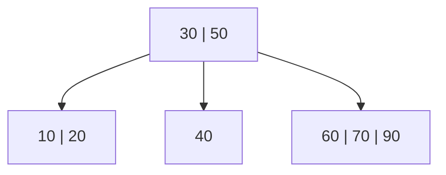
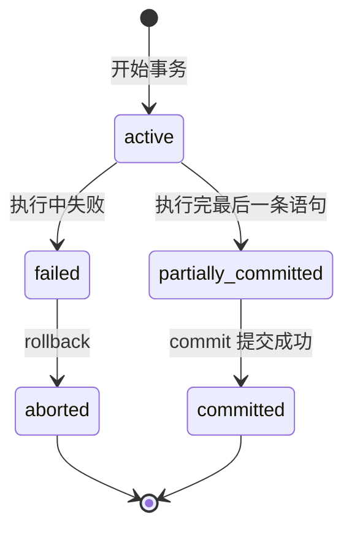

---
title: 数据库原理 课程笔记 (3) 存储、索引、事务和并发
url: https://blog.kisechan.space/2025/notes-database-3/
type: post
time: '2026-10-21T16:02:14.153Z'
---

**数据库系列笔记**

点击查看系列汇总：

---

Kisechan 的数据库系列笔记
https://blog.kisechan.space/tags/%E6%95%B0%E6%8D%AE%E5%BA%93/

---

- **数据库原理课程笔记部分**：
  - [数据库原理 课程笔记 (1) 数据库、关系代数和 SQL](https://blog.kisechan.space/2025/notes-database-1/)
  - [数据库原理 课程笔记 (2) E-R 模型和关系模式](https://blog.kisechan.space/2025/notes-database-2/)
  - 数据库原理 课程笔记 (3) 存储、索引、事务和并发【**当前阅读**】
  - [数据库原理 课程笔记 (4) 杂项和题目整理](https://blog.kisechan.space/2025/notes-database-4/)
- **手搓数据库** (CS346) **部分**：
  - [设计一个数据库引擎 (1) 内存、外存和记录管理](https://blog.kisechan.space/2025/db-engine-1/)
  - [设计一个数据库引擎 (2) 索引](https://blog.kisechan.space/2025/db-engine-2/)
  - [设计一个数据库引擎 (3) SQL 处理](https://blog.kisechan.space/2025/db-engine-3/)
- **Oracle 和 NoSQL 课程部分**：
  - ~~Oracle 的学习使用和环境配置~~
  - [NoSQL 的学习使用和环境配置](https://blog.kisechan.space/2026/nosql/)

## 存储与文件

### 物理存储介质

1. **高速缓冲存储器**（**Cache**）：位于CPU和主存之间。

   - 速度**非常快**，比主存快得多；

   - **成本高**，容量小；

   - 用于**暂存**最常用的数据，减少CPU访问主存的次数。

2. **主存储器**：也叫内存（RAM）。CPU可以**直接访问**，按地址来读取和写入数据。
   - **易失性**：断电数据就会消失。

3. **快闪存储器**（Flash）：一种**非易失性**存储器，断电也不会丢失数据（如SSD就用的是 Flash），相比 RAM 写入速度慢，但比磁盘快很多。
4. **磁盘存储器**：传统硬盘属于这一类，**可以随机访问**，不需要按顺序。常用于数据库的在线数据存储。
5. **光学存储器**：如CD、DVD，通常是**只读**或**少次写、多次读**。
6. **磁带存储器**：只支持**顺序访问**，需要按顺序读写，速度慢，但**成本低、容量大**；常用于**备份和归档**数据。

#### 三级存储结构

这是一个将存储设备分级以兼顾**速度与成本**的体系：

|    存储级别    |                           说明                           |
| :------------: | :------------------------------------------------------: |
|  **基本存储**  |  最靠近CPU，如 Cache 和主存，速度最快，但价格高，容量小  |
|  **辅助存储**  | 如硬盘、SSD，是**在线存储**，容量大，成本适中，速度中等  |
| **第三级存储** | 如磁带、光盘，是**离线存储**，访问慢但成本低，多用于备份 |

#### 磁盘存储器的结构与性能

磁盘的基本构成是：

- **盘片**：有多个圆盘堆叠在一起；
- **磁道**：每个盘面按同心圆划分的环；
- **扇区**：磁道再细分的部分，是最小存储单位；
- **柱面**：多个盘片在同一位置的磁道组合。

计算机通过**磁头号 + 柱面号 + 扇区号**定位具体数据。

---

**磁盘的性能指标**：

- **访问时间** = **寻道时间**（磁头移动）+ **旋转等待时间**（盘片转到正确位置）
  - 平均寻道时间：磁头移动到目标轨道的平均时间；
  - 平均旋转延迟：盘片转到目标扇区的平均时间。
- **数据传输率**：读取/写入数据的速度；
- **平均故障间隔时间**：衡量磁盘可靠性

#### RAID

RAID（冗余独立磁盘阵列）是一种把多个硬盘组成阵列，以**提高性能**和**增强可靠性**的技术。 RAID 的三大目标是：

1. **扩大容量**（多个硬盘组合成一个大空间）；
2. **提高性能**（多个硬盘**并行读写**，更快）；
3. **提高可靠性**（通过**冗余**来防故障）。

---

RAID 的关键技术：

- **Striping**（数据条带化）：
  - **比特级**：一个字节的每个位分开存储；
  - **块级**：一个文件按块拆分，每块存在不同硬盘中。
- **冗余信息**：

  - **校验位/奇偶校验**、**备份**、**纠错码**等。

|          等级          |                                        特点与应用                                        |
| :--------------------: | :--------------------------------------------------------------------------------------: |
|       **RAID 0**       | 条带化存储，不提供容错，只提升性能。容量为所有硬盘之和。适合不要求数据安全的高性能场景。 |
|       **RAID 1**       |      镜像存储，两个盘存一份数据，**容错强但容量减半**。适合对数据安全要求高的应用。      |
| **RAID 1+0 (RAID 10)** |                 结合 RAID 0 和 RAID 1，既有高性能也有高容错。成本较高。                  |
|       **RAID 2**       |                        使用纠错码（ECC），较复杂，实际应用很少。                         |
|       **RAID 3**       |          有一块专门的盘用于**奇偶校验**，其他盘并行存数据。缺点是校验盘压力大。          |
|       **RAID 4**       |               块级条带化+一块校验盘。比RAID3更灵活，但同样校验盘成为瓶颈。               |
|       **RAID 5**       | 把**校验信息分布在所有磁盘上**，解决RAID 4的瓶颈问题，性能和容错都不错，是最常用的类型。 |
|       **RAID 6**       |           比RAID 5多一个校验位，能容忍同时两个磁盘故障，安全性更高，性能略低。           |

### 缓冲区

缓冲区是**主存中的一块内存区域**，用来**临时存储从磁盘中读取的磁盘块副本**。它是数据库系统中用来缓解 CPU 与磁盘间速度差异的重要机制。

**磁盘访问慢**（毫秒级），**主存访问快**（纳秒级）， **CPU 更快**，因此使用缓冲区提高整体效率。

---

数据库系统中缓存块的使用基于程序的**局部性原理**，包括：

- **时间局部性**：最近访问过的数据块**很可能会再次被访问**。
- **空间局部性**：某个块被访问后，它附近的块也**很可能马上会被访问**。

这两个特性是设计缓存策略的理论基础。

#### 缓存替换策略

1. LRU（Least Recently Used）策略

   - 替换**最近最久未使用的块**。

   - 假设旧数据不再需要，而新数据更有可能被再次访问

2. MRU（Most Recently Used）策略

   - 替换**最近使用过的块**。
   - 假设最近访问的块已经使用完了，**接下来不再需要**（某些特殊场景适用）。

---

**被钉住的块**指的是**正在被使用或更新**的缓存块，在未完成写操作或事务提交前，这些块**不能被替换或写回磁盘**，防止数据丢失。

即使缓冲区空间够用，也**必须立即将某些块写回磁盘**，这叫做**块的强制写出**。这通常发生在：

- 事务提交时（保证持久性）
- 系统恢复日志要求时

### 文件组织

数据库中的数据保存在**多个文件**中，每个文件由**记录组成**。

- 一个文件可能对应一个或多个关系（表）。

每条记录包含若干字段，可分为：

- **定长记录**：每条记录大小固定。
  - 优点：容易定位第 $n$ 条记录。
  - 缺点：空间浪费，尤其是对变长字段。
- **变长记录**：含有**变长字段**或**重复字段**。常用结构：* **变长属性方法**：字段长度+字段值。* **分槽页结构**（Slotted-page Structure）：页头维护槽表，每个槽存放记录的指针。

可以用**空闲列表**跟踪文件中**未被占用或已删除记录的位置**，方便快速复用。

#### 文件记录组织类型

数据库文件内部可以按以下方式组织记录：

1. **堆文件**：**无特定顺序**，新增记录直接放入可用位置，插入快，但查询效率较低。
2. **顺序文件**：记录按照**某个搜索码（如主键）排序**。查询高效，但插入/删除复杂。
3. **散列文件**：使用**哈希函数**定位记录存储位置，查询某条记录极快，但不适合范围查询。

#### 多表聚类文件

将多个相关的关系（表）**物理上存储在同一个文件中**，以提高联合查询效率。

- **优点**：如果你经常要同时查询客户与其账户信息，会非常高效。

- **缺点**：不方便对单独表进行查询、更新等操作。

#### 数据字典

又称为 **元数据存储结构**，保存“关于数据的数据”。

数据字典是数据库系统中的特殊文件或表，用来描述数据库结构、用户信息、权限、视图、索引等。

主要类型有：

|         类型         |                   描述                   |
| :------------------: | :--------------------------------------: |
| `Relation metadata`  |  表的名称、属性数量、存储方式、位置等。  |
| `Attribute metadata` |  字段名、所属关系、类型、位置、长度等。  |
|   `User metadata`    |     用户名、加密密码、用户组等信息。     |
|   `Index metadata`   | 索引名、索引对应关系、类型、索引字段等。 |
|   `View metadata`    |          视图名称、定义语句等。          |

## 索引和散列

**索引**类似于目录，用于加快数据在数据库中的查找速度。

**搜索码**用于构建索引的属性或属性集，常用于查询条件中。

### 顺序索引

顺序索引**按搜索码的值排序组织索引项**，一般用 **B+ 树**实现。常用于范围查询（如`balance > 500`）。

1. **稠密索引**：每一个搜索码值都有对应的索引项。

   - 优点：查询精确、高效。

   - 缺点：空间占用大。

2. **稀疏索引**：仅对部分搜索码建立索引项（通常每页一个）。稀疏索引常用于多级索引、聚集索引场景。

   - 优点：节省空间。

   - 缺点：访问速度略慢。

3. **聚集索引**：记录在数据文件中按搜索码[^1]的顺序进行物理排列。
   - 只允许一个聚集索引。
   - 也称**主索引**。

[^1]: 这个情况下，**搜索码就是表的物理排序方式**，很多数据库如 MySQL 等默认是把主键作为物理排列的依据。

4. **非聚集索引**：记录不按搜索码顺序排列。
   - 可以有多个。
   - 也称**辅助索引**。

---

为解决单层索引太大、无法一次性加载到内存的问题，发明了**多级索引**。多级索引是**稀疏索引**的进一步扩展，可以分为：

- 磁道级
- 柱面级
- 磁盘级

可以提高查找效率，类似分层管理。

#### B 树和 B+ 树

B 树和 B+ 树是顺序索引的实现方式。

---

**B 树**是一种**自平衡的多路搜索树**，它所有节点都有多个分支，所有键值都**存储在内部结点或叶子结点**，适合用在磁盘/数据库中，减少磁盘访问次数。

$m$ 阶 B 树每个节点最多 $m$ 个孩子，每个节点有 $k\in [\lceil m/2\rceil,m-1]$ 个关键字。内外节点都有数据。

B 树的所有叶子节点在同一层。



---

**B+ 树**是 B 树的**变种**，改进如下：

- **所有数据项[^2]只保存在叶子结点**
- 内部节点只作为路由索引，**不存储实际数据**
- 叶子结点之间使用**链表相连**，方便范围查找

B+ 树的所有关键字都出现在叶子结点，内部节点只存**索引**。所有叶子节点构成一个有序链表，**范围查询非常快**。查询路径长度更均衡，**查询时间更稳定**；插入删除代价更小（节点分裂只影响叶子或少数节点）。

[^2]: 数据项是指数据库中可以被事务访问（读/写）的最小单位。取决于粒度大小的设置，它可以是一张表、一条记录乃至于一个字段。在下面并发控制其实涉及用的更多。

> ```mermaid
> graph TD
>     A["30 | 50"] --> B["10 | 20"]
>     A --> C["30 | 40"]
>     A --> D["50 | 60 | 70"]
>
>     subgraph Leaf Nodes
>         B -..-> C -..-> D
>     end
> ```
>
> - `A` 是根节点（索引用）
>
> - `B`、`C`、`D` 是叶子结点，**数据全部存于此**
>
> - `B`、`C`、`D` 构成链表，**方便范围查找**

---

字符串可以作为搜索码参与建立 **顺序索引** 或 **B+树索引**。但因为字符串**变长、占空间大、跨扇区**，所以需要对**字符串索引**进行额外优化：

- **前缀压缩**：只存搜索码的公共前缀，节省空间，适合在 B+ 树节点中应用。

- **前缀划分子树**：如果字符串前缀相同，可以分为两棵子树（类似 Trie 树优化），减少重复比较。

> 例如对于 `search key` 为姓氏：
>
> ```
> Anderson, Andrews, Andy, Bailey, Brown, ...
> ```
>
> 可将 `And` 提取为前缀索引，加快定位。

---

如果搜索码不是单一属性，而是**由多个属性组合形成的**，那么就叫做**多码索引**，常用于**多条件查询优化**。

但局限性在于复合键的比较顺序很重要：如 `(a, b)` 构建的索引可以处理 `a=... and b=...`，但不能反过来只查 `b`。不满足组合顺序就无法走索引。

> 例如对于复合搜索码 `(branch_name, balance)`：
>
> ```sql
> -- 可用索引
> SELECT * FROM account WHERE branch_name = 'Perryridge' AND balance < 1000;
>
> -- 不可用（balance在前）
> SELECT * FROM account WHERE balance = 1000;
> ```

---

B+ 树索引的**叶子节点通常只保存搜索码和指向数据的指针**，**覆盖索引**在叶子节点**额外加入其他字段的值**，可以直接满足查询而**无需访问原始数据表**。优点在于：

- 查询更快，尤其是**只查某几个字段**时
- 非聚集索引性能接近聚集索引

> 例如查询：
>
> ```sql
> SELECT branch_name, balance FROM account WHERE branch_name = 'Perryridge';
> ```
>
> 如果 `branch_name` 是非聚集索引，且覆盖索引包含 `balance` 字段，就**不需要回表**。

---

在 B+ 树组织下，**叶子节点存数据**或**指向数据的指针**。若原始数据因插入/删除而移动（如页分裂），辅助索引中的指针就会**失效**。这就是**辅助索引的记录重定位问题**，是非聚集索引 / B+ 树文件组织中面临的挑战。

解决方案就是：

- 辅助索引只保存主键（主索引搜索码），不直接保存物理指针。
- 查询过程变为：**辅助索引 → 主键 → 聚集索引 → 数据记录**

### 哈希索引

**散列索引**，或者叫**哈希索引**的体系和用 B+ 树实现的顺序索引不同，是另一种索引机制。

|                  |     哈希索引      |       B+ 树索引        |
| :--------------: | :---------------: | :--------------------: |
|   **范围查询**   |      不支持       |      支持（有序）      |
| **精确匹配效率** |       极高        |   高（但略逊于哈希）   |
|  **插入/删除**   | 动态哈希可自适应  |  插入/删除有一定代价   |
|     **结构**     | 基于桶 + 哈希函数 | 基于多路平衡树（有序） |
| **索引维护成本** | 静态高 / 动态较低 |    较高（平衡维护）    |

> 哈希索引适合**精确等值查询**（例如 `WHERE id = 123`）， B+ 树更适合**范围查询**（例如 `WHERE id > 100 AND id < 200`）。

散列索引不是“文件组织结构”本身，而是对文件的**辅助访问结构**。

- 每个索引项 = `(搜索码, 指针)` 组成。
- 搜索码通过哈希函数映射到某个桶。
- 哈希索引可以是主索引（搜索码是主键），也可以是辅助索引（搜索码是普通字段）。

#### 静态散列

静态散列的核心组件是桶和哈希函数：

- **桶**：存储记录的磁盘块，通常一个桶对应一个磁盘页。
- **哈希函数** `h(k)`：将搜索码 `k` 映射为桶号 `b`，即 `h: K → B`。
  - 一般要求 **均匀分布**，避免聚集到某些桶。

> 例如对字符串 `branch_name` 使用散列函数：
>
> $$
> h(s) = (s[0]×31^{n-1} + s[1]×31^{n-2} +\do\text{TS} + s[n-1]) \mod 10
> $$
>
> - 结果是桶号 $0$ ~ $9$。
> - 每个桶中存储对应记录。

---

如果在桶已满时插入新的记录，会导致空间不足，产生**桶溢出问题**。原因有二：

1. **桶不足**：总桶数过少。
2. **桶偏斜**：哈希函数分布不均匀，导致某些桶过度填充。

解决方案：**溢出桶**，即附加一个新桶，通过**溢出链表**链接，插入时顺着链表找可用空间。缺点是**链表太长会降低查询效率**。

#### 动态散列

为了解决静态散列扩展困难的问题，**动态散列**允许哈希表随数据量增长而扩展，有两种实现方法：

1. **可扩展散列**

- 用**目录表**代替固定桶数。
- 桶分裂时只改变目录，不重建全表。
- 目录大小 = $2^d$，其中 $d$ 为全局深度。

2. **线性散列**

- 有规律地按顺序分裂桶，称为**渐进式扩展**。
- 控制哈希函数版本，自动切换 `h(k)` 到 `h'(k)`。

#### SQL 的索引语句

SQL 提供了索引语句，与实现无关。

```sql
CREATE INDEX index_name ON table_name (attribute_list);
```

索引具体是采用 B+ 树、哈希还是其他结构由数据库系统决定，例如：

|    数据库    |            默认索引类型            |
| :----------: | :--------------------------------: |
| MySQL InnoDB |                B+树                |
|  PostgreSQL  | B+树（默认），支持 Hash、GIN、GiST |
|  SQL Server  |                B+树                |

```sql
-- 创建普通索引（非唯一）
CREATE INDEX branch_index ON branch(branch_name);

-- 创建唯一索引（候选码）
CREATE UNIQUE INDEX branch_index ON branch(branch_name);

-- 删除索引
DROP INDEX branch_index;
```

## 事务

事务是对数据库的一组操作，**要么全部执行，要么全部不执行**。

关于事务的相关其他内容在[先前的笔记](https://blog.kisechan.space/2025/notes-database-1/#%E4%BA%8B%E5%8A%A1)也出现过。

**重点：ACID 特性**

| 特性                     | 含义                                   | 通俗解释                                     |
| ------------------------ | -------------------------------------- | -------------------------------------------- |
| 原子性 (**A**tomicity)   | 操作不可分割，要么都执行，要么都不执行 | 类似“转账”必须扣钱+加钱一起完成              |
| 一致性 (**C**onsistency) | 执行事务前后数据库应保持一致性约束     | 数据不能因事务而出错，如A账户和B账户总额不变 |
| 隔离性 (**I**solation)   | 多事务并发执行互不影响                 | 多人同时转账时不会互相干扰                   |
| 持久性 (**D**urability)  | 事务一旦提交，对数据库的修改是永久的   | 突然断电，数据仍然不会丢失                   |


### 事务的状态和转移

事务的生命周期：



- `active`：事务正在执行中
- `partially committed`：事务逻辑执行完毕，等待提交
- `committed`：成功完成事务，变更写入磁盘
- `failed`：事务执行中出现错误
- `aborted`：事务中止，数据回滚恢复原状

|   操作   |      控制语法       |
| :------: | :-----------------: |
| 开始事务 | `BEGIN TRANSACTION` |
| 提交事务 |      `COMMIT`       |
| 回滚事务 |     `ROLLBACK`      |

### 事务和并发

**并发**允许多个**事务**同时执行，可以有效提高资源利用率和吞吐量，缩短响应时间。

事务是处理逻辑的单位，而并发是调度这些单位的方式。

相应地，它的缺点是多事务间冲突（读写冲突）可能**破坏数据库一致性**。在并发执行多个事务时，事务的读写操作可能交错执行，这可能会导致中间状态被另一个事务看见或依赖。

|    并发问题    |                          描述                          |                      一致性问题                       |
| :------------: | :----------------------------------------------------: | :---------------------------------------------------: |
|    **脏读**    |           $T_2$ 读取了 $T_1$ 尚未提交的数据            | 如果 $T_1$ 回滚，$T_2$ 基于无效数据继续计算，造成错误 |
| **不可重复读** |       $T_1$ 两次读取 $X$，$T_2$ 在中间修改了 $X$       | $T_1$ 在同一个事务中看到两个不同值，可能违背业务规则  |
|    **幻读**    | $T_1$ 读取了满足某条件的记录，$T_2$ 在中间插入了新记录 |     $T_1$ 的操作范围发生变化，可能导致不一致处理      |

#### 可串行化

对**并发调度是否安全的判断**就叫做**可串行化**。

对于一个并发调度（多个事务交叉执行），如果它的执行效果**等价于某个事务串行调度的结果**，那么这个调度是可串行化的。[^3]

[^3]: 多个事务交叉执行的调度是**并发调度**；而所有事务一个接一个地执行，不交叉的调度就是**串行调度**。

通常用**冲突可串行化**来判断一个调度是否安全。调度 $S_1$ 和 $S_2$ 被称为**冲突等价**，如果满足：

- 它们包含**相同的操作集**
- 每对**冲突操作**在两个调度中顺序相同

冲突操作有：

|   操作1    |   操作2    | 数据项 | 是否冲突 |
| :--------: | :--------: | :----: | :------: |
| `read(Q)`  | `read(Q)`  |  相同  |    ❌    |
| `read(Q)`  | `write(Q)` |  相同  |    ✅    |
| `write(Q)` | `read(Q)`  |  相同  |    ✅    |
| `write(Q)` | `write(Q)` |  相同  |    ✅    |

---

判断一个调度是否是冲突可串行化的，可以用到**构建优先图**的方法。优先图是一个有向图，表示事务之间的先后执行约束关系。图中：

- 节点是**事务** $T_i$
- 边 $T_i \to T_j$ 表示 $T_i$ 必须在 $T_j$ 之前执行，才能避免冲突

对调度中的每一对**冲突操作**，若：

- $T_i$ 中先执行 `write(Q)`，$T_j$ 中后执行 `read(Q)`： $T_i \to T_j$
- $T_i$ 中先执行 `read(Q)`，$T_j$ 中后执行 `write(Q)`： $T_i \to T_j$
- $T_i$ 中先执行 `write(Q)`，$T_j$中后执行 `write(Q)`： $T_i \to T_j$

**判断标准**：

- 如果**优先图中无环** → 调度是**冲突可串行化的**
- 如果**优先图中有环** → 调度**不是冲突可串行化的**

要找出可串行执行顺序，只需对优先图进行**拓扑排序**即可。拓扑排序的顺序就是合法的**串行调度顺序**。

> 例如：
>
> - $T_1$: `read(A); write(A); read(B); write(B);`
>
> - $T_2$: `read(A); write(A);`
>
> 分析冲突操作：
>
> - $T_1$: `write(A)` 和 $T_2$: `read(A)`，则 $T_1\to T_2$
> - $T_2$: `write(A)` 和 $T_1$: `read(A)` ，则 $T_2\to T_1$
>
> ```mermaid
> graph TD
>     T1 --> T2
>     T2 --> T1
> ```
>
> 存在环 → **不是冲突可串行化的**

#### 视图可串行化

在**视图可串行化**中，“**视图**”表示的是：

- “每个事务看到的数据库状态”（也就是它 **读取到的数据值**）

换句话说，视图是指：每个事务的 `read `操作**所读到的写操作的来源是谁**（由谁写入）。

这个视图**和 SQL 里面的视图无关**。

一个调度是**视图可串行化的**，如果它与某个串行调度具有**相同的读写视图行为**，包括以下三个条件：

给定调度 $S$，事务集合为 $T_1, T_2, ..., T_n$，如果存在一个串行调度 $S'$，满足：

1. **初读相同**：如果某事务 $T_i$ 在 $S$ 中第一个读取某数据项 $x$，并读取的是初始值（即没有事务写过），那么在 $S'$ 中也必须读取初始值。

2. **读-写一致性**：如果 $T_i$ 在 $S$ 中读取了 $x$，而这个值是由 $T_j$ 最后写入的（在读之前），那么在 $S'$ 中，$T_i$ 也必须从 $T_j$ 那里读这个值。

3. **最终写相同**：如果在调度 $S$ 中，数据项 $x$ 的最终写操作是由事务 $T_k$ 执行的，那么在 $S'$ 中也必须是 $T_k$ 最终写入 $x$。

所有**冲突可串行化调度**都是**视图可串行化的**，但不是所有**视图可串行化的调度**都是冲突可串行化的（视图更宽松）。

#### 可恢复性调度

在并发调度中，我们希望系统能够在**某个事务失败时保持一致性**，因此需要**可恢复调度**。

可恢复性调度要求：**如果一个事务 $T_j$ 从 $T_i$ 读取数据（即读了 $T_i$ 的写），那么它必须等到 $T_i$ 提交之后自己再提交。**

> 例如：
>
> - $T_1$: `write(x)`
> - $T_2$: `read(x)`
> - $T_2$: `commit`
> - $T_1$: `abort`
>
> $T_2$ 读取了 $T_1$ 的值，但在 $T_1$ 提交前就提交了。若 $T_1$ 回滚，那 $T_2$ 读到了一个**无效值**，会导致数据的不一致。
>
> 因此这个调度是**不可恢复的**。

可恢复调度保证了**事务失败后不会留下不一致**。

#### 无级联调度

无级联调度**是可恢复调度的子集**。

一个事务**只能从已经提交的事务中读数据**，这就叫**无级联调度**。

也就是说，如果事务 $T_j$ 读了事务 $T_i$ 写的数据，则 $T_i$ 必须**已经提交**。

这样可以避免**事务连锁回滚**的情况。

> 例如：
>
> - $T_1$: `write(x)`
> - $T_2$: `read(x)`
> - $T_3$: `read(x)`
> - $T_1$: `abort`
>
> 如果 $T_1$ 回滚，$T_2$、$T_3$ 也都得回滚，会造成连锁回滚。

无级联调度的优势：

- 一旦一个事务失败，不会影响其他事务
- 更易于实现和恢复

**严格调度**（基于 2PL 等的机制）是比无级联调度更强的调度规则。

#### 影子拷贝

事务的操作是**原子性和持久性**的（_ACID 特性_）：

- 事务的所有操作要么全部执行，要么全部不执行（失败时不影响数据库）。
- 一旦事务提交，它对数据库的影响就是永久性的。

**影子拷贝**是一种早期的数据库事务实现机制，它用于保证原子性和持久性。

1. 为数据页创建**副本/影子页**
2. 所有写操作作用于影子页
3. 事务提交时：

   - 将影子页变为正式页（切换指针或替换）

4. 若事务失败：

   - 直接丢弃影子页，不影响正式页

---

**优点**：

- 实现简单
- 不需要 `undo`/`redo` 日志

**缺点**：

- 成本高：每次都要复制整页
- 不适合大规模数据库系统

## 并发控制

事务定义一致性，并发影响一致性，并发控制恢复一致性。正如上面所说，并发会导致数据库一致性的问题，所以就需要并发控制机制来解决这个问题。

**并发控制机制**是数据库系统用来处理**多个事务并发执行**时相互干扰问题的技术。它的目标是：

1. **提高并发性**：尽可能多地允许事务并发执行。
2. **保持事务隔离性**：事务运行过程中对数据的修改不能被其他事务看到。
3. **保证调度的正确性**：
   - 至少保证调度是**冲突可串行化**或**视图可串行化**；
   - 最好保证调度是**无级联调度**。

下面所讲的各种并发控制协议的目的就是实现上面的这些目标，保证并发执行的事务在结果上等价于某种串行执行，即实现**可串行化**，从而保证数据的一致性。

### 基于锁的协议

用加锁的方式实现事务之间的互斥访问。

|   锁   | 简写 | 权限                     |
| :----: | :--: | ------------------------ |
| 共享锁 | `S`  | 允许**读**，**不允许写** |
| 排他锁 | `X`  | 允许**读 + 写**          |

- 若事务 $T_i$ 加了 **`lock-S(Q)`**，则它可以读取数据项 $Q$，但不能写入；
- 若事务 $T_i$ 加了 **`lock-X(Q)`**，则它可以读取和写入 $Q$。

基于锁的协议，以 **2PL** 为核心。

#### 锁相容性矩阵

| 当前锁 \ 新申请 | `S` | `X` |
| :-------------: | :-: | :-: |
|       `S`       | ✅  | ❌  |
|       `X`       | ❌  | ❌  |

- 多个事务可以**共享读取**（共享锁兼容）；
- 任何**包含写的操作都要获得排他锁**，与任何锁都**不兼容**。

> 例如两个事务：
>
> - $T_1$: 从账户 $B$ 转账 50 元到 $A$
> - $T_2$: 显示 $A$ 和 $B$ 的总余额
>
> $T_1$:
>
> ```pseudocode
> lock-X(B); read(B); B := B - 50; write(B); unlock(B);
> lock-X(A); read(A); A := A + 50; write(A); unlock(A);
> ```
>
> $T_2$:
>
> ```pseudocode
> lock-S(A); read(A); unlock(A);
> lock-S(B); read(B); unlock(B);
> ```
>
> 这里用锁来控制 $T_2$ 不能在 $T_1$ 修改数据时读取 $A$ 或 $B$，保证一致性。

#### 封锁协议

**封锁协议**是一组规定**事务何时加锁和解锁**的数据访问规则。限制事务并发调度的集合，让所有合法调度只是“所有可串行化调度”的一个**真子集**。目的是：

- 控制多个事务对同一数据的并发访问；
- 防止**脏读**、**不可重复读**、**幻读**；
- 保证调度的正确性（例如：**冲突可串行化**）。

---

**相关定义**：

1. **冲突顺序** $T_i \rightarrow T_j$

_如果_：

- $T_i$ 在数据项 $Q$ 上持有类型为 `A` 的锁，
- 后来 $T_j$ 想在 $Q$ 上加类型为 `B` 的锁，
- 且 $\text{comp}(A, B) = \text{false}$（不兼容），

则我们记作：$T_i \rightarrow T_j$

这形成了事务间的依赖图——**优先图**的基础。

1. **合法调度**

调度 $S$ 是封锁协议下的合法调度，当且仅当：所有加/解锁操作都遵守协议。

3. **串行化保证**

如果封锁协议**产生的所有调度都一定是冲突可串行化的**，我们就说这个协议**保证冲突可串行性**。

---

**两阶段封锁协议** (2PL) 是一种常见的基于锁的并发控制协议，它要求：**每个事务的加锁和解锁操作必须分两个阶段进行**：

- **增长阶段**：可以加锁，但不能解锁；
- **缩减阶段**：可以解锁，但不能再加锁。

2PL 可以通过**封锁点**[^4]线性排序事务，满足两阶段封锁的事务调度 **一定是冲突可串行化的**。

普通的 2PL 可能导致其他事务读到未提交数据，引发级联回滚。

[^4]: **事务最后一次加锁的地方**。封锁点之前是增长阶段，之后是缩减阶段。

---

2PL 可能导致**死锁与饿死**：

- **死锁**：多个事务循环等待对方释放锁，所有人都卡住。
- **饿死**：一个事务长期得不到锁，迟迟无法执行。

如果要避免死锁，那么需要满足在事务 $T_i$ 申请加锁时，仅当：

- 数据项 $Q$ 上**没有冲突锁**；
- 没有比 $T_i$ 更早提出申请的事务正在等待锁；

才允许加锁。

|     类型     |                      定义                       |            优点            |          缺点          |
| :----------: | :---------------------------------------------: | :------------------------: | :--------------------: |
| **普通 2PL** |         **只要求加锁和解锁分两个阶段**          |      保证冲突可串行化      | 可能死锁、可能级联回滚 |
| **严格 2PL** | 所有**排他锁**要等到事务**提交/回滚**之后再释放 |        避免级联回滚        |       仍可能死锁       |
|  **强 2PL**  |       **所有锁**都在**提交/回滚**后才释放       | 可实现最高隔离性，避免死锁 |       并发性更低       |

> 假设有事务 $T_1$ 操作账户 $A$ 和 $B$：
>
> ```pseudocode
> T1:
> lock-S(A);       -- 加锁
> read(A);
>
> lock-X(B);       -- 加锁
> write(B);
>
> unlock(A);       -- 解锁
> unlock(B);       -- 解锁
> ```
>
> 这个事务先加锁，然后解锁，没有在解锁后再加锁，**符合两阶段封锁协议**。
>
> ---
>
> ```pseudocode
> T2:
> lock-S(A);
> read(A);
> unlock(A);       -- 提前释放
>
> lock-X(B);       -- 解锁后又加锁，违反两阶段封锁
> write(B);
> unlock(B);
> ```
>
> 这个事务在释放了 $A$ 的锁后，又去加锁 $B$，违反两阶段封锁，**不保证冲突可串行性**，可能引发并发错误。
>
> ---
>
> **严格两阶段封锁**：
>
> ```pseudocode
> T3:
> lock-X(A);
> read(A);
> write(A);
>
> lock-X(B);
> write(B);
>
> commit;          -- 所有锁延迟到提交之后再释放
> unlock(A);
> unlock(B);
> ```
>
> 这个事务即使处理完 $A$，也不释放锁，直到 `commit `，所以不会让其他事务读取到未提交数据，**可以避免级联回滚**。

|     问题      | 普通 2PL | 严格 2PL | 强 2PL |
| :-----------: | :------: | :------: | :----: |
| 冲突可串行化  |    ✅    |    ✅    |   ✅   |
|  死锁可能性   |    有    |    有    |   低   |
| 避免级联回滚  |    ❌    |    ✅    |   ✅   |
| 脏读/幻读避免 |    ❌    |    ✅    |   ✅   |
|    并发性     |   较高   |   中等   |  较低  |

#### 锁转换

锁可以在不同阶段进行转换，以适应事务的需求：

|  转换类型   |   条件    |        作用        |
| :---------: | :-------: | :----------------: |
|  `Upgrade`  | `S` → `X` | 只能在增长阶段进行 |
| `Downgrade` | `X` → `S` | 只能在缩减阶段进行 |

锁转换机制有以下优点：

1. **提高并发性**（尤其是共享访问）
   - 如果一开始加的是共享锁，那其他事务也可以同时访问（读）
   - 只有当确定要修改数据时才升级为排它锁，延迟加重锁，**降低冲突率**
2. **减少死锁概率**
   - 若一开始就加排它锁（X锁），其他读事务就会被阻塞
   - 使用共享锁 + 按需升级，可以让多个读事务并发执行，减少因互相等待而导致的死锁
3. 支持事务行为的**自然变化**
   - 事务运行时往往并不能预知是否会修改数据
   - 锁转换机制使得系统对事务行为更有弹性

#### 锁的实现机制

锁管理器和锁表实现了锁。

- **锁管理器**：**统一处理所有事务对数据项的加锁、解锁请求**，并做出相应的授权或阻塞。
- **锁表**：锁表是由锁管理器维护的一个关键数据结构，**用来记录每个数据项的加锁情况**。
  - 锁表是一个以 **数据项名称为键值** 的 **哈希表**，每个键对应一个 **链表**，链表中每个节点（记录）描述一个 **事务对该数据项的锁请求情况**。每条记录中包括：
    - 事务 ID
    - 请求的锁类型（共享锁 `S` 或排它锁 `X`）
    - 当前状态：已授权/等待中

这是**实现两阶段封锁协议的底层机制**。

---

**锁管理器的处理逻辑**主要包括

- **接收加锁请求**：
  - 如果这个数据项已经存在链表：
    - 把新的请求挂在**链表尾部**
    - 尝试判断是否能授权该请求（例如是否与当前授权的锁冲突）
  - 如果这个数据项链表不存在：
    - 创建一个新的链表，仅包含当前事务的锁请求
- **接收解锁请求**：
  - 从对应链表中删除该事务的记录
  - **检查后续请求是否可以被授权**（例如，解锁后共享锁请求可能都能立即获得）
- **接收事务中止消息**：清除该事务**在所有数据项上的锁请求**（包括等待中的）。

### 基于图的协议

这是一个**替代两阶段封锁协议**的机制，在特定情况下可以**实现更高并发性**。

如果在事务开始之前就知道访问数据项的顺序，可以通过**访问图**（或称偏序图）来约束事务访问顺序，从而保证冲突可串行化。

设有数据项集合 $D = \{d_1, d_2, \do\text{TS}, d_n\}$，如果对任意两个 $d_i$ 和 $d_j$ 都满足：

- 若存在偏序 $d_i \to d_j$
- 那么任何事务如果要同时访问 $d_i$ 和 $d_j$，必须 **先访问 $d_i$，再访问 $d_j$**

这个偏序可以用一个 **有向无环图** 表示。

#### 树形协议

树形协议是基于图协议的一种实现。规则如下：

1. 事务可以对任意节点（数据项）首次加锁；
2. 之后每次加锁的数据项 $Q$，必须是之前已加锁数据项的**子节点**；
3. 事务可以在任何时候释放锁；
4. 一旦对某数据项 $Q$ 释放锁，**就不能再次加锁该数据项**。

每个事务的加锁路径必须在图中是**从根开始的一条路径**。因为可以动态解锁，所以**不需要严格的两阶段封锁**。

它不一定能实现所有串行调度，但**能保证冲突可串行化**。

> ```mermaid
> graph TD
> 	A --> B
> 	A --> C
> 	B --> D
> 	B --> E
> 	C --> F
> 	E --> G
> 	E --> H
> ```
>
> 数据项组织为一棵树。事务调度如下：
>
> ```pseudocode
> T10:
> lock-X(B);
> lock-X(E);
> lock-X(D);
> unlock(B);
> unlock(E);
> lock-X(G);
> unlock(D);
> unlock(G);
> ```
>
> - 初始访问 $B$、$E$、$D$ 是 $B$ 的子孙，**合法**；
> - **错误**：`unlock(B)` 之后又对 $G$（$E$ 的子节点）加锁，违反“释放后不可重加”的原则
>
> ---
>
> ```pseudocode
> T11:
> lock-X(D);
> lock-X(H);
> unlock(D);
> unlock(H);
> ```
>
> - **错误**： $D$ 不是根节点，不能最开始访问 $D$（违反首次加锁任意项的规则中的“必须从根开始路径”）
>
> ---
>
> ```pseudocode
> T12:
> lock-X(B);
> lock-X(E);
> unlock(E);
> unlock(B);
> ```
>
> - **合法**：全部操作在从根开始的一条路径上 ($B\to E$) ，释放顺序无问题
>
> ---
>
> ```pseudocode
> T13:
> lock-X(D);
> lock-X(H);
> unlock(D);
> unlock(H);
> ```
>
> - **错误**：同 $T_{11}$，$D$ 不是根节点，首次加锁非法。

---

|           特点           |       两阶段封锁协议       |             树形协议             |
| :----------------------: | :------------------------: | :------------------------------: |
| 是否需要提前知道访问顺序 |             否             |         必须提前定义偏序         |
|    是否允许中途释放锁    |     必须先加锁，后解锁     |         允许，但不能重加         |
|   是否支持所有串行调度   | 支持冲突可串行化的所有调度 | 只支持符合偏序的冲突可串行化调度 |
|       是否可能死锁       |           有可能           | 不会死锁，因为偏序限制避免等待环 |
|          并发性          |             中             |    高，支持更灵活的释放策略）    |

### 基于时间戳的协议

为每个事务 $T_i$ 分配一个唯一的时间戳 $\text{TS}(T_i)$，用来表示事务的逻辑“先后”。系统确保所有冲突操作按照时间戳的先后顺序执行，以保证**冲突可串行性**。

**时间戳排序协议** (Timestamp Ordering, TO)

每个数据项 $Q$ 维护两个时间戳：

- $\text{R-timestamp}(Q)$：最近**成功读取**该数据项的事务的时间戳；
- $\text{W-timestamp}(Q)$：最近**成功写入**该数据项的事务的时间戳。

**规则**：

1. 事务 $T_i$ 执行 `read(Q)`：

   - 如果 $\text{TS}(T_i) < \text{W-timestamp}(Q)$，说明有“将来事务”已经写了 $Q$，$T_i$ 不应看到它 → **拒绝读取，回滚**；
   - 否则，允许读取，并更新 $\text{R-timestamp}(Q) = \max(\text{R-timestamp}(Q), \text{TS}(T_i))$。

2. 事务 $T_i$ 执行 `write(Q)`：

   - 如果 $\text{TS}(T_i) < \text{R-timestamp}(Q)$ 或 $\text{TS}(T_i) < \text{W-timestamp}(Q)$，说明存在将来事务已经读或写了 $Q$ → **拒绝写入，回滚**；
   - 否则，允许写入，并更新 $\text{W-timestamp}(Q) = \text{TS}(T_i)$。

> 例如，考虑事务：
>
> - $T_{25}$：`read(B), read(A), display(A+B)`
> - $T_{26}$：`read(B), B := B - 50, write(B), read(A), A := A + 50, write(A), display(A+B)`
>
> 如果 $\text{TS}(T_{25}) < \text{TS}(T_{26})$，则为了保证时间戳顺序：
>
> - $T_{26}$ 的写操作必须发生在 $T_{25}$ 的读之后，否则会导致回滚；
> - 若 $T_{25}$ 先读了 `B`，后 $T_{26}$ 才写 `B` → 正常；
> - 若 $T_{26}$ 先写 `B`，$T_{25}$ 再读 `B` → 会因为 $\text{TS}(T_{25}) < \text{W-timestamp}(B)$ 而被拒绝。

#### Thomas 写规则

**Thomas 写规则**是时间戳协议的改进，放松了对写冲突的限制，允许忽略“**过时事务**”的写操作：

- 如果 $\text{TS}(T_i) < \text{R-timestamp}(Q)$：写操作不安全，**回滚**；
- 如果 $\text{TS}(T_i) < \text{W-timestamp}(Q)$：说明更新已经被更“新”的事务覆盖，**忽略 `write(Q)`**；
- 否则，**允许写入**。

这样避免了不必要的回滚，提高了吞吐量。

### 基于有效性检验的协议

基于有效性检验的协议适用于下列场景：

- 数据库冲突较少（如只读场景）
- 不加锁，避免了死锁

事务执行分三阶段：

1. **读阶段**：

   - 读取数据项到本地缓存，所有写操作只修改本地副本。

2. **验证阶段**（Validation）：
   - 验证当前事务是否和并发事务冲突；
   - 若通过验证 → 进入写阶段，否则 **回滚**。

3. **写阶段**：

   - 将本地修改应用到数据库。

---

记：

- $\text{Start}(T_i)$：开始时间；
- $\text{Validation}(T_i)$：验证时间；
- $\text{Finish}(T_i)$：写阶段完成时间。

对于任意事务 $T_j$，若 $\text{TS}(T_j) < \text{TS}(T_i)$，则必须满足以下任意条件：

- $\text{Finish}(T_j) < \text{Start}(T_i)$：事务互不重叠；
- $\text{Start}(T_i) < \text {Finish} (T_j) < \text{Validation}(T_i)$：事务有交叉但不冲突（如只读）；

**否则回滚**。

### 多粒度封锁协议

数据库对象有不同粒度：数据库 → 表 → 页 → 元组，如果一次性锁住整个表，会影响并发，如果锁住的元组太多那么开销也大。

多粒度封锁协议使用了**多粒度树结构**，每个节点是数据库的不同层次对象，组织成一棵树，并用**意向锁**封锁。

意向锁用于表达“我打算在子节点上加锁”，解决锁兼容检查效率问题。

- **`IS`**（意向共享锁）：意图在子节点上加 `S` 锁；
- **`IX`**（意向排他锁）：意图在子节点上加 `X` 锁；
- **`SIX`**（共享 + 意向排他锁）：本节点 `S` 锁，子节点可能 `X` 锁。

---

多粒度封锁协议的加锁规则为：

- 从根节点开始加锁
- 若在某节点 $Q$ 上加 `S` 锁，必须持有父节点的 `IS` 或 `IX` 锁
- 若在某节点加 `X` 锁，父节点必须是 `IX` 或 `SIX`
- 必须在一个事务中只在增长阶段加锁，缩减阶段解锁（保持 2PL 一致性）
- 解锁某节点前，必须先释放其子节点的锁

### 并发控制协议的总结

|    协议类型    |         原理         |  保证可串行化   | 死锁可能 |               特点               |
| :------------: | :------------------: | :-------------: | :------: | :------------------------------: |
|  基于锁的协议  |  显式加锁（如2PL）   |       是        |   可能   |     保守安全，适用于多数系统     |
|   时间戳协议   |  操作顺序基于时间戳  |       是        |    否    |         高并发，可能回滚         |
| Thomas 写规则  |    忽略过时写操作    |       是        |    否    |    提高吞吐量，牺牲一致性部分    |
| 有效性检验协议 |  读写阶段分离+验证   |       是        |    否    |    乐观策略，适用于低冲突场景    |
|   多粒度封锁   | 基于锁+树结构+意向锁 | 是（与2PL结合） |    是    | 提高并发粒度控制能力，复杂但高效 |

### 死锁

当若干个事务之间循环等待被对方持有的锁时，就会进入**死锁**状态。系统需要采取策略来预防、避免、检测和恢复。

#### 死锁预防

1. **完全或有序封锁所有数据项**
   - 在事务执行前，预先申请所需的所有锁；
   - 若无法一次性全部获得 → 不执行；
   - **优点**：彻底避免死锁；
   - **缺点**：降低并发度，浪费资源。
2. **强行为数据项加总顺序**（如 $A<B<C$ ）
   - 事务只能按严格顺序申请锁；
   - 不允许后退加锁；
   - 避免循环等待 → **无死锁**；
   - 实际中可通过哈希编号/表顺序实现。

#### 死锁处理

**抢占与事务回滚**：

给每个事务分配**时间戳** $\text{TS}(T)$，在竞争锁时决定等待还是回滚。

1. **Wait-Die（非抢占）机制：**
   - 如果 $\text{TS}(T_i) < \text{TS}(T_j)$，**$T_i$ 等待**；否则，$T_i$ **回滚**；
   - 不会形成循环等待，**避免死锁**。

2. **Wound-Wait（抢占）机制：**
   - 如果 $\text{TS}(T_i) < \text{TS}(T_j)$，$T_i$ 抢占，**$T_j$ 回滚**；否则，$T\_i$ 等待；
   - 不产生循环等待，也能避免死锁。

用时间戳避免死锁和饥饿：回滚的事务保留原时间戳，最终会成为最老事务，一定成功。

---

**基于超时机制**：

设置**最长等待时间**，若事务在超时时间内未获得锁 → **自动回滚重启**。简单实用，但容易导致**频繁回滚**。

#### 死锁检测

即使采取了预防措施，也可能发生死锁，因此需要**动态检测**死锁并进行**恢复**。

**死锁检测**：等待图法。

- 构造**等待图**：

  - 顶点：事务；
  - 边：若 T\_i 等待 T\_j 释放锁，则有边 $T_i \to T_j$；

- 若图中出现**环** → 存在死锁。

#### 死锁恢复

选择牺牲者事务回滚，按下面的标准选择：

- 已使用时间（越少越容易牺牲）
- 需要数据项数量
- 回滚代价（依赖事务数量）
- 回滚次数（避免“饿死”）

**回滚类型**：

- **全部回滚**：恢复事务开始前状态；
- **部分回滚**：只撤销部分操作；
- 配合检查点机制提高效率。

### 插入与删除操作

引入 `insert(Q)` 与 `delete(Q)` 操作时，调度机制需扩展。

| 后续指令 $I_j$ | 若 `delete(Q)` 在前 | 若 `delete(Q)` 在后 |
| :------------: | :-----------------: | :-----------------: |
|   `read(Q)`    | 错误， $Q$ 已被删除 |        正确         |
|   `write(Q)`   |        错误         |        正确         |
|  `delete(Q)`   |        错误         |   错误，重复删除    |
|  `insert(Q)`   |  错误，先删再插入   |  错误， $Q$ 已存在  |

#### 使用两阶段封锁支持 `insert`/`delete`

- 删除前加 **`X` 锁**；
- 插入后立即为 $Q$ 加 **`X` 锁**。

#### 时间戳排序支持 `insert`/`delete`

- 删除：

  - 若 $\text{TS}(T_i) < \text{R/W-timestamp}(Q)$ → **回滚**；

- 插入：

  - 设置 $Q$ 的 $\text{R/W-timestamp}$ 为 $\text{TS}(T_i)$；
  - 保证插入不会覆盖更老事务的数据。

### 幻象

事务 $T_1$ 执行聚合查询（如 `sum(balance)`）后，事务 $T_2$ 插入新记录会影响 $T_1$ 结果。$T_1$ 重复执行相同查询，结果会不一致。

> 例如：
>
> ```sql
> -- T1
> SELECT SUM(balance) FROM account WHERE branch_name = 'Perryridge';
>
> -- T2（并发插入）
> INSERT INTO account VALUES ('A-201', 'Perryridge', 900);
>
> -- T1再次执行：
> SELECT SUM(balance) FROM account WHERE branch_name = 'Perryridge';
> ```
>
> 即使使用行级封锁（如对已有 `account` 表中每条记录加锁）也**不能阻止新的幻影记录插入**。

解决方案：

- 使用 **可重复读 + 间隙锁**；
- 或在 SQL 中指定事务隔离级别为 **序列化**。

## 参考和注解
