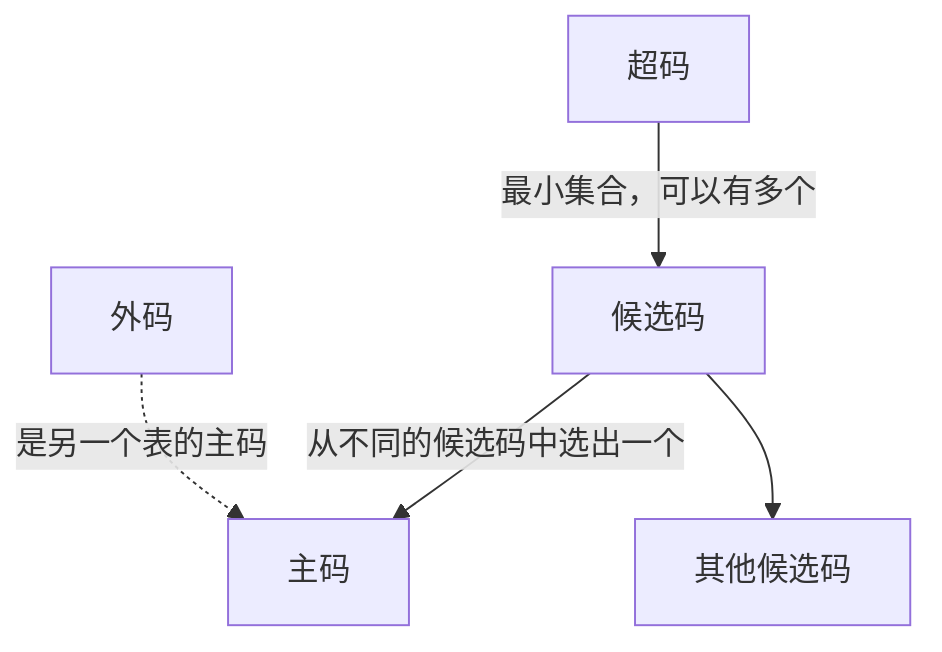
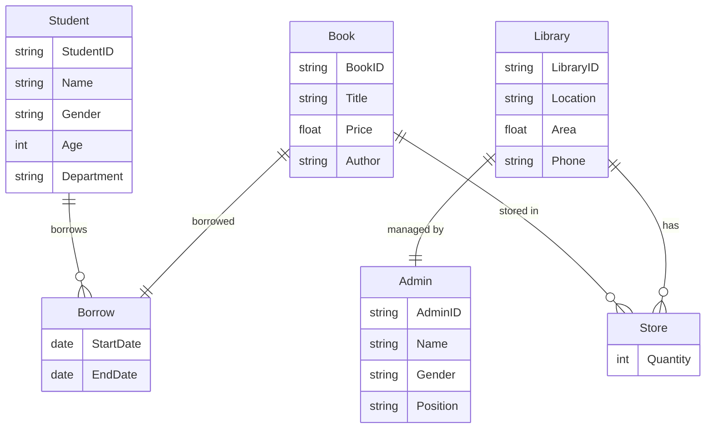

---
title: 数据库原理 课程笔记 (4) 杂项和题目整理
url: https://blog.kisechan.space/2025/notes-database-4/
type: post
time: '2026-10-21T16:02:14.153Z'
---

**数据库系列笔记**

点击查看系列汇总：

---

Kisechan 的数据库系列笔记
https://blog.kisechan.space/tags/%E6%95%B0%E6%8D%AE%E5%BA%93/

---

- **数据库原理课程笔记部分**：
  - [数据库原理 课程笔记 (1) 数据库、关系代数和 SQL](https://blog.kisechan.space/2025/notes-database-1/)
  - [数据库原理 课程笔记 (2) E-R 模型和关系模式](https://blog.kisechan.space/2025/notes-database-2/)
  - [数据库原理 课程笔记 (3) 存储、索引、事务和并发](https://blog.kisechan.space/2025/notes-database-3/)
  - 数据库原理 课程笔记 (4) 杂项和题目整理 【**当前阅读**】
- **手搓数据库** (CS346) **部分**：
  - [设计一个数据库引擎 (1) 内存、外存和记录管理](https://blog.kisechan.space/2025/db-engine-1/)
  - [设计一个数据库引擎 (2) 索引](https://blog.kisechan.space/2025/db-engine-2/)
  - [设计一个数据库引擎 (3) SQL 处理](https://blog.kisechan.space/2025/db-engine-3/)
- **Oracle 和 NoSQL 课程部分**：
  - ~~Oracle 的学习使用和环境配置~~
  - [NoSQL 的学习使用和环境配置](https://blog.kisechan.space/2026/nosql/)

## 概念整理

### 码

来自[这篇博客](https://blog.kisechan.space/2025/notes-database-1/#%E7%A0%81)。

- **超码**
  - 一个或多个属性的集合，**其中可能包含冗余属性**
  - 可在一个关系中唯一标识一个元组
- **候选码**
  - **标识一个元组的最小属性集合**
  - 一个表可以有多个候选码
- **主码**
  - **候选码中选出的唯一标识符**
  - 不能为 `NULL` ，且值唯一
- **外码**
  - 本关系/表中的某个属性恰好是**另外一个关系里的主码**
  - 建立表间关系

---

|  名称  |             定义             |           说明           |
| :----: | :--------------------------: | :----------------------: |
|  超码  | 能唯一标识元组的属性**集合** |    可以是多个字段组成    |
| 候选码 | **最小的超码**，不能去掉字段 |        可能有多个        |
|  主码  |    从候选码中选出的“主键”    |     唯一、非空、不变     |
|  外码  |   指向另一个关系主码的属性   | 用于建立表与表之间的联系 |



## 题目整理

### 第一题

已知关系模式 $R\langle U, F\rangle$，有 $U=\{A, B, C, D, E, F\}$ 和 $F=\{A\to BCD, BC\to DE, B\to D, D\to A\}$。

1. 证明 $DF$ 是一个候选码。
2. 写出所有候选码。

3. **证明**：
   - 候选码的定义是能唯一标识元组的最小属性集，**它闭包包含所有属性**，即 ${DF}^+ = U$，证明如下：
     - 初始：${DF}^+ = \{D, F\}$
     - 依赖：
       - $D \to A$，加上 $A$
       - $A \to BCD$，加上 $B$, $C$
       - 此时 ${DF}^+ = \{A, B, C, D, F\}$
       - $BC \to DE$，我们已经有 $B$, $C$，所以加上 $E$
       - 最后 ${DF}^+ = \{A, B, C, D, E, F\} = U$
4. **解**：
   - 首先， $D$、 $F$ 不是候选码。显然。
   - 枚举是个技术活，指数复杂度，观察得到只有 $DF$ 一个候选码。

### 第二题

图书馆欲开发一套管理系统，数据库需要保存以下信息：

- 图书（图书馆中可能有多本同一种书）
  - 编号
  - 书名
  - 价格
  - 作者
- 书库
  - 书库号
  - 地点
  - 面积
  - 电话
- 管理员
  - 工号
  - 姓名
  - 性别
  - 职务
- 学生
  - 学号
  - 姓名
  - 性别
  - 年龄
  - 学院

其中，一个学生可以借 0 ~ 5 本书，借书过程需要记录起止时间，书库中可以存放图书，需要记录存放的每一种书的数量，一名管理员负责管理一个书库。

完成以下设计：

1. 设计该系统的 E-R 图。
2. 将 E-R 图转换为关系模式。
3. 指出转换后，每个关系模式的主码。

E-R 图如下：



关系模式如下，主码加粗：

1. Book(**BookID**, Title, Price, Author)
2. Library(**LibraryID**, Location, Area, Phone)
3. Admin(**AdminID**, Name, Gender, Position)
4. Student(**StudentID**, Name, Gender, Age, Department)
5. Store(**LibraryID**, **BookID**, Quantity) ，多对多，联合主码
6. Borrow(**StudentID**, **BookID**, StartDate, EndDate) ，多对多，联合主码
7. Manages(**LibraryID**, AdminID) ，一对一，用联合主码表示，或任选其一为主码

### 第三题

根据下列关系模式：

- `department(dept_name, building, budget)`
- `instructor(ID, name, dept_name, salary)`
- `course(course_id, title, dept_name, credits)`
- `section(course_id, sec_id, semester, year, building, room_number, time_slot_id)`
- `teachers(ID, course_id, section_id, semester, year)`
- `student(ID, name, dept_name, tot_cred)`
- `prereq(course_id, prereq_id)`
- `advisor(s_id, i_id)`
- `takes(id, course_id, sec_id, semester, year, grade)`
- `classroom(building, room_number, capacity)`
- `time_slot(time_slot_id, day, start_time, end_time)`

用关系代数和 SQL 语句完成下列查询操作：

1. 查询 2020 年秋季未选课的学生的 ID
2. 查询选了名为 `'Einstein'` 的老师开设的所有课程的学生的姓名（老师、学生不存在重名的）
3. 查询所有在 2020 年秋季开课且不在 2021 年春季开课的课程 ID
4. 给年薪大于 70000 元的老师涨 5% 工资，小于等于这个数字的老师涨 10%
5. 不用聚合函数，查询老师的最高工资

**第一问**：

$$
\pi_\text{ID}(\text{student}) - \pi_\text{ID}(\sigma_{\text{semester='Fall'} \land \text{year}=2020}(\text{takes}))
$$

```sql
SELECT ID
FROM student
WHERE ID NOT IN (
    SELECT id
    FROM takes
    WHERE semester = 'Fall' AND year = 2020
);
```

**第二问**：

$$
\pi_\text{student.name} \left(
    \text{student} \bowtie_\text{student.ID = takes.id}
    \text{takes} \bowtie_{\text{takes.course\_id = teachers.course\_id} \land \text{takes.section\_id = teachers.section\_id} \land \text{takes.semester = teachers.semester} \land \text{takes.year = teachers.year}}
    \text{teachers} \bowtie_\text{teachers.ID = instructor.ID}
    \sigma_\text{instructor.name = 'Einstein'}(\text{instructor})
\right)
$$

```sql
SELECT student.name
FROM student
JOIN takes ON student.ID = takes.id
JOIN teachers ON takes.course_id = teachers.course_id
             AND takes.section_id = teachers.section_id
             AND takes.semester = teachers.semester
             AND takes.year = teachers.year
JOIN instructor ON teachers.ID = instructor.ID
WHERE instructor.name = 'Einstein';
```

（也可以使用 $\div$ 运算）

**第三问**：

$$
\pi_\text{course\_id}(\sigma_{\text{semester='Fall'} \land \text{year=2020}}(\text{section}))
-
\pi_\text{course\_id}(\sigma_{\text{semester='Spring'} \land \text{year=2021}}(\text{section}))
$$

```sql
SELECT DISTINCT course_id
FROM section
WHERE semester = 'Fall' AND year = 2020
  AND course_id NOT IN (
      SELECT course_id
      FROM section
      WHERE semester = 'Spring' AND year = 2021
  );
```

**第四问**：
（更新操作）

```sql
UPDATE instructor
SET salary = salary * 1.05
WHERE salary > 70000;

UPDATE instructor
SET salary = salary * 1.10
WHERE salary <= 70000;
```

**第五问**：

$$
\pi_{\text{salary}}(\text{instructor})
-
\pi_{I1.salary}(
    \rho_{I1}(\text{instructor}) \bowtie_{\text{I1.salary} < \text{I2.salary}} \rho_{I2}(\text{instructor})
)
$$

```sql
SELECT DISTINCT I1.salary
FROM instructor I1
WHERE NOT EXISTS (
    SELECT 1
    FROM instructor I2
    WHERE I2.salary > I1.salary
);
```

## 参考和注解
