---
title: 软件设计模式 课程笔记
url: https://blog.kisechan.space/2025/notes-design-pattern/
type: post
time: '2026-10-21T16:02:14.153Z'
---


## 面向对象和设计模式

### 设计模式概论

设计模式面向对象技术发展到一定阶段后的产物。

- 是**被反复使用、众所周知并经过总结分类的面向对象设计经验**。
- 对面向对象系统中的复杂问题提供通用解决方案。
- **设计模式对面向对象开发的意义**约等于**数据结构对面向过程开发的意义**。
- 设计模式能帮助开发者实现：
  - 可维护
  - 可复用
  - 可扩展
  - 灵活性高
- 能更快地成长为优秀的软件开发工程师。

设计模式本质上是 **对面向对象思想的深化与实践**。学习设计模式能更深入理解 OO 概念与 OO 软件体系结构。

### 面向对象（Object-Oriented）

Coad 提出：**面向对象 = 对象 + 类 + 继承 + 通信**。

面向对象的特点是：

- 既是一种 **编程范式**，也是一套 **系统开发方法论**。
- 是对现实世界的抽象：把相关的数据和方法组合为“对象”。
- 相对于面向过程，更符合自然事物建模方式。

#### OO 的目标

- **可维护**：修改局部，不影响整体
- **可复用**：类和组件可多次使用
- **可扩展**：加新功能不破坏旧结构
- **灵活性**：结构可组合、可替换、可重组

> 比喻：活字印刷术中，可更换、重排的“字块”

#### 面向对象编程语言

现代主流语言几乎全部支持或围绕 OOP 构建，如： Java、C++、Go、Python、C#、Ruby、JavaScript、Objective-C、Scala、PHP 等。

#### 面向对象开发方法

OO 方法贯穿开发方法的整个生命周期

- OOA：对象分析
- OOD：对象设计
- OOP：对象编程
- OOT：对象测试
- OOSM：对象维护

面向对象不只是编程语言，更是一整套软件工程方法论。

#### 面向对象的发展与全貌

##### 历史演进

- **Simula 67**（1967，挪威）：首次引入类、继承、多态 → 第一门真正意义的 OOPL
- **Smalltalk**：确立 OO 思想
- 后续语言：C++、Objective-C、Java、C#、Ruby 等

##### 形成的体系

- OOPL：支持 OO 的语言
- OOP：利用 OOPL 进行 OO 编程
- 类库 & 框架：OOP 促进大规模可复用组件库出现
- 设计模式：在类库、框架设计过程中沉淀出的“可复用设计思想”

##### 配套方法与工具

- **UML（统一建模语言）**：用图形表示 OO 软件结构
- OO 建模方法、开发流程
- OO 已成为覆盖整个开发流程的综合技术体系

##### 目标

- 利用前人经验（模式、框架、建模方法）
- 提高软件质量与开发效率
- 支持大规模复杂软件的管理与设计

### 面向对象设计

OO 设计是对“**面向对象分析结果**”的进一步整理，使其能够被直接用于面向对象编程。目标是**把分析的对象、关系、职责，转化为可实现的类、方法、属性以及组件结构**。

面向对象设计的三个层次：

- 框架级设计
- 类设计
- 代码设计

#### 框架级设计（Framework Level）

框架是从一类特定软件中抽象出的**可复用、协作的类群**，定义了软件的体系结构。关注点：

- 类如何分组 → 包（Package）
- 包之间如何协同
- 抽象层较高，强调复用与架构组织

常见例子：三层逻辑架构（UI → 业务逻辑 → 数据库）

---

##### 包（Package）与包结构原则

包的六大原则分两类：

- **包的内聚性原则**（决定类如何划分到包中）
  1. **重用发布等价原则 REP**
     - 复用的粒度 = 发布的粒度
     - 复用的类应打包在一起，以便统一发布。
  2. **共同重用原则 CRP**
     - 经常一起变化的类应放在同一包中（高内聚）。
     - 避免把不相关的类打包在一起。
  3. **共同封闭原则 CCP**
     - 对同一类变化原因负责的类，应放同一包中。
     - 提升修改的局部性。

- **包的耦合性原则**（决定包与包之间如何连接）

  4. **无环依赖原则 ADP**

     - 包之间不能出现循环依赖。

     - 保证架构清晰、可维护、可编译。

  5. **稳定依赖原则 SDP**
     - 不稳定的包应依赖稳定的包。
     - 避免不稳定组件成为系统“根”。

  6. **稳定抽象原则 SAP**

     - 稳定的包应更抽象（用接口/抽象类）。

     - 稳定 ≠ 僵化。

#### 类设计（Class Level）

关注对象、类、属性、行为的抽象与组织方式。

- 解决如何将现实世界对象转化为类结构，如何定义其行为和属性。
- 软件设计模式属于此层次（Factory、Singleton、Strategy 等）。

---

**类的定义**

- 对象：问题域中的实体抽象
- 类：对象属性与行为的模板

类设计要处理：

- 类的组织与表示
- 行为（方法）的组织
- 属性的组织
- 类之间的关系（复用、耦合度）

---

1. **类的组织与表示**（从现实到抽象）

   - **类的发现**：从具体实例抽象，例如：苹果、香蕉 → 水果类

   - **聚类分析**：找出对象集合的共同特征

   - **类的再抽象**：进一步抽象成更通用概念，如“水果”或模板“List<T>”

   - **类的拆分**：一个类中不属于核心领域的部分应拆出（如水果篮中的鲜花）

   - **类的可见性**：区分公开、私有成员（对外接口 vs 内部实现）

   - **类的复用性（高内聚、低耦合）**

2. **行为（方法）的组织与表示**

   - **行为的参与者**：行为涉及的对象（老鼠吃水果）

   - **行为分组与接口**：例如吃香蕉 / 吃苹果 → 吃水果

   - **行为分解**：抽象行为的内部步骤（剥皮 → 吃 → 吐核）

   - **行为的可见性**：内部实现与外部接口区分

   - **行为的返回结果**：吃水果返回成功/失败/数量

   - **行为的差异性**：不同对象实现同一行为（多态）

3. **属性的组织与表示**

   - 属性类型：内置、自定义

   - 可访问性：只读、只写、读写

   - 不变属性：不会随时间变化（身份证号）

   - 类属性 vs 实例属性：如“扑克牌背面图案”是类属性

   - 属性可见性：常隐藏，靠 getter/setter 暴露

   - 属性设计依赖具体编程语言特性

---

**变化**

这是类设计的核心难点。

1. **职责的变化**（接口变化）

   - 行为签名改变

   - 新增功能

   - 可访问性改变

2. **实现的变化**（内部变化）

   - 数据类型变化

   - 数据结构变化

   - 行为算法变化

示例分析：

```cpp
class A {
public:
     //0. 新增函数 f1    （职责变化）
     //1. f 参数表可能变化（职责变化）
     //2. f 的具体实现变化（实现变化）
     void f(int n, int m);
private:
     //3. 数据类型变化（实现变化）
     //4. 数据结构变化（实现变化）
     int nums[50];
};
```

---

**应对变化的两种方式**

1. **修改既有代码**
   - 缺点：

     - 可能无法访问源码

     - 修改已发布代码风险高

     - 修改接口可能影响大量调用者

2. **扩展既有代码**（OO 推荐方式）

   - 使用类关系扩展系统：

     - **继承扩展**（最常见但谨慎使用）

     - **依赖扩展**

     - **关联扩展**

     - **聚合扩展**

     - **组合扩展**

   - 目标：遵守开闭原则（对扩展开放，对修改关闭）。

#### 代码设计（Code Level）

类的具体实现（物理级）：源代码、二进制代码、可执行代码。关注：

- 性能
- 可部署性
- 可移植性
- 代码结构与文件组织方式

### 关系模型与设计模式的关联

#### 关系模型（类间关系）是复用的基础


类之间的关系是 OO 中复用的工具。

|            关系            |    强度    |      UML 表示       |       关键语义       |
| :------------------------: | :--------: | :-----------------: | :------------------: |
|   **依赖**（Dependency）   |     ⭐     |    **虚线箭头**     |   临时使用，弱关系   |
|  **关联**（Association）   |    ⭐⭐    |    **实线箭头**     | 长期使用，语义级关系 |
|  **聚合**（Aggregation）   |   ⭐⭐⭐   | **空心菱形 + 实线** |  整体-部分，可分离   |
|  **组合**（Composition）   |  ⭐⭐⭐⭐  | **实心菱形 + 实线** | 整体-部分，不可分离  |
| **泛化**（Generalization） | ⭐⭐⭐⭐⭐ |  **空心三角实线**   |   继承，有实现复用   |
|  **实现**（Realization）   | ⭐⭐⭐⭐⭐ |  **空心三角虚线**   | 实现接口，无实现继承 |

##### 依赖（Dependency）

- A **使用到** B，但这种关系 **偶然、弱、短暂**
- B 的变化会影响到 A，但二者并不是长期绑定

典型代码表现有：

- 方法参数
- 方法内部局部变量
- 调用对方静态方法
- 临时 `new`/`delete`

```cpp
class A {
    void func(B b);
    void func(B* b);
    void func(B& b);
};
```

UML 表示用虚线箭头，A → B 表示 “A 依赖 B”。

示例：

- 老鼠吃苹果
- 人借车移动
- 警察抓小偷（也可设计为更复杂的双向依赖）
- Screen（画布）依赖 Shape 的绘制接口
- Mouse 依赖 Fruit（通过子类型适配多种水果变化）

---

关键思想：

依赖关系用于**适应短期变化**。

常见的使用方法：

- 参数多态（`Fruit&`）
- 子类型化适应扩展（`Cat`/`Dog` 类型化 `Monster`）

##### 关联（Association）

- A 和 B **长期存在语义关联**
- 强于依赖
- 双方地位平等（通常）

UML 用实线箭头 A → B（单向）或实线无箭头（双向）表示

代码特征通常表现为 **成员变量**：

```cpp
class CWife {
    CHusband* husband;  // 关联
};
```

关联分三大类：

1. **单向关联**：只有一方持有对方
2. **双向关联**：双方互相持有
3. **自身关联**：类内部引用自己（如链表 Node）

示例：

- 英雄（Hero）持有宝物（Goods）
- 学生（Student）拥有宿舍（Dorm）
- 丈夫 ↔ 妻子（双向）
- 链表 Node 自身关联 nextNode

本质上，关联描述一种 **更稳定的“使用关系”**。 生命周期独立，但逻辑联系长期存在。

---

##### 聚合（Aggregation）

- “整体–部分（has-a）”关系
- 部分 **可以独立于整体存在**
- 关系 **弱于组合**

例如：

- 自行车 — 轮胎；
- 学生 — 宿舍；
- 科研团队 — 科研人员。

UML 用空心菱形 + 实线表示。

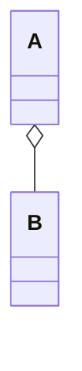

代码例子：

```cpp
class Dorm {
    Student** mStudents;  // 但学生可独立存在
};
```

特性：

- 整体与部分可分离
- 生命周期不绑定
- 常用于“容器拥有元素”

示例扩展：

- 果篮–水果
- 防盗门–锁
- Grid 包含多个 Rect（绘图示例）

##### 组合（Composition）

强聚合（比聚合强），部分的生命周期 **完全依赖整体**

例如：

- 人和大脑
- 窗口和标题栏
- 公司和部门（生命周期绑定）

UML 用实心菱形 + 实线表示

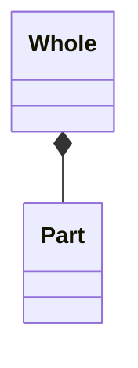

代码特征：

```cpp
class A {
    B b;          // 组合：整体负责部分的生命周期
};
// 或
class A {
    B* b;
    A() { b = new B; }
    ~A() { delete b; }
};
```

特征：

- 部分不能脱离整体生存
- 整体被析构 → 部分也被析构
- 表现更强的所有权

##### 泛化（Generalization）

- “一般–特殊”关系
- **继承**
- 子类继承父类的**属性和实现**

UML 用空心三角形 + 实线表示子类 → 父类

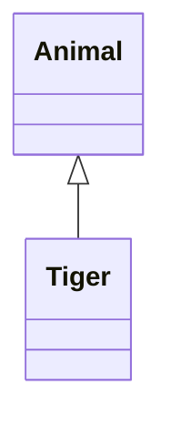

示例：

- Monster ← Cat
- Monster ← Dog
- Animal ← Tiger

---

##### 实现（Realization）

类实现接口，类似 Java 的 `implements`。

和泛化的区别：

- **泛化**：继承父类的实现（代码）
- **实现**：仅继承接口，无实现

UML 用空心三角形 + 虚线表示：

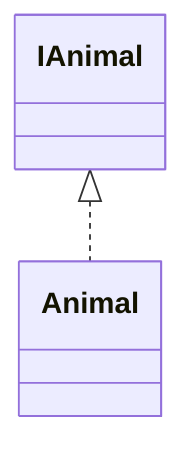

#### 设计原则是行为准则

面向对象从提出到成熟经历了大量实践，逐渐沉淀出 **七大设计原则**。
它们可分为两类：

- **设计目标**（设计的“方向”），重点：让系统**稳定**、**可扩展**、**可维护**
  1. **开闭原则** OCP
  2. **里氏替换原则** LSP
  3. **迪米特原则** LoD（最少知道原则）

- **设计方法**（如何“做到”），重点：实现**高内聚**、**低耦合**
  1. **单一职责原则** SRP
  2. **接口分隔原则** ISP
  3. **依赖倒置原则** DIP
  4. **组合/聚合复用原则** CARP

这七个原则不是孤立的，互相强化。

**OCP 是核心，其他六条都是帮助我们实现 OCP 的工具。**

| 原则 |      中文名       |                作用                |   与 OCP 的关系    |
| :--: | :---------------: | :--------------------------------: | :----------------: |
| OCP  |     开闭原则      |      最终目标：可扩展、可维护      |                    |
| LSP  |   里氏替换原则    | 正确继承，确保扩展不会破坏原有功能 |     OCP 的根基     |
| LoD  |    迪米特原则     |     减少耦合，间接提高可扩展性     |   提供低耦合环境   |
| SRP  |   单一职责原则    |        单一职责，使扩展简单        | 便于扩展、减少修改 |
| ISP  |   接口分隔原则    |        专门接口，提高灵活性        |   避免修改胖接口   |
| DIP  |   依赖倒置原则    |     高层不依赖低层，实现可替换     |  通过抽象实现 OCP  |
| CARP | 组合/聚合复用原则 |    用组合支持扩展、减少继承修改    | 扩展开放、修改关闭 |

面向对象七大原则的核心是“**开闭原则**”，它强调对扩展开放、对修改关闭。

- **里氏替换原则**保证继承结构的正确性；
- **迪米特原则**降低耦合；
- **单一职责原则**和**接口隔离原则**控制了类与接口的粒度；
- **依赖倒置原则**通过抽象降低层间依赖；
- **组合/聚合复用原则**提供了一种比继承更稳定的复用机制。

它们共同协作以提高软件的可扩展性、可维护性和稳定性。

| 原则 |                   最常见错误                   |
| :--: | :--------------------------------------------: |
| OCP  |             大量 if-else 判断类型              |
| LSP  | 子类破坏父类行为约定，父类可以做但是子类做不了 |
| LoD  |                一长串对象调用链                |
| SRP  |            万人嫌“上帝类”，职责太多            |
| ISP  |   巨型接口，方法太多，子类没必要去每个都实现   |
| DIP  |           依赖具体实现而不是抽象基类           |
| CARP |             滥用继承，只为复用代码             |

##### 开闭原则（Open-Closed Principle, OCP）

> 软件实体应该*对扩展开放*，_对修改关闭_。

即：添加功能**不改旧代码，通过扩展类/接口实现新行为**。

意义：

- **稳定性**：减少修改旧模块引入 bug。
- **扩展性**：通过新类扩展系统能力。

如何实现？

- 找出系统中“变化点”，抽象为接口。
- 使用“面向接口编程”而不是面向实现。
- 新行为 = 新类 + 实现既有接口，而不是改旧类。

典型反例：

> 绘图程序中有 `Circle`、`Square`，错误设计用 `switch-case` 判断类型 → 违反 OCP。

正确方法：

> 给 `Shape` 定义抽象方法 `draw()`，每个图形类实现自己的 draw。

---

##### 里氏替换原则（LSP）

> 任何父类出现的地方，子类必须能够透明替换，并保持程序正确性。

一句话：**子类必须完全遵守父类的行为契约**。

违反的表现：

- 用 `typeid`、`instanceof` 判断类型 → 明显违反 LSP。
- 子类重写方法后导致父类行为被破坏。

经典反例：

> `Square` 继承 `Rectangle`
>
> `Rectangle` 有：
>
> - `setWidth`
> - `setHeight`
>
> `Square` 继承后无法保持矩形逻辑 → 损坏父类行为。
>
> 因此，这种继承是**错误的继承**。

正确做法：

> 建立更高层抽象，例如 `Quadrilateral`。

本质：

- 正确判断哪些类应该“继承”，哪些应该“关联”。
- 如果继承会破坏行为契约，则不应该继承。

---

##### 迪米特原则（LoD，最少知道原则）

> 一个对象应该尽量少地了解其他对象，只与直接朋友通信。

判断“朋友”：

- `this`
- 方法参数
- 成员变量
- 成员变量的元素（如列表内元素）
- 当前对象创建的对象

其他都属于“陌生人”，不应该直接访问。

表现形式：

- 不要“链式访问”：`a.getB().getC().doSomething()` → 违反 LoD
- 不要暴露太多 `public` 方法。

示例：洗衣机

> `Person` 调用 `WashingMachine` 的内部细节（`receiveClothes`、`wash`、`dry`） → 知道太多。

调整为：

> `WashingMachine` 提供 `automatic()`，内部自己组织流程。

---

##### 单一职责原则（SRP）

> 一个类应该只有一个引起它变化的原因。

如果一个类承担多个职责：

- 一个职责变化会影响另一个职责的用户
- 增加耦合性、降低可维护性

例子：`Modem`

> - `dial`/`hangup` = 连接职责
>
> - `send`/`receive` = 通讯职责
>
> - 放一起 → 违反 SRP
>
> 应该分成 `Connect` 接口 + `DataCommunicate` 接口。

---

##### 接口分隔原则（ISP）

> 不要强迫用户依赖他们不需要的接口。
>
> 使用多个专用接口，而不是单一的胖接口。

ISP 和 SRP 的区别：

- **SRP**：关注“类/接口本身是否职责单一”
- **ISP**：从“调用者角度”，避免把不必要的方法塞给用户

例子：

> `Door` + `Alarm` 功能
>
> - 错误：`Door` 接口包含 `alarm()`
>
> 正确方案：
>
> - `Door` 接口：`lock`/`unlock`
> - `Alarm` 接口：`alarm`
> - `AlarmDoor` = `Door` + `Alarm`

---

##### 依赖倒置原则（DIP）

> - 高层模块不应依赖低层模块；二者都应依赖抽象
>
> - 抽象不应该依赖细节；细节应该依赖抽象

本质：面向接口编程

例如：

> **反例**（错误）
>
> 高层直接依赖 `FileLogger` / `DatabaseLogger` 等具体类
>
> **正例**（正确）
>
> - 定义 `Logger` 接口
> - 高层依赖 `Logger`
> - 具体 `FileLogger`、`DbLogger` 实现 `Logger`
>
> 这样：
>
> - 新增 `RedisLogger` → 不改高层代码 → 符合 OCP
> - 高层不依赖具体实现 → 松耦合

---

##### 组合/聚合复用原则（CARP）

> 尽量使用“组合/聚合”来实现复用，而不是继承。

继承的问题：

- 父类变 → 子类全变（紧耦合）
- 强类型绑定，限制结构

组合的优势：

- 灵活替换（符合 OCP）
- 对象之间松耦合

> 例：`Player` 拥有 `Bike`（组合）
> 而不是 `class Player : private Bike` → **继承不符合实际关系**。

另外，**继承属于典型的白箱复用**，通过修改或扩展其内部实现来实现复用。而**黑箱复用**利用**组合/委托**来实现复用，只依赖行为接口，不关心内部实现，耦合性更弱，更安全。

#### 设计模式是对 OO 设计经验的提炼

- 基于关系模型
- 遵循设计原则
- 解决反复出现的设计问题
- 是从大量复用实践中总结的通用解决方案

总结三者关系：

- 关系模型 = 工具
- 设计原则 = 准则
- 设计模式 = 在工具与准则基础上总结出的经验

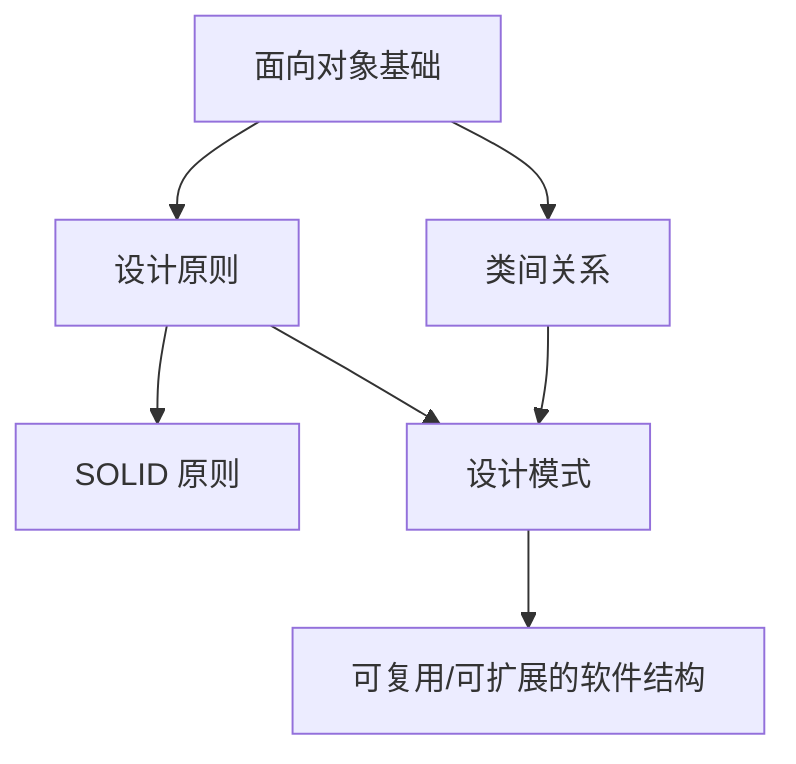

## 设计模式

设计模式并非起源于软件行业，而是起源于建筑学。

“模式之父” Christopher Alexander（加州大学环境结构中心 所长）在 1977 年出版了 _A Pattern Language_，总结了 **253 个建筑与城市规划模式**。Alexander 给出的模式定义：

> “每个模式描述了一个在环境中不断出现的问题，并提供解决该问题的核心方案，可反复使用。”
>
> **A pattern is a solution to a problem in a context.**

即：**模式 = 在特定环境中解决某类问题的通用方案**

---

1990 年代，软件工程界开始关注模式思想。

- **1991–1992 年**：四人组（**Gang of Four, GoF**：Gamma、Helm、Johnson、Vlissides）把模式引入面向对象软件设计。
- **1994 年**：他们发表了著名的 _Design Patterns: Elements of Reusable Object-Oriented Software_，总结 **23 个经典设计模式**，奠定了软件设计模式的基础。

此后，设计模式成为软件工程教育的标准内容，也广泛应用在 Java、.NET 等平台中。

### 软件模式

软件模式是对软件开发中 **重复出现的问题及其解决方案** 的总结，包括：

- 架构模式（如 MVC）
- 分析模式
- 设计模式（GoF）
- 过程模式（如敏捷模式）

软件模式的结构一般包含四部分：

1. 问题描述
2. 前提条件（环境或约束）
3. 解决方案
4. 效果（优缺点）

#### 模式发现的“三次律”（Rule of Three）

一个方案必须至少在 **三个不同系统** 中成功使用，才有资格成为一个真正的模式。

### GoF 设计模式

GoF 在 1994 年总结了 **23 种最经典的软件设计模式**，用于解决软件设计中可复用性、扩展性、可维护性的问题。

设计模式帮助统一分析、设计、实现之间的沟通语言，使面向对象设计更加系统化与工程化。

#### 设计模式的基本要素

每个设计模式一般包含如下关键结构：

- **模式名称**（Pattern Name）：便于沟通的“专业词汇”
- **问题**（Problem）：该模式要解决的矛盾或场景
- **解决方案**（Solution）：类结构与交互方式
- **效果**（Consequences）：优点、缺点、对系统的影响

> 实际书中通常还包含示例代码、相关模式等内容。

#### 设计模式的分类

##### 按“目的”分类（WHAT 解决什么问题）

1. **创建型（Creational）**
   - 用于对象的创建过程
   - 如：工厂方法、单例、建造者、抽象工厂、原型
2. **结构型（Structural）**
   - 如何组合类或对象形成更大的结构
   - 如：适配器、代理、桥接、组合、装饰、享元、外观
3. **行为型（Behavioral）**
   - 类或对象之间如何分配职责、如何通信
   - 如：观察者、策略、命令、状态、迭代器、访问者等

##### 按“范围”分类（WHO 参与关系）

4. **类模式**

   - 处理类与子类之间的关系（通过继承，编译期确定）

   - 静态结构

5. **对象模式**

   - 处理对象之间的关系（运行期确定）

   - 动态结构，更灵活，也更多出现

---

| 范围 \ 目的  |          创建型模式          |                   结构型模式                   |                            行为型模式                            |
| :----------: | :--------------------------: | :--------------------------------------------: | :--------------------------------------------------------------: |
|  **类模式**  |           工厂方法           |                    类适配器                    |                         解释器、模板方法                         |
| **对象模式** | 抽象工厂、建造者、原型、单例 | 对象适配器、桥接、组合、装饰、外观、享元、代理 | 职责链、命令、迭代器、中介者、备忘录、观察者、状态、策略、访问者 |

### 设计模式的优点

1. **提供通用语言**（便于沟通），设计模式为开发者提供标准术语，使讨论系统结构更清晰。例如：

   - “这里使用观察者模式通知 UI”

   - “把数据库访问层抽象成工厂模式”
     这些话大家都能理解。

2. **提高代码复用性、可维护性**，设计模式总结了成熟的设计方案，避免：

   - 重新发明轮子

   - 重复犯常见设计错误

3. **让系统更加灵活且易扩展**：许多模式（如策略、装饰）让系统结构更具可扩展性，符合开闭原则。

4. **提升软件质量与开发效率**：设计模式经过验证，是构建高可靠软件的重要技术。

5. **帮助初学者理解面向对象思想**：设计模式是学习 OO 思维的最佳教材：

   - 抽象

   - 封装

   - 多态

   - 组合优于继承

## 创建型设计模式

创建型模式（Creational Patterns）的核心思想：

> **把“创建对象”这件事独立出来，让使用对象的代码不再关心创建过程。**

换句话说：平时我们总是在写 `new XXX()`，但一旦类多、构建复杂、依赖变化，`new` 会成为巨大的负担，创建型模式就是帮助你：**不要乱用 `new`**。

它的两个关键特征：

1. **客户不知道对象的具体类是什么**（解耦，隐藏细节）
2. **隐藏对象实例的创建与组织过程**（你只“要”，不“造”）

只要想写出：

```Java
SomeObject obj = new SomeObject();  // ← 看到 new 就要想：能不能用工厂？
```

就可以考虑创建型模式。

创建型模式包括：

- 简单工厂模式
- 工厂方法模式
- 抽象工厂模式
- 建造者模式
- 原型模式
- 单例模式

### 简单工厂模式

比如 UI 中有三种按钮：

- 圆形按钮
- 矩形按钮
- 菱形按钮

不想写：

```java
Button b = new RoundButton();
```

而希望：

```java
Button b = ButtonFactory.getButton("round");
```

你只需要知道一个“**类型参数**”，不需要知道类名，不需要知道构造过程。

---

简单工厂 又叫 **静态工厂方法** Static Factory Method，即：

> 定义一个专门的工厂类，根据传入参数，返回某个父类（抽象产品）下的具体子类（具体产品）。

因此角色有：

- **Factory 工厂角色**：负责创建对象（通常是 static 方法）
- **Product 抽象产品角色**：父类/接口
- **ConcreteProduct 具体产品角色**：各种实际产品的实现类

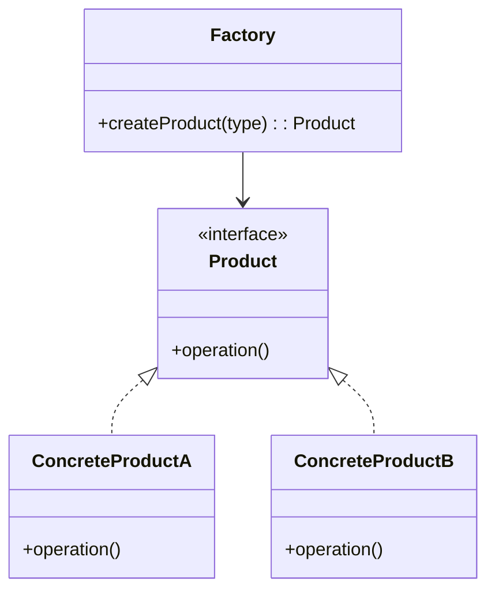

---

示例：未使用工厂，代码臃肿难维护：

```java
public void pay(String type) {
    if (type.equalsIgnoreCase("cash")) {
        ...
    } else if (type.equalsIgnoreCase("creditcard")) {
        ...
    } else if (type.equalsIgnoreCase("voucher")) {
        ...
    }
}
```

所有支付逻辑写在一起，增加新的支付方式 → 必须改这个函数。**违反开闭原则** OCP。

---

**使用简单工厂**：

1. **抽象产品**

```java
public abstract class AbstractPay {
    public abstract void pay();
}
```

2. **具体产品**

```java
public class CashPay extends AbstractPay {
    public void pay() { /* 现金支付 */ }
}
```

3. **工厂类**

```java
public class PayMethodFactory {
    public static AbstractPay getPayMethod(String type) {
        if(type.equalsIgnoreCase("cash")) {
            return new CashPay();
        } else if(type.equalsIgnoreCase("creditcard")) {
            return new CreditcardPay();
        }
        ...
    }
}
```

使用：

```java
AbstractPay pay = PayMethodFactory.getPayMethod("cash");
pay.pay();
```

**对象的创建完全被封装**，业务逻辑更清晰。

---

**优点**：

1. **工厂类集中管理对象创建**，客户端不需要知道具体类名。
2. **客户端与具体类解耦**，只需传入一个参数。
3. 可以将参数放到 **配置文件 / 数据库** 中，实现“无需修改代码即可替换产品”。

**缺点**：

1. **工厂类承担所有对象创建职责，过于臃肿**，一个工厂要知道所有产品，非常不灵活。
2. **不符合开闭原则**，添加新产品就必须修改工厂类的判断逻辑。
3. **工厂方法是静态的**，无法通过继承扩展工厂（这是和工厂方法模式的区别）。

如果产品越来越多，应该升级到 **工厂方法模式** 或 **抽象工厂模式**。

---

**模式适用场景**

适用于：

- 产品数量 **较少**；
- 客户端只有一个“类型参数”，不关心如何创建对象；
- 希望集中管理对象创建逻辑；
- 创建逻辑简单，不需要复杂构建流程；

典型场景：

- JDK 的工具类
- 加密算法（Cipher）
- 日期格式化（DateFormat）

---

JDK 经典例子：`DateFormat`

```java
DateFormat df1 = DateFormat.getDateInstance();
DateFormat df2 = DateFormat.getDateInstance(DateFormat.FULL);
DateFormat df3 = DateFormat.getDateInstance(DateFormat.FULL, Locale.US);
```

这就是一个典型的 **多个静态工厂方法**。

---

Java 加密 API 示例

```java
KeyGenerator keyGen = KeyGenerator.getInstance("DESede");
Cipher cp = Cipher.getInstance("DESede");
```

`getInstance` 就是简单工厂。

#### 模式扩展：把工厂放到产品类中

可以将工厂方法直接写进抽象产品中：

```java
public abstract class Shape {
    public static Shape create(String type) { ... }
}
```

- 优点：减少类数量。
- 缺点：产品类职责增加，不够纯粹。

下面我继续为你**归纳 + 系统化讲解工厂方法模式（Factory Method Pattern）**，内容结构与上一部分保持一致，并会适当插入 **Mermaid UML 图代码**，你可以直接放进 slides 使用。

### 工厂方法模式

简单工厂模式的问题：

- 工厂类只有一个，负责所有产品实例化 → **职责过重**
- 增加新产品必须修改工厂类 → **违反开闭原则**
- 产品越多，判断逻辑越复杂 → **不利维护与扩展**

工厂方法模式的目标就是解决这些问题：**把创建对象的选择延迟到子类，由子类决定创建哪种产品。**

---

**问题**：如何“扩展”一个产品，而不修改已有工厂？

例：按钮系统 → 圆形按钮、矩形按钮、菱形按钮……如果想增加 “椭圆形按钮”，简单工厂必须修改 `if`...`else`。

**解决**：把“创建哪个按钮”的决定交给子类

- 定义一个抽象工厂：`ButtonFactory`
- 每种按钮对应一个工厂子类：`CircleButtonFactory`、`RectButtonFactory`...
- 子类负责实例化具体按钮

优点：不改旧代码，**直接增加新工厂即可** → **完全符合开闭原则**！

---

> **工厂方法模式：定义一个创建对象的接口（工厂方法），让子类决定实例化哪一个类。**
>
> 工厂方法让一个类的实例化延迟到其子类完成。

**角色说明**：

- **Product**（抽象产品）：所有产品的父接口
- **ConcreteProduct**（具体产品）：具体产品实现
- **Factory**（抽象工厂）：声明工厂方法
- **ConcreteFactory**（具体工厂）：真正生产对应的具体产品

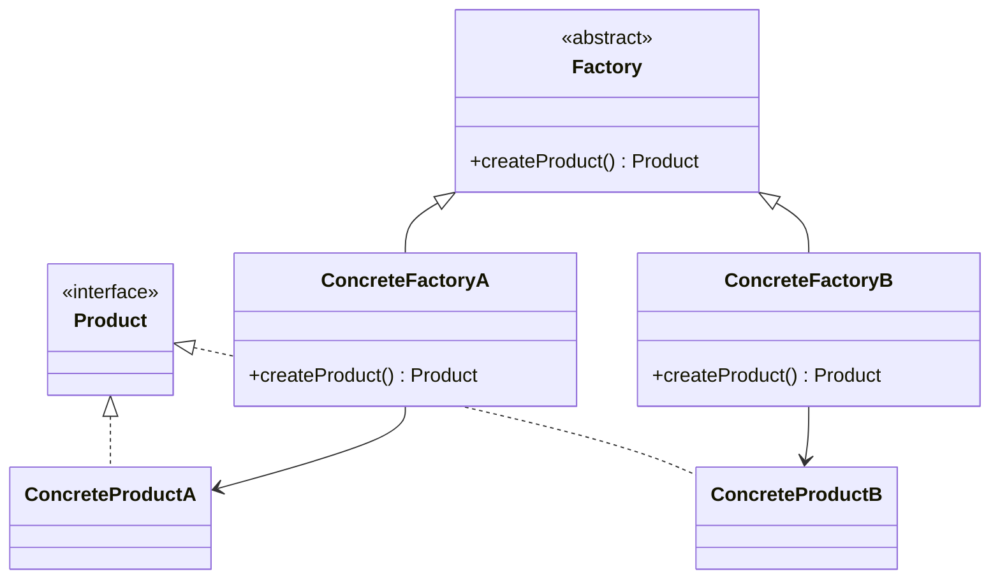

---

典型实例：

1. **抽象产品**

```java
public abstract class AbstractPay {
    public abstract void pay();
}
```

2. **具体产品**

```java
public class CashPay extends AbstractPay {
    public void pay() {
        // 现金支付处理
    }
}
```

3. **抽象工厂**

```java
public abstract class PayMethodFactory {
    public abstract AbstractPay createPayMethod();
}
```

4. **具体工厂**

```java
public class CashPayFactory extends PayMethodFactory {
    public AbstractPay createPayMethod() {
        return new CashPay();
    }
}
```

5. **客户端**

```java
PayMethodFactory factory = new CashPayFactory();
AbstractPay pay = factory.createPayMethod();
pay.pay();
```

---

**优点**：

|     简单工厂      |       工厂方法       |
| :---------------: | :------------------: |
| 新产品 → 修改工厂 | 新产品 → 创建新工厂  |
|  不符合开闭原则   | **完全符合开闭原则** |
|   工厂逻辑复杂    |    工厂类单一职责    |
| 静态方法不可扩展  |  多态，可以动态加载  |

**工厂方法利用多态，通过子类决定“创建什么产品”，实现耦合解散。**

---

**反射 + 配置文件**（高级使用）

实际开发中可以不用 `new`：

XML：

```xml
<className>CashPayFactory</className>
```

Java：

```java
Class c = Class.forName(className);
PayMethodFactory factory = (PayMethodFactory) c.newInstance();
```

优点：**新增产品完全零修改客户端代码**

---

**适用场景**：

工厂方法非常适用于：

1. **类不知道需要创建何种类的实例**
2. **系统需要在运行时决定创建哪个产品**
3. **想做到真正的开闭原则**

典型使用地方：

- JDBC
- JNDI
- JMS
- Spring BeanFactory（底层思想）

### 抽象工厂模式

工厂方法模式一个工厂只负责一个产品等级结构。但开发中经常出现：

- 一个工厂要生产**多个相互关联的产品对象**
- 这些产品分属于不同的“产品等级结构”（类的继承体系）
- 这些产品必须来自同一个“产品族”（例如海尔电视 + 海尔冰箱）

> 工厂方法模式无法同时创建多个产品族内的不同产品，因此需要抽象工厂模式。

**两个关键概念**：

|                 概念                  |                           含义                           |
| :-----------------------------------: | :------------------------------------------------------: |
| **产品等级结构**（Product Hierarchy） |     指一个抽象产品及其所有具体子类，构成一个继承体系     |
|     **产品族**（Product Family）      | 指同一工厂生产的、属于不同等级结构的一组产品（一起使用） |

例如：

- 产品等级结构1：电视（抽象电视 → 海尔电视、TCL电视…）
- 产品等级结构2：冰箱（抽象冰箱 → 海尔冰箱、TCL冰箱…）

“海尔”是一个产品族，“TCL”也是产品族。

- 当需要“同时创建同一个品牌的电视 + 冰箱”等一组产品时，使用抽象工厂。

---

> **抽象工厂模式（Abstract Factory）**：提供一个接口，用于创建一系列相关或相互依赖的对象，而无需指定它们具体的类。

又叫 **Kit 模式**。

**模式结构**

|              角色               |                   作用                   |
| :-----------------------------: | :--------------------------------------: |
| **AbstractFactory（抽象工厂）** |     声明“每个产品族”中产品的创建方法     |
| **ConcreteFactory（具体工厂）** | 实现抽象工厂，创建某个产品族中的所有产品 |
| **AbstractProduct（抽象产品）** |        每个产品等级结构的抽象父类        |
|     **Product（具体产品）**     |           具体工厂创建的产品类           |

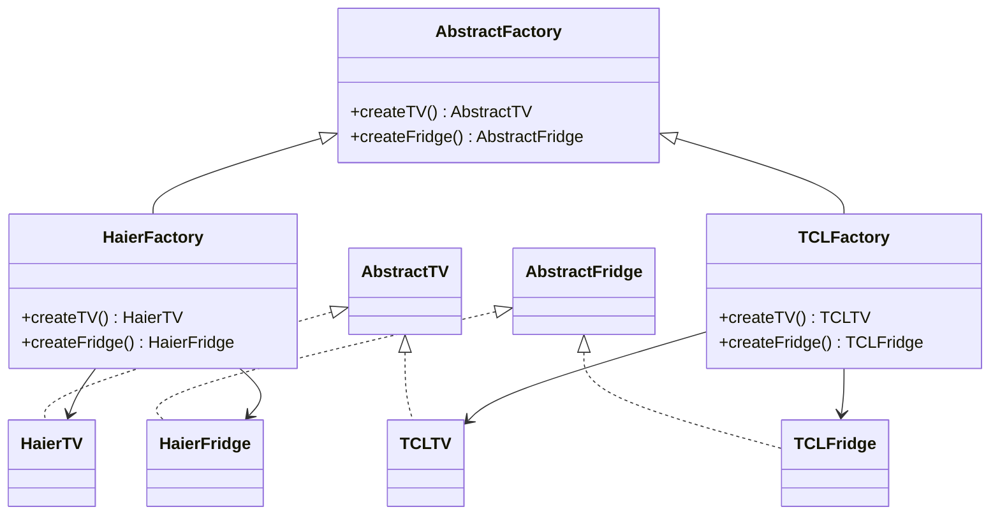

---

**优点**：

1. **隔离具体类**，客户端完全不知道产品具体类名称 → 松耦合。

2. **保证产品族的一致性**，创建出的产品一定属于同一族（如海尔电视 + 海尔冰箱）。

3. **增加产品族方便**（扩展性强），新增一个品牌 → 增加一个新的 ConcreteFactory 即可。

**缺点**：

1. **难以增加新的产品等级结构**（非常重要）

例如：

- 原来只有电视 + 冰箱
- 想增加“洗衣机”

❗需要修改：

- 抽象工厂接口
- 所有具体工厂类

违背开闭原则 → **开闭原则的倾斜性**

2. **类数量多，结构复杂**

---

抽象工厂模式适用于：

- 系统需要与环境绑定（如 GUI 主题、OS UI）
- 程序需同时创建某一产品族中的多个对象
- 一个产品族中的多个对象必须一起使用
- 系统提供产品接口库，隐藏实现细节

典型例子：

- Java AWT：不同操作系统生成不同外观组件
- GUI 主题切换：按钮 + 输入框 + 背景成套变化

---

**模式扩展**

开闭原则的倾斜性（**非常关键**）：

|         扩展内容         |                 难度                  |
| :----------------------: | :-----------------------------------: |
|    **增加新的产品族**    |     简单（新增 ConcreteFactory）      |
| **增加新的产品等级结构** | 困难（必须改抽象工厂 + 所有具体工厂） |

#### 抽象工厂方法的退化链条

| 情况                                                  | 退化成       |
| ----------------------------------------------------- | ------------ |
| 抽象工厂中每个具体工厂只有一个工厂方法                | 工厂方法模式 |
| 工厂方法中的抽象工厂和具体工厂合并，且方法改为 static | 简单工厂模式 |

它们三个其实是一个“进阶链”。

---

> **抽象工厂模式的本质是 —— 选择整个产品族的实现。**

工厂方法选择“一个产品”，

抽象工厂选择“一系列相关产品（产品族）”。

---

|              特点              |       简单工厂       |          工厂方法          |              抽象工厂              |
| :----------------------------: | :------------------: | :------------------------: | :--------------------------------: |
|          **创建什么**          |       一个产品       |      一个产品等级结构      |    一个产品族（多产品等级结构）    |
|          **如何创建**          | 静态方法 + 分支判断  | 多态：子类决定创建哪种产品 |   多态：子类一次创建多个相关产品   |
| **扩展新产品是否修改旧代码？** |  **必须修改工厂类**  |      **新建工厂即可**      |   **新建工厂即可**（仅限产品族）   |
|      **对开闭原则的支持**      |          差          |             好             | 倾斜：对产品族好，对产品等级结构差 |
|          **适用场景**          |       产品简单       |      产品等级结构扩展      |    多产品族、整体替换主题/平台     |
|            **示例**            | `DateFormat.parse()` |    JDBC `DriverManager`    |       GUI 主题、AWT Toolkit        |
|           **复杂度**           |        最简单        |            中等            |                最高                |

### 建造者模式

在现实世界与软件系统中，有些对象结构复杂，需要多个步骤才能完成。例如：

- 车 = 轮胎 + 发动机 + 座椅 + 方向盘
- 游戏中的地图 = 天空 + 背景 + 地面
- 邮件对象 = 发送者 + 接收者 + 标题 + 内容 + 日期...

**复杂对象 = 多个组件 + 有顺序的组装步骤**

关键问题：

- 用户 **不需要** 明确知道这些组件如何组合
- 产品内部构造很复杂
- 构建步骤通常必须按顺序
- 不同建造者可以产生不同版本的产品（如不同风格的 UI、不同配置的电脑）

解决方案：**将构建过程与产品组成分离，封装到 `Builder` 中，由 `Director` 指挥组装。**

---

> **建造者模式（Builder Pattern）**： 将一个复杂对象的构建与它的表示分离，使得同样的构建过程可以创建不同的表示。

也就是**把“怎么构建”与“构建出的对象长什么样”分开。**

**模式结构**：

|               角色                |               描述                |
| :-------------------------------: | :-------------------------------: |
|     **Builder（抽象建造者）**     |      定义构建产品部件的接口       |
| **ConcreteBuilder（具体建造者）** |     实现具体部件的构造与装配      |
|      **Director（指挥者）**       | 控制构建顺序，调用 Builder 的方法 |
|        **Product（产品）**        |        最终生成的复杂对象         |


**优点**：

- **分离构建与表示**（符合单一职责原则）
- **相同构建过程可以生成不同产品**
- **更精细控制构建步骤**
- **增加新的建造者容易**（符合开闭原则）
- **隐藏复杂构建逻辑，客户端无需知晓内部细节**

**缺点**：

- 产品结构相似，才能使用，否则 `Builder` 太多
- 产品内部变化复杂时 `Builder` 也会变复杂

---

**适用场景**：

- 产品内部结构 **复杂**（多属性、多子对象）
- 产品构建需要 **特定顺序**
- 创建产品过程需要 **独立于产品类**
- 同样的构建步骤要生产 **不同风格的产品**

---

**经典应用**：

1. JavaMail 邮件构建流程（邮件内容多，构建步骤多 → 非常适合 Builder）

2. 游戏中的“地图/人物建造器”

3. GUI 界面搭建（如 Swing/AWT）

4. SQL 构造器（MyBatis、Hibernate）

---

**模式扩展**：

**可简化版本**

- **去掉 `AbstractBuilder`**

- **去掉 `Director`**

- 甚至两者合并

适合产品结构简单、只有一个 `Builder` 时。

---

|  比较项  |      Builder       |   Abstract Factory   |
| :------: | :----------------: | :------------------: |
| 返回对象 |      完整产品      | 产品家族（多个产品） |
| 核心思想 |    关注构建步骤    |     关注对象分类     |
| 适用场景 | 复杂对象，步骤明确 |       多产品族       |

比喻：

- **抽象工厂** = 汽车配件工厂（轮胎、发动机）
- **建造者模式** = 汽车总装厂（组装一辆整车）

### 原型模式

问题场景：

- 创建对象成本很高（构造复杂、消耗资源）
- 有时需要频繁创建类似对象
- 构造函数复杂但对象大部分状态相同

解决方案：**用原型对象克隆得到新对象，而不是重新 `new`。**

类比：

- 拉一份文档模板再修改
- 复印机复制信件
- 复制 UI 组件后再修改

---

> **原型模式（Prototype Pattern）**：通过复制现有实例来创建新的对象，而无需知道创建的细节。

简化理解：**不用 `new`，直接 `clone`。**

**模式结构**：

|               角色                |          描述          |
| :-------------------------------: | :--------------------: |
|     **Prototype（抽象原型）**     |   定义 `clone` 方法    |
| **ConcretePrototype（具体原型）** |   实现 `clone` 方法    |
|       **Client（客户端）**        | 使用原型对象生成新对象 |


#### 深拷贝 & 浅拷贝

|    类型    | 基本类型 |         引用类型         |
| :--------: | :------: | :----------------------: |
| **浅拷贝** |  复制值  |      仅复制引用地址      |
| **深拷贝** |  复制值  | 复制对象本身（递归克隆） |

Java 默认 `Object.clone()` 是 **浅克隆**。

深克隆可以通过：

- 手动克隆每个引用对象
- 序列化（最常见）

---

示例：Java `clone()`

```java
public class PrototypeDemo implements Cloneable {
    public Object clone() {
        try {
            return super.clone(); // 浅克隆
        } catch (CloneNotSupportedException e) {
            System.err.println("Not support cloneable");
            return null;
        }
    }
}
```

---

**使用场景**

适合：

- 创建对象开销大（IO、数据库、复杂计算）
- 对象大量相似，只需少量属性不同
- 系统需要保存对象不同历史状态（可与备忘录模式结合）
- 需要避免庞大的工厂类层级结构

---

**优点**：

- **效率高**（避免复杂构造）
- **减少类层次结构**
- **动态扩展容易**（新增原型不影响现有代码）
- **可配合深克隆保存对象状态**

**缺点**：

- 每个类都必须实现 `clone`（违反开闭原则）
- 深克隆代码复杂
- 存在多层嵌套对象时容易出错

#### 带原型管理器

等价于一个“对象工厂”，内部存放多个原型对象。

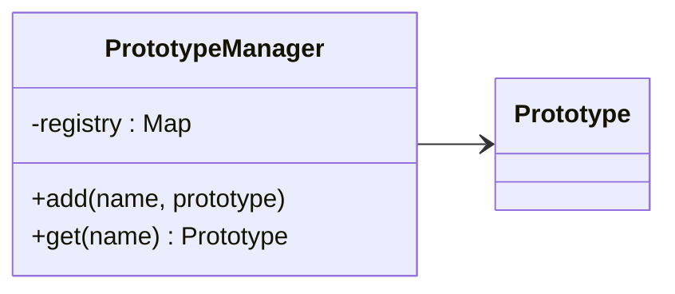

作用：

- 管理多个原型
- 通过 key 复制对应对象

---

|    设计模式    |            本质            |
| :------------: | :------------------------: |
| **建造者模式** | 分离：构建算法 与 部件构造 |
|  **原型模式**  | 克隆生成对象，避免重复构建 |

### 单例模式

在某些场景中，系统只需要某个类的一个实例，例如：

- 文件系统
- 任务管理器
- 打印池 `Print Spooler`
- 全局配置、日志记录器
- 序列号生成器

传统方式（如全局变量）无法防止对象被重复实例化，因此需要一种机制——**让类自己管理唯一实例，并提供全局访问点**。

---

> **保证一个类只有一个实例**，并提供一个可访问它的**全局访问点**。

要点：

1. 类只能有一个实例
2. 类负责自行创建这个实例
3. 类提供全局访问该实例的静态方法


---

一个标准的单例类必须满足：

- **构造函数私有化**（禁止外部 `new`）
- **包含静态私有实例变量**
- **提供静态公共工厂方法返回唯一实例**

Java 实现示例：

```java
public class Singleton {
    private static Singleton instance = null;

    private Singleton() {}   // 私有构造函数

    public static Singleton getInstance() {
        if (instance == null) {
            instance = new Singleton();  // 第一次访问时创建实例
        }
        return instance;
    }
}
```

---

示例 1：**身份证号码**

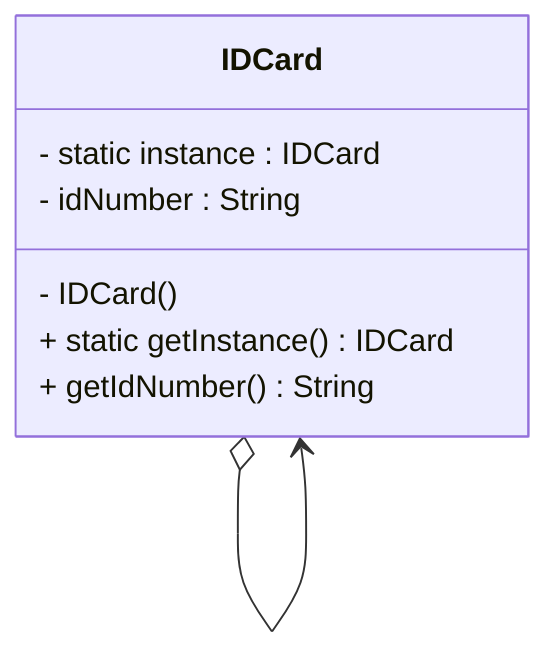

居民身份证号唯一，一个人补办身份证时仍使用同一号码。

---

示例 2：**打印池** `Print Spooler`

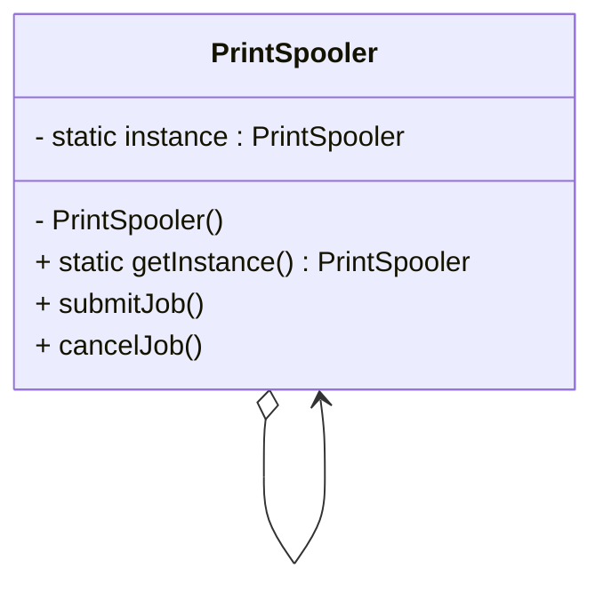

系统中只能有一个打印池程序，否则可能导致打印任务管理混乱。

**优点**：

- **受控访问唯一实例**，单例类通过自身封装严格控制实例创建。
- **节约系统资源**，频繁创建/销毁对象将增加开销，单例可以减少开销。
- **允许扩展为“可控数量的实例”**，可扩展为多例模式（Multiton），控制实例数目。

**缺点**：

- **不易扩展**：因为没有抽象层，很难继承和扩展
- **职责过重**：既负责创建实例又负责自身业务逻辑
- **容易被滥用**：可能导致对象共享过多，造成安全或资源问题（如把数据库连接池设计为单例导致连接耗尽）

---

适合使用单例模式的情况：

- 系统中只需要一个实例（如日志记录器、配置管理器）
- 实例需要通过唯一的全局访问点访问
- 实例创建成本高、或需要在整个运行周期维持的对象

**系统中的实际应用**

1. Java Runtime（经典单例）

```java
public class Runtime {
    private static Runtime currentRuntime = new Runtime();
    public static Runtime getRuntime() {
        return currentRuntime;
    }
    private Runtime() {}
}
```

2. Spring 默认 `Bean Scope = Singleton`

```xml
<bean id="date" class="java.util.Date" scope="singleton"/>
```

Spring 默认管理的 Bean 是单例级别（应用范围内共享）。

#### 单例模式的扩展

1. **饿汉式**（**类加载时就创建对象**）

```java
public class Singleton {
    private static Singleton instance = new Singleton();
    private Singleton() {}
    public static Singleton getInstance() {
        return instance;
    }
}
```

**优点：** 线程安全、实现简单

**缺点：** 可能占用不必要的资源（类加载时就创建）

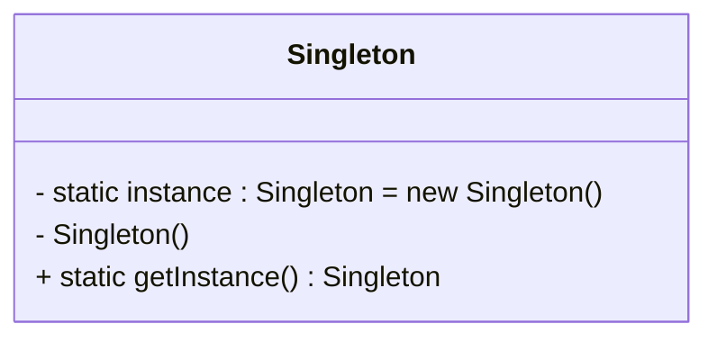

2. **懒汉式**（第一次使用时才创建）

```java
public static synchronized Singleton getInstance()
```

**优点：** 节省资源

**缺点：** 在多线程环境下需要同步，性能较低

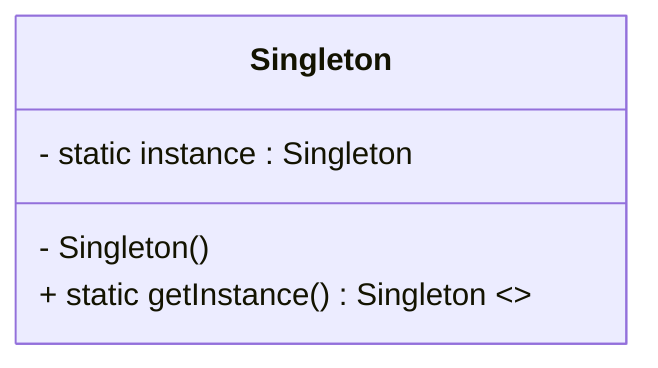

---

单例模式的本质是：**控制实例数量**。

不仅可以控制为 1 个，也可以控制为 2 个、3 个或者 $N$ 个 → 形成 **多例模式**（Multiton）。

## 结构型设计模式

结构型模式主要解决 —— **如何把类或对象组合成更强大、更复杂的结构**。

就像：

- 积木组合 → 建筑
- 代码组件组合 → 模块化软件系统

结构型模式分为两类：

1. **类结构型模式**（以继承关系为主）

   - 通过类与类之间的继承、实现关系组成更大结构

   - 特点：编译期静态绑定，灵活性较低

2. **对象结构型模式**（以组合、聚合为主）

   - 对象组合：一个对象持有另一个对象，实现更灵活的结构

   - 更符合“合成复用原则”（优先使用组合而不是继承）

   - 大多数结构型模式属于对象结构型模式

**常见的结构型设计模式**：

|          模式          |               功能               |
| :--------------------: | :------------------------------: |
| **适配器模式** Adapter |  接口转换，使不兼容对象协同工作  |
|  **桥接模式** Bridge   |  将抽象与实现分离，两者独立变化  |
| **组合模式** Composite | 树形结构，统一处理单个与组合对象 |
| **装饰模式** Decorator |      动态为对象添加额外职责      |
|  **外观模式** Facade   |   为复杂子系统提供统一简化接口   |
| **享元模式** Flyweight |      共享对象，减少内存消耗      |
|   **代理模式** Proxy   |    控制访问对象，附加额外功能    |

### 适配器模式

当“已有类”能满足需求但**接口不兼容**时，会出现以下问题：

- 方法名不同
- 参数格式不同
- 类不方便修改（黑盒库、第三方库）

类似我们日常使用的“电源适配器”：

- 插头不匹配 → 使用 `adapter` 来转换接口

适配器模式的目的：**把一个接口转换成客户期望的接口，使得现有类可以复用。**

---

**适配器模式**（Adapter Pattern）：

> 将一个类的接口转换成客户期望的另一个接口，使原本接口不兼容的类可以一起工作。

又称为：**包装器**（Wrapper）

适配器模式分两类：

1. **类适配器**（**使用继承**）
2. **对象适配器**（**使用组合**）

---

#### 对象适配器

对象适配器使用组合，更加常用。

注意，在图中， **`Target` 是我们需要调用的“统一的接口”**，而 `Adaptee` 是旧的或者不兼容的接口，所以我们需要用 `Adapter` 兼容它的功能。


```java
public class Adapter implements Target {
    private Adaptee adaptee;

    public Adapter(Adaptee adaptee) {
        this.adaptee = adaptee;
    }

    public void request() {
        adaptee.specificRequest();
    }
}
```

特点：

- **更灵活**，可适配多个适配者类
- 强烈符合“合成复用原则”

---

对象适配器的优点：

- 一个适配器可以对应多个适配者实例
- 可以适配适配者及其子类
- 灵活性更高 → 使用更多

缺点：

- 不易重写适配者方法（除非再写子类）

#### 类适配器

使用继承。


```java
public class Adapter extends Adaptee implements Target {
    public void request() {
        specificRequest(); // 调用父类方法
    }
}
```

特点：

- 使用 **多重继承（类继承 + 接口实现）**
- Java/C# 不支持多重继承 → 只能继承一个 Adaptee

类适配器的优点：

- 由于使用继承，可以覆盖适配者的方法（更灵活）

缺点：

- **不能适配多个适配者类**（继承限制）
- 目标必须是接口或抽象类（否则不能继承）

---

**适配器模式的优点**：

- **解耦**：目标类与适配者类解耦
- **复用性强**：可以复用已有类（不用改源代码）
- **符合开闭原则**：可以随时添加新的适配器
- **对象适配器支持适配多个类及其子类**

---

**适配器模式适用环境**

- 系统需要使用某个类，但其接口不兼容
- 希望复用一些“功能相似但接口不同”的类
- 想为未来可能增加的新类（适配者）准备好扩展点

---

**应用实例**

1. **JDBC 驱动**（典型应用）
   - JDBC → 抽象的 Target
   - 数据库驱动 → Adapter
   - 底层数据库 API → Adaptee
   - 每种数据库都有自己的适配器。

2. **JDK 的 `InputStreamAdapter`**

```java
public class InputStreamAdapter extends InputStream {
    ImageInputStream stream;

    public InputStreamAdapter(ImageInputStream stream) {
        this.stream = stream;
    }

    public int read() throws IOException {
        return stream.read();
    }

    public int read(byte[] b, int off, int len) throws IOException {
        return stream.read(b, off, len);
    }
}
```

---

**模式扩展**

1. **默认适配器模式**（接口适配器）

当一个接口方法很多，但我们只需要一部分时：

- 定义一个 **默认适配器类（提供空方法）**
- 子类只需覆盖需要的方法


常见于 Java AWT：

- `WindowAdapter`
- `KeyAdapter`
- `MouseAdapter`

2. **双向适配器**

可以同时转换：

- Target → Adaptee
- Adaptee → Target


3. **智能适配器**

在调用前后加入附加处理，例如：

- 日志
- 校验
- 缓存
- 自动选择不同的适配者（策略化）

---

> 适配器模式的本质：**转换匹配 + 复用功能**

核心理念：

- 不修改旧代码
- 把旧接口“包装”为新接口
- 让不兼容的类可以协作

结构型模式的核心是：**通过组合/继承构建更强大结构**，适配器模式正是其中最典型的“接口转换器”。

### 桥接模式

蜡笔具有两个变化维度：

- 颜色（12 种）
- 型号（大、中、小）

它们被“绑定在同一类中”：

> 型号 + 颜色 → 一个具体类

所以：

- 增加一种型号 → 多 12 个类
- 增加一种颜色 → 多 3 个类

最终膨胀为 36 个类。

原因：**两个变化维度没有分离（耦合大）**。

---

而毛笔分为：

- 型号 → 3 种笔（抽象维度）
- 颜色 → 12 种颜料（实现维度）

组合后仍然可以实现 3×12 的组合，但只需 **3 + 12 = 15 类对象**。

图形学中的“形状 Shape + 颜色 Color”也是同样的问题。

此类问题的本质：

> **某个类存在两个（或多个）独立变化的维度**，但如果写死在一个类中，扩展必然爆炸。

---

**桥接模式**：

> **将抽象部分与实现部分分离**，使它们都可以独立地变化。

关键词：

- 独立变化的维度（如“形状”和“颜色”）
- 抽象部分（Abstraction）
- 实现部分（Implementor）
- 用“对象组合”代替“继承耦合”
- 是对象结构型模式

经常也被叫做：

- Handle and Body
- Interface


1. **实现接口**

```java
public interface Implementor {
    void operationImpl();
}
```

2. **抽象部分**

```java
public abstract class Abstraction {
    protected Implementor impl;

    public void setImpl(Implementor impl) {
        this.impl = impl;
    }

    public abstract void operation();
}
```

3. **扩展抽象部分**

```java
public class RefinedAbstraction extends Abstraction {
    public void operation() {
        // 先做抽象类的操作
        impl.operationImpl();  // 调用实现层的方法
        // 再做子类扩展操作
    }
}
```

#### 桥接模式实例：模拟毛笔

根据课件：3 种型号 × 5 种颜色。

1. **颜色的维度（Implementor）**

```java
public interface Color {
    void paint(String penType, String name);
}
```

不同颜色实现：

```java
public class Red implements Color {
    public void paint(String penType, String name) {
        System.out.println(penType + " red " + name);
    }
}
```

2. **型号的维度（Abstraction）**

```java
public abstract class Pen {
    protected Color color;
    public void setColor(Color color) {
        this.color = color;
    }
    public abstract void draw(String name);
}
```

3. **型号的子类**

```java
public class BigPen extends Pen {
    public void draw(String name) {
        color.paint("Big pen", name);
    }
}
```

4. **使用示例**

```java
Pen pen = new BigPen();
pen.setColor(new Red());
pen.draw("Flower");
```

**桥接模式的优点**：

| 优点                            | 说明               |
| :------------------------------ | ------------------ |
| **1. 分离抽象与实现**（最核心） | 两个维度可独立变化 |
| **2. 替代多重继承**             | 避免继承层次爆炸   |
| **3. 组合优于继承**             | 更灵活、更可扩展   |
| **4. 任意维度扩展不影响对方**   | 符合开闭原则       |
| **5. 运行期动态切换实现**       | 更灵活             |

**缺点**

- 增加设计复杂度
- 需要识别“独立变化的维度”，需要经验

---

**适用场景**

- 当一个类有 **两个或多个独立变化维度**
- 不希望使用继承来绑定多个维度
- 想要在运行时动态切换某一个维度
- 系统要支持组合爆炸（如 3×5）但不能真的写那么多个类

---

> 桥接模式的本质是：**分离抽象和实现，让它们可以独立变化。**

其余优点（动态切换、减少子类个数等）都是这一点带来的必然结果。

---

#### 桥接 + 适配器模式

两种模式的区别：

|    点    |             桥接模式             |              适配器模式               |
| :------: | :------------------------------: | :-----------------------------------: |
|   目的   | 解耦“抽象与实现”两个独立变化维度 |      兼容已有接口，使旧代码能用       |
|   用在   |           系统设计初期           | 系统已经成型后，为兼容旧代码/第三方库 |
|  改代码  |       需要设计两个层次结构       |        不需要改原有类（黑盒）         |
|   本质   |           组合两个维度           |               转换接口                |
| 解决问题 |           扩展性和解耦           |           可复用性和兼容性            |

一句话总结：

> - 桥接：**设计好的解耦结构**
> - 适配器：**后期发现接口不兼容时的补丁**

---

**联用场景**：报表显示 × 数据源读取

需求：

- 报表有多种显示方式（PDF / HTML …）
- 数据源有多种读取方式（txt / DB / Excel …）

→ 报表（抽象维度）
→ 数据源（实现维度）

但 Excel API 由第三方提供，需要：

- `ExcelDataReaderAdapter`（适配器）转为系统可用格式
- `DataReader` 是 bridge 的实现层

结构示意：


---

问：**为什么要桥接 + 适配**？

因为：

- **桥接**解决“报表显示方式 × 数据读取方式”的多维扩展
- **适配器**解决“Excel API 与系统接口不兼容”

进一步总结：

| 模式       | 在此场景中作用                       |
| ---------- | ------------------------------------ |
| **桥接**   | 报表和数据源是两个维度，需灵活组合   |
| **适配器** | Excel API 接口与 `DataReader` 不兼容 |

这一组合在实际系统中极其常见：

- 多媒体播放器（视频编码 × 播放方式）
- 数据可视化（图表类型 × 数据供应器）
- 跨平台 GUI（控件 × 渲染接口）

### 组合模式

现实中大量结构是 **树形结构**，例如：

- 文件系统：文件夹里有文件和子文件夹
- 公司组织：部门 > 小组 > 员工
- GUI 系统：窗口 > 面板 > 控件

**问题：**
容器节点（`Folder`）和叶子节点（`File`）功能不一样，如果客户端要遍历它们，就必须区分处理：

```pseudocode
if (node is folder) {
    traverse children
} else if (node is file) {
    open file
}
```

这会让客户端代码复杂、难以维护。

**组合模式的目标：**“让客户端对叶子对象和容器对象一视同仁（统一处理）。”

---

**组合模式**：

> 通过把对象组合成树形结构，让客户端对 _整体_ 和 _部分_ 的使用保持一致。

- 叶子对象（Leaf）：没有子节点
- 容器对象（Composite）：含有子节点（叶子或容器）
- 抽象组件（Component）：对两者统一建模并提供相同接口
- 客户端（Client）：只依赖 Component，不关心是叶子还是组合

```text
         Component
        /         \
     Leaf      Composite
                    |
                 children[]
```

Component 中会出现的典型结构：

```java
add(c)
remove(c)
getChild(i)
operation()
```

---

**抽象组件**

```java
abstract class Component {
    public abstract void operation();
    public void add(Component c) { throw new UnsupportedOperationException(); }
    public void remove(Component c) { throw new UnsupportedOperationException(); }
    public Component getChild(int i) { throw new UnsupportedOperationException(); }
}
```

**叶子组件**

```java
class Leaf extends Component {
    public void operation() {
        System.out.println("Leaf operation");
    }
}
```

**容器组件**（重点：**递归**）

```java
class Composite extends Component {
    List<Component> children = new ArrayList<>();

    public void add(Component c) { children.add(c); }
    public void remove(Component c) { children.remove(c); }
    public Component getChild(int i) { return children.get(i); }

    public void operation() {
        for (Component c : children) {
            c.operation();   // 递归
        }
    }
}
```


---

实例：**水果盘**（Plate）

- Leaf：Apple, Banana
- Composite：Plate（含若干水果或子盘子）
- 调用 `operation()` → 遍历整个结构并吃掉水果


---

**优点**：

1. **统一叶子与容器接口** —— 客户端不必区分
2. **容易扩展** —— 添加新的 Leaf 或 Composite 不影响原有代码
3. **天然适配树结构** —— 遍历用递归即可

**缺点**：

1. **难以限制容器的子类型**（可能放入非法类型组件）
2. **管理子节点操作可能导致叶子类出现无意义方法**（透明模式）

#### 透明组合模式

较为常见

`Component` 中包含 `add`/`remove`/`getChild()`
→ 客户端统一处理
→ **`Leaf` 中这些方法无意义，但必须实现（抛异常）**

#### 安全组合模式

`Component` 不包含 `add`/`remove`/`getChild`，`Composite` 中才有 `add`/`remove`
→ 安全，但客户端必须区分 `Composite`/`Leaf`

---

> 组合模式的本质：**统一叶子对象和组合对象**。

客户端只面对 Component，不管是整体还是部分都一样使用。

### 装饰模式

给对象**动态添加功能**有几种方式：

1. **继承**（缺点：静态、组合爆炸）

想给 Car 添加各种功能：

- 会说话
- 会飞
- 会射击
- 会游泳

如果用继承：

> `FlyingTalkingSwimmingShootingCar`

类爆炸，扩展困难。

2. **关联**（装饰模式思想）

> `Car` -> 装饰器(飞) -> 装饰器(说话) -> 装饰器(泳)

**动态组合、随装随改、可多次叠加。**

---

装饰模式通过创建一个“**装饰器对象**”包裹原对象，在原方法执行的前后增强行为，实现功能的动态叠加。

别名：Wrapper（包装器）

> 装饰模式的核心：**动态组合，而不是继承**。

```text
         Component
      /              \
ConcreteComponent  Decorator
                      |
             ConcreteDecoratorA
             ConcreteDecoratorB
```


---

**抽象组件**

```java
abstract class Component {
    public abstract void operation();
}
```

**具体组件**（被装饰对象）

```java
class ConcreteComponent extends Component {
    public void operation() {
        System.out.println("基础功能");
    }
}
```

**抽象装饰类**（关键）

```java
class Decorator extends Component {
    protected Component component;
  	// 注意这里，记录了一个外层的装饰器

    public Decorator(Component c) {
        this.component = c;
    }

    public void operation() {
        component.operation();   // 默认先调用原功能
    }
}
```

**具体装饰器**

```java
class ConcreteDecoratorA extends Decorator {
    public ConcreteDecoratorA(Component c) { super(c); }

    public void operation() {
        super.operation();
        System.out.println("附加功能A");
    }
}
```

---

实例：**变形金刚**

```
Car (基础)
  ↓ 装饰为 Robot
Robot
  ↓ 再装饰为 飞机
RobotFly
```

客户端：

```java
Component c = new Car();
c = new RobotDecorator(c);    // 变成机器人
c = new AirplaneDecorator(c); // 加飞行能力
c.operation();
```

**优点**：

1. **比继承更灵活（组合 > 继承）**
2. **功能小而单一，易复用**
3. **动态：运行时自由叠加**

**缺点**：

1. **类数变多**（每一种功能一个装饰器）
2. **排查问题（多层嵌套）较困难**

---

**适用场景**

- 不改原有类结构，但想给对象添加功能
- 许多独立功能需要自由组合
- 类不能继承（例如 `final class`）

特别常见于：

- **Java I/O 体系（最典型）**
- **Swing/`JScrollPane` 装饰 `JList`**
- **流式 API 中增强行为**

#### 透明装饰模式

所有东西都用 `Component` 类型接收：

```java
Component c = new AdvancedDecorator(new SimpleDecorator(new ConcreteComponent()));
```

#### 半透明装饰模式

更常见。

允许访问具体装饰器的方法：

```java
Robot r = new Robot(car);
r.say();  // 特有功能
```

---

> 装饰模式的本质是“**动态组合对象行为**”。

- 动态（运行时）
- 组合（不是继承）
- 通过叠加装饰器来增强功能

### 外观模式

现实中的场景：

- 组装电脑需要分别和 CPU 商家、主板商家、显卡商家打交道 → **复杂**。
- 找装机店 → 只跟装机店沟通，装机店内部对接多个商家 → **简单**。

在软件系统中：客户端若要使用系统 A 的功能，却必须调用 **子系统 A、子系统 B、子系统 C**……

这让客户端代码变得复杂、耦合度高。

**解决方案：引入“外观角色”（Facade）**
→ 客户端只与外观类交互
→ 外观类内部协同多个子系统完成任务
→ 隐藏系统复杂性，降低耦合度。

---

> 外观模式（Facade Pattern）：**为子系统中的一组接口提供一个统一的入口**。
>
> 它定义一个高层接口，让子系统更易使用。

特性：

- 客户端只需与外观类交互，不需要了解子系统细节。
- 外观模式是 **迪米特法则**（最少知识原则） 的典型实现。

---

**模式结构与角色**

1. **Facade** **外观角色**

   - 提供一个统一入口，封装对子系统的调用逻辑。

   - 知道“应该调用哪个子系统”。

2. **SubSystem** **子系统角色**

   - 完成实际业务逻辑。

   - 不知道外观类的存在。


**模式实现示例**

1. **子系统类**

```java
class SubSystemA {
    public void MethodA() { }
}

class SubSystemB {
    public void MethodB() { }
}

class SubSystemC {
    public void MethodC() { }
}
```

2. **外观类**

```java
public class Facade {
    private SubSystemA a = new SubSystemA();
    private SubSystemB b = new SubSystemB();
    private SubSystemC c = new SubSystemC();

    public void method() {
        a.MethodA();
        b.MethodB();
        c.MethodC();
    }
}
```

3. **客户端**

```java
Facade f = new Facade();
f.method();
```

---

**优点**

- **大幅降低系统复杂度**，客户端只依赖外观类。
- **子系统变化不影响客户端**。
- 客户端更易使用（统一入口）。
- 外观可以作为系统 API 的入口（分层结构的边界）。

**缺点**

- 过度使用可能让 “外观类过于臃肿”。
- 增加或删除子系统需要修改外观类 → **违反开闭原则**。

---

**模式适用场景**

- 系统复杂，希望给客户一个简单接口。
- 客户端与多个子系统高度耦合。
- 分层架构中，使用外观作为层之间的 API。

---

**模式实例**：**JDBC 外观封装**

传统 JDBC 要创建：Connection → Statement → ResultSet
非常繁琐。

外观类：

```java
public class JDBCFacade {
    private Connection conn;
    private Statement statement;

    public void open(...) { ... }
    public int executeUpdate(String sql) { ... }
    public ResultSet executeQuery(String sql) { ... }
    public void close() { ... }
}
```

客户端只用一个类就能完成所有数据库操作。

---

**模式扩展**

1. **外观类可以有多个**：按业务拆分多个 Facade，不必所有子系统都放在一个大外观中。

2. **不要在外观类中加入新业务**：外观不是业务处理层，只是“调用协调器”。

3. 可以引入 **抽象外观类**

   - 使系统更遵守开闭原则。

   - 可以在不改客户端代码的情况下替换外观类。

---

> 外观模式的本质：**封装交互，简化调用**。

外观屏蔽了多个子系统之间的复杂交互，为客户端提供简单统一的 API。

### 享元模式

围棋棋盘上：

- 黑子：数百个
- 白子：数百个

但其实：

- 所有黑子 **外观完全相同**
- 所有白子 **外观完全相同**

如果为每一个棋子都 `new` 一个对象：

```
500个黑子 + 500个白子 = 1000个对象
```

这 1000 个对象内部保存的：

- 颜色
- 形状
- 显示信息

全部重复 → 浪费内存

但实际上：

> 同一种颜色的棋子，只需要一个对象位置由外部记录

**享元模式的本质：用“位置”等外部状态替代对象内部的重复信息**

#### 内部状态和外部状态

1. **内部状态**（Intrinsic State）

特点：

- 不会因为环境变化而变化
- 可以共享
- 存储在享元对象内部

比如：
围棋中的棋子颜色：黑 / 白
字符中的字母内容：`a`, `b`, `c`

2. **外部状态**（Extrinsic State）

特点：

- 随环境变化
- 不可共享
- 由外部传入

比如：
围棋中的位置：`(x, y)`
字符的字体大小 / 颜色

---

**相同内部状态的对象可以共享，同一个对象多次使用，不同的外部状态通过参数传入。**

---

**抽象享元类**：`ChessFlyweight`

```java
public abstract class ChessFlyweight {
    protected String color;  // 内部状态：颜色

    public ChessFlyweight(String color) {
        this.color = color;
    }

    // 外部状态通过参数注入（位置）
    public abstract void display(int x, int y);
}
```

**具体享元类**：`BlackChess` 和 `WhiteChess`

```java
public class BlackChess extends ChessFlyweight {

    public BlackChess() {
        super("黑色");
    }

    @Override
    public void display(int x, int y) {
        System.out.println("在位置 (" + x + ", " + y + ") 放置 " + color + " 棋子");
    }
}
public class WhiteChess extends ChessFlyweight {

    public WhiteChess() {
        super("白色");
    }

    @Override
    public void display(int x, int y) {
        System.out.println("在位置 (" + x + ", " + y + ") 放置 " + color + " 棋子");
    }
}
```

**享元工厂类**：`ChessFlyweightFactory`

这个是核心角色：**享元池 + 管理创建**

```java
import java.util.HashMap;
import java.util.Map;

public class ChessFlyweightFactory {

    private static Map<String, ChessFlyweight> pool = new HashMap<>();

    public static ChessFlyweight getChess(String color) {
        ChessFlyweight chess = pool.get(color);
        // 从享元池里面取出对象
				// 如果享元池里面不存在，那就创建一个
        if (chess == null) {
            if (color.equals("black")) {
                chess = new BlackChess();
            } else if (color.equals("white")) {
                chess = new WhiteChess();
            }
            pool.put(color, chess);
        }

        return chess;
    }
}
```

**客户端使用代码**

```java
public class Client {
    public static void main(String[] args) {

        ChessFlyweight black1 = ChessFlyweightFactory.getChess("black");
        black1.display(1, 1);

        ChessFlyweight black2 = ChessFlyweightFactory.getChess("black");
        black2.display(2, 3);

        ChessFlyweight white1 = ChessFlyweightFactory.getChess("white");
        white1.display(4, 5);

        System.out.println(black1 == black2); // true，共享
    }
}
```

两个 `black` 实际只创建了一个对象，只是位置是外部传入：这就是享元。

#### 单纯享元模式

特点：

- 所有享元类都是共享的
- 没有非共享子类

例子：围棋棋子、字符共享

最适合：大量重复、无个性变化的对象

#### 复合享元模式（结合组合模式）

比如：文本编辑器中的**一段文字**可以由多个字符组合而成，它们可以共用同一外部状态（字体、大小等）/

伪代码示意：

```java
public class CompositeFlyweight implements Flyweight {

    private List<Flyweight> children = new ArrayList<>();

    public void add(Flyweight f) {
        children.add(f);
    }

    @Override
    public void operation(String extrinsicState) {
        for (Flyweight f : children) {
            f.operation(extrinsicState);
        }
    }
}
```

复合享元 = 享元 + 组合模式

#### 与工厂模式

大多数享元模式：

- 一定要有工厂
- 工厂负责缓存对象

典型结构：

```java
public static Flyweight get(key);
```

#### 与单例模式

一般一个系统中：

> 只需要一个享元工厂

所以：

```
FlyweightFactory → 通常设计为单例
```

#### 与组合模式

在做“复合享元”时：

```
多个Flyweight → 组成一个整体
```

这个本质上就是：

> 享元模式 + 组合模式

#### 与装饰模式

| 模式 | 关注点             |
| ---- | ------------------ |
| 享元 | 节省内存、共享对象 |
| 装饰 | 动态扩展功能       |

享元是“**减少对象数量**”，装饰是“**增强对象能力**”。

---

**适用条件**：

> **对象多 + 内容像 + 可外部化 = 用享元**

- 大量对象
- 大量重复
- 大部分状态可外部化
- 多次重复使用同类对象

---

**享元模式核心目标：**把大量重复对象变成少量共享对象，用“外部状态”代替对象的“内部个性差异”。

### 代理模式

- 现实中的“代购”场景：你不能（或不想）直接访问国外商店，于是找代购网站代理你购买。

- 软件中：有时客户端“不想”或“不能”直接访问某个对象，**需要第三者代理**。

例如：

- 控制权限（保护代理）
- 控制对象生成（虚拟代理）
- 远程访问（远程代理）
- 访问额外行为（智能引用代理）
- 缓存结果（缓冲代理）

---

> 代理模式（Proxy Pattern）：**为某个对象提供一个代理，由代理控制对这个对象的访问**。

代理充当真实对象的替身，负责：

- 转发调用
- 控制访问
- 附加附加功能（延迟加载、缓存、权限检查等）

---

**模式结构与角色**

1. **Subject** **抽象主题**：真实对象和代理对象的共同接口。
2. **RealSubject** **真实主题**：真正干活的对象。

3. **Proxy** **代理类**

   - 维护 RealSubject 的引用

   - 控制访问

   - 调用前后加入新的行为


---

**模式示例**

1. **抽象主题**

```java
public interface Subject {
    void request();
}
```

2. **真实主题**

```java
public class RealSubject implements Subject {
    public void request() {
        // 真实业务逻辑
    }
}
```

3. **代理类**

```java
public class Proxy implements Subject {
    private RealSubject real = new RealSubject();

    public void request() {
        preRequest();
        real.request();
        postRequest();
    }

    private void preRequest() { }
    private void postRequest() { }
}
```

---

**代理模式分类 & 适用场景**

| 代理类型         | 作用                                   |
| ---------------- | -------------------------------------- |
| **远程代理**     | 跨网络访问对象（RMI、WebService）      |
| **虚拟代理**     | 延迟创建开销大的对象，如大图片、大文档 |
| **保护代理**     | 控制权限，用户权限不一样               |
| **缓冲代理**     | 保存结果，减少重复计算                 |
| **智能引用代理** | 调用计数、自动加锁等                   |
| **防火墙代理**   | 阻止不安全访问                         |
| **同步代理**     | 多线程环境下控制访问                   |
| **写时复制代理** | Copy-on-write                          |

---

**优点**

- 解耦客户端与真实对象
- 代理可增强功能
- 可扩展性强（符合开闭原则）

**缺点**

- 多了一层调用，可能降低性能
- 某些代理复杂度较高（如动态代理）

#### 动态代理

相对于静态代理，动态代理更灵活：

- 不需要为每个 RealSubject 写一个代理类
- 运行时自动生成

基于两个核心类：

- `InvocationHandler`
- `Proxy.newProxyInstance()`

例如 Spring AOP 的实现原理。

---

> 代理模式的本质：**控制对象访问**（添加间接层）。

代理插入在客户端与目标对象之间，从而：

- 控制访问（权限）
- 改善性能（缓存、延迟加载）
- 添加功能（日志、统计、事务）

## 行为型模式

行为型模式关注的是：

- **对象之间如何分配职责**
- **对象之间如何交互**
- **运行时对象如何协作完成任务**

分为两大类：

| 类型               | 特征                                                                         |
| ------------------ | ---------------------------------------------------------------------------- |
| **类行为型模式**   | 通过 _继承_ 分配行为，父类与子类之间职责分配                                 |
| **对象行为型模式** | 通过 _对象关联（组合）_ 分配行为，更符合合成复用原则，大部分行为模式属于此类 |

常见行为型模式包括：

- 职责链
- 中介者
- 命令
- 观察者
- 策略
- 状态
- 解释器
- 迭代器
- 访问者
- 模板方法
- 备忘录

### 职责链模式

现实中的“链式处理”场景：

- 斗地主：出牌→下家→下下家→…直到有人要得起
- 请假审批：辅导员 → 系主任 → 院长 → 校长
- 异常捕获：子类异常 → 父类异常 → Throwable

这些共同特点：

- **请求会沿着一条链依次传递**
- **每个节点可以处理，也可以继续往下传**
- **客户端不关心最终由谁来处理**

职责链模式就是对这种结构的抽象。

---

> **职责链模式（Chain of Responsibility）**让多个对象都有机会处理请求，将这些处理对象连接成一条链，并沿着链传递请求，直到某个对象处理为止。
>
> ——属于对象行为型模式。

关键点：

- 发送者 → 不知道 → 最终处理者是谁
- 处理者 → 只知道 → 自己的“下家”是谁
- 链可以动态组合

---

**角色**

| 角色                      | 职责                                       |
| ------------------------- | ------------------------------------------ |
| **Handler**（抽象处理者） | 定义处理接口；保存 `successor`（下家）引用 |
| **ConcreteHandler**       | 实现处理逻辑；决定是否处理或转发           |
| **Client**                | 负责创建链并发起请求                       |


**典型代码**

1. **抽象处理者：**

```java
public abstract class Handler {
    protected Handler successor;

    public void setSuccessor(Handler successor) {
        this.successor = successor;
    }

    public abstract void handleRequest(int num);
}
```

2. **具体处理者：**

```java
public class Manager extends Handler {
    @Override
    public void handleRequest(int day) {
        if (day < 3) {
            System.out.println("Manager approves");
        } else if (successor != null) {
            successor.handleRequest(day);
        }
    }
}
```

3. **Client 组织链：**

```java
Handler a = new Manager();
Handler b = new Director();
Handler c = new CEO();

a.setSuccessor(b);
b.setSuccessor(c);

a.handleRequest(10);
```

模式实例：**请假审批**

| 请假天数 | 审批人 |
| -------- | ------ |
| <3       | 主任   |
| 3~9      | 经理   |
| 10~29    | 总经理 |
| ≥30      | 不批准 |

请求沿链依次传递——典型的职责链模式。

**优点**

- **降低耦合度**：发送者不关心处理者是谁
- **动态组合职责链**：可以在运行时调整处理顺序
- **符合开闭原则**：新增处理者无需修改旧代码

**缺点**

- **可能没人处理请求**
- **调试困难**（链很长时不易定位）
- **链配置不当可能导致循环**

**适用场景**

- 多个对象都可能处理请求，但具体由谁处理未知
- 希望“职责可变”，可以动态组合处理链
- 请求处理逻辑以“逐级过滤”的方式出现
  e.g. Web Filter Chain

**模式扩展**

1. **纯职责链**

   - 每个处理者 **要么处理，要么向下传递**

   - 请求一定被处理

2. **不纯职责链**（更常见）

   - 处理者可以部分处理再往下传

   - 请求可被多个处理者处理

   - 请求可能没人处理（JavaScript 事件冒泡）

---

> 职责链模式本质：**分离职责、动态组合处理流程**

### 中介者模式

现实类比：

- QQ 群 → 群负责群成员之间消息的转发与协调
- 机场塔台 → 管理所有飞机起降调度
- GUI 中控（Dialog 中控按钮、列表框等互相影响）

这些场景共同特点：

- **对象之间存在非常复杂的多对多关系**
- 如果对象互相直接引用，则耦合极高
- 修改一个对象会牵连整个系统

解决方式：

引入一个**中介者**（Mediator）

- 将对象之间的交互逻辑统一封装
- 同事对象不再直接相互引用

---

> **中介者模式（Mediator）**：用一个中介对象来封装一系列对象交互，使对象不需要显式地相互引用，从而使其耦合松散，交互集中管理。
> ——属于对象行为型模式。

核心思想：

- 多对多 → 转换为 → 一对多
- 交互逻辑全部交给中介者处理

---

| 角色                        | 职责                                   |
| --------------------------- | -------------------------------------- |
| **Mediator（抽象中介者）**  | 定义交互接口；提供同事注册方法         |
| **ConcreteMediator**        | 实现具体协调逻辑；维护同事引用         |
| **Colleague（同事抽象类）** | 持有中介者引用；定义自身行为           |
| **ConcreteColleague**       | 实现同事行为，通过中介者与其他同事通信 |


---

**典型代码**

1. **抽象中介者：**

```java
abstract class Mediator {
    public abstract void register(Colleague c);
    public abstract void operation(Colleague sender, String msg);
}
```

2. **具体中介者：**

```java
class ConcreteMediator extends Mediator {
    private List<Colleague> list = new ArrayList<>();

    @Override
    public void register(Colleague c) {
        list.add(c);
    }

    @Override
    public void operation(Colleague sender, String msg) {
        for (Colleague c : list) {
            if (c != sender) {
                c.receive(msg);
            }
        }
    }
}
```

3. **同事类：**

```java
abstract class Colleague {
    protected Mediator mediator;
    public Colleague(Mediator mediator) { this.mediator = mediator; }
    public abstract void receive(String msg);
    public void send(String msg) { mediator.operation(this, msg); }
}
```

模式实例：**聊天室**

- 群主（Mediator）负责消息广播
- 群成员（Colleague）只与群主交互，不直接找其他成员

发送消息代码：

```java
member1.send("hello");
```

群主转给其他所有人。

---

**优点**

- **彻底降低同事对象之间耦合**
- **同事对象更易复用**
- **交互逻辑集中管理，易修改、易扩展**

**缺点**

- **中介者过度膨胀（复杂度转移）**
  越多的交互越集中，中介者可能成为“上帝类”

---

**适用场景**

- 多个对象之间存在复杂的引用关系和交互
- GUI 组件之间联动（按钮、列表框、文本框）
- 聊天室、消息系统
- MVC 模式中的 `Controller`（典型中介者）

#### 与外观模式的比较

| 模式           | 作用                 | 交互方向 | 应用位置             |
| -------------- | -------------------- | -------- | -------------------- |
| **中介者模式** | 封装对象**内部**交互 | 多向     | 同层对象之间（内部） |
| **外观模式**   | 简化子系统对外接口   | 单向     | 系统外部调用系统内部 |

一句话总结：**外观是外部调用内部；中介者是内部之间交互。**

---

> 中介者本质：封装交互，**把网状结构变为星形结构**。

### 命令模式

命令模式可看作 “**把一个请求变成一个对象**”。

现实类比 —— **开关控制电器**

- “开关” 是 **请求发送者**
- “电灯” 是 **请求接收者**
- “电线” 是 **命令对象**

关键点：

> **开关并不知道要控制什么电器，只负责发送“开/关”的动作；真正执行逻辑由电器完成。**

这就是 **解耦发送者与接收者**，使得发送者不关心接收者的类型和逻辑。

软件类比：

- GUI按钮（Invoker）
- 点击处理函数（Command）
- 实际业务处理类（Receiver）

---

> 命令模式**将一个请求封装为一个对象，因此可以对请求排队、记录日志、撤销、组合等**。

命令 = 对接收者执行某种操作的 "对象化表示"。

角色职责：

- **Command**：抽象命令，声明 `execute()`
- **ConcreteCommand**：具体命令，包装了 Receiver
- **Receiver**：执行真正的业务逻辑
- **Invoker**：请求发送者，通过 Command 调用 Receiver


---

命令模式的关键点在于：

1. **把“行为”对象化**，请求从“函数调用”变成独立对象 → 可以存储、传递、排队。

2. **彻底解耦发送者与接收者**，Invoker 不知道 Receiver 的存在，只认识 Command。

3. 能支持以下功能：

   - 请求队列（批处理）

   - 请求日志（恢复/重放）

   - 撤销（Undo）

   - 重做（Redo）

   - 宏命令（组合命令）

且命令模式真正厉害的地方在于扩展性，而不仅是结构：

#### 命令队列（多命令批处理）

将多个命令对象存入队列：

```java
class CommandQueue {
    //定义一个ArrayList来存储命令队列
    private ArrayList<Command> commands = new ArrayList<Command>();
    public void addCommand(Command command) {  commands.add(command);   }
    public void removeCommand(Command command) {  commands.remove(command);  }
    //循环调用每一个命令对象的execute()方法
    public void execute() {
        for (Object command : commands) {
            ((Command)command).execute();
        }
    }
}
```


作用：

- 批量执行
- 顺序执行或并发执行
- 常用于调度器、批任务系统

#### 请求日志

保存“命令对象”而不是“执行结果”，在系统重启后可以 **重放操作**。

典型应用：

- 数据库日志
- 配置文件增删改日志
- 文件操作日志

#### 撤销

两种方式：

1. **命令类提供反向操作**（`reverse`/`undo`）
2. **通过保存执行前的状态**（借助备忘录模式）

第二种是命令模式 + 备忘录模式的联用。

#### 宏命令

命令模式 + 组合模式：一个命令包含多个命令，可以多层嵌套。

常见应用：

- Shell 脚本
- VS Code “组命令”
- 关键帧动画：一个宏命令 = 多个简单命令

---

实例：**电视遥控器**

- Button → Invoker
- OpenTVCommand → ConcreteCommand
- TV → Receiver

一个按钮可以绑定为任意行为 → 解耦。

---

实例：**功能键定义**

FunctionButton 是 Invoker
用户可以通过配置文件修改功能：

功能 A → exit
功能 B → help
功能 C → save

无需改变按钮代码，只改变配置文件 → 非常灵活。

---

**优点**

- 极强的扩展性（新命令类不影响已有代码）
- 彻底解耦请求者/接收者
- 内建支持撤销、队列、日志等复杂操作
- 宏命令功能强大

**缺点**

- 会生成大量命令类（类爆炸）

---

**模式适用场景**

- 需要撤销
- 需要日志
- 需要排队
- GUI 中按钮/菜单/快捷键绑定
- 宏命令
- 事务模型（正向调用 → 反向撤销）

---

命令模式的本质：

> **对请求进行封装，使行为对象化。**

### 备忘录模式

备忘录模式要解决的是：

> **在不暴露对象内部结构的前提下，保存和恢复对象的内部状态。**

这是“复杂撤销”的基础设施。

现实类比 —— <kbd>Ctrl</kbd> + <kbd>Z</kbd>

- 用户误操作
- 软件需要回到 **之前的某个状态**

百分之百依赖 **状态保存**。

---

> 备忘录模式**保存对象在某一时刻的状态，使其可以恢复**。

关键词：

- 不破坏封装
- 保存状态
- 恢复状态

---


角色：

- **Originator**：有状态，要被恢复的对象
- **Memento**：保存状态
- **Caretaker**：管理备忘录（但不能修改）

---

备忘录模式的关键点是 **封装性必须强**：

- 外界不能修改备忘录
- 只有 Originator 才能读写备忘录

Java 通过：包级可见性 / 内部类实现隐藏。

C++ 可通过 `friend`。

---

**缺点**：

- **大状态 = 大内存消耗**
- 频繁快照非常昂贵

这就是为什么编辑器的撤销次数一般有限。

#### 多次撤销 & 重做

策略：

- `Caretaker` 维护一个栈或列表
- `undo`：向后取一个备忘录
- `redo`：向前取一个备忘录


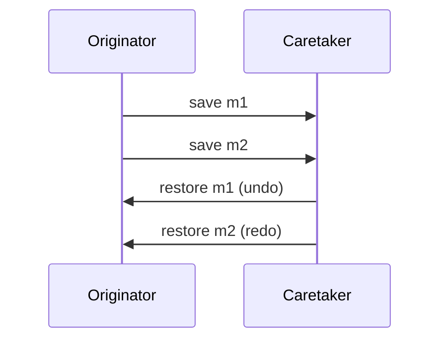

#### 与命令模式的联动

命令模式负责 **动作**，备忘录模式负责 **保存状态**。

两者可组合成强力撤销系统：

- 执行命令前：生成 `Memento`
- 撤销时：`restoreMemento()`

#### 与原型模式的结合

Originator 可以直接 `clone()`，这个 `clone` 就作为备忘录对象保存。

适合“全部状态都需要存储”的系统。

---

备忘录模式的本质：

> **保存和恢复内部状态**（**不破坏封装**）。

#### 命令模式和备忘录模式的对比

| 特征       | 命令模式                | 备忘录模式                       |
| ---------- | ----------------------- | -------------------------------- |
| 目的       | 封装行为/请求           | 保存状态以恢复                   |
| 支持撤销？ | 需配合备忘录            | 是撤销的基础设施                 |
| 本质       | 行为对象化              | 状态对象化                       |
| 主要用于   | GUI、事务、队列、宏命令 | 编辑器撤销、游戏回合、数据库回滚 |
| 是否解耦   | 解耦发送者/接收者       | 不破坏封装，状态安全             |

组合使用效果最佳：

- 命令 → 执行/撤销
- 备忘录 → 保存状态

### 迭代器模式

**核心矛盾：**

> 一个类既要负责**存储数据**，又要负责**遍历数据**，会导致职责混乱、扩展困难。

比如：

- 一个 `TV` 类既存频道，又提供 `nextChannel()`、`prevChannel()`、`randomChannel()` 等遍历方式。
- 如果以后要加“按频道类型遍历”？你就要改 `TV` 类。

这违反了：**单一职责原则**和**开闭原则**

因此我们：

> 把“遍历行为”从“存储类”中剥离出来，由一个独立的对象负责 —— 迭代器。

就像：

- 电视：只负责存频道
- 遥控器：负责访问和切换频道

---

> 迭代器模式：**提供一种统一的方式访问聚合对象内部元素，而不暴露其内部结构**。

关键词记住三点：

- 不暴露内部结构
- 顺序访问
- 职责分离

---

| 角色              | 职责                       |
| ----------------- | -------------------------- |
| Iterator          | 定义遍历接口               |
| ConcreteIterator  | 实现具体遍历逻辑           |
| Aggregate         | 抽象聚合类，负责创建迭代器 |
| ConcreteAggregate | 具体聚合对象               |

```
客户端 ---> 迭代器 ---> 聚合对象
```

迭代器内部持有聚合对象的引用。


**抽象迭代器**：

```java
interface Iterator {
    void first();
    void next();
    boolean hasNext();
    Object currentItem();
}
```

**抽象聚合**：

```java
interface Aggregate {
    Iterator createIterator();
}
```

**具体实现关系**：

```java
class ConcreteAggregate implements Aggregate {
    private List<Object> elements;

    public Iterator createIterator() {
        return new ConcreteIterator(this);
    }

    public Object get(int index) {
        return elements.get(index);
    }

    public int size() {
        return elements.size();
    }
}
class ConcreteIterator implements Iterator {
    private ConcreteAggregate aggregate;
    private int cursor = 0;

    public void first() {
        cursor = 0;
    }

    public void next() {
        cursor++;
    }

    public boolean hasNext() {
        return cursor < aggregate.size();
    }

    public Object currentItem() {
        return aggregate.get(cursor);
    }
}
```

---

**优点**：

1. 分离集合与遍历逻辑
2. 支持多种遍历策略
3. 符合开闭原则
4. 统一访问方式

**缺点**：

1. 类数量增加
2. 抽象设计难度较高
3. 有些情况下性能略有损耗

#### 内部与外部迭代器

| 比较   | 外部迭代器        | 内部迭代器           |
| ------ | ----------------- | -------------------- |
| 控制权 | 客户端控制        | 迭代器控制           |
| 方式   | 手动调用 `next()` | 传回调函数           |
| 例子   | `Iterator`        | `forEach` / `Stream` |

> 外部是“你走路”，内部是“它推你走”。

---

迭代器模式的本质：**控制对聚合对象内部元素的访问**。

### 观察者模式

> 当一个对象发生改变时，如何让所有依赖它的对象自动更新？

比如：

- 股票价格变化 → 各个股票 App 显示更新
- 老师出成绩 → 所有学生收到通知
- 游戏中 Boss 状态变化 → UI、音效、队友同步反馈

---

> **定义对象间的一种一对多依赖关系，使得当一个对象状态改变时，所有依赖它的对象都会收到通知并更新。**

别名：

- 发布-订阅模式
- 事件监听模式

---

观察者模式的角色：

| 角色             | 职责       |
| ---------------- | ---------- |
| Subject          | 被观察目标 |
| ConcreteSubject  | 具体目标   |
| Observer         | 抽象观察者 |
| ConcreteObserver | 具体观察者 |


**抽象目标类**：

```java
abstract class Subject {
    protected List<Observer> observers = new ArrayList<>();

    public void attach(Observer obs) {
        observers.add(obs);
    }

    public void detach(Observer obs) {
        observers.remove(obs);
    }

    public abstract void notifyObservers();
}
```

**抽象观察者**：

```java
interface Observer {
    void update();
}
```

**具体目标类**：

```java
class ConcreteSubject extends Subject {
    private int state;

    public void setState(int state) {
        this.state = state;
        notifyObservers();
    }

    public int getState() {
        return state;
    }

    public void notifyObservers() {
        for(Observer obs : observers) {
            obs.update();
        }
    }
}
```

**具体观察者**：

```java
class ConcreteObserver implements Observer {
    private ConcreteSubject subject;

    public ConcreteObserver(ConcreteSubject subject) {
        this.subject = subject;
        subject.attach(this);
    }

    public void update() {
        System.out.println("状态更新为：" + subject.getState());
    }
}
```

---

**优点**：

1. 解耦目标与观察者
2. 支持动态联动
3. 支持广播机制
4. 符合开闭原则

**缺点**：

1. 多级联动可能导致级联问题
2. 可能出现死循环（互相观察）
3. 广播效率问题（观察者多时）

---

典型应用场景：

| 场景          | 模式                               |
| ------------- | ---------------------------------- |
| GUI事件       | `MouseListener` / `ActionListener` |
| AWT/Swing事件 | 事件监听模型                       |
| MVC架构       | Model ← View                       |

观察者模式的本质：

1. **建立动态的一对多联动机制**
2. **由目标对象的状态变化触发**
3. **通知所有依赖它的对象执行响应**

### 状态模式

对象在不同状态下，**行为不同**，而且状态之间**会发生转换**。

如果用 `if-else` 或 `switch-case` 写：

```java
if (state == NEWBIE) {...}
else if (state == MASTER) {...}
else if (state == EXPERT) {...}
```

一旦状态和行为增多，这个类就会爆炸、难维护。

状态模式的目的就是：把**“状态 + 状态下的行为”**抽出来，交给不同类管理。

---

**角色结构如下**：

| 角色                        | 说明                             |
| --------------------------- | -------------------------------- |
| Context（环境类）           | 拥有状态的对象                   |
| State（抽象状态类）         | 统一定义不同状态的行为接口       |
| ConcreteState（具体状态类） | 每个状态一个类，封装该状态的行为 |


#### 状态转换的两种方式

1. **由 `Context` 负责切换**

   - 状态管理集中

   - `State` 类“纯粹”，只做行为

```java
public void changeState() {
    if (value == 0)
        this.setState(new StateA());
    else if (value == 1)
        this.setState(new StateB());
}
```

特点：

- 状态类简洁
- `Context` 会逐渐变复杂（状态过多）

2. **由 `State` 自己控制切换**
   - 每个状态知道自己“该何去何从”

```java
public void handle(Context ctx) {
    if (ctx.getValue() > 100) {
        ctx.setState(new ExpertState());
    }
}
```

特点：

- 符合“对象自治”
- 状态类与 `Context` 强耦合

#### 共享状态

多个对象共享一个状态对象（类似单例）：

```java
class ConcreteStateA {
    public static ConcreteStateA INSTANCE = new ConcreteStateA();
}
```

好处是：减少对象创建开销。

#### 简单状态模式和可切换状态模式

| 比较维度                 | 简单状态模式   | 可切换状态模式       |
| ------------------------ | -------------- | -------------------- |
| 是否状态转换             | 没有           | 有                   |
| 状态类是否知道 `Context` | 不需要         | 通常需要             |
| 是否符合开闭原则         | 比较好         | 新状态通常要改旧代码 |
| 典型场景                 | 客户端指定状态 | 系统运行中自动切换   |

#### 状态模式和观察者模式

| 对比点     | 状态模式             | 观察者模式   |
| ---------- | -------------------- | ------------ |
| 触发时机   | 状态变化             | 状态变化     |
| 触发的行为 | 根据状态不同选择行为 | 通知订阅者   |
| 行为固定？ | 不固定               | 固定（通知） |
| 本质区别   | 状态决定行为         | 变化通知外部 |

---

> 状态模式的本质：**根据状态封装行为，根据状态切换决策行为。**

核心思想： “把不同状态的行为隔离到不同的类中”。

### 策略模式

- 出行策略：步行 / 汽车 / 火车 / 飞机

- 排序策略：冒泡 / 选择 / 插入

它的关键词只有一个：**多种算法，可相互替换**。

和状态模式不同：策略模式关注的是**“算法不同”**，而不是“状态变化”。

---

**三大角色**

| 角色             | 说明         |
| ---------------- | ------------ |
| Context          | 使用算法的类 |
| Strategy         | 抽象策略     |
| ConcreteStrategy | 具体策略实现 |

**代码模型**

```java
abstract class Strategy {
    public abstract void algorithm();
}

class StrategyA extends Strategy {
    public void algorithm() { ... }
}
class Context {
    private Strategy strategy;

    public void setStrategy(Strategy strategy) {
        this.strategy = strategy;
    }

    public void execute() {
        strategy.algorithm();
    }
}
```


---

**策略模式的真正价值**：

- 消灭 if-else
- 支持运行时切换
- 算法解耦

#### 策略模式和状态模式

| 对比维度       | 策略模式         | 状态模式         |
| -------------- | ---------------- | ---------------- |
| 关注点         | 算法选择         | 状态变化         |
| 是否自动切换   | 客户端切换       | 状态内部管理     |
| 是否关心上下文 | 不关心 `Context` | 常需要 `Context` |
| 状态是否互斥   | 可以多个策略并存 | 状态是排他的     |
| 本质不同       | 算法可替换       | 行为随状态变     |

- 策略 = 做什么方式
- 状态 = 处于什么阶段

**策略是“换做法”，状态是“变身份”。**

#### 策略模式和命令模式[^1]

命令模式和策略模式的类图确实很相似，只是命令模式多了一个**接收者**（Receiver）角色。它们虽然同为行为类模式，但是两者的区别还是很明显的。

[^1]: https://github.com/ChenGeng0102/JLU/blob/main/%E5%A4%A7%E4%B8%89%E4%B8%8A/%E8%BD%AF%E4%BB%B6%E8%AE%BE%E8%AE%A1%E6%A8%A1%E5%BC%8F/%E6%9C%9F%E6%9C%AB%E7%AC%94%E8%AE%B0%EF%BC%88%E8%80%83%E5%9C%BA%E7%89%88%EF%BC%89/%E8%AE%BE%E8%AE%A1%E6%A8%A1%E5%BC%8F%E3%80%90%E6%96%87%E4%BB%B6A%E3%80%91.pdf

策略模式的意图是封装算法，它认为“算法”已经是一个完整的、不可拆分的原子业务（注意这里是原子业务，而不是原子对象），即其意图是让这些算法独立，并且可以相互替换，让行为的变化独立于拥有行为的客户；而命令模式则是对动作的解耦，把一个动作的执行分为执行对象（接收者角色）、执行行为（命令角色），让两者相互独立而不相互影响。

1. **关注点不同**
   - 策略模式关注的是算法替换的问题，一个新的算法投产，旧算法退休，或者提供多种算法由调用者自
     己选择使用，算法的自由更替是它实现的要点。换句话说，策略模式关注的是算法的完整性、封装
     性，只有具备了这两个条件才能保证其可以自由切换。
   - 命令模式则关注的是解耦问题，如何让请求者和执行者解耦是它需要首先解决的，解耦的要求就是把
     请求的内容封装为一个一个的命令，由接收者执行。由于封装成了命令，就同时可以对命令进行多种
     处理，例如撤销、记录等。
2. 角色功能不同
   - 在我们的例子中，策略模式中的抽象算法和具体算法与命令模式的接收者非常相似，但是它们的职责
     不同。策略模式中的具体算法是负责一个完整算法逻辑，它是不可再拆分的原子业务单元，一旦变更
     就是对算法整体的变更。
   - 而命令模式则不同，它关注命令的实现，也就是功能的实现。例如我们在分支中也提到接收者的变更
     问题，它只影响到命令族的变更，对请求者没有任何影响，从这方面来说，接收者对命令负责，而与
     请求者无关。命令模式中的接收者只要符合六大设计原则，完全不用关心它是否完成了一个具体逻
     辑，它的影响范围也仅仅是抽象命令和具体命令，对它的修改不会扩散到模式外的模块。
   - 当然，如果在命令模式中需要指定接收者，则需要考虑接收者的变化和封装，例如一个老顾客每次吃
     饭都点同一个厨师的饭菜，那就必须考虑接收者的抽象化问题。
3. 使用场景不同
   - 策略模式适用于算法要求变换的场景，而命令模式适用于解耦两个有紧耦合关系的对象场合或者多命令多撤销的场景。

### 模板方法模式

有些步骤是固定的，有些步骤是变化的。

固定的：

- 点单
- 买单

变化的：

- 吃什么

---

模板方法模式的结构是最简单的行为模式之一：


```java
abstract class Dining {
    // 模板方法
    public final void eat() {
        order();
        doEat();  // 抽象
        pay();
    }

    protected void order() {
        System.out.println("点单");
    }

    protected abstract void doEat();

    protected void pay() {
        System.out.println("买单");
    }
}
class EatNoodles extends Dining {
    protected void doEat() {
        System.out.println("吃面条");
    }
}
```

---

**几个重点概念**：

| 概念             | 说明                   |
| ---------------- | ---------------------- |
| 模板方法         | 定义整个流程骨架       |
| 基本方法         | 流程中具体步骤         |
| 钩子方法（可选） | 子类可选择覆盖或不覆盖 |

模板方法通常用 `final` 修饰，防止子类篡改流程。

#### 模板方法和策略模式

| 维度          | 模板方法           | 策略模式       |
| ------------- | ------------------ | -------------- |
| 技术手段      | 继承               | 组合           |
| 改变行为方式  | 子类重写方法       | 注入不同策略   |
| 编译期/运行期 | 编译期固定结构     | 运行期切换     |
| 灵活性        | 较低               | 较高           |
| 适用场景      | 流程固定，步骤可变 | 算法整体可替换 |

一句话总结：

- 模板方法是“**父类定流程，子类实现细节**”
- 策略模式是“**接口定算法，运行时切换实现**”。

## 备考方法总结

### 选择题速查

Gemini 整理。

#### 面向对象与基础理论（必考 2-4 分）

这部分主要考定义和原则。看到左边的描述，直接选右边的词。

|            题目出现的关键词/描述             | 对应的术语/答案                                      |
| :------------------------------------------: | :--------------------------------------------------- |
|          **对扩展开放，对修改关闭**          | **开闭原则 (OCP)**                                   |
|      **一个类只有一个引起它变化的原因**      | **单一职责原则 (SRP)**                               |
|           **子类必须能够替换父类**           | **里氏替换原则 (LSP)**                               |
|        **依赖于抽象，不要依赖于具体**        | **依赖倒置原则 (DIP)**                               |
| **接口要小而专，客户端不应依赖不需要的方法** | **接口隔离原则 (ISP)**                               |
|    **只与直接的朋友通信 / 最少知识原则**     | **迪米特法则 (LoD)**                                 |
|      **优先使用对象组合，而不是类继承**      | **合成复用原则 (CARP)** / **黑箱复用**               |
|      **继承复用 / 父类细节对子类可见**       | **白箱复用**                                         |
|            **设计模式的三大要素**            | **名称 (Name)、问题 (Problem)、解决方案 (Solution)** |
|            **模式发现的“三次律”**            | **Rule of Three** (事不过三，不要预先设计模式)       |
|              **高内聚、低耦合**              | **High Cohesion, Low Coupling** (软件设计目标)       |

#### 设计模式的分类（送分题，必考 2 分）

#### 23种模式的一句话定义（核心考点）

这是选择题的重灾区。看到题干的描述，快速定位是哪个模式。

1. **创建型**

| 关键词 / 题干描述                                                        | 对应模式                        |
| :----------------------------------------------------------------------- | :------------------------------ |
| **保证一个类只有一个实例**，提供全局访问点                               | **单例 (Singleton)**            |
| **定义创建对象的接口，让子类决定实例化哪一个类**                         | **工厂方法 (Factory Method)**   |
| 提供一个接口，创建**一系列相关或相互依赖**的对象（产品族）               | **抽象工厂 (Abstract Factory)** |
| 将一个复杂对象的**构建与表示分离**，使得同样的构建过程可以创建不同的表示 | **建造者 (Builder)**            |
| 通过**复制 (Clone)** 现有对象来创建新对象                                | **原型 (Prototype)**            |

2. **结构型**

| 关键词 / 题干描述                                              | 对应模式             |
| :------------------------------------------------------------- | :------------------- |
| 将一个接口**转换**成客户希望的另一个接口                       | **适配器 (Adapter)** |
| 将**抽象部分与实现部分分离**，使它们可以独立变化（多维度变化） | **桥接 (Bridge)**    |
| 将对象组合成**树形结构**，以表示“部分-整体”的层次结构          | **组合 (Composite)** |
| **动态地**给一个对象**添加一些额外的职责**（比继承更灵活）     | **装饰 (Decorator)** |
| 为子系统中的一组接口提供一个**一致的界面/统一入口**            | **外观 (Facade)**    |
| 运用**共享**技术有效地支持大量细粒度的对象                     | **享元 (Flyweight)** |
| 为其他对象提供一种**代理**以**控制**对这个对象的访问           | **代理 (Proxy)**     |

3. **行为型**

| 关键词 / 题干描述                                                          | 对应模式                       |
| :------------------------------------------------------------------------- | :----------------------------- |
| 定义一系列**算法**，把它们封装起来，并且使它们可**互换**                   | **策略 (Strategy)**            |
| 定义一个操作中算法的**骨架**，而将一些步骤**延迟到子类**中                 | **模板方法 (Template Method)** |
| 一对多依赖，一个对象**改变状态**，所有依赖者**收到通知**并自动更新         | **观察者 (Observer)**          |
| 将**请求封装为一个对象**，从而支持排队、日志、撤销操作                     | **命令 (Command)**             |
| 允许一个对象在其**内部状态改变**时改变它的行为                             | **状态 (State)**               |
| 使多个对象都有机会处理请求，将这些对象连成**一条链**                       | **职责链 (Chain of Resp.)**    |
| 用一个**中介对象**来封装一系列的对象**交互**（多对多变一对多）             | **中介者 (Mediator)**          |
| 在不破坏封装性的前提下，**捕获**一个对象的内部状态，并在该对象之外**保存** | **备忘录 (Memento)**           |
| 提供一种方法**顺序访问**一个聚合对象中各个元素，而不暴露内部表示           | **迭代器 (Iterator)**          |

#### 易混淆概念辨析（陷阱题）

选择题里经常会有干扰项，比如“A和B的区别”。

1.  **适配器 vs 桥接**：
    - **适配器**：事后补救。接口不通，我加个转接头。（关键词：转换、兼容）。
    - **桥接**：事前设计。防止类爆炸，两个维度独立变化。（关键词：分离抽象与实现）。

2.  **适配器 vs 装饰 vs 代理**：
    - **适配器**：**改变**接口，不改变功能（为了能插进去）。
    - **装饰**：**不改变**接口，**增强**功能（为了更漂亮/强大）。
    - **代理**：**不改变**接口，**控制**访问（为了安全/性能）。

3.  **外观 (Facade) vs 中介者 (Mediator)**：
    - **外观**：单向。客户端 $\rightarrow$ 外观 $\rightarrow$ 子系统。（为了简单）。
    - **中介者**：双向/多向。同事A $\leftrightarrow$ 中介 $\leftrightarrow$ 同事B。（为了解耦）。

4.  **状态 (State) vs 策略 (Strategy)**：
    - **状态**：状态转移通常是**自动**的，或者由上下文内部逻辑决定。
    - **策略**：算法的选择通常是**客户端主动指定**的。

#### 真题里出现过的“偏门”考点

- **开闭原则的英文**：The Open-Closed Principle (OCP)。
- **单一职责原则的英文**：Single Responsibility Principle (SRP)。
- **设计模式的起源**：建筑学（Christopher Alexander）。
- **GoF (Gang of Four)**：指《设计模式》那本书的四位作者。
- **模式数量**：GoF 书里一共有 **23** 种典型模式，但是**所有的设计模式不止 23 种**。

### 设计原则

|     症状 /坏味道 (Bad Smell)     |   违反的原则   |           标准修正方案           |
| :------------------------------: | :------------: | :------------------------------: |
|       类的方法太多，大杂烩       | SRP (单一职责) |              拆分类              |
| 接口方法太多，实现类被迫写空方法 | ISP(接口隔离)  |             拆分接口             |
| 修改功能要去改旧代码 (`if-else`) | OCP (开闭原则) |         加策略模式/多态          |
| 高层代码里直接 `new` 底层具体类  | DIP (依赖倒置) |        依赖接口，依赖注入        |
|     子类抛出“不支持操作"异常     | LSP (里氏替换) |      提取公共父类，取消继承      |
| 代码出现 `a.getB().getC().do()`  |  LoD (迪米特)  | 在 B 中增加 `doSomething()` 方法 |
|  继承仅仅为了用代码，不是 is-A   | CARP(合成复用) |         改为成员变量组合         |

### UML 绘图


### 选取设计模式

| 题目关键词/场景描述                                                                   | 对应设计模式              | 核心特征                 |
| ------------------------------------------------------------------------------------- | ------------------------- | ------------------------ |
| **树形结构**、目录、文件夹、部分-整体一致                                             | **组合模式** (Composite)  | 统一叶子和容器的接口     |
| **动态添加功能**、加边框、加滤镜、层层包装                                            | **装饰模式** (Decorator)  | 继承+组合同一个接口      |
| **算法切换**、多种打折方式、多种税费计算、排序                                        | **策略模式** (Strategy)   | 消除 `if-else`，算法独立 |
| **联动**、当...变化时通知其他...、广播、订阅                                          | **观察者模式** (Observer) | 1对多依赖，自动更新      |
| **换肤**、多数据库支持、生产**一系列**产品(上衣+裤子)                                 | **抽象工厂**              | 生产“产品族”             |
| **撤销/重做**、**解耦请求和执行**、**将请求封装为对象**、宏指令、菜单请求、排队、日志 | **命令模式** (Command)    | 请求封装成对象           |
| **旧系统**、接口不兼容、转换接口                                                      | **适配器模式** (Adapter)  | 包装旧接口适配新接口     |
| **状态流转**、行为随状态改变（如订单已支付/未支付）                                   | **状态模式** (State)      | 消除庞大的 switch-case   |
| **唯一实例**、读取全局配置                                                            | **单例模式** (Singleton)  | private static instance  |
| **多维度变化**（如：形状+颜色，品牌+型号）                                            | **桥接模式** (Bridge)     | 分离抽象与实现           |

根据 _设计模式通关指南_ 整合（Gemini）：

#### 创建型模式 (Creational)

1. **抽象工厂模式** (Abstract Factory)

   - **PDF对应例题**：**校服生产子系统**（作业二，第8页）。
     - **场景特征**：
       - 题目提到“生产**一系列**产品”或“**产品族**”。
       - 产品有明确的**套系**概念，且套系之间不能混用。
       - **关键词**：“一套秋季校服（含上衣、裤子）”、“一套夏季校服”、“Windows风格控件（含按钮、窗口）”。

   - **判题逻辑**：
     - 如果只产一种产品（如只产上衣） $\rightarrow$ **工厂方法**。
       - 如果产一套搭配好的产品（上衣+裤子） $\rightarrow$ **抽象工厂**。

2. **建造者模式** (Builder)

   - **PDF对应例题**：**数据导出框架/文件生成**（作业二，第10页）。
     - **场景特征**：
       - 创建一个复杂的对象，且创建过程有严格的**步骤/顺序**。
       - **关键词**：“分三个部分：文件头、文件体、文件尾”、“分步构建”、“组装”。

   - **判题逻辑**：
     - 看到“分步骤”或“组成部分固定但内容不同” $\rightarrow$ **建造者**。

3. **单例模式** (Singleton)

   - **PDF对应例题**：**TicketMaker**（作业二，第12页）、**DBConnections**（第13页）。

   - **场景特征**：
     - 全局只需要一个实例，或者需要限制实例的数量（如连接池）。
     - **关键词**：“全局唯一”、“资源共享”、“序列号生成器”、“读取配置”。

   - **易错点**：注意**双重检查锁 (Double-Check Locking)** 的写法，考试常考代码填空。

4. **原型模式** (Prototype)

   - **PDF对应例题**：**银行广告信发送**（作业四最后，第55页）、**水果克隆**（作业一，第3页）。

   - **场景特征**：
     - 创建新对象成本较高，或者需要大量相似对象。
     - **关键词**：“大量”、“克隆”、“复制”、“Clone()方法”。

   - **混淆误区**：
     - **vs 抽象工厂**：有时抽象工厂内部会使用原型模式来快速生成产品，但如果强调“复制自身”就是原型。

#### 结构型模式 (Structural)

1. **适配器模式** (Adapter)

   - **PDF对应例题**：**类/对象适配器转换**（作业三，第13页）、**视频监控系统/播放器**（第54页）、**电商税费计算**（第47页）。
     - **场景特征**：
       - **新旧**系统对接，接口不兼容。
       - **关键词**：“已有的类接口不符合需求”、“第三方库”、“复用旧代码”。

   - **重要考点**：
     - **类适配器**：继承旧类，实现新接口（继承关系）。
       - **对象适配器**：持有旧类的对象，实现新接口（组合关系）。**PDF第13页专门考了这个转换，必看！**

2. **桥接模式** (Bridge)

   - **PDF对应例题**：**操作系统线程调度**（作业三，第14页）、**报表系统**（作业四最后，第56页）。
     - **场景特征**：
       - 一个类存在**两个或多个独立变化的维度**。
       - **关键词**：“M个操作系统 x N种调度算法”、“M种图表类型 x N种数据源”、“排列组合”。

   - **判题逻辑**：
     - 看到“两个维度”的组合爆炸 $\rightarrow$ **桥接模式**。
     - **报表系统**那个题是**桥接+适配器**的混用（桥接解决图表和数据源的组合，适配器解决Excel接口不兼容）。

3. **组合模式** (Composite)

   - **PDF对应例题**：**五星级酒店菜单**（作业三，第15页）、**电子相册目录**（作业四，第44页）、**楼宇房间管线**（作业四，第41页）。

   - **场景特征**：
     - **树形结构**，需要统一对待整体（文件夹/菜单）和部分（文件/菜品）。
     - **关键词**：“树状”、“目录”、“层级”、“递归”、“部分-整体”。

   - **判题逻辑**：
     - 只要看到“树”或“无限层级嵌套” $\rightarrow$ **组合模式**。

4. **装饰模式** (Decorator)

   - **PDF对应例题**：**饮料加配料**（作业三，第18页）、**奖金计算**（作业三，第20页）、**照片加特效**（作业四，第44页）。

   - **场景特征**：
     - **动态**地给对象增加功能，且功能可以**叠加**。
     - **关键词**：“加糖加奶”、“加滤镜加边框”、“奖金层层叠加”、“无限包装”。

   - **混淆误区 (高频)**：
     - **vs 策略模式**：
       - **策略**是“**换**衣服”（多种算法选一个：要么打8折，要么满减）。
       - **装饰**是“**穿**衣服”（功能叠加：底薪 + 业务奖 + 团队奖 = 总工资）。
       - _注意_：PDF第20页的奖金计算用了装饰模式，因为奖金是**累加**的。如果题目说“根据不同职级选择**一种**计算公式”，那就是策略模式。

5. **代理模式** (Proxy)

   - **PDF对应例题**：**带名字的打印机**（作业四，第53页）。

   - **场景特征**：
     - 控制对对象的访问，或者需要延迟加载。
     - **关键词**：“代理人”、“权限控制”、“不直接实例化真正的对象”。

#### 行为型模式 (Behavioral)

1. **策略模式** (Strategy)

   - **PDF对应例题**：**电影票打折**（作业四，第39页）、**电商促销**（第47页）。

   - **场景特征**：
     - 有多种算法/规则，需要在运行时根据条件切换。
     - **关键词**：“打折方式”、“税费计算算法”、“排序算法”、“if-else过多”。

   - **判题逻辑**：
     - 看到“多种计算方式可互换” $\rightarrow$ **策略模式**。
     - _高级用法_：第40页提到，如果策略中有公共代码，可以结合**模板方法模式**（父类定骨架，子类实现具体算法）。

2. **观察者模式** (Observer)

   - **PDF对应例题**：**病房呼叫系统**（作业三，第28页）、**消防应急系统**（作业四，第32页）、**智能家居**（第50页）。

   - **场景特征**：
     - 一个对象变化，自动通知其他多个对象。
     - **关键词**：“联动”、“一变多”、“发布-订阅”、“触发响应”。

   - **混淆误区**：
     - **vs 中介者**：第28页的病房呼叫系统，题目特意提到了“中介者模式”，但实际上如果主要是“状态改变通知”，观察者更常用。区别在于：
       - **观察者**：A变了，通知B、C、D。（单向广播）
       - **中介者**：A和B不说话，A告诉M，M决定告诉B还是C。（网状变星状，逻辑集中在M）。

3. **命令模式** (Command)

   - **PDF对应例题**：**快餐店点餐**（作业四，第25页）、**Word文档操作**（作业四，第42页）。

   - **场景特征**：
     - 将“**请求**”封装成对象，支持**撤销、重做、排队、日志**。
     - **关键词**：“菜单按钮”、“快捷键”、“宏指令”、“请求排队”。

   - **判题逻辑**：
     - 看到“按钮绑定操作”或“撤销(Undo)” $\rightarrow$ **命令模式**。

4. **职责链模式** (Chain of Responsibility)

   - **PDF对应例题**：**差旅费报销审批**（作业四，第24页）。

   - **场景特征**：
     - 请求在多级对象间传递，直到有人处理。
     - **关键词**：“审批流程”、“科长-处长-校长”、“层级处理”。

5. **状态模式** (State)

   - **PDF对应例题**：**金库/银行安防系统**（作业四，第34页）、**温度自动调节系统**（作业四，第37页）。

   - **场景特征**：
     - 对象的**行为取决于它的状态**，且状态会在运行时转换。
     - **关键词**：“白天/黑夜模式”、“开启/关闭/运行中”、“状态流转”。

   - **混淆误区 (必考)**：
     - **vs 策略模式**：
       - **策略**：客户端**主动选择**算法（我要用VIP打折）。
       - **状态**：系统**自动流转**（当前是“加热态”，到了100度自动变成“保温态”，用户不直接干预）。

#### 混合模式实战（高分关键）

PDF中出现了几个难度较高的混合模式，这是大题的压轴点：

1.  **组合 + 装饰 (Composite + Decorator)**
    - **例题**：电子相册（第44页）。
    - **逻辑**：用组合模式构建相册（年/月/日/照片）的树形结构，用装饰模式给照片（叶子节点）加特效。

2.  **策略 + 适配器 (Strategy + Adapter)**
    - **例题**：电商促销与税费（第47页）。
    - **逻辑**：用策略模式处理不同的促销折扣，用适配器模式接入不同供应商的税费计算接口。

3.  **观察者 + 适配器 (Observer + Adapter)**
    - **例题**：消防系统（第32页）。
    - **逻辑**：探测器发现火灾（Subject）通知各种设备（Observer），但不同品牌的设备接口不一样，所以用适配器（Adapter）包一层再接收通知。

4.  **桥接 + 适配器 (Bridge + Adapter)**
    - **例题**：报表系统（第56页）。
    - **逻辑**：图表形状和数据来源是两个维度（桥接），其中Excel数据源是第三方API，不兼容，需要适配（适配器）。

#### 总结：考试答题“必杀技”

1.  **找维数**：一个维度变化选策略，两个维度选桥接。
2.  **看数量**：一个对象选单例，一族对象选抽象工厂。
3.  **看关系**：树形选组合，层层包裹选装饰，转换接口选适配器。
4.  **看动作**：多级审批选职责链，撤销重做选命令，联动更新选观察者。
5.  **看逻辑**：状态自动变选状态模式，算法人为换选策略模式。

## 参考和注解

**参考**：

- 这位学长的笔记：https://blog.chencs.online/posts/%E8%AE%BE%E8%AE%A1%E6%A8%A1%E5%BC%8F%E5%BA%94%E8%AF%95%E7%AC%94%E8%AE%B0/
- 设计模式通关指南：https://www.cnblogs.com/gonghr/p/16907680.html
- 学长整理的资料集合：https://github.com/ChenGeng0102/JLU/tree/main/%E5%A4%A7%E4%B8%89%E4%B8%8A/%E8%BD%AF%E4%BB%B6%E8%AE%BE%E8%AE%A1%E6%A8%A1%E5%BC%8F
- 张欣佳老师的教案
