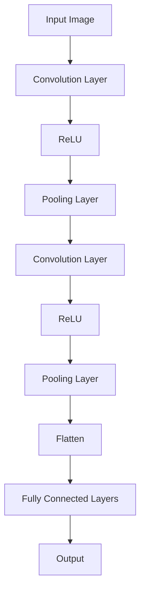
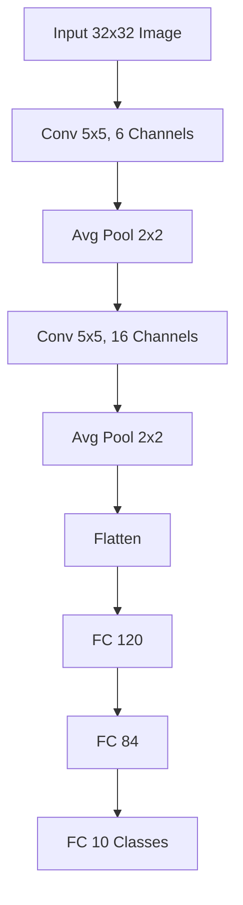
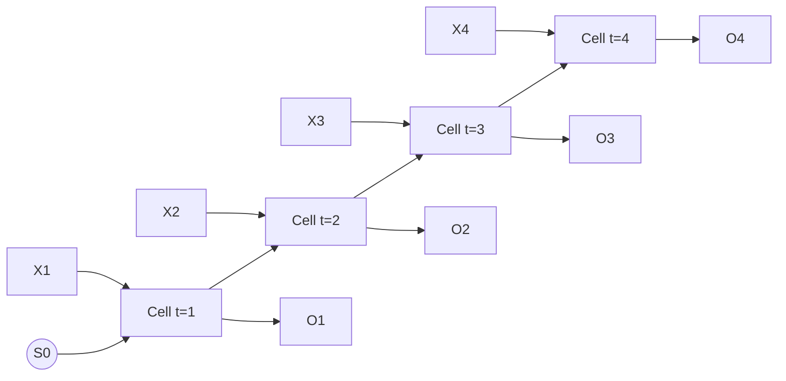
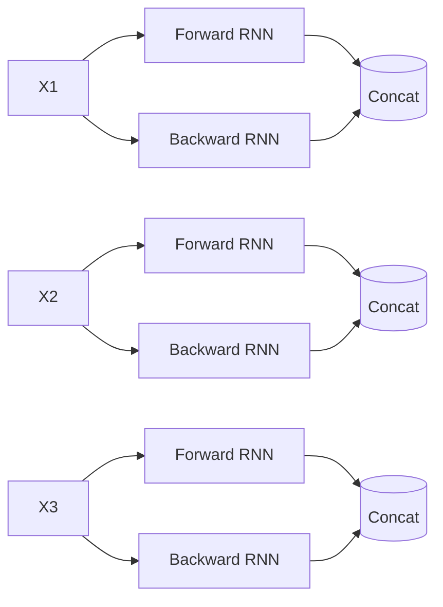
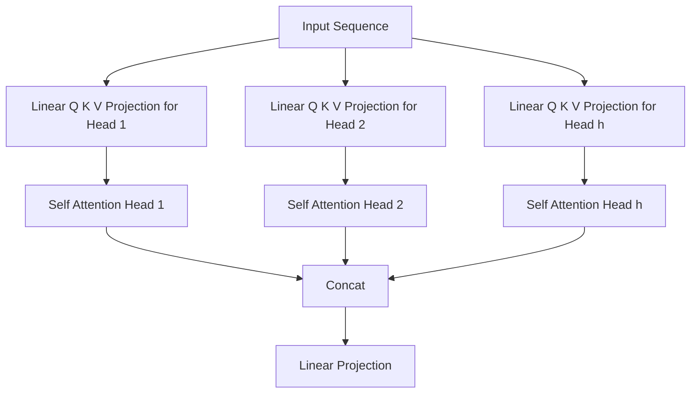

---
title: 机器学习 课程笔记
url: https://blog.kisechan.space/2025/notes-machine-learning/
type: post
time: '2026-10-21T16:02:14.153Z'
---

## 写在前面

> **2025/12/09 更新**：
>
> 12 月 2 日考完*机器学习*，现在有点空，更新一下。
>
> 考完的时候和饭哥等群友复盘了一下 23 级考试的原题，可以点击[这里](https://blog.csdn.net/mifanandpeicai/article/details/155504450)观看饭哥的汇总，希望将来我们也可以把考题传承下去。
>
> 总的来说，23 级考题从难度上比 22 级高了不少，考的很细很偏，计算题难度也提升了，但也没有特别困难的公式推导（KKT 条件这种肯定不会涉及到）。总结一下就是，BFS 的复习思想是不能丢掉的，具体也可以看看上面的汇总。

---

这是吉林大学 2023 级*机器学习 B* 课程的复习/预习/应试笔记，本门课的授课顺序是比较混乱的，于是我基于*机器学习方法*调整了一下笔记各部分的顺序：

1. _绪论_
2. **监督学习**
   - **线性回归**
   - **逻辑回归**
   - **支持向量机**
3. **无监督学习**
   - **降维**
   - **聚类**
4. **深度学习**
   - ~~_常见网络模型_~~（本章节只有 2022 级教案有，2023 级教案不存在这部分内容）
   - 神经网络
   - _径向基函数网络_（2022 级教案中这章同时包含了径向基函数和自组织特征映射神经网络）

关于考试范围，在笔记中不重要的章节，博主也已经在上面和文档中的标题中用*斜体*标注了它的标题，重点部分用**粗体**标出。


考试同时也不涉及复杂的公式推导，只要背下来公式，并知道如何计算即可。需要记住的公式已用 `\boxed` 标记出，例如：

$$
\boxed{\min_\theta J(\theta)
= \frac{1}{2} \sum_{i=1}^m (h_\theta(x^{(i)}) - y^{(i)})^2}
$$

### 矩阵微积分和矩阵求逆

**矩阵微积分公式**：

$$
\begin{aligned}

\frac{\partial\mathbf{Ax}}{\partial\mathbf{x}}&=\mathbf{A}^{\mathrm{T}}\quad&\text{线性项求导}&\\

\frac{\partial\mathbf{x}^{\mathrm{T}}\mathbf{a}}{\partial\mathbf{x}}=
\frac{\partial\mathbf{a}^{\mathrm{T}}\mathbf{x}}{\partial\mathbf{x}}
&=\mathbf{a}^{\mathrm{T}}\quad&\text{线性项求导}&\\

\frac{\partial\mathbf{x}^{\mathrm{T}}\mathbf{A}\mathbf{x}}{\partial\mathbf{x}}&=\mathbf{(A+A^T)x}\quad&\text{二次型求导}&
\\&=2\mathbf{Ax}\quad&\text{如果是对称矩阵如 $XX^T$，则可以这么简化}&

\end{aligned}
$$

**矩阵求逆方法**（高斯-若尔当方法）：


## _绪论_

机器学习的定义：

> A computer program is said to learn from experience $E$ with respect to some task $T$ and some performance measure $P$, if its performance on $T$, as measured by $P$, improves with experience $E$. (Tom Mitchell, 1998)
>
> 机器学习 = 随着经验 $E$ 的增加，完成任务 $T$ 的表现 $P$ 持续变好。

### 机器学习就是要寻找一个函数

我们希望从数据中学习一个映射：

$$
f:X\to y
$$

其中：

- $X$：输入空间（特征）
- $y$ ：输出空间（标签）

---

训练集的数学表示：

$$
S_{\text{training}} = \{(X^{(i)}, y^{(i)})\}_{i=1}^{N} \in \{\mathcal{X}, \mathcal{Y}\}^{N}
$$

其中，

- $N$：样本数量

- 每个样本由两部分组成：

  - $X^{(i)}$ ：第 $i$ 个样本的特征
  - $y^{(i)}$：第 $i$ 个样本的标签

- 训练的目标就是在训练集上学习一个函数：
  $$
  f : X \to Y
  $$

### 机器学习的基本流程

机器学习整体流程非常固定，可分为三大步：

#### 选择模型

选择一个模型（定义函数集合）等价于选择一个函数族：

$$
\mathcal{F} = \{f_\theta \mid \theta \in \mathbb{R}^d\}
$$

例如：

- 线性回归：

  $$
  f_\theta(x) = \theta^T x
  $$

- 神经网络：网络结构决定函数族的形状

- SVM：决策边界的形式由模型选择决定

#### 定义目标函数

即定义**损失函数/似然函数/正则项**，目标函数通常称为 $J(\theta)$ 或 $L(\theta)$。

$$
J(\theta) = \frac{1}{N}\sum_{i=1}^N L\big(f_\theta(X^{(i)}), y^{(i)} \big)
$$

下面按类别总结。

##### 分类常用损失

1. **0-1 损失**（**注**：不可导，不用于训练，只用于评估。）

$$
L(y, \hat{y}) =
\begin{cases}
0, & y = \hat{y} \\
1, & y \neq \hat{y}
\end{cases}
$$

2. **交叉熵损失**（最常用），二分类：
   $$
   L(y, \hat{y}) = - \big( y\log \hat{y} + (1-y)\log(1-\hat{y}) \big)
   $$

##### 回归常用损失

1. **均方误差**（MSE），光滑，可导，最常用。

$$
L(y, \hat{y}) = (y - \hat{y})^2
$$

2. **平均绝对误差**（MAE），抗离群点能力强。

$$
L(y, \hat{y}) = |y - \hat{y}|
$$

3. **Huber 损失**，结合 MSE 和 MAE 的优点。

$$
L_\delta(y, \hat{y}) =
\begin{cases}
\frac{1}{2}(y - \hat{y})^2, & |y - \hat{y}| \le \delta \\
\delta \cdot |y - \hat{y}| - \frac{1}{2}\delta^2, & |y - \hat{y}| > \delta
\end{cases}
$$

##### 概率推理相关损失

1. **KL 散度**（常用于 VAEs）

$$
D_{\mathrm{KL}}(P \| Q) = \sum_x P(x)\log \frac{P(x)}{Q(x)}
$$

2. **最大似然**（MLE）

目标是最大化似然：

$$
\theta^* = \arg\max_\theta p(y \mid x; \theta)
$$

等价于最小化负对数似然 NLL：

$$
\theta^* = \arg\min_\theta -\log p(y \mid x; \theta)
$$

##### 正则化（避免过拟合）

1. **L1 正则**，使参数稀疏。

$$
||\Theta||_{1} = \lambda \sum_{i=1}^{d} |\theta_i|
$$

2. **L2 正则**，使参数变小（权重衰减）。

$$
||\Theta||_{2}^{2} = \lambda \sum_{i=1}^{d} \theta_i^{2}
$$

3. **范数约束**

$$
||\Theta||_2^2 \le c
$$

#### 选择最优函数（训练 = 优化）

最常用方法：**梯度下降**。

$$
\theta_i^{(t)}
\leftarrow
\theta_i^{(t-1)} - \lambda \frac{\partial}{\partial \theta_i^{(t-1)}} J(\Theta)
$$

其中：

- $\lambda$：学习率
- $J(\theta)$：目标函数

梯度下降是一个迭代求解最小值的过程。

---

**随机梯度下降**（SGD）每一步只使用一个样本或小批量样本：

$$
\theta \leftarrow \theta - \lambda \nabla_\theta J_{\text{mini-batch}}(\theta)
$$

优点：

- 更快
- 可以在线学习
- 适合大规模数据

---

### 机器学习的主要类型

#### 监督学习（Supervised Learning）

> 利用带标签数据学习一个映射 $f : X \to Y$。

任务：

- 分类
- 回归

关键点：

- 标签真实、明确
- 训练目标：拟合标签

#### 半监督学习（Semi-supervised Learning）

结合少量标注 + 大量无标注数据。

**两大基本假设**：

1. **聚类假设**：同一聚类中的样本倾向于有相同的标签

2. **流形假设**：数据分布在低维流形上，局部相似 → 标签相似

#### 无监督学习（Unsupervised Learning）

> 没有标签，从数据中发现结构。

任务：

- 聚类（k-means、层次聚类）
- 降维（PCA、LDA）
- 密度估计

---

#### 强化学习（Reinforcement Learning）

> Agent 与环境交互，通过累积奖励学习策略。

强化学习不是“靠标签”，而是凭 trial-and-error 学习。

|   类型   |            如何学习？             |
| :------: | :-------------------------------: |
| 监督学习 |       给定正确答案（指导）        |
| 强化学习 | 给定奖励（好/坏），但没有对错标签 |

---

#### 自监督学习（Self-supervised Learning）

> 从无标签数据中**自动构造标签**来训练模型。

例子：

- BERT：预测被 mask 的词
- GPT：预测下一个词
- SimCLR：预测不同视角的相似性

> Yann LeCun:
>
> 如果人工智能是一块蛋糕，蛋糕的大部分是自监督学习，糖衣是监督学习，樱桃是强化学习。
>
> - 意思：**自监督学习未来最重要。**

## 线性回归

### 监督学习概述

监督学习的任务类型：

- **回归**（Regression）：输出是连续值，如房价预测、温度预测。
- **分类**（Classification）：输出是离散类别，如图片识别、垃圾邮件分类。

---

**监督学习的一般范式**：

训练集形式：

$$
\{(x^{(i)}, y^{(i)}) \mid i = 1,\ldots,m\}
$$

- $x^{(i)} \in \mathbb{R}^n$：**$n$ 维特征**（**$(i)$ 是代表第几个数据的序号，这个 $x^{( i )}$ 是一个向量**！）
- $y^{(i)} \in \mathbb{R}$：输出（回归时）或类别（分类时）

### 线性回归模型（Hypothesis）

给定 $n$ 个特征，线性回归假设模型为：

$$
h_\theta(x) = \theta_0 + \theta_1 x_1 + \cdots + \theta_n x_n
$$

$\theta$ 是参数（权重），**需要从数据中学习**。写成向量形式：

$$
\boxed{h_\theta(x)
= \theta^T x}
$$

若将 $x$ 扩展为：

$$
x =
\begin{bmatrix}
1 \\ x_1 \\ \vdots \\ x_n
\end{bmatrix}
$$

则上式成立。

### 确定 $\theta$

我们需要一个 **代价函数** （cost function）来衡量 $h(x)$ 与真实 $y$ 的误差。

**从样本数据推导损失函数**：

1. **原始误差表示**：**绝对误差**（$\text L1$）

$$
J(\theta) = \sum_{i=1}^m | h_\theta(x^{(i)}) - y^{(i)} |
$$

直观、可解释，但：

- **不可导**（在 0 点不可导）
- **优化困难**

2. **更常用**：**平方误差**（$\text L2$）

为了可导且数学简单，我们改为平方误差：

$$
J(\theta)
= \sum_{i=1}^m ( h_\theta(x^{(i)}) - y^{(i)} )^2
$$

**常见形式会加入 $\frac{1}{2}$** [^1]：

$$
\boxed{J(\theta) = \frac{1}{2} \sum_{i=1}^m ( h_\theta(x^{(i)}) - y^{(i)} )^2}
$$

[^1]: 便于求导，使导数中前面的系数变得更整齐。

因此我们可以得到**最小二乘目标函数**（Least Squares），也就是我们最终要优化的目标：

$$
\boxed{\min_\theta J(\theta)
= \frac{1}{2} \sum_{i=1}^m (h_\theta(x^{(i)}) - y^{(i)})^2}
$$

目标：**找到能让模型预测接近真实 $y$ 的参数 $\theta$。**

### 线性模型的特点

- 形式简单
- 可解释性强（$\theta$ 的大小反映特征的重要性）
- 是许多非线性模型的基础
- 深度模型可以被看作线性模型的堆叠

### _特征规范化（Feature Normalization）_

也叫做归一化。也就是把用于将数据的特征缩放到相同的范围内。其目的是消除不同特征之间的量纲差异，使得每个特征在相同的尺度上进行比较。

如果不同特征量级差别巨大：

- **代价函数的等高线变得“狭长”**
- 梯度下降效率极低

因此需要归一化，例如 Z-Score 标准化，将特征转换为标准正态分布：

$$
x_i = \frac{x_i - \bar{x}}{\sigma}
$$

解释：

- 减去**均值**：让数据居中
- 除以**标准差**：让尺度一致

作用：

1. **提高模型性能**：许多机器学习算法，尤其是那些基于距离的算法（如 K 近邻算法、SVM 等），对数
   据的量纲非常敏感。不同特征的量纲差异可能导致某些特征在计算距离时占据主导地位，从而影响
   模型的性能。归一化可以消除这种量纲差异，使得所有特征在同一尺度上进行比较。
2. **加速收敛**：对于基于梯度下降的优化算法（如线性回归、逻辑回归、神经网络等），特征归一化可
   以加速算法的收敛过程，提高模型训练的效率。
3. **增强可解释性**：归一化后的数据特征具有相同的尺度，更容易进行可视化和解释。

### 正规方程解法

就是直接给出 $\theta$ 的**闭式解（closed-form solution）**[^2]，计算出所需的 $\theta$。

#### _构造矩阵 $X$ 和向量 $y$_

训练样本：

$$
(x^{(1)}, y^{(1)}), \ldots, (x^{(m)}, y^{(m)})
$$

令：

$$
\begin{align*}
X =\begin{bmatrix}
(x^{(1)})^T \\
(x^{(2)})^T \\
\vdots \\
(x^{(m)})^T
\end{bmatrix}&=
\underbrace{\begin{bmatrix}
1 & x_1^{(1)} & \cdots & x_n^{(1)} \\
1 & x_1^{(2)} & \cdots & x_n^{(2)} \\
\vdots & \vdots & \ddots & \vdots \\
1 & x_1^{(m)} & \cdots & x_n^{(m)}
\end{bmatrix}}_\text{注意这里的 $X$ 是 $m\times(n+1)$ 的矩阵，多了一列全是 $1$ 的列，因为固定了 $x_0=0$}\\

\\
y &=
\begin{bmatrix}
y^{(1)} \\
y^{(2)} \\
\vdots \\
y^{(m)}
\end{bmatrix}
\end{align*}
$$

[^2]: 即**一个数学问题的解可以用有限次的标准数学运算**直接表达出来，不需要迭代、极限、数值方法等过程。

#### 用矩阵表示目标函数

首先：

$$
h_\theta(x^{(i)}) = (x^{(i)})^T \theta
$$

因此：

$$
X\theta - y=
\begin{bmatrix}
(x^{(1)})^T\theta - y^{(1)} \\
\vdots \\
(x^{(m)})^T\theta - y^{(m)}
\end{bmatrix}
$$

平方和误差可以写成：

$$
J(\theta)
= \frac{1}{2}(X\theta - y)^T (X\theta - y)
$$

取导数：

$$
\begin{align*}
\frac{\partial}{\partial \theta}\frac{1}{2}(X\theta - y)^T (X\theta - y)
&=\frac{\partial}{\partial \theta}\frac{1}{2}((X\theta)^T-y^T)(X\theta-y)\\
&=\frac{\partial}{\partial \theta}\frac{1}{2}(\theta^TX^T-y^T)(X\theta-y)\\
&=\frac{\partial}{\partial \theta}\frac{1}{2}(\theta^TX^TX\theta-\underbrace{y^TX\theta-\theta^TX^Ty}_{\text{这两项是一个互为转置的标量，是相等的}}+y^Ty)\\
&=\frac{\partial}{\partial \theta}\frac{1}{2}(\underbrace{\theta^TX^TX\theta}_\text{二次型求导，得到 $(X^TX+XX^T)\theta$}-\underbrace{2Xy^T\theta}_\text{线性求导，得到 $2X^Ty$}+\underbrace{y^Ty}_\text{常数，得到 $0$})\\
&=\frac{1}{2}(2X^TX\theta-2X^Ty)\\
&= X^T(X\theta - y)
\end{align*}
$$

令其 $= 0$：

$$
\boxed{X^T X \theta = X^T y}
$$

最终解为：

$$
\boxed{\theta = (X^T X)^{-1} X^T y}
$$

条件：$X^TX$ **可逆**。


### 梯度下降法解法

梯度下降法（Gradient Descent）是用来 **最小化** 一个目标函数 $J(\theta)$ 的最常用方法。

直觉上：

- 梯度（gradient）表示函数上升最快的方向
- 因此最陡下降方向是其反方向

所以我们更新参数的方法是：

$$
\theta_j := \theta_j \textcolor{red}{-} \alpha \frac{\partial}{\partial\theta_j} J(\theta)
$$

其中：

- $\alpha$：学习率（step size）
- $\frac{\partial}{\partial\theta_j} J(\theta)$：梯度
- **注意符号**

---

如果不是要“下山”，而是要“爬山”（最大化）：

$$
\theta_j := \theta_j + \alpha \frac{\partial}{\partial\theta_j} J(\theta)
$$

> **梯度是指向上升最快方向的向量**
>
> - 要最大化 → 顺着梯度走
> - 要最小化 → 逆着梯度走

#### 梯度的数学意义

函数 $z = f(x, y)$ 的梯度是：

$$
\nabla f(x,y) = \left(\frac{\partial f}{\partial x},\frac{\partial f}{\partial y}\right)
$$

它代表**在点 $(x,y)$ 处函数上升最快的方向**。

---

假设只有一维参数 $w$，损失函数 $L(w)$：

$$
w^{(1)} \leftarrow w^{(0)} - \eta \frac{dL}{dw}\bigg|_{w=w^{(0)}}
$$

- 如果导数为正 → 表示在右边函数变大 → 要往左（减小 $w$）
- 如果导数为负 → 要往右（增大 $w$）

这就是梯度向下的最直观思想。

#### _线性回归的梯度推导_

这是**针对线性回归目标函数**的梯度推导，对于单个样本：

$$
h_\theta(x) = \sum_{i=0}^{n} \theta_i x_i
$$

损失函数（单样本）：

$$
J = \frac12 (h_\theta(x) - y)^2
$$

计算偏导：

$$
\begin{aligned}
\frac{\partial J}{\partial \theta_j} &= \frac{\partial}{\partial \theta_j} \frac{1}{2} ({h_\theta(x) - y})^2 \\
&= \frac{1}{2} \cdot 2 \cdot (h_\theta(x) - y) \cdot \frac{\partial}{\partial \theta_j}(h_\theta(x) - y) \quad \text{ 外层导数 } \times \text{ 内层导数} \\
&= (h_\theta(x) - y) \cdot \frac{\partial}{\partial \theta_j}(\theta_0 x_0 + \dots + \theta_j x_j + \dots - y) \\
&= (h_\theta(x) - y) \cdot x_j \quad \text{
}
\end{aligned}
$$

因此更新规则（单样本）：

$$
\boxed{\begin{align}
\theta_j &:= \theta_j - \alpha (h_\theta(x) - y) x_j\\
&:=\theta_j+\textcolor{red}{\alpha (y - h_\theta(x)) x_j}\\
&\quad\text{注意这里是加号}
\end{align}}
$$

这也叫 **LMS（Least Mean Square）更新规则**，也就是梯度下降在线性回归里面的专有名字。

---

LMS 规则有什么用？观察**更新量**：

$$
\Delta\theta_j=-\alpha\cdot\underbrace{(h_\theta(x)-y)}_\text{误差 Error}\cdot\underbrace{x_j}_\text{输入 Input}
$$

这告诉了我们它是如何**调整参数**的：

1. **误差驱动**：
   - 如果预测准了，误差很小，参数就不动
   - 如果**误差很大**，更新的步子就**迈得很大**
   - 这是一种**自适应**机制，离目标远时跑得快，离目标近时走得慢。
2. **输入加权**：
   - 为什么要乘 $x_j$？
   - 如果某个特征很小（比如接近0），说明这个特征对预测结果没啥贡献
     - 既然没贡献，这次预测出错了，**也不该怪到 $\theta_j$ 头上**，所以更新得很少
   - 如果 $x_j$ 很大，说明这个特征对结果影响大，预测错了它有很大责任，所以要大幅调整
   - 可以起到**责任分配**的作用，谁的输入大，谁的权重就改得多

> LMS 非常适合**在线学习**，因为只需要一个样本就能更新，数据来一个学一个，不需要等所有数据到齐。这非常适合实时系统（比如实时股价预测）。

#### 梯度下降求解的三种形式

1. **Batch Gradient Descent**（**批量梯度下降**）

​ 每次用所有样本的平均梯度：

$$
\theta_{j} := \theta_{j} + \alpha \sum_{i=1}^{m} \textcolor{red}{(y^{(i)} - h_\theta(x^{(i)})) x_j^{(i)}}
$$

​ 特点：

- **每次更新很“准”，但速度慢**
- **大数据集时很低效**

2. **Stochastic Gradient Descent**（**随机梯度下降**）

​ 每次只用一个样本：

$$
\theta_j := \theta_j + \alpha \textcolor{red}{(y^{(i)} - h_\theta(x^{(i)})) x_j^{(i)}}
$$

​ 特点：

- 更新频繁 → **收敛快**
- **会震荡**，**不会到精确最小值，但会接近它**

3. **Mini-Batch Gradient Descent**

​ 折中方法：每次用 $B$ 个样本（如32、64、128）。

​ 优点：

- **稳定**
- **高效**
- **GPU 适配**

​ 目前深度学习里最常用。

#### _线性回归损失是凸函数_

这部分证明**线性回归的损失一定只有一个全局最优**。

线性回归损失：

$$
J(\theta) = \frac{1}{2} \sum_{i=1}^{m} (h_\theta(x^{(i)}) - y^{(i)})^2
$$

是一个 **二次函数**（quadratic function），对应一个“碗形”：

- **凸函数**（convex function）
- **只有一个全局最小值，没有局部最小值**

所以梯度下降一定能找到全局最优。

#### 关于学习率 $\alpha$ 的讨论

1. 如果 $\alpha$ **太小**：

   - 每一步走很慢，**收敛慢**

2. 如果 $\alpha$ **太大**：

   - 跨过“山谷”，**震荡甚至发散**

**解决方法**：

现代优化算法使用动态学习率：

- Adagrad
- RMSProp
- Momentum
- **Adam**（RMSProp + Momentum）

Adam 最常用。

#### 梯度下降和正规方程的对比

|        项目        |  梯度下降  |       正规方程       |
| :----------------: | :--------: | :------------------: |
|   是否需要学习率   |    需要    |        不需要        |
|    是否需要迭代    |     是     |          否          |
| 是否需要特征归一化 |    需要    |        不需要        |
|     时间复杂度     | $O(k n^2)$ | $O(n^3)$，需要计算逆 |
|    特征数量大时    |    可用    |        不可用        |

**正规方程缺点：**

- 需要矩阵 $(X^TX)^{-1}$，可能不可逆
- 特征维度大时，**求逆非常慢**

所以实际工程中**基本不用正规方程**，深度学习完全都用梯度方法。

#### _线性回归的概率解释_

线性回归假设数据满足：

$$
y^{(i)} = h_\theta(x^{(i)}) + \epsilon^{(i)}
$$

其中：

- $\epsilon^{(i)}$ 独立同分布
- 服从高斯分布 $\mathcal{N}(0, \sigma^2)$

为什么服从高斯？**中心极限定理**：很多随机因素叠加会接近正态分布。

---

**最小二乘 = 最大似然估计（MLE）**

若误差为高斯分布，那么最大化似然就是最小化平方误差和，这是因为高斯分布概率密度：

$$
\exp\left(-\frac{(y - h_\theta(x))^2}{2\sigma^2}\right)
$$

要最大化似然，就是要最小化上式指数的负号部分：

$$
\min_\theta \sum (y^{(i)} - h_\theta(x^{(i)}))^2
$$

这部分可以证明：

> 在**高斯噪声假设**下，最小二乘法是最大似然估计（MLE）得到的最优解。

即：

- 假设噪声 ~ $N(0,\sigma^2)$
- 写出似然函数
- 对数化
- 最大化似然
- 得到与最小二乘 **完全等价**

这个证明的意义是：

> 线性回归不仅仅是数学上的“平方误差最小”，而是统计意义上的 **最优无偏估计**。

这让线性回归有了非常强的理论基础。

### _线性回归的拓展_

#### 局部加权线性回归

普通线性回归给每个样本同等权重，而 **局部加权线性回归**（Locally Weighted Linear Regression, LWR）会根据预测点 $x$ 的邻近程度，对样本赋予不同的权重 $w_i$：

- 距离近 → 权重大
- 距离远 → 权重小

> 直观理解：我们希望“关注局部”，即预测时主要用邻近点的信息，而不是全局平均。

**带权重的平方误差函数**：

$$
f(\theta) = \sum_{i=1}^{m} w_i (y_i - x_i^T \theta)^2
$$

- $\theta$：回归系数
- $w_i$：样本 $i$ 的权重

矩阵形式：

$$
f(\theta) = (y - X \theta)^T W (y - X \theta)
$$

- $W = \text{diag}(w_1, w_2, \dots, w_m)$

---

**求解方法**：

令偏导数为 0：

$$
\frac{\partial f(\theta)}{\partial \theta} = -2 X^T W (y - X\theta) = 0
$$

得到 **加权正规方程**：

$$
X^T W y = X^T W X \theta
$$

求解参数：

$$
\theta = (X^T W X)^{-1} X^T W y
$$

> 与普通正规方程类似，只是加入了权重矩阵 $W$。

---

**权重选择**

最常用的是 **高斯核函数**：

$$
w_{ii} = \exp\left( -\frac{|x_i - x|^2}{2 k^2} \right)
$$

- $x_i$：训练样本
- $x$：预测点
- $k$：控制“局部性”的参数
  - $k$ 大 → 权重差异小 → 更像全局回归
  - $k$ 小 → 权重差异大 → 只使用附近点

> 直观：预测点周围的点“更重要”，远的点几乎不参与。

#### 非线性模型的多元回归

线性回归可以扩展到非线性特征，通过 **特征变换**：

$$
h_\theta(x) = \sum_{j=0}^{n} \theta_j \phi_j(x)
$$

- $\phi_j(x)$ 可以是多项式、正弦、指数等函数
- 保留线性回归解法，只是特征被非线性映射

**损失函数**：

$$
J(\theta) = \sum_i (y^i - \theta^T \phi(x^i))^2
$$

**矩阵形式**：

$$
\Phi =
\begin{bmatrix}
\phi_0(x^1) & \phi_1(x^1) & \cdots & \phi_m(x^1) \\
\phi_0(x^2) & \phi_1(x^2) & \cdots & \phi_m(x^2) \\
\vdots      & \vdots      & \ddots & \vdots      \\
\phi_0(x^n) & \phi_1(x^n) & \cdots & \phi_m(x^n)
\end{bmatrix}
$$

$$
\theta = (\Phi^T \Phi)^{-1} \Phi^T y
$$

- $\Phi$ 是映射后的特征矩阵
- 与普通线性回归求解方法相同

> 直观理解：线性回归“只对参数线性”，特征可以非线性 → 可拟合复杂关系。

### _机器学习中的若干讨论_

#### 样本离群点（Outliers）

- 极端值可能严重影响线性回归结果

- 对应方法：鲁棒回归（robust regression）、使用 $\text L1$ 损失

#### 欠拟合与过拟合

- **欠拟合**（underfitting）：**模型太简单**，对训练数据拟合不好

- **过拟合**（overfitting）：**模型太复杂**，对训练数据拟合好，但泛化差

> **奥卡姆剃刀法则**（Occam’s Razor）：在多个可行模型中，选择最简单的能解释数据的模型

#### 正则化

下面的 $w$ 指的是权重向量，也就是 $x$ 的系数。

1. **$\text L 2$ 正则化**（Ridge / 岭回归）[^4]

$$
\min_w \sum_{i=1}^m (y_i - w^T x_i)^2 + \lambda \| w \|_2^2
$$

**惩罚系数**较大时，会导致**参数更小更平滑**，降低过拟合。

[^4]: $\|\cdot \|$ 指的是**范数**，例如 $\| w \|_2^2$ 指的就是 $\text L2$ 系数的平方

2. **$\text L 1$ 正则化**（LASSO 回归）

$$
\min_w \sum_{i=1}^m (y_i - w^T x_i)^2 + \lambda \| w \|_1
$$

$\text L1$ 范数更容易在坐标轴上取到，所以另外一个参数必须为 0，因此可以得到**稀疏解**，自然完成特征选择。

#### 特征选择（Feature Selection）

- 选择重要特征，去掉冗余特征

- LASSO 的稀疏解本质就是一种自动特征选择方法

## 逻辑回归

在线性回归中，目标变量 $y$ 是连续的，而逻辑回归要解决 **分类问题 (Classification)**：

- 输入：特征向量 $x^{(i)}$
- 输出：类别标签 $y^{(i)}$

可以分成**软分类和硬分类**：

- **硬分类**：**硬分类的输出是离散的类别标签**，即模型会直接给出某个样本所属的类别。例如，对于一个二
  分类问题，硬分类模型会输出“类别 A”或者“类别 B”。
- **软分类**：**输出是连续的概率值**，即模型会输出每个样本属于各个类别的概率。

---

最常见的是：

1. **二分类**

$$
y \in \{0,1\}
$$

例如：

- 1：垃圾邮件，0：正常邮件
- 1：肿瘤恶性，0：肿瘤良性
- 1：人脸匹配成功，0：不匹配

2. **多分类**

$$
y \in \{1,2,\cdots,K\}
$$

一般多分类可以拆成多个二分类（如 One-vs-All 方法）。

### 从线性回归到分类器

为什么直接用线性回归不行？线性回归输出的是实数：

$$
\hat{y} = \theta^T x
$$

但分类需要输出：

- 明确类别标签

或

- 属于某一类的概率（更好）

线性回归有两个问题：

1. **输出不是概率**（可能 <0 或 >1），例如预测癌症概率不能得到 1.3 或 -0.8。

2. **使用单位阶跃函数不可导**，若我们强行使用“硬分类”：

$$
y =
\begin{cases}
1 & z>0\\
0 & z<0
\end{cases}
$$

​ 这是 **不连续** 的，无法用梯度优化。

### Sigmoid 函数（Logistic 函数）

逻辑回归的核心思想：**用线性函数得到一个值 $z$，再用 Sigmoid 将其变成一个概率**。

**Sigmoid 函数**：

$$
\boxed{g(z)=\frac{1}{1+e^{-z}}}
$$

关键性质：

- $z→+\infty$ 时 → 1

- $z→-\infty$ 时 → 0

- **输出永远在 $(0,1)$ 之间**

- **可导**：
  $$
  \boxed{g'(z)=g(z)(1-g(z))}
  $$

这正适合做 **概率模型**。

---

**逻辑回归的假设函数**：

$$
\boxed{h_\theta(x)=\frac{1}{1+e^{-\theta^Tx}}}
$$

解释：

- 输出 = 输入属于正类（$y=1$）的概率

#### _概率视角 $P(y|x)$ 的表达_

对于二分类：

$$
P(y=1|x;\theta)=h_\theta(x)
$$

可写成统一形式：

$$
P(y|x;\theta)=
(h_\theta(x))^y (1-h_\theta(x))^{1-y}
$$

如果：

- $y=1$ → 保留前项
- $y=0$ → 保留后项

这部分**定义了模型的输出含义**，也就是把问题名正言顺地变成了**预测一个分类是 $1$ 的概率**。

#### _Logit 几率比（odds ratio）_

定义几率比：

$$
\text{odds} = \frac{p}{1-p}
$$

例如：中彩票概率 0.1，则：

$$
\text{odds} = \frac{0.1}{0.9}=1:9
$$

---

**与逻辑回归的关系**：

从模型：

$$
p = h_\theta(x)
$$

推得：

$$
\frac{p}{1-p}=e^{\theta^T x}
$$

再取对数（logit transform）：

$$
\ln \frac{p}{1-p} = \theta^T x \in (-\infty, +\infty)
$$

所以我们可以得到：**对数几率是线性的**，Sigmoid 函数是有用的，正确的。

意义：

> 逻辑回归实际上在学习：
> **特征如何影响 $\log$ (几率比)**
> 这是一种“线性解释的概率模型”。

#### _用最大似然估计推导逻辑回归目标函数_

逻辑回归的损失函数不像线性回归一样采用均方误差，**而是用对数似然损失**。这是因为 Sigmoid 下，均方误差是非凸函数，容易陷入局部最优，而对数似然是凸函数，好优化，可以用牛顿法。

“概率给事件，似然给参数”。这部分证明了**下面的优化目标（对数损失）在数学上是唯一正确且最优**。

逻辑回归模型的似然：

$$
L(\theta)
= \prod_{i=1}^m (h_\theta(x^{(i)}))^{y^{(i)}}(1-h_\theta(x^{(i)}))^{1-y^{(i)}}
$$

因为样本独立同分布（i.i.d.），取对数得到对数似然（便于推导）：

$$
\boxed{\ell(\theta)
= \sum_{i=1}^m
\left[
y^{(i)}\log h_\theta(x^{(i)})
+
(1-y^{(i)})\log(1-h_\theta(x^{(i)}))
\right]}
$$

这就是逻辑回归优化的**目标函数**。我们要求它的最大值。

#### 使用梯度上升法优化参数

因为我们要**最大化模型预测出正确标签的概率**（上面得到的对数似然），所以用梯度上升：

$$
\max_\theta \ell(\theta)
$$

梯度上升更新规则：

$$
\theta := \theta + \alpha\nabla \ell(\theta)
$$

注意可与线性回归做对比：

- 线性回归是梯度下降（$-$）
- 逻辑回归是梯度上升（$+$）

#### 推导梯度

$$
\begin{align*}
\frac{\partial \ell(\theta)}{\partial \theta_j}
&= \frac{\partial\ell}{\partial h_\theta}\cdot\frac{\partial h_\theta}{\partial x^{(i)}}\cdot\frac{\partial x^{(i)}}{\partial\theta_j}\\
&=\underbrace{[\frac {y^{(i)}}{h_\theta}-\frac{1-y^{(i)}}{1-h_\theta}]}_{\text{第一项，$\ell=y^{(i)}\ln h_\theta+(1-y^{(i)})\ln(1-h_\theta)$}}\cdot\underbrace{[h_\theta(1-h_\theta)]}_{\text{第二项，Sigmoid 函数求导}}\cdot \underbrace{[x_j^{(i)}]}_\text{第三项，直接对 $\theta^T x$，其它项都是常数只留这一项} \\
&=\underbrace{\frac{y^{(i)}-h_\theta}{\cancel{h_\theta(1-h_\theta)}}\cdot\cancel{[h_\theta(1-h_\theta)]}}_\text{分母正好消掉了，非常神奇}\cdot x_j^{(i)}\\
&= \boxed{(y^{(i)} - h_\theta(x^{(i)}))x_j^{(i)}}\quad \text{和线性回归的长一样}
\end{align*}
$$

**与线性回归几乎一样**。

因此有**随机梯度上升**（SGD）更新：

$$
\theta_j := \theta_j + \alpha \textcolor{red}{(y^{(i)} - h_\theta(x^{(i)})) x_j^{(i)}}
$$

### Softmax 回归（多分类）

Softmax 是 Sigmoid 函数在多分类上的推广。

当类别：

$$
y \in \{1,2,\dots,k\}
$$

Softmax 回归模型输出 $k$ 个概率，它们的总和为 $1$：

$$
p(y=j|x;\theta)=\frac{e^{\theta_j^T x}}{\sum_{l=1}^k e^{\theta_l^T x}}
$$

组合写法：

$$
h_\theta(x)=
\frac{1}{\sum_{j=1}^k e^{\theta_j^T x}}
\begin{bmatrix}
e^{\theta_1^T x}\\
e^{\theta_2^T x}\\
\vdots\\
e^{\theta_k^T x}
\end{bmatrix}
$$

Softmax 是逻辑回归的多分类扩展：**Sigmoid 是二分类概率归一化，Softmax 是 $k$ 类概率归一化**。

> 补充：Softmax 的目标函数是交叉熵，后面神经网络还会讲。

### 牛顿法（Newton Iteration）

牛顿法的本质是利用一阶与二阶导数，通过“**局部二次近似**”求方程的根，例如**求方程 $f(x)=0$ 的牛顿公式**，目标求解：

$$
f(x)=0
$$

牛顿迭代公式：

$$
x_{n+1} = x_n - \frac{f(x_n)}{f'(x_n)}
$$

也就是把 $f(x)$ 用泰勒展开近似成直线，然后找它的根。那我们要求 **$\ell(\theta)$ 的极大值点**，就是相当于把 $f(x)$ 替换成 $\ell(\theta)$ 的导函数 $\ell'(\theta)$：

$$
\theta_{t+1} = \theta_t - \frac{\ell'(\theta_t)}{\ell''(\theta_t)}
$$

#### Newton–Raphson 方法

但是机器学习中，要求的参数是一个向量，而不是一个常数，所以需要进行处理：

- 一阶导 $\ell'(\theta_t)$ 转换成**梯度向量** $\nabla \ell(\theta)$
- 二阶导 $\ell''(\theta_t)$ 转换成 **Hessian 矩阵** $H$，取反了就是逆矩阵 $H^{-1}$

更新公式得到：

$$
\boxed{\theta := \theta - H^{-1} \nabla \ell(\theta)}
$$

如果把 Hessian 矩阵换成 **Fisher 信息矩阵** $I=-\text E[H]$，它是 Hessian 矩阵的期望的取反，就得到了 Newton-Raphson 方法的变体 **Fisher Scoring**。

在逻辑回归中，计算期望往往比直接计算 Hessian 矩阵更方便，且性质更好（半正定）。它能比梯度上升收敛得更快。

> 这部分应该只考**公式默写和思路简述**，手搓牛顿法梯度下降这种计算机干的事情还是有点太非人类了。

#### 牛顿法和梯度下降法

现在的深度学习一般都不用牛顿法，因为**计算量太大了**。

|                |                梯度下降                |                   牛顿法                   |
| :------------: | :------------------------------------: | :----------------------------------------: |
|  **利用信息**  |          一阶导数，只知道坡度          |       一阶＋二阶导数，知道坡度和曲率       |
|  **几何直观**  |          盲人下山，一步步试探          |        用二次曲面拟合，直接跳到坑底        |
|  **收敛速度**  |      **慢**，线性收敛，迭代次数多      |    **快**，二阶收敛，通常几次迭代即收敛    |
| **单步计算量** |        **小**，只算梯度 $O(n)$         | **极大**，需计算 $H^{-1}$，复杂度 $O(n^3)$ |
|  **适用场景**  | 特征维度 $n$ **很大** ，如**深度学习** |   特征维度 $n$ **较小**，如传统统计模型    |
|   **超参数**   |       需要手动调学习率 $\alpha$        |          无需学习率，步长自然确定          |

### 模型评估方法与性能评价指标

逻辑回归属于分类模型，因此我们需要：

- 避免过拟合/欠拟合
- 正确划分数据集
- 正确评价模型性能

#### 过拟合与欠拟合

**过拟合**：模型过度学习训练集的细节和噪声会导致测试集表现变差。

原因包括：

- 模型太复杂
- 特征太多
- 数据量太少
- 参数权重太大

解决：

- 正则化（$\text L1$/$\text L2$）
- 更多样本
- 降低特征维度

#### 数据集划分

| 数据集 |         作用         |   比例   |
| :----: | :------------------: | :------: |
| 训练集 |       拟合模型       | 50%～80% |
| 验证集 |       调超参数       | 10%～20% |
| 测试集 | 最终评估，不能再调参 | 10%～30% |

---

**常见划分方法**：

1. **留出法**（Hold-out）：一次性划分 训练 / 验证 / 测试。
   - 缺点：容易受切分的随机性影响。

2. **交叉验证**（Cross-validation）：将数据切成 $K$ 折：

- 每次选择 $1$ 折做验证

- 其他 $K-1$ 折做训练

- $K$ 轮结果平均

​ 最常用：$K=10$

​ 当 $K=N$（样本数）时就是**留一法 LOOCV**

3. **自助法** Bootstrapping（有放回抽样）：每次抽样 $m$ 次（有放回），约有 $1/e \approx 1/3$ 样本落入测试集。

   优点有：

   - 小数据集非常有用

   - Bagging 等集成学习强依赖该方法

### _分类性能指标_

分类评价不仅仅是准确率。

#### 混淆矩阵（Confusion Matrix）

|              | 预测正类 | 预测负类 |
| :----------: | :------: | :------: |
| **真实正类** |  **TP**  |  **FN**  |
| **真实负类** |  **FP**  |  **TN**  |

这是后面所有指标的基础。

#### 准确率 Accuracy

$$
\text{Accuracy} = \frac{\text{TP} + \text{TN}}{\text{TP} + \text{TN} + \text{FP} + \text{FN}}
$$

适用于数据平衡的场景。

#### 精确率 Precision（查准率）

$$
\text{Precision} = \frac{\text{TP}}{\text{TP}+\text{FP}}
$$

**预测为正的样本中**，有多少是真正的正例。

用于：垃圾邮件、广告点击预测等 **假正成本高** 的任务。

#### 召回率 Recall（查全率）

$$
\text{Recall} = \frac{\text{TP}}{\text{TP}+\text{FN}}
$$

**真实为正的样本中**，有多少被找出来。

用于：疾病预测、地震预测、作弊检测等 **漏报代价高** 的任务。

#### F1 分数（调和平均）

$$
\text F1 = \frac{2}{\frac{1}{\text{Precision}} + \frac{1}{\text{Recall}}}
= 2 \cdot \frac{\text{PR}}{\text{P}+\text{R}}
$$

当需要均衡 Precision 和 Recall 时使用。

#### 平均每类准确率（Average Per-class Accuracy）

用于多分类：

$$
\frac{1}{K}\sum_{i=1}^K \text{Accuracy}_i
$$

比总体 Accuracy 更能体现多类任务中的表现。

#### ROC 曲线

横轴：FPR（假正例率）

$$
\text{FPR} = \frac{\text{FP}}{\text{FP}+\text{TN}}
$$

纵轴：TPR（真正例率）= Recall

$$
\text{TPR} = \frac{\text{TP}}{\text{TP}+\text{FN}}
$$

每个阈值对应一个 (FPR, TPR) 点，连接形成 ROC 曲线。

#### AUC

就是 ROC 曲线下的面积

- AUC = 1 → 完美分类器
- AUC = 0.5 → 随机猜测
- 越大越好

**特点：**

- 不受类别不平衡影响（非常重要）
- 光滑 ROC 曲线表明模型未过拟合

## 支持向量机（SVM）

SVM 是一种**二类分类模型**。 它的基本模型是定义在特征空间上的间隔最大的线性分类器， 间隔最大使它有别于感知机。

SVM 的学习策略是间隔最大化，可以形式化为一个求解凸二次规划的问题，也等价于正则化 Hinge 损失函数的最小化问题。SVM 的学习算法通过求解凸二次规划的最优化算法来实现。主要有三种 SVM：

1. **线性可分支持向量机**（Linear Support Vector Machine in Linearly Separable Case）：
   - 硬间隔最大化（Hard Margin Maximization）

2. **线性支持向量机**（Linear Support Vector Machine）
   - 训练数据近似线性可分时，通过软间隔最大化（Soft Margin Maximization）
3. **非线性支持向量机**（Non-linear Support Vector Machine）
   - 当训练数据线性不可分时，通过使用核技巧（Kernel Trick）及软间隔最大化

**关于核函数和核技巧**：

- 当输入空间为欧氏空间或离散集合、特征空间为希尔伯特空间时，**核函数**（Kernel Function）表示**将输入从输入空间映射到特征空间得到的特征向量之间的内积**。
- 通过使用**核函数**可以学习非线性支持向量机，等价于隐式地在高维特征空间中学习线性支持向量机，这样的方法称为**核技巧**。
- **核方法**（Kernel Method）是比支持向量机更为一般的机器学习方法。

---

在 SVM 之前，感知机[^3]和神经网络已经存在了。但是它们有一个大问题：**小样本下的过拟合**，也就是**“过学习”与“泛化能力”的矛盾**。

**小样本**（Small Sample）是指在统计学和机器学习中，**可用于训练模型的数据点数量相对较少的情况**。在这种情况下，样本的数量不足以全面代表整个数据的分布特性。小样本学习是统计学习理论中的一个重要概念，它关注的是如何在样本数量有限的情况下构建有效的学习模型。小样本的特点：

1. **数据稀缺**：可用的数据量有限，可能不足以覆盖所有可能的情况或特征。
2. **泛化风险**：由于样本数量少，模型可能无法很好地泛化到新的、未见过的数据上。
3. **过拟合倾向**：模型可能会过度拟合训练数据中的噪声和细节，导致在新数据上的预测性能下降。
4. **统计推断困难**：在小样本情况下，对数据的统计推断可能不够准确或可靠。

那么，SVM 就要在传统的小样本问题上进行改进：

- **经验风险最小化 (ERM)**：

  - 传统的统计学（如大数定律）通常假设样本量无穷大，但在现实应用中，数据往往是有限的（**小样本**）
  - 在样本很少的情况下，如果非要强求模型在训练集上表现完美（**经验风险最小化，ERM**），模型就会变得非常复杂，像是在“死记硬背”训练数据，连噪声都记住了，**这也就容易导致过拟合**

- **结构风险最小化 (SRM)**：我们要找一个模型，它不仅要**“分得对”**（训练误差小），还要**“长得简单”**（模型复杂度低）。于是 SVM 基于**统计学习理论**，采用 SRM 策略，解决这两个矛盾。

  - SVM 的目标是控制期望风险的上限，**核心公式**：

    $$
    R(w) \leq R_\text{emp}(w) + \Phi(h/n)=R_\text{emp}(w) + \sqrt{\frac{h(\ln(2h/n)+1)-\ln(\eta/4)}{n}}
    $$
    - **左边**：我们真正关心的未来表现
      - **期望风险 $R(w)$**：模型在未知测试数据上的真实误差
    - **右边**：要优化的目标（**结构风险** $R_\text{struct}$）
      - **第一项 $R\_\text{emp}(w)$**：**经验风险**。即模型在训练集上的平均损失（分错了多少）
      - **第二项 $\Phi(h/n)$**：**置信范围（模型复杂度惩罚）**。它与样本数 $n$ 成反比，与 **VC 维 $h$** （模型的复杂程度，SVM 通过**最大化几何间隔**来实现）成正比

  - **含义**： SVM 不只看训练误差（经验风险），还强行限制模型的复杂度（置信范围）。它试图在“分对数据”和“模型简单”之间找平衡

[^3]: Perceptron，也是一种二分类线性分类模型，本质上跟神经网络的感知机模型**是一个东西**，只不过神经网络的是原始感知机的推广。通过 $y=\mathrm{sign}(w^T x+b)$ 得到分类结果。


这就是 **SVM 为什么要搞“最大间隔”的理论依据**。

- **最大间隔** 本质上就是在**限制模型的复杂度**（降低 VC 维）。
- **直观上**：间隔越大，对噪声的容忍度越高，鲁棒性越强。
- 因为限制了复杂度，所以哪怕样本不多，SVM 也能保证很好的**推广能力（泛化能力）**，不容易过拟合。

**本章背诵公式整理**

1. **硬间隔原始问题及约束**

   $$
   {\begin{aligned}
   \min_{w,b} \quad & \frac{1}{2}||w||^2 \\
   \text{s.t.} \quad & y_i(w \cdot x_i + b) \geq 1
   \end{aligned}}
   $$

2. **拉格朗日对偶问题的目标函数和约束**

   $$
   {\begin{align*}
   \max_\alpha &\sum_{i=1}^N \alpha_i - \frac{1}{2} \sum_{i=1}^N \sum_{j=1}^N \alpha_i \alpha_j y_i y_j (x_i \cdot x_j)\\
   \text{s.t. }&\sum \alpha_i y_i = 0,\\
   &\alpha_i\ge0
   \end{align*}}
   $$

3. **软间隔 SVM 的问题及约束**

   $$
   {\begin{aligned}
   \min_{w,b,\xi} \quad &  \frac{1}{2}||w||^2 + C \sum_{i=1}^N \xi_i \\
   \text{s.t.} \quad & y_i(w \cdot x_i + b) \geq 1 - \xi_i\\
   & \xi_i \geq 0
   \end{aligned}}
   $$

4. 高斯核函数

   $$
   {K(x, z) = \exp(-\frac{||x-z||^2}{2\sigma^2})}
   $$

5. SVM 的决策函数
   $$
   f(x)=\mathrm{sign}\left(\sum_{i=1}^N\alpha_i^*y_i(x_i\cdot x)+b^*\right)
   $$

### 什么是“最好的分类”？

假设桌子上有一堆红球和蓝球（线性可分），你可以用无数根棍子（超平面）把它们分开。哪根棍子最好？

- **感知机**：只要分开就行，不管棍子是不是贴着球。这种的解有无穷个。
- **SVM**：这根棍子不仅要分开球，还要**离两边的球都尽可能远**。
  - **间隔 (Margin)**：棍子到最近的球的距离。
  - **目标**：找到**最大化间隔 (Max Margin)** 的那个超平面。

### 硬间隔线性可分 SVM

这是 SVM 的“理想形态”，线性可分的意思就是：数据是完美的，**完全可以用一条直线分开**。

#### 超平面与决策函数

- **超平面方程**：$w \cdot x + b = 0$
  - $w$：**法向量**，决定平面的方向。
  - $b$：截距，决定平面的位置。
- **决策函数**：$f(x) = \text{sign}(w \cdot x + b)$
  - 结果为 +1 是正类，-1 是负类。

#### 支持向量

支持向量指的是在所有样本点中，离**超平面**[^5]最近的那些点。

也就是所有满足 $y_i(w\cdot x_i+b)=1$ 的点。

[^5]: 超平面是一个几何概念，用于描述高维空间中的一个子空间，**它将空间分割成两个部分**。超平面的定义和维度依赖于它所在的空间的维度。例如在三维空间中，超平面是一个二维平面。它可以分割空间，且通过原点。

- **作用**：**它们“支撑”起了分类边界**。SVM的独特之处在于，**决定这条分界线的，只有这些少数的支持向量**，其他离得远的点删掉也不影响结果（这与逻辑回归不同，逻辑回归所有点都起作用）。

#### 间隔

假设空间中的训练数据集：

$$
D=\{(x_1,y_1),(x_2,y_2),\cdots,(x_N,y_N)\},\quad x_i\in\mathcal{X}=R^n,\quad y_i\in\mathcal{Y}=\{+1,-1\},\quad i=1,2,\cdots,N
$$

- **点到平面的距离公式**：$d = \frac{|w \cdot x + b|}{||w||}$。$y_i\cdot\frac{|w \cdot x_i + b|}{||w||}$ 被称为**几何间隔**。

- **约束条件**：要求所有点都被正确分类，且都在间隔之外。

  $$
  y_i(w \cdot x_i + b) \geq 1
  $$
  - 左边的项被称为**函数间隔**。
  - 其实右边可以是任何常数 $c$。为了数学方便，我们通过缩放 $w$ 和 $b$，**强制让最近点的函数间隔** $|w \cdot x + b| = 1$。这叫**规范化**。

- **几何间隔**：对于**支持向量**，距离就是 $\frac{1}{||w||}$，因为 $y_i(w \cdot x_i + b) \geq 1, \quad y_i=\pm1$，所以 $d = \frac{|w \cdot x + b|}{||w||}\ge\frac{1}{||w||}$。

- **总间隔**：正负两类支持向量之间的距离是 $\frac{2}{||w||}$。


#### 最终优化目标（Primal Problem 原始问题）

我们要让间隔 $\frac{2}{||w||}$ 最大，等价于让分母 $||w||$ 最小，为了方便求导，改为最小化 $\frac{1}{2}||w||^2$。

$$
\boxed{\begin{aligned}
\min_{w,b} \quad & \frac{1}{2}||w||^2 \\
\text{s.t.} \quad & y_i(w \cdot x_i + b) \geq 1, \quad i=1,\dots,N
\end{aligned}}
$$

这是一个凸二次规划问题（Convex Quadratic Programming）。

通过间隔最大化或等价方法求解相应的凸二次规划问题学习得到的分离超平面为：

$$
w^*\cdot x+b^*=0
$$

决策函数是：

$$
f(x)=\text{sign}(w^*\cdot x+b^*)
$$


> **例题**
>
> 
>
> 也可以用支持向量的几何特征来算，$x_1$ 和 $x_3$ 肯定是支持向量，代入进方程是 1，它们的连线也是垂直于超平面的，可以这样算出来。

#### 拉格朗日优化算法

这一部分是数学推导的核心。直接解带约束的原始问题很难。我们通过拉格朗日乘子法，把约束条件“融合”到目标函数里，变成一个新问题（对偶问题）。好处在于：

- **对偶问题更容易求解**。
- 将原始问题中的不等式约束转为了**对偶问题中的等式约束**。

- 对偶问题自然引入了**内积**形式，可以引入**核函数**轻松计算。

我们求解问题的步骤是：

1. 利用拉格朗日乘子法，构造**拉格朗日函数**；
2. 利用强对偶性（KKT 条件）将优化问题进行转化，并求解；
3. 利用最优的 $w^_$ 和 $b^_$ 构建分类器。

---

**拉格朗日函数**

> 拉格朗日方法的本质不需要深究。简单地说它就是**把约束变成了惩罚**，如果不满足约束，拉格朗日函数 $L(w, b, \alpha)$ 后面那一项就会特别大，迫使优化过程回到可行域。[^6]
>
> 拉格朗日函数的形式：
>
> $$
> L(w,b,\alpha)=\text{原目标}-\sum\alpha_i\times(\text{约束})
> $$

[^6]: *统计学习方法*第 531 页，附录 C 拉格朗日对称性。

$$
L(w, b, \alpha) = \frac{1}{2}||w||^2 - \sum_{i=1}^N \alpha_i [y_i(w \cdot x_i + b) - 1],\quad \alpha_i\ge0
$$

- **原始问题的优化目标**：$\min\limits_{w,b} \max\limits_{\alpha} L(w, b, \alpha)$ （极小极大问题）
- **对偶问题的优化目标**：$\boxed{\max\limits_{\alpha} \min\limits_{w,b} L(w, b, \alpha)}$ （极大极小问题）

**强对偶性**：当满足某些条件（**KKT 条件**）时，这两个问题的解是一样的。我们选择解对偶问题。

---

**求解** $\max\limits_{\alpha}\min\limits_{w,b}L(w, b, \alpha)$

1. **求极小**：让 $L$ 对 $w$ 和 $b$ 求偏导为 0。
   $$
   \begin{align*}
   \nabla_wL(w,b,\alpha)&=&w-\sum\alpha_iy_ix_i&=0\\
   \nabla_bL(w,b,\alpha)&=&-\sum\alpha_iy_i&=0
   \end{align*}
   $$

- 得出的关系式：$w = \sum \alpha_i y_i x_i$ （**权值向量 $w$ 是样本向量的线性组合**）。
- 以及约束：$\sum \alpha_i y_i = 0$。

2. **代回 $L$**：把上面的关系代回 $L$，消去 $w$ 和 $b$。得到只包含 $\alpha$ 的目标函数：

   $$
   \boxed{\begin{align*}
   \max_\alpha &\sum_{i=1}^N \alpha_i - \frac{1}{2} \sum_{i=1}^N \sum_{j=1}^N \alpha_i \alpha_j y_i y_j (x_i \cdot x_j)\\
   \text{s.t. }&\sum \alpha_i y_i = 0,\\
   &\alpha_i\ge0
   \end{align*}}
   $$

   求最大则等价于求：

   $$
   {\begin{align*}
   \min_\alpha &[-\sum_{i=1}^N \alpha_i + \frac{1}{2} \sum_{i=1}^N \sum_{j=1}^N \alpha_i \alpha_j y_i y_j (x_i \cdot x_j)]\\
   \text{s.t. }&\sum \alpha_i y_i = 0,\\
   &\alpha_i\ge0
   \end{align*}}
   $$

3. **求解**：假设最优解是 $\alpha^_=(\alpha_1^_, \alpha_2^_, \cdots, \alpha_N^_)^T$。则存在**任意一个** $j$ 使得 $\alpha_j^*>0$，并可以得到解[^7]：

   - $w^*=\sum_{i=1}^N \alpha_i^*y_ix_i$

   - $b^*=y_j-\sum_{i=1}^N\alpha_i^*y_i(x_i\cdot x_j)$

   - 决策函数 $f(x)=\operatorname{sign}(\sum\alpha^_\_iy_i(x_i\cdot x)+b^_)$

     _如果是用的核函数，就把 $x_i\cdot x$ 换成 $K(x_i, x)$ 即可_

[^7]: *统计学习方法*第 103 页，这部分的所有证明基本都是来自这里。

> **例题**
>
> 

_**KKT 条件**_

KKT 条件是**强对偶成立，可以允许用拉格朗日方法求解的必要条件**，其中最重要的是**互补松弛条件**：

$$
\alpha_i [y_i(w \cdot x_i + b) - 1] = 0
$$

**含义**：

- 如果 $\alpha_i > 0$，则后面括号必须为 0，那么样本在边界上，**是支持向量**。
- 如果后面括号 $>0$（样本在边界外），则 $\alpha_i$ 必须为 0，**不是支持向量**。
- 这证明了**只有支持向量决定模型参数**。

_**SMO 算法**_

求解 $\alpha$ 还是很难，变量太多。所以可以用 SMO 算法来解那个全是 $\alpha$ 的方程。

**SMO 的思路**：每次只挑两个变量 $\alpha_i, \alpha_j$ 来更新，固定其他变量。这样就把复杂问题变成了简单的二次函数求极值问题（有解析解）。解析解快，收敛也快。

#### _SVM 的优缺点_

优点：

- 泛化错误率低
- 计算开销不大（取决于支持向量数量）
- 结果易解释（支持向量）
- 适合小样本

缺点：

- 对参数（如 $C$ 和核参数）敏感
- 对缺失数据敏感
- 大规模数据训练慢

### 线性支持向量机的软间隔

现实数据往往有噪声（比如红球堆里混进了一个蓝球），硬间隔会导致无解或过拟合。所以我们可以通过引入松弛变量允许少量误分，换取更大的间隔。于是我们引入**松弛变量** (Slack Variable) $\xi$。

- **允许样本点不满足约束条件**，“犯错”，跑进间隔里，甚至跑到对面去。
- 约束变为：$y_i(w \cdot x_i + b) \geq 1 - \xi_i$ （$\xi_i \geq 0$）。

**新的目标函数**：

$$
\boxed{\begin{aligned}
\min_{w,b,\xi} \quad &  \frac{1}{2}||w||^2 + C \sum_{i=1}^N \xi_i \\
\text{s.t.} \quad & y_i(w \cdot x_i + b) \geq 1 - \xi_i, \quad \xi_i \geq 0
\end{aligned}}
$$

- **$C$ （惩罚参数）**：
  - $C$ 很大，就意味着**对错误零容忍**，让点逼近硬间隔（易过拟合）。
  - $C$ 很小，就意味着**容忍更多错误**，让间隔更宽（易欠拟合）。
  - **Hinge Loss**：这一项实际上等价于合页损失函数 $\max(0, 1-y(wx+b))$。

#### 软间隔的对偶问题

形式和硬间隔几乎一样，唯一的区别是 $\alpha$ 的约束变了：

$$
0 \le \alpha_i \le C \quad \text{（硬间隔是 $\alpha_i \ge 0$）}
$$

### 非线性 SVM 和核方法（Kernel Trick）

这是 SVM 最天才的地方，**怎么解决线性不可分（如XOR问题）？**就可以用到**核方法把数据映射到高维去**，建立非线性的 SVM，然后**用核函数计算避免高维计算灾难**。

#### 升维

世界真奇妙。

- “低维空间不可分，映射到高维空间就线性可分了。”
- 映射函数 $\phi(x)$：把 $x$ 变成**高维向量**。


#### 维数灾难与核方法

**问题**：变成高维向量后，**高维空间（甚至无穷维）计算内积 $\phi(x_i) \cdot \phi(x_j)$ 计算量太大，算不动**。

**核函数 $K(x, z)$ 的定义**：存在一个函数 $K(x, z)$，算它**等于**直接在高维空间算内积（这是一个发现）。

$$
K(x, z) = \phi(x) \cdot \phi(z)
$$

**好处**：我们不需要知道 $\phi(x)$ 具体长什么样，也不用去高维空间死算，直接在低维空间套用 $K$ 公式就行。

#### 常见的核函数

1.  **线性核**：$K(x, z) = x \cdot z$ （就是原始 SVM）
2.  **多项式核**：$K(x, z) = (x \cdot z + 1)^p$
3.  **S 形核（双曲正切核）**：$K(x_i,x_j)=\tanh(v(x_i\cdot x_j)+c),\quad(v>0,c<0)$
4.  **高斯核（RBF）**：$\boxed{K(x, z) = \exp(-\frac{||x-z||^2}{2\sigma^2})}$
    - **特点**：映射到**无穷维**空间。
    - **参数 $\sigma$**：$\sigma$ 越小，高斯分布越尖，模型越复杂（易过拟合）；$\sigma$ 越大，越平滑（易欠拟合）。

### _SVM 回归 （SVR）_


SVM 也可以做回归预测。**核心区别**：

- **SVM 分类**：追求间隔最大，希望点都在**间隔带之外**。
- **SVR 回归**：追求点都在**间隔带之内**。我们容忍 $\epsilon$ 范围内的误差。

SVR 同样也可以加入松弛因子 $\xi$。

#### $\epsilon$-不敏感损失函数

- 只要预测值 $f(x)$ 和真实值 $y$ 的差值小于 $\epsilon$，损失就为 0（认为是预测对了）。
- 只有差值超过 $\epsilon$，才计算损失。
- **几何意义**：这就相当于构建了一个宽为 $2\epsilon$ 的“**管道**”，在这个管道里的点我们都不管，只优化管道外的点。

有了管道，我们也可以得到 SVR 间隔带的宽度是：

$$
\frac{2\epsilon}{||w||}
$$

因为管道的宽度 $2\epsilon$ 是一个常数，所以我们要想让宽度最大[^8]，也就是要让 $||w||$ 最小，和 SVM 是殊途同归的。

[^8]: 如果 $\|w\|$ 很大，那么就很管道窄，回归线陡，所以模型容易“过拟合”，对噪声敏感。从结构风险最小化的角度看 $\text{经验风险}+\lambda\cdot\text{模型复杂度}$，我们要让间隔最大，等价于最小化模型复杂度，也就最小化了过拟合风险。

## 降维

随着特征维度增加，数据在空间中变得极其稀疏，计算量呈指数级增长，且距离度量（如欧氏距离）逐渐失效，这就导致了**维数灾难**（Curse of Dimensionality）。所以我们需要降维。

**降维**（Dimensionality Reduction）是将训练数据中的样本（实例）**从高维空间转换到低维空间**。该过程与信息论中有损压缩概念相似，完全无损的降维是不存在的。

降维方法又分为**线性降维和非线性降维**，非线性降维又分为**基于核函数和基于流形**等方法。

降维的目的是：

- **降低计算复杂性**： 简化数据分析和建模的过程，使得模型训练和预测更高效。
- **提高可视化效果**： 降维后的数据更易于进行可视化，从而帮助理解数据的结构和模式。
- **减少冗余信息**： 通过压缩数据，去除多余的噪声和不相关的信息，使得数据更简洁和有意义。

其中有两种特殊情况：

1. **将一个高维变量系统有效的降至二维**
   - 高维不可见空间（抽象思维）变成直观平面图示（形象思维）。
   - 增加决策知识，提高决策人员的洞察能力。
   - 这种方法的目的是将高维数据投影到二维空间，使得数据能够以平面图示的方式直观展示。这种转换可以帮助决策者更清晰地理解复杂数据的结构和模式，从而增加决策知识，提高洞察能力。
   - 应用例子： 假设你有一个包含很多变量的数据集，通过降维，你可以将这些数据转换成一个二维的散点图。这种图表能够帮助决策者识别出数据中的关键趋势和群组，进而做出更明智的决策。
2. **将一个高维变量系统有效的降至一维**
   - 将高维指标系统变成综合指数。
   - 这种方法将高维数据简化为一个综合指数，便于对整体趋势进行评估和比较。例如，将多个经济指标综合成一个代表经济健康程度的指数。

---

降维不是将多余的维度直接删除，而是将特定的维度进行**融合**。于是维度就从原先的物理测量，变成了抽象的概念值。**消除“相关性”，提取“主要矛盾”**。

1. **相关性和冗余**：“身高”和“腿长”通常是高度正相关的（高个子通常腿长）。

   - **数学视角**：这两个维度提供了重复的信息。在几何上，数据点并没有布满整个二维平面，而是挤在一条斜线附近。

   - **降维操作**：既然它们挤在一条线上，我为什么还要用两个坐标轴 $(x, y)$ 去描述它？我直接沿着那条线的方向建立一个新的数轴，只用一个坐标就能描述大部分信息了。这就是把 2 维降到了 1 维。

2. **信号和噪声**

   - **数学视角**：数据中变化剧烈（方差大）的方向通常代表了信号（Signal），而变化微小（方差小）的方向通常代表了噪声（Noise）。

   - **降维操作**：保留方差大的方向，丢弃方差小的方向。

### 主成分分析（PCA）

PCA 是**无监督、线性**的降维方法，通过**平移、旋转坐标轴**（**基变换**）完成对数据原始特征空间的重构。

> 想象一个椭圆状的饼，只用一条线来描述它，怎么画？
>
> - **方向一**：沿着饼最长的方向画（**方差最大**，信息保留最多）。
> - **方向二**：与方向一垂直（**正交**，互不相关）。


**PCA的两个核心目标（数学本质）：**

1.  **最大方差理论**：降维后的数据在新的坐标轴上分布得越散越好（方差大 = 信息量大）。
2.  **最小重构误差**：降维后能尽可能恢复回原来的数据。

_(注：这两个目标在数学上是等价的)_

#### PCA 的数学逻辑

符号列表：

- $X$：**数据矩阵**
  - 一般是 $n\times m$ 的矩阵
  - **每行是一个样本**
  - **每列是一个特征**
  - _注：PPT 上面是反过来的_

千万要注意数据是**一行还是一列**！

- $C$：**协方差矩阵**，描述特征之间的相关性
  - $C=\frac{1}{m-1}XX^T$，是一个 $n\times n$ 方阵
  - **对角线元素**表示各个特征的**方差**
  - **非对角线元素**表示特征之间的**协方差**（对称的）
  - _如果是每列是一个样本，那就是 $X^TX$_
- $\lambda$：**特征值**，表示主成分的方差
  - 越大则对应特征向量的方向越重要
  - 使用 $(C-\lambda I)v=0\text{ 有非零解 }\Rightarrow |C-\lambda I|=0$ 求解
    - $I$ 是**单位矩阵**
    - $v$ 是**特征向量**，就是**新的主轴**
    - 将 $\lambda$ 回代进 $(C-\lambda I)v=0$ 求 $v$，一般需要再将它**归一化**
- $P$：**变换矩阵**，由选出的特征向量组成的矩阵
- $Y$：**降维后的矩阵**
  - 其中的新样本 $y$ 就是**主成分**，第一主成分就是影响最大的主成分，以此类推
  - $y_i=v_i^Tx=\sum e_{i1}x_1+\cdots+e_{in}x_n$

---

- **协方差 (Covariance)**：衡量两个特征的相关性。

  - $\text{Cov}(x, y) = 0$ 表示两个特征线性无关（正交）。
  - 我们希望降维后的特征之间**互不相关**，即**协方差为 0**。

- **协方差矩阵 (Covariance Matrix)**：

  $$
  \boxed{C = \frac{1}{m-1} X X^T} \quad \text{注：也有除以 $m$ 的}
  $$
  - **对角线**：是各个特征的**方差**（我们要最大化它）
  - **非对角线**：是特征间的**协方差**（我们要让它变为 0）
  - 理论上这里除以 $m$ 和 $m-1$，或者不除以 $m-1$ 都没影响，**得到的答案是一样的**

- **对角化**：

  - 我们的目标就是找一个变换矩阵 $P$，使得变换后的协方差矩阵 $D$ 是一个**对角矩阵**
  - **线性代数知识**：实对称矩阵（协方差矩阵就是）可以通过**特征值分解**来对角化
  - **结论**：**变换矩阵 $P$ 的每一行，就是协方差矩阵 $C$ 的特征向量**

#### PCA 算法的步骤

**算法流程：**

1.  **中心化 (Centering)**：所有的样本减去均值（保证均值为 0）。
2.  **计算协方差矩阵**：$C = \frac{1}{m-1} X X^T$。
3.  **特征值分解**：求 $C$ 的**特征值** $\lambda$ 和**特征向量** $\vec{v}$。
4.  **排序与筛选**：将**特征值从大到小排序**，选前 $k$ 个对应的特征向量。
5.  **投影**：$Y = P X$ （$P$ 是选出的特征向量组成的矩阵）。


---

**PPT 例题**
假设数据矩阵 $X$（已经过去均值）：
$$ X = \begin{pmatrix} -1 & -1 & 0 & 2 & 0 \\ -2 & 0 & 0 & 1 & 1 \end{pmatrix} $$
这里 $n=2$ (2维特征)，$m=5$ (5个样本)。

**Step 1: 计算协方差矩阵 $C$**
$$ C = \frac{1}{5-1} X X^T = \frac{1}{4} \begin{pmatrix} -1 & -1 & 0 & 2 & 0 \\ -2 & 0 & 0 & 1 & 1 \end{pmatrix} \begin{pmatrix} -1 & -2 \\ -1 & 0 \\ 0 & 0 \\ 2 & 1 \\ 0 & 1 \end{pmatrix} $$
算出结果（PPT P21）：
$$ C = \begin{pmatrix} 6/5 & 4/5 \\ 4/5 & 6/5 \end{pmatrix} $$
_(注：PPT里用的系数好像是1/5而不是1/4，考试时请注意题目要求是用 1/m 还是 1/(m-1)，通常数据量大时差别不大，统计学上样本方差用m-1)_

**Step 2: 求特征值 $\lambda$**
解方程 $|C - \lambda I| = 0$：
$$ \begin{vmatrix} 1.2 - \lambda & 0.8 \\ 0.8 & 1.2 - \lambda \end{vmatrix} = (1.2-\lambda)^2 - 0.8^2 = 0 $$
解得：$\lambda_1 = 2, \lambda_2 = 0.4$。

**Step 3: 求特征向量**

- 对于 $\lambda_1 = 2$，代入 $(C - \lambda I)x = 0$，解得特征向量 $p_1 = \begin{pmatrix} 1 \\ 1 \end{pmatrix}$。
  - **注意**：特征向量通常需要**单位化（归一化）**！
  - 单位化后：$p_1 = \begin{pmatrix} 1/\sqrt{2} \\ 1/\sqrt{2} \end{pmatrix}$。
- 对于 $\lambda_2 = 0.4$，同理解得 $p_2 = \begin{pmatrix} -1/\sqrt{2} \\ 1/\sqrt{2} \end{pmatrix}$。

**Step 4: 降维**
如果要降到 1 维，选最大的特征值 $\lambda_1=2$ 对应的向量 $p_1$。
变换矩阵 $P = (1/\sqrt{2}, 1/\sqrt{2})$。
降维后的数据 $Y = P X$。

---

> **容易混淆的概念**（LMS vs PCA）
>
> - 我们在讲线性回归时提到了 LMS (最小均方)。
> - **注意**：PCA 最小化的是**重构误差**（点到直线的垂直距离），而线性回归最小化的是**预测误差**（点到直线的竖直距离）。**两者几何意义不同，不要混淆。**

#### 主成分的统计特征

1. **主成分的均值为 0**

   - 因为原始数据已经中心化了，所以线性组合以后的主成分 $y$ 的均值也是 0。

2. **主成分的方差为 $\lambda_i$**

3. **不同主成分之间互不相关**，**协方差为 0**

   - 这就意味着 PCA 消灭了特征之间的冗余
     $$
     \text{Cov}(y_i, y_j)=0, \quad (i\neq j)
     $$

#### 异常点检测和辅助分析

1. **累计贡献率**：用来决定**保留多少个维度 ($k$)**。

   - **公式**：

     $$
     \text{贡献率} = \frac{\lambda_i}{\sum_{j=1}^n \lambda_j}, \quad \text{累积贡献率} = \frac{\sum_{i=1}^k \lambda_i}{\sum_{j=1}^n \lambda_j}
     $$

   - 通常要求累积贡献率达到 **85% 或 95%** 以上。

2. 判断“**异常点**”：如果一个样本点在某个**很次要的主成分**（$\lambda$ 很小）上有很大的投影值，说明它违背了数据的主要分布规律。
   - **度量指标**：如果 $y_h^2(i) / \lambda_h$ 的值很大，说明样本 $i$ 在第 $h$ 主成分上异常。

3. **数据重构**：降维是不可逆的（信息丢失），但我们可以**近似恢复**原始数据。

- **公式**：$\hat{x} = \sum_{i=1}^k y_i e_i$
- **矩阵形式**：$\hat{X} = P^T Y$ （其中 $P$ 是特征向量矩阵，$Y$ 是降维后的数据）
- 如果之前减去了均值，**记得加回去**
- 如果 $k=n$（**保留所有特征**），则数据可以完全重构（无损）；如果 $k<n$，则会有重构误差。

#### PCA 与 神经网络

这部分联系了生物学和数学。

1.  **Hebb 学习规则**：
    - 生物学假设：“Together fired, together wired”（同时兴奋的神经元连接会增强）。
    - 公式：$\Delta w = \eta y x$ （权重增量 = 输入 $\times$ 输出）。
    - **问题**：权重 $w$ 会无限增长，发散。

2.  **Oja 学习规则**：
    - 这是 Hebb 规则的改进版，引入了**归一化/遗忘因子**，防止权重无限增长。
    - **结论**：使用 Oja 规则训练的单个神经元，其权重向量 $w$ 最终会收敛到输入数据协方差矩阵的**第一主成分（最大特征向量）**。
    - **意义**：证明了神经网络可以通过无监督学习自动提取主成分。

#### PCA 算法的优缺点

**优点**

1. **仅仅需要以方差衡量信息量**，不受数据集以外的因素影响
2. **各主成分之间正交**，可消除原始数据成分间的相互影响的因素
3. **计算方法简单**，主要运算时特征值分解，易于实现
4. **它是无监督学习**，完全无参数限制的

**缺点**

1. 主成分各个特征维度的含义具有一定的模糊性，**不如原始样本特征的解释性强**
2. 方差小的非主成分也可能含有对样本差异的重要信息，因**降维丢弃可能对后续数据处理有影响**

### _表征学习与自编码器 （AutoEncoder）_

_这是深度学习时代的降维方法，主要在 PPT 后半部分，通常考选择或简答。_

#### 表征学习 (Representation Learning)

- **概念**：让机器自动学习特征，而不是人工设计特征。
- **分类**：
  - 监督（如 CNN 分类）
  - 无监督
  - 自监督（如自编码器）

#### 自编码器 (AutoEncoder, AE)

**结构**：

- **编码器 (Encoder)**：压缩数据，$x \to z$（降维）。
- **解码器 (Decoder)**：还原数据，$z \to \hat{x}$。

**原理**：训练网络让输出 $\hat{x}$ 尽可能接近输入 $x$（$\text{Loss} = ||x - \hat{x}||^2$）。

**中间层 (Bottleneck)**：中间那层神经元很少，迫使网络学会数据的“精华”表示。**这本质上就是一种非线性的PCA**。

#### 变体

- **去噪自编码器 (Denoising AE)**：输入加噪声，强制网络学会还原干净数据，鲁棒性更强。
- **卷积自编码器**：用于图像。

## 聚类

**聚类**是一种是最常见的**无监督学习算法**，指的是按照某个特定标准（如距离）把一个数据集分割成不同的类或簇，使得**同一个簇内的数据对象的相似性尽可能大**，同时**不在同一个簇中的数据对象的差异性也尽可能地大**。

主要的聚类算法分成：

- **划分聚类**（K-means、 K-medoids等）：给定包含 $N$ 个点的数据集， 划分法将构造 $K$ 个分组， 每个分组代表一个聚类， 这里每个分组至少包含一个数据点， 每个数据点属于且仅属于一个分组。
- **层次聚类**（凝聚法、分裂法）：将给定数据集进行逐层分解，直到满足某种条件为止。有自顶向下和自底向上两种。
- **密度聚类**（DBScan、 基于密度峰值算法）：不依赖于距离，而是依赖于密度，从而克服基于距离的算法只能发现“球形”聚簇的缺点。只要一个区域中点的密度大于某个阈值，就把它加到与之相近的聚类中去。
- 网格法（STING、 CLIQUE）：将数据空间划分成有限个单元的网格结构，所有的处理都是以单个的单元为对象。
- 模型法：给每一个聚类假定一个模型，然后去寻找能很好的拟合模型的数据集。
  - 概率模型：高斯混合模型（Gaussian Mixture Models）
  - 神经网络模型：SOM 模型
  - 吸引子传播算法：AP 聚类
- 谱聚类

---

要聚类，先得知道两个点像不像（距离远近），所以需要**距离度量**：

- **闵可夫斯基距离** (Minkowski Distance)：

  $$
   d(x, y) = (\sum |x_i - y_i|^p)^{1/p}
  $$
  - $p=2$：**欧氏距离**（最常用，两点间直线）。
  - $p=1$：**曼哈顿距离**（走街区直角）。

- **余弦相似度** (Cosine Similarity)：
  - 衡量两个向量方向是否一致，常用于文本分类。
  - 计算公式：$\cos \theta = \frac{x \cdot y}{||x|| ||y||}$。

### 划分聚类和 K-Means 算法

K-means 聚类，也称为 K-平均或 K-均值聚类，因为要涉及到算均值，所以名字带 means。

K-Means 算法的流程如下：

1.  **初始化**：随机选 $K$ 个点作为初始质心（Centroids）。
2.  **分配** (Assignment)：计算每个样本到这 $K$ 个质心的距离，把它归到最近的那个质心所在的簇。
3.  **更新** (Update)：重新计算每个簇的**均值**（Mean）[^9]，作为新的质心。
4.  **迭代**：重复 2 和 3，直到**质心不再变化**或达到最大迭代次数。


> **例题**
>
> 

[^9]: 求**均值**就是把这些样本在每个维度上的值求平均，得到一个新的点，然后这个点就是新的质心。例如二维的样本点 $(x_i, y_i)$，它们组成的簇的均值/质心就是 $(\frac{1}{n}\sum x_i, \frac{1}{n}\sum y_i)$。

#### K-means 的损失函数


#### K 值的选择

一般使用**肘部法**：画出 **$K$ 值与损失函数（SSE，误差平方和）的关系图**。在曲线弯曲像“手肘”的地方，就是最佳的 $K$。

#### K-means 方法的优缺点

- **优点**：
  - **简单，快速**
  - **可解释性强**
  - **簇是密集的，效果好**

- **缺点**：
  - **$K$ 需预设**
  - **对初值敏感**：初始点选不好，结果可能很差（容易陷入局部最优）
  - **对噪声/离群点敏感**：一个离得特远的点会把均值拉偏
  - **只能聚凸形簇**：对于环形、月牙形数据无能为力
  - 只适合**数值型数据**的聚类

#### K-Medoids 算法（中心点算法）

是 K-means 的改进版。

- **区别**：不用“均值”做质心，而是选簇里**实际存在的某个点**（中位数点）做质心。
- **好处**：对噪声（离群点）不敏感（鲁棒性强）。

### _层次聚类_ (Hierarchical Clustering)

不需要预设 $K$ 值，能生成一棵**树状图 (Dendrogram)**。

主要有两种策略：

- **凝聚法** (Agglomerative)：自底向上。开始时每个点都是一个簇，然后两两合并，直到剩下一个大簇。
- **分裂法** (Divisive)：自顶向下。


#### 簇间距离

要把两个簇合并，怎么算它们之间的距离？

- **Single Linkage** （最小距离）：两个簇中**最近**两点的距离。
  - _特点_：容易产生“长链”效应。
- **Complete Linkage** （最大距离）：两个簇中**最远**两点的距离。
  - _特点_：倾向于球形簇。
- **Average Linkage** （平均距离）：所有点对距离的平均。
- **Ward Linkage**：合并后导致方差（SSE）增加最小的两个簇。

#### 层次聚类的特点

- 无需事先指定类的数目
- 需要确定相异度和联接度量准则
- 运算量较大，适用于不太大规模的数据
- 一旦一个步骤（合并或分裂）完成，就不能撤销或修正，因此产生了改进的层次聚类方法，例如BRICH, BURE, ROCK, Chameleon 等

### _密度聚类_

解决 K-Means 无法聚类非球形数据（如笑脸图）的问题。它将簇定义为密度相连的点的最大集合，能够把具有高密度的区域划分为簇。


**核心概念**：

- **邻域半径** $\epsilon$ 和**邻域**
- **核心对象**：给定一个数目 $m$， 如果对象的 $\epsilon$ 领域内，至少含有 $m$ 个对象， 该对象就是核心对象
- 当邻域半径 $\epsilon$ 内的点的个数大于 $m$ 时， 就是**密集点**

**三种点的角色**：

- **核心点**：半径 $\epsilon$ 内的邻居数 $\ge m$
- **边界点**：在核心点的邻域内，但自己不是核心点
- **噪声点**：既不是核心点，也不是边界点

#### 聚类逻辑

- **密度直达/可达/相连**：只要两个核心点离得近，它们所在的簇就合并。
- **优点**：不需要设 $K$，能发现任意形状的簇，抗噪声。
- **缺点**：参数 $\epsilon$ 和$m$ 难调，高维数据效果差。

### _基于模型与网格的聚类_

- **GMM（高斯混合模型）**：
  - 认为数据是由 $K$ 个高斯分布混合生成的。
  - 属于**软聚类**（Soft Clustering），输出的是属于某类的概率。
  - 求解使用 **EM 算法**（E 步猜类别概率，M 步更新高斯参数）。
- **网格聚类 (Grid-based)**：
  - 把空间划成网格，只处理网格单元。速度快，但精度低。

### 聚类性能度量

#### 外部指标

假设我们知道真实的类别标签（比如测试集）。

- **Jaccard 系数 (JC)**
- **Rand 指数 (RI)**
- **核心逻辑**：看聚类结果里“被分到同一组的一对样本”在真实标签里是不是也是同一组。

#### 内部指标

**更常用的指标**。只有数据，没有标签。**目标：簇内越紧密越好，簇间越疏远越好。**

- **DBI (Davies-Bouldin Index)**：
  - 计算（簇内平均距离之和 / 簇中心距离）。
  - **越小越好**。
- **Dunn Index (DI)**：
  - 计算（簇间最短距离 / 簇内最大直径）。
  - **越大越好**。
  - _(记忆技巧：Dunn 希望分子大分母小，所以越大越好；DBI 反之)_

### _SOM 和 AP 聚类_

#### SOM（自组织映射网络）

- **本质**：一种**无监督**神经网络，用于**聚类**和**降维**。
- **核心机制**：**竞争学习（胜者为王）**。输入一个样本，所有神经元比赛谁离它近。最近的那个（Winner）带着它的邻居们一起更新权重，向样本靠拢。
- **特点**：能保持**拓扑结构**（输入空间相邻的点，映射到 SOM 网格上也相邻）。

#### AP 聚类 (Affinity Propagation)

- **核心思想**：所有点都想当老大（Exemplar），大家互相发消息（**吸引度**和**归属度**）来选举。
- **优点**：**不需要预设 $K$ 值**（这是最大的卖点），初值不敏感。

## _常用网络模型_

> 本章节只有 2022 级教案有，2023 级的 V6 教案不存在这部分内容。

### 卷积神经网络（CNN）

DNN（全连接网络）在图像上有一个致命问题：**参数量爆炸**：例如， 100×100 ×3 的彩色图片，如果用全连接层输入：

> 100 × 100 × 3 = 30,000 个输入节点
> 如果下一层是 1000 节点，则需要 3千万参数

非常容易过拟合。

---

而 CNN 利用图像特性，**能够减少参数**：

1. **局部连接**，图像的模式（边缘、纹理）一般都很局部，不需要覆盖全图，所以**卷积只连接像素的一个小邻域**（如 3×3）。

2. **参数共享**，同一模式会在不同区域出现，所以使用**同一卷积核**扫描整张图，参数量不随图像大小增长。

3. **下采样不改变物体**，所以池化层（Pooling）减少分辨率，但保留关键结构。

#### CNN 的典型结构



**Convolution Layer -> Pooling Layer 可以重复很多次**。

|       操作        |              目的              |      效果      |
| :---------------: | :----------------------------: | :------------: |
|    Convolution    | 找局部模式（边缘、纹理、形状） |    提取特征    |
| Parameter sharing |        同一卷积核扫全图        |   降低参数量   |
|      Pooling      |           降低分辨率           |   提高鲁棒性   |
| Multiple filters  |       不同通道学不同特征       | 多层次特征提取 |

#### 卷积层（Convolution Layer）

卷积核心思想：**边界检测**（edge detection）、**特征提取**。

卷积核是一个小矩阵，例如（Sobel 核）：

```text
[-1  0  1]
[-2  0  2]
[-1  0  1]
```

每个卷积核扫描整张图，得到一个 **特征图**（feature map）。

多通道输出：使用 $K$ 个卷积核，就得到 $K$ 个通道，**通道数 = 卷积核数量**。

---

**卷积减少尺寸**（不使用 padding 时）：

如果输入大小为：$H \times W$
卷积核为 $k \times k$
输出大小为 $(H - k + 1) \times (W - k + 1)$

#### 池化层（Pooling Layer）

池化层的作用有：

1. 下采样 → 降低分辨率
2. 保留关键特征，使模型对小变化具有稳定性（translation invariant）
3. 降低参数量、计算量

**常用池化方式**：

- **最大池化** Max Pooling（最常用）：选出区域中最大值

- **平均池化** Average Pooling

---

**池化不会改变通道数**：它只改变宽高，不改变通道数量。

> 常用参数：
>
> 窗口大小 2×2、步长 2
>
> 意味着区域不重叠，尺寸缩小一半

#### Flatten 层

Pooling 后的输出形状为：

```text
(批量大小，通道数，高，宽)
```

Flatten 会把每个样本摊平为一个向量：

```text
通道 × 高 × 宽
```

然后输入到全连接层（分类器）。

#### 经典 CNN 架构

##### LeNet-5（1998）

- 用于手写数字（MNIST）识别
- 第一篇“实用性” CNN 论文（Yann LeCun）

LeNet 架构流程：



##### AlexNet（2012）

推动深度学习爆发的关键模型

- 更深层
- 使用 GPU 训练
- 使用 ReLU
- 使用 Dropout
- 在 ImageNet 取得显著突破

##### VGG（2014）

特点：

- 使用简单的结构：连续的 3×3 卷积堆叠
- 深度更大（16 或 19 层）

优点：结构规则，方便迁移学习

##### GoogLeNet（2014）

使用 Inception 模块（并行多尺度卷积）

##### ResNet（2015）

- 使用 **残差结构（Residual block）**
- 解决深度网络梯度消失问题
- 可训练上百层甚至上千层

#### ImageNet 数据集

ImageNet（李飞飞团队）：

- 1500 万图像
- 22,000 个类别
- 大规模标注

推动深度学习的两大动力：

1. **大数据（ImageNet）**
2. **GPU 计算能力**

之后才有 AlexNet、VGG、ResNet 等模型的发展。

### 循环神经网络（RNN）

序列建模的核心困难，需要让 RNN 解决。

以往的前馈网络（DNN/CNN）满足的结构是：

> Input → Algorithm → Output

每个输入只对应一个输出，没有记忆能力。

但在许多任务中：

- 句子（文本）
- 声音（语音）
- 视频帧序列
- 行为序列、时间序列（金融预测）

**当前时刻的输入必须依赖之前的上下文**，没有记忆能力的模型无法完成。所以需要 **RNN** —— 能把之前的信息保存下来。

---

RNN 的核心思想：“**隐状态（hidden state）是记忆，它跟随时间不断更新**”

单步结构：

```text
Xt → (U) → ◼ → (V) → Ot
           ↑
           W
          St-1
```

数学表达：

1. **隐状态更新**

$$
S_t = f(U X_t + W S_{t-1})
$$

2. **输出**

$$
O_t = g(V S_t)
$$

隐状态 $S_t$ 同时依赖当前输入 $X_t$，也依赖历史状态 $S_{t-1}$，这就是 RNN 可以“记住前文信息”的原因。

#### RNN 的时间展开（unrolling）

展开后的结构：



输入顺序不同 → 隐状态传递不同 → 输出也不同，所以**RNN 是顺序敏感的模型**。

### RNN 的变种结构

#### 双向 RNN（Bi-RNN）

普通 RNN：

- 只能看到过去 → 不看未来

对于句子理解来说：

- 当前词意义通常依赖前文和后文

所以有：

← RNN （看未来）
→ RNN （看过去）

拼接两者输出：



#### Deep RNN（多层 RNN）

把多个 RNN 叠在一起：

> RNN layer 1 → RNN layer 2 → …

提高模型表达能力。

### RNN 的三个主要缺点

1. **短期记忆问题**
   只能记住最近输入，无法处理长序列
   因为每一步都对记忆进行“覆盖”
2. **训练困难**
   RNN 的时间展开非常长，梯度要跨时间回传
3. **梯度消失和梯度爆炸**
   不适合学习长期依赖
   这也是为什么要有 LSTM、GRU

### LSTM：解决长期依赖问题

LSTM（1997）引入 **记忆单元（cell state）** + **三个门**：

- 输入门 $i_t$
- 遗忘门 $f_t$
- 输出门 $o_t$

公式如下：

$$
\begin{aligned}
i_{t}&=\sigma(W_{ii}x_t+b_{ii}+W_{hi}h_{t-1}+b_{hi})\\
f_{t}&=\sigma(W_{if}x_t+b_{if}+W_{hf}h_{t-1}+b_{hf})\\
g_{t}&=\tanh(W_{ig}x_t+b_{ig}+W_{hg}h_{t-1}+b_{hg})\\
o_{t}&=\sigma(W_{io}x_t+b_{io}+W_{ho}h_{t-1}+b_{ho})\\
c_{t}&=f_{t}\odot c_{t-1}+i_{t}\odot g_{t}\\
h_{t}&=o_{t}\odot\tanh(c_{t})
\end{aligned}
$$

#### LSTM 核心机制

- **遗忘门**决定忘多少历史
- **输入门**决定写入多少新信息
- **输出门**决定输出多少记忆

梯度可以沿着 $c_t$ 长距离传播，不容易消失。

#### GRU：更轻量的 RNN

比 LSTM 少一个门，更简单、训练更快。

GRU 结构：

- 重置门 $r_t$
- 更新门 $z_t$
- 候选隐藏状态 $\tilde{h}_t$

$$
\begin{aligned}
r_t &= \sigma(W_r[h_{t-1}, x_t])\\
z_t &= \sigma(W_z[h_{t-1}, x_t])\\
\tilde{h}_t &= \tanh(W_{\tilde{h}}[r_t*h_{t-1}, x_t])\\
h_t &= (1-z_t)*h_{t-1} + z_t*\tilde{h}_t
\end{aligned}
$$

GRU 和 LSTM 效果相似，但参数更少。

### Attention 机制

心理学基础：注意力是“选择信息子集、集中关注”的过程。

在深度学习中：**Attention = 根据重要性对输入序列加权**，让模型专注于更相关的部分。

好处：

- 解决 RNN 的长距离依赖问题
- 更好的信噪比，提高性能
- 可以解释模型关注了哪里
- 是 Transformer、BERT、GPT 的基础

#### Seq2Seq with Attention

RNN Seq2Seq 的问题：

- 编码器要把整个句子压成一个向量（太难）
- 会丢失大量信息
- 长句效果差

注意力机制：

- 解码器的每一步都使用编码器所有隐藏状态按权重加权
- “动态取信息”，而不是用一个静态向量

#### Self-Attention（自注意力）

这是 Transformer 的核心。

**Q, K, V 模型**：

- **Q (Query)**：查询向量（我拿着这个去查）
- **K (Key)**：键向量（被查的索引）
- **V (Value)**：值向量（实际包含的内容）

**计算过程**：

$$
\boxed{\mathrm{Attention}(Q,K,V)=\mathrm{softmax}\left(\frac{QK^T}{\sqrt{d_k}}\right)V}
$$

- $QK^T$：计算相关性（相似度）
- $\sqrt{d_k}$：缩放因子（防止积太大导致 $\text{softmax}$ 梯度消失）
- $\text{softmax}$：归一化成概率（权重）
- 乘 $V$：根据权重对 Value 进行加权求和

#### 多头自注意力 Multi-Head Self Attention

一个头只能学习一种关系模式

例如：

- 语法依赖
- 主题相关
- 相邻词关系
- 长程依赖

多头注意力（Multi-Head Attention）让模型学多种模式。

做法：

1. 把输入向量拆成多个子空间
2. 每个子空间做一次 Self-Attention（称为一个“头”）
3. 最后拼接（concat）各头的输出
4. 再做线性变换



总结：

- 多头注意力 = 多种信息模式的组合
- Transformer 并行、高效、无序列依赖

### 图神经网络

CNN 只能处理网格数据（图片），RNN 处理序列数据。

但社交网络、分子结构、知识图谱这种**图结构 (Graph)** 怎么办？

图神经网络的核心思想：

- **邻居聚合** (Neighbor Aggregation)：一个节点的特征，应该由它自己和它的**邻居节点**共同决定。
- **消息传递** (Message Passing)：节点之间通过边交换信息，更新自己的状态。

#### GCN (图卷积网络)

简单理解：就是把 CNN 的卷积操作推广到了图上。

- 公式里通常涉及**邻接矩阵** $A$（表示谁和谁相连）。

## 神经网络

### 神经元模型

#### M-P 神经元模型

M-P 神经元模型是最原始的神经元模型。


公式：

$$
y = f(\sum_{i=1}^n w_i x_i - \theta)
$$

- $x_i$：输入信号。
- $w_i$：权重（连接强度）。
- $\theta$：阈值（Threshold，也可以看作偏置 $b = -\theta$）。
- $f(\cdot)$：激活函数（早期常用阶跃函数，现在常用 Sigmoid/ReLU）。

M-P 模型可以实现逻辑运算（与、或、非），但它**没有学习能力**（权重是人为设定的）。

#### 感知机

感知机是具备学习能力的起点，它是一个**单层神经网络**。

- **能力**：只能解决**线性可分**问题（如 AND, OR）。

- **死穴**：**无法解决 XOR（异或）问题**。因为 XOR 是非线性的，一条直线分不开。

- 感知机 $f(x)=\text{sign}(w\cdot x+b)$ 的**损失函数**：

  $$
  L(w,b)=-\sum_{x_i\in M}y_i\left(w\cdot x_i\right.+b)
  $$

- **学习规则**：

  $$
  \begin{aligned}w&=w-\eta\nabla_wL, &b&=b-\eta\nabla_bL,\\&=w+\eta y_i\:x_i\:,&&=b+\eta y_i\:,\end{aligned}
  $$
  - **物理含义**：如果预测错了，就根据误差调整权重；预测对了就不动。

### 多层前馈网络 (MLP)

为了解决XOR问题，我们在输入层和输出层之间加入了**隐层 (Hidden Layer)**。

- **万能逼近定理**：只要有隐层，且神经元够多，MLP可以逼近任意连续函数。

在多层前馈神经网络中，通用神经元的计算模型是：

$$
\boxed{\begin{aligned}&z=\sum_{i=1}^nw_ix_i+b=\mathbf{w}^T\mathbf{x}+b\\&y=f(z)\end{aligned}}
$$

其中，

- $x_i$：**来自上一层的输入**
- $w_i$：**权重**，可学习参数
- $b$：**偏置项**，可学习参数

#### MLP 参数量计算

MLP 的参数量就是**权重 $w$ 和偏置项 $b$ 的总数量**，用于衡量模型的复杂度。

假设：

- 输入层节点数：$N$
- 隐层节点数：$H$
- 输出层节点数：$K$

**请务必记住：每一层都有偏置（Bias）！**

- **输入 $\to$ 隐层**：
  - 权重数：$N \times H$
  - 偏置数：$H$ （每个隐层神经元配一个偏置）
- **隐层 $\to$ 输出**：
  - 权重数：$H \times K$
  - 偏置数：$K$
- **总参数量** = $(N+1) \times H + (H+1) \times K$

> **例子**：输入10维，隐层5个节点，输出1维。
> 参数量 = $(10 \times 5 + 5) + (5 \times 1 + 1) = 55 + 6 = 61$。
> _千万别漏了偏置！输入层不会进行计算！_

### 反向传播算法

- **正向传播** (Forward Pass)：输入信号一层层传过去，算出预测值 $\hat{y}$，算出误差 $E$。
- **反向传播** (Backward Pass)：把误差 $E$ 从输出层反向传回来，根据**链式法则**计算梯度，更新权重。

#### 关键公式推导

以单样本、Sigmoid 激活为例。

- **输入** $x$，**权重** $w$，**偏置** $b$。
- **线性输出** $z = w x + b$。
- **激活输出** $a = \sigma(z) = \frac{1}{1+e^{-z}}$。
- **损失函数** $E = \frac{1}{2}(y - a)^2$。

**我们需要求：$\frac{\partial E}{\partial w}$ （误差对权重的梯度）**

利用**链式法则 (Chain Rule)**，像剥洋葱一样一层层剥开：

$$
\frac{\partial E}{\partial w} = \frac{\partial E}{\partial a} \cdot \frac{\partial a}{\partial z} \cdot \frac{\partial z}{\partial w}\\\\
\frac{\partial E}{\partial b} = \frac{\partial E}{\partial a} \cdot \frac{\partial a}{\partial z} \cdot \frac{\partial z}{\partial b}
$$

我们一项一项算：

1.  **误差对输出的导数** $\frac{\partial E}{\partial a}$：

    $$
     \frac{\partial}{\partial a} \frac{1}{2}(y - a)^2 = -(y - a)
    $$

2.  **输出对输入的导数（Sigmoid导数）** $\frac{\partial a}{\partial z}$：

    $$
     \sigma'(z) = a(1 - a) \quad \text{(这是 Sigmoid 的特性)}
    $$

3.  **输入对权重和偏置项的导数 $\frac{\partial z}{\partial w}$ 和 $\frac{\partial z}{\partial b}$**：
    $$
    \boxed{\begin{align*}
    \frac{\partial}{\partial w}(w x + b) &= x\\
    \frac{\partial}{\partial b}(w x + b) &= 1
    \end{align*}}
    $$

**$\frac{\partial E}{\partial a}\cdot\frac{\partial a}{\partial z}=\frac{\partial E}{\partial z}$** 通常记为 $\delta$，叫做**误差信号**。

$$
\delta=-(y-a)\cdot a\cdot(1-a)=-(y-a)\sigma'(z)
$$

**最终梯度公式（合并）**：

$$
\begin{align*}
\frac{\partial E}{\partial w} = -(y - a) \cdot a(1 - a) \cdot x&=\delta\cdot x\\
\frac{\partial E}{\partial b} = -(y - a) \cdot a(1 - a) \cdot 1&=\delta
\end{align*}
$$

**权重更新公式**：

$$
\begin{align*}
w_\text{new} &= w_\text{old} - \eta \cdot \frac{\partial E}{\partial w}\\
b_\text{new} &= b_\text{old} - \eta \cdot \frac{\partial E}{\partial b}
\end{align*}
$$

---

那怎么求**隐藏层**和更前面的层的更新？同样假设：

$$
\begin{align}
x
&\;\xrightarrow{\;\text{线性变换，经过隐藏层 1}\;}\;
z_1 = w_1 x + b_1
\\[6pt]
&\;\xrightarrow{\;\text{激活函数 } \sigma(\cdot)\;}\;
h = \sigma(z_1)
\\[12pt]
h
&\;\xrightarrow{\;\text{线性变换，经过输出层 2}\;}\;
z_2 = w_2 h + b_2
\\[6pt]
&\;\xrightarrow{\;\text{激活函数 } \sigma(\cdot)\;}\;
a = \sigma(z_2)
\\[12pt]
a
&\;\xrightarrow{\;\text{与目标 } y \text{ 比较}\;}\;
E = \frac12 (y - a)^2
\end{align}
$$

- **输入**：$x$
- **隐藏层**（第 1 层)：
  - 线性部分：$z_1=w_1\cdot x+b_1$
  - 激活输出：$h=\sigma(z_1)$
  - $\delta_1=\frac{\partial E}{\partial a}\cdot\frac{\partial a}{\partial z_1}=\frac{\partial E}{\partial z_1}$
- **输出层**（第 2 层)：
  - 线性部分：$z_2=w_2\cdot h+b_2$
  - 最终输出：$a=\sigma(z_2)$
  - $\delta_2=\frac{\partial E}{\partial a}\cdot\frac{\partial a}{\partial z_2}=\frac{\partial E}{\partial z_2}$
- **损失函数**：$E=\frac{1}{2}(y-a)^2$

那么我们要求的就是**梯度**：

$$
\frac{\partial E}{\partial w_1}=\underbrace{\frac{\partial E}{\partial a}\cdot\frac{\partial a}{\partial z_2}}_{\text{输出层部分}}\cdot\underbrace{\frac{\partial z_2}{\partial h}}_{\text{跨层连接}}\cdot\underbrace{\frac{\partial h}{\partial z_1}\cdot\frac{\partial z_1}{\partial w_1}}_{\text{隐藏层部分}}
$$

输出层部分我们已经求出来了：

$$
\frac{\partial E}{\partial a}\cdot\frac{\partial a}{\partial z_2}=\frac{\partial E}{\partial z_2}=\delta_2=-(y-a)\cdot\sigma^{\prime}(z_2)
$$

因为 $z_2=w_2\cdot h+b_2$，所以显然地，有

$$
\frac{\partial z_2}{\partial h}=w_2
$$

然后就很简单了，

$$
\frac{\partial h}{\partial z_1}\cdot\frac{\partial z_1}{\partial w_1}=\frac{\partial \sigma(z_1)}{\partial z_1}\cdot\frac{\partial w_1\cdot x+b_1}{\partial w_1}=\sigma'(z_1)\cdot x
$$

整合一下，

$$
\begin{align*}
\frac{\partial E}{\partial w_1}&=\underbrace{\frac{\partial E}{\partial a}\cdot\frac{\partial a}{\partial z_2}}_{\text{输出层部分，即 $\delta_2$}}\cdot\underbrace{\frac{\partial z_2}{\partial h}}_{\text{跨层连接，即 $w_2$}}\cdot\underbrace{\frac{\partial h}{\partial z_1}\cdot\frac{\partial z_1}{\partial w_1}}_{\text{隐藏层部分}}\\
&=\delta_2\cdot w_2\cdot\sigma'(z_1)\cdot x\\
&=\delta_1\cdot x
\end{align*}
$$

### 激活函数

激活函数主要有：

1.  **Sigmoid**：$\sigma(z) = \frac{1}{1+e^{-z}}$
    - **优点**：**输出在 $(0,1)$ 之间，类似概率，平滑**。
    - **缺点**：**梯度消失问题**（导数最大只有 0.25，深层网络传不回去）、非零中心。
2.  **$\tanh$**：**双曲正切**，$\tanh(z)=\frac{e^x-e^{-x}}{e^x+e^{-x}}$
    - 形状和 Sigmoid 差不多。
    - 输出在 $(-1, 1)$ 之间，零中心，比 Sigmoid 好，但**依然有梯度消失**。
3.  **ReLU** (Rectified Linear Unit)：$f(z) = \max(0, z)$
    - **优点**：计算简单（只判断正负）、**解决梯度消失**（正区间导数为1）、收敛快。
    - **缺点**：**Dead ReLU**（负区间导数为0，神经元“死”了）。

### 神经网络的训练技巧

这部分主要针对“过拟合”和“难训练”。

1.  **过拟合** (Overfitting)：
    - **现象**：训练集准确率极高，测试集很差（死记硬背）。
    - **对策**：
      - **早停** (Early Stopping)：**验证集误差开始上升时，立刻停止训练**。
      - **正则化** (Regularization)：**在损失函数里加 $\text L1$ 或 $\text L2$ 范数**（限制权重大小）。
      - **Dropout**：**随机让一部分神经元不工作**，强迫网络不依赖特定神经元，增强鲁棒性。

2.  **数据预处理**：
    - **归一化**：把输入数据压缩到 $[0,1]$ 或 $[-1,1]$，加速梯度下降收敛。

#### _跳出局部最小的策略_

- **多组不同的初始参数优化神经网络**，选取误差最小的解作为最终参数
- **模拟退火技术**，每一步都以一定的概率接受比当前解更差的结果, 从而有助于跳出局部极小
- **随机梯度下降**，与标准梯度下降法精确计算梯度不同, 随机梯度下降法在计算梯度时加入了随机因素.
- **遗传算法**

#### _动量项_

在标准的梯度下降（Steepest Descent）中，我们每次更新只看当前的坡度（梯度）。而**动量项**（Momentum） 的思想是：不但要看当前的坡度，**还要看之前跑得有多快**（惯性）。

$$
\begin{align*}
w_\text{new}&=w_\text{old}+\eta\cdot\text{当前梯度}\quad&\text{旧的更新策略}\\
w^{m+1}&=w^m+\underbrace{\eta\Delta w^{m+1}}_\text{当前的梯度，也就是“推力”}+\underbrace{\alpha\Delta w^m}_\text{上一次更新的梯度，也就是“惯性”}\quad&\text{新的更新策略}
\end{align*}
$$

#### 批处理反向传播和随机反向传播

1. **批处理 BP 算法** (Batch Gradient Descent, BGD)：在每次更新权值之前，计算**所有样本**的误差

   - **优点**：
     - 方向准：因为看了所有数据，梯度的方向是最准的（数学上的“最速下降”）
     - 稳定：收敛曲线很平滑

   - **缺点**：
     - **慢**，效率极低
     - 容易陷入局部最优（因为它太“理智”了，没有随机性）

2. **随机/在线 BP 算法** (Stochastic Gradient Descent, SGD)：每计算**一个样本点**的误差就更新权值一次，需将数据每个循环**随机打乱**

   - **关键操作**：**随机打乱** (Shuffle)。这是为了防止数据有某种排序规律（比如先把简单的全学了，再学难的容易学崩），打乱后能保证学习的随机性和独立性。

   - **优点**：
     - **快**，参数更新频率极高
     - **能跳出局部最优**：因为单个样本的梯度可能有“噪声”（不代表整体），这种“乱走”反而可能误打误撞跳出坑

   - **缺点**：
     - **震荡**：更新路径像醉汉走路，晃晃悠悠，很难稳定在最低点

3. **Mini-batch**，既不是用所有样本，也不是用 1 个，而是每次用一小堆（比如 64 个）
   - **优点**：结合了 Batch 的稳定性和 SGD 的速度，而且适合 GPU 并行计算，是当前的主流

### 神经网络的局限性

- 神经网络由于强大的表示能力，经常遭遇过拟合。表现为：训练误差持续降低, 但测试误差却可能上升。
- 如何设置隐层神经元的个数仍然是个未决问题，实际应用中通常使用“试错法”调整。

## _径向基函数网络（RBF）_

> **这一章是完全的非重点**，看看概念即可。

径向基函数网络是一种**局部**模型，它不像全局模型（如 BP）那样牵一发而动全身，而是把输入空间划分成很多小区域，每个区域派一个专家（径向基函数）去负责。

### RBF 网络的核心结构

RBF 网络非常简单，只有三层（输入、隐层、输出），而且结构是**固定**的：

1.  **输入层**：是个传声筒，把数据 $x$ 原封不动地传给隐层。
2.  **隐层**：是 RBF 的灵魂。
    - **功能**：把低维的输入数据，映射到高维空间（类似于 SVM 的核函数思想）。
    - **激活函数**：**径向基函数**（Radial Basis Function）。最常用的是 **高斯函数（Gaussian）**。
    - **特点**：**局部响应**。这就好比在地图上插旗子（中心点），只有当走到旗子附近时，这个神经元才会“兴奋”起来；离得远了，它就没反应（输出为 0）。
3.  **输出层**：就是一个简单的**线性回归**。把隐层那些“专家”的意见加权求和。

### 核心公式

1.  **高斯径向基函数（隐层输出）**：

    $$
    \phi(r) = \exp\left( -\frac{||x - c_i||^2}{2\sigma^2} \right)
    $$
    - **$x$**：你的输入数据。
    - **$c_i$**：第 $i$ 个隐层神经元的**中心**（Center）。
    - **$\sigma$**：**扩展常数（宽度/方差）**。它决定了这个“专家”管辖范围有多宽。
    - 算出输入 $x$ 和中心 $c_i$ 的距离，距离越近，输出越接近 1；距离越远，输出越接近 0。

2.  **网络最终输出（线性组合）**：

    $$
    y = \sum_{i=1}^{M} w_i \phi_i(x)
    $$
    - **$w_i$**：权重。
    - 把所有“专家”的打分 $\phi_i(x)$ 乘以它们的权威度 $w_i$，加起来就是最终结果。

### RBF 和 BP（MLP）的对比

> 感觉是这一章唯一可能考的……

|     特性     |  **RBF 网络** (径向基)  |    **BP 网络** (多层感知机)     |
| :----------: | :---------------------: | :-----------------------------: |
| **逼近方式** |  **局部逼近** (Local)   |      **全局逼近** (Global)      |
| **激活函数** | **高斯函数** (钟形曲线) | **Sigmoid / $\tanh$** (S形曲线) |
| **训练速度** |         **快**          |             **慢**              |
|   **结构**   |      **固定三层**       |       层数不限，结构灵活        |
| **泛化能力** | 较好，尤其在插值问题上  |  取决于结构和训练，容易过拟合   |

- **局部逼近** (RBF)：一个神经元只对输入空间的一小块区域有反应。修改一个神经元的参数，只影响这一小块区域的输出，对其他地方没影响。
- **全局逼近** (BP)：Sigmoid 函数在定义域内无限延伸。修改一个神经元的参数，会影响整个输入空间的输出结果（牵一发而动全身）。

### 训练算法

RBF 网络有三个参数要定：**中心 $c$、宽度 $\sigma$、权重 $w$**。训练通常分**两步**，这就是它快的原因：

1.  **无监督学习**：找中心 $c$ 和宽度 $\sigma$。
    - 不用管标签 $y$，只看输入数据 $x$ 怎么分布。
    - **方法**：可以用 **K-Means 聚类**，聚出来的 $K$ 个簇中心，就是 RBF 的 $K$ 个隐层中心。
    - 宽度 $\sigma$ 通常设为中心点之间的最大距离或者平均距离。

2.  **有监督学习**：找权重 $w$。
    - 一旦中心和宽度定好了，隐层的输出 $\phi(x)$ 就是已知数了。
    - 这时候网络就变成了一个简单的**线性回归模型**：$y = W \cdot \Phi$。
    - **方法**：直接用 **LMS** （最小均方算法） 或者 **伪逆法** （正规方程） 一步算出最优权重 $w$。不需要像 BP 那样迭代。

### 正则化 RBF

- **完全内插法**：如果在每个样本点上都放一个高斯函数（中心就是样本本身），那么训练误差就是 0。
- **问题**：这样做模型太复杂，容易**过拟合**（对噪声敏感），而且参数太多计算量大。
- **解决**：**广义 RBF**。中心点个数 $M$ 远小于样本数 $N$（$M \ll N$），不再每个点都放中心，而是选几个代表性的点（聚类中心）放中心。这本质上就是一种**正则化**思想。

## 参考和注解

参考，**也可以看一看**：

- [陈学长整理的资料](https://github.com/ChenGeng0102/JLU/tree/main/%E5%A4%A7%E4%B8%89%E4%B8%8A/%E6%9C%BA%E5%99%A8%E5%AD%A6%E4%B9%A0B)
- [猫娘学长的 2022 级考试真题回忆](https://www.cnblogs.com/lycatears/p/18658528)
- [饭哥整理的速成](https://blog.csdn.net/mifanandpeicai/article/details/144317165?spm=1001.2014.3001.5501)
- 教材：李航的*统计学习方法*及它的习题，这本书其实讲得很好，比教案好 $1\mathrm e9$ 倍
- [*统计学习方法*习题解答](https://datawhalechina.github.io/statistical-learning-method-solutions-manual/#/)，有些题可能可以看

---

**注释**
