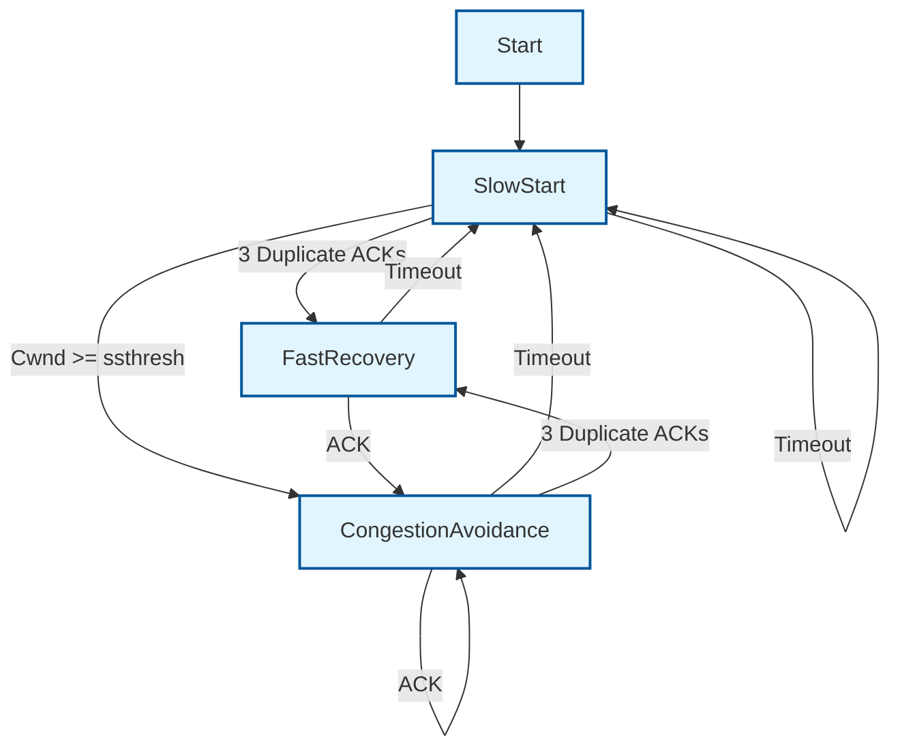

---
title: 计算机网络总结归纳
url: https://blog.kisechan.space/2025/notes-networks-summary/
type: post
time: '2026-10-23T14:43:06.486Z'
---

- **第1章：概论**
- **第2章：数据通信基础** (物理层的理论基础，如傅里叶变换、编码解码)
- **第3章：物理层** (介质、信号、比特流)
- **第4章：数据链路层** (成帧、差错控制、流量控制、以太网)
- **第5章：网络层** (IP协议、路由算法、子网划分) —— _核心难点_
- **第6章：传输层** (TCP/UDP、拥塞控制、可靠传输) —— _核心难点_
- **第7章：局域网与广域网技术**
- **第8章：TCP/IP 协议** (含IPv6基础)
- **第9章：Internet 服务** (DNS, DHCP, Email等)
- (第10-12章为简讲或不讲内容：网络编程、安全、管理)

## 英文缩写/概念

| 英文缩写 |                全称                |          中文          |                                                             含义                                                              |
| :------: | :--------------------------------: | :--------------------: | :---------------------------------------------------------------------------------------------------------------------------: |
|   SAP    |        Service Access Point        |                        |                                                 层间接口处**提供服务的地方**                                                  |
|   SDU    |         Service Data Unit          |                        |                                       **相邻层**在提供服务的过程中要传递的**数据单元**                                        |
|   PDU    |         Protocol Data Unit         |                        |                               **对等层**间交换的信息单位，N层的PDU由N层的SDU加上该层的PCI 构成                                |
|   PCI    |    Protocol Control Information    |                        |                                                      该层的协议控制信息                                                       |
|          |              request               |    **请求**服务原语    |                                 一个实体请求得到某种服务。由(N+1)向N层发出的,要求N层提供服务                                  |
|          |             indication             |    **指示**服务原语    |                               把关于某一事件的消息告诉某一实体。由N向(N+1)层发出，表示服务开始                                |
|          |              response              |    **响应**服务原语    |                                 一个实体愿意响应某一事件，由(N+1)向N层发出，表示对指示的响应                                  |
|          |              confirm               |    **证实**服务原语    |                                   确认一个实体的服务请求。由N向(N+1)层发出，表示请求已完成                                    |
|          |                                    |          信源          |                                                     产生要发送数据的设备                                                      |
|          |                                    |        发送设备        |                                                     对数据进行编码的设备                                                      |
|          |                                    |        传输系统        |                                                        传输线路或网络                                                         |
|          |                                    |        接收设备        |                                                     将接收的信号变成数据                                                      |
|          |                                    |          信宿          |                                                           目的系统                                                            |
|   ASK    |        Amplitude shift key         |        幅移键控        |                                                 用载波的不同幅度代替数字1，0                                                  |
|   FSK    |        Frequency shift key         |        频移键控        |                                                 用载波的不同频率代替数字1，0                                                  |
|   PSK    |          Phase shift key           |        相移键控        |                                                 用载波的不同相位代替数字1，0                                                  |
|   QAM    |  Quadrature amplitude modulation   |        正交调幅        |                                                  ASK和PSK结合起来的编码方法                                                   |
|   FDM    |  Frequency-Division Multiplexing   |      频分多路复用      |                                           通过分割线路的带宽来实现，适用于模拟信号                                            |
|   TDM    |     Time-Division Multiplexing     |      时分多路复用      |                            通过分割时间片来划分信道，每个时间片由一个复用信号占用，适用于数字信号                             |
|   WDM    |  Wavelength-Division Multiplexing  |      波分多路复用      |                               利用多个激光器在单条光纤上同时发送多束不同波长激光，就是光的 FDM                                |
|   CDMA   |   Code-Division Multiple Access    |      码分多路复用      |                                         根据码型结构的不同来实现信号的分割的多路复用                                          |
|   CRC    |                                    |       循环校验码       |                                                                                                                               |
|   DTE    |      Data Terminal Equipment       |                        |                                        具有数据处理能力及发送和接收数据信息能力的设备                                         |
|   DCE    | Data Circuit-Terminating Equipment |                        |                                     是能够通过网络发送和接收模拟或数字信号形式数据的设备                                      |
|   ENQ    |               EQuiry               |         询问帧         | 在询问/确认 (ENQ/ACK) 模式下，如果两个设备之间存在一条专用链路，启动方会首先发送一个询问帧 (ENQ) 来询问接收方是否可以接收数据 |
|   ACK    |            ACKnowledge             |         确认帧         |                                                                                                                               |
|   NAK    |       Negative AcKnkowledge        |         否认帧         |                                                                                                                               |
|   ARQ    |      Automatic Repeat reQuest      |      自动重复请求      |                          数据帧在传输中出现错误，接收方就返回一个 NAK，出错的帧就会被发送方重新传送                           |
|   RIP    |    Routing Information Protocol    |      路由信息协议      |                                                  距离向量路由算法使用的协议                                                   |
|   OSPF   |       Open Short Path First        | 开放式最短路径优先协议 |                              链路状态路由算法使用的协议 同时也是内部网关路由选择的路由协议                               |
|   BGP    |      Border Gateway Protocol       |      边界网关协议      |                                          外部网关协议，完成自治系统间的路由选择问题                                           |
|   IGP    |     Interior Gateway Protocol      |      内部网关协议      |                                                                                                                               |
|   EGP    |      Exterior GatewayProtocol      |      外部网关协议      |                                                                                                                               |
|    AS    |                                    |        自治系统        |                                                                                                                               |
|   SPF    |        Shortest Path First         |        SPF 算法        |                                                      就是 Dijkstra 算法                                                       |
|   TSAP   |   Transport Service Access Point   |                        |                                                 传输服务点的地址，称为端口号                                                  |
|   NSAP   |    Network Service Access Point    |                        |                                                        网络服务访问点                                                         |
|   LLC    |                                    |    逻辑链路控制子层    |                                 IEEE 802数据链路层的上子层，它对于所有的LAN协议来说都是相同的                                 |
|   MAC    |                                    |    媒体访问控制子层    |                                                  解决共享介质的竞争使用问题                                                   |

## 协议汇总

### EIA-232 接口标准

EIA-232 接口标准是一种重要的物理层协议，用于规范**数据终端设备 (DTE)** 和 **数据电路终接设备 (DCE)** 之间的连接，确保不同设备能够方便地相互连接。

- **制定机构和历史：** EIA-232 接口标准是由**电子工业协会 (EIA)** 在 1962 年制定的，早期被称为 **RS-232** 标准。
- **物理层协议功能：** 作为物理层协议，它定义了 **DTE-DCE 接口**的标准化，包括机械、电气、功能和规程四个方面的特性。
- **典型应用场景：** 它是一种 DTE-DCE 接口标准，主要用于 DTE（如计算机或终端）通过 DCE（如调制解调器）连接到通信网络的情境。
- **通信距离限制：** EIA-232 接口对电缆长度有限制，**不能超过 25 米**。

#### 机械特性

- **连接器：** EIA-232 接口使用 **DB25 连接器**（DB25 连接头），该连接器定义了插头的尺寸和各管脚的位置等。
- **引脚数量：** 使用 **25 根引脚**进行物理连接。

#### 电气特性

**编码方式：** 采用**非归零电平编码 (NRZ-L)** 进行数据传输。

- **逻辑电平定义：** 逻辑 **0** 对应**正电平**，逻辑 **1** 对应**负电平**。
- **电压范围：** 传输线上的电压范围在 **-15V 到 +15V** 之间，其中有效区域通常为 +3V 到 +15V（逻辑 0）和 -3V 到 -15V（逻辑 1），-3V 到 +3V 是无效区域（或过渡区域）。

#### 功能特性（主要功能线）

EIA-232 定义了多条线路来区分数据线和控制线，每条线上的特定电平代表特定的意义。

#### 规程特性

规程特性说明了数据交换的**控制步骤**，即各种可能事件（如准备、就绪、建立、数据传输和清除连接）发生的**先后顺序**。源设备和目的设备之间的物理连接建立和释放涉及多个引脚（如 20、6、4、5、8、2、24、3、17 号引脚）信号的激活与撤销。

#### 其它相关协议

##### 空调制解调器 (Null Modem)

- **概念：** 是一种基于 **EIA-232** 标准的连接方案。当需要连接的两台 **DTE** 设备（如两台计算机）相距很近，**不需要调制解调器 (DCE)** 时，可以直接相连。
- **作用：** 空调制解调器在没有 DCE 设备的环境下，提供了 **DTE-DCE/DCE-DTE** 的接口功能。

##### EIA-232 的子集

实际的 **DTE-DCE** 接口通常只使用 **EIA-232** 标准的一部分引脚（如 8 或 9 针连接器），因为大多数用户并不需要所有功能，例如在异步串行通信中不需要同步时钟信号线。计算机的串行口就是 EIA-232 标准接口的一个子集。

##### X.21 标准

它使用 DB-15 连接头 (15 针)，**撤销了大多数控制线路**，将控制信息导向数据线路进行传输。针对数字通信设计，接口简化，效率更高。

### PDU、SDU 和 PCI

我给你的东西，是你的 SDU；你在外面包的壳，是你的 PCI；包完之后的整体，是你的 PDU。

SDU 如果很大，则可以进行分段。

|   OSI 层   |  本层 SDU  |   本层 PCI   |  得到的本层 PDU  |
| :--------: | :--------: | :----------: | :--------------: |
|   应用层   |  应用数据  |  应用协议头  |       报文       |
|   传输层   | 应用层报文 |  TCP/UDP 头  |      报文段      |
|   网络层   | TCP/UDP 段 |    IP 头     | 分组 / IP 数据报 |
| 数据链路层 |  IP 分组   | MAC 头 + FCS |        帧        |
|   物理层   |     帧     |      —       |      比特流      |

### 服务

### 信息

|   名词   |        本质         | 是否抽象 |   作用    |     度量方式      |
| :------: | :-----------------: | :------: | :-------: | :---------------: |
| **信息** | 意义 / 不确定性减少 |    ✅    | 表达内容  | bit（信息量、熵） |
| **数据** |     信息的表示      |  半抽象  | 存储/处理 |    bit / byte     |
| **信号** |   数据的物理形式    |    ❌    |   传输    | 幅度、频率、功率  |
| **信道** |      传输通路       |    ❌    | 限制能力  |    带宽、容量     |

### ENQ、ACK 和 NAK

#### ENQ

**ENQ** 的全称是 **EQuiry**，意为**询问帧**。它在数据链路层的**线路规程**中用于启动一个通信会话或查询对方状态。

**出现的场景有**：

- **线路规程（数据链路层）：**
  - 在**询问/确认 (ENQ/ACK) 模式**下，如果两个设备之间存在一条专用链路（即点对点方式），**启动方**会首先发送一个**询问帧 (ENQ)** 来询问接收方是否可以接收数据,。

#### ACK

**ACK** 的全称是 **ACKnowledge**，意为**确认**。它是一种积极的响应信号或控制帧，用于表示数据或请求已被成功接收或同意。

**出现的场景有**：

- 线路规程（**数据链路层**）：
  - 在**询问/确认 (ENQ/ACK) 模式**下，**接收方**如果已准备好接收数据，会回答一个**确认帧 (ACK)**,。
  - 在**轮询/选择 (Poll/Select) 模式**下的**选择 (Select)** 阶段，当主设备希望发送数据时，从设备会使用 **ACK** 帧来**同意接收**数据,。
- **流量与差错控制协议**（**数据链路层**）：
  - 在**停止等待协议**中，发送方每发送一帧后，就等待 **ACK** 确认信号，只有收到一个 **ACK** 后，才发送下一个帧,。
  - 在**滑动窗口协议**中，接收方可以使用一个 **ACK 帧**来对**多个数据帧**的接收进行确认,。接收方发送的 **ACK 编号**是**期望收到的下一帧**的编号,。
- **传输控制协议 (TCP)（传输层）：**
  - 在 **TCP 报头**中，**ACK** 是一个**标志字段**（占 1 位），当 **ACK = 1** 时，表示报文段中的**确认号字段有效**，该确认号是发送方期望收到对方的**下一个**报文段的数据的第一个字节的序号,。
  - 在 **TCP 连接建立（三次握手）**过程中，第二次握手时，目的主机发送的 **SYN+ACK** 报文段和第三次握手时，源主机发送的 **ACK** 报文段都带有 **ACK** 标志位，用于确认收到了对方的序号,。
  - 在 **TCP 连接释放（四次挥手）**过程中，同样使用 **ACK** 标志位来进行确认和应答,。
  - 在 **TCP 拥塞控制**的**快速重传**算法中，**三个重复 ACK** 的到达是数据段已经丢失的标志，会触发发送端不等重传定时器超时就重传疑似丢失的数据段,。

#### NAK

**NAK** 的全称是 **Negative Acknowledge**，意为**否定应答**或**拒绝**。它是一种响应信号或控制帧，用于表示数据或请求中存在错误或无法处理。

**出现的场景有**：

- **线路规程（数据链路层）：**
  - 在**询问/确认 (ENQ/ACK) 模式**下，如果接收方**没有准备好接收**数据，则会回答一个**否认帧 (NAK)**,。
  - 在**轮询/选择 (Poll/Select) 模式**下的**选择 (Select)** 阶段，从设备会使用 **NAK** 帧来**拒绝接收**数据,。
  - 在**轮询 (Poll)** 阶段，当主设备询问从设备是否有数据发送时，如果从设备没有数据发送，**必须回答否定应答帧 (NAK)**,。
- **流量与差错控制协议（数据链路层）：**
  - 在**自动重复请求 (ARQ, Automatic Repeat reQuest)** 机制中，如果数据帧在传输中出现错误，接收方会返回一个**否定应答帧 (NAK)**，通知发送方重新传送出错的帧,。
  - 在**滑动窗口协议**中，接收方可以发送 **否认帧 (NAK)** 来告知发送方重新发送一个损坏的帧,。
  - 在**回退N自动重复请求 (Go-back-N, GBN)** 协议中，**NAK** 用于通知发送方重传从被损坏帧开始的所有帧,。
  - 在**选择拒绝自动重复请求 (Select-Rej, SR)** 协议中，**NAK 帧的编号**指的是**错误或丢失的帧**的编号,。

### 网关路由协议

互连网中提供两级路由协议：

- 内部网关协议 **IGP**(Interior Gateway Protocol)
- 外部网关协议 **EGP**(Exterior Gateway Protocol)

### LLC 和 MAC

### IP 地址

| 类别 | 首字节范围 | 默认掩码 | 网络位 | 主机位 | 规模 |
| :--: | :--------: | :------: | :----: | :----: | :--: |
|  A   |   1–126    |    /8    |   8    |   24   | 极大 |
|  B   |  128–191   |   /16    |   16   |   16   |  中  |
|  C   |  192–223   |   /24    |   24   |   8    |  小  |
|  D   |  224–239   |    —     |   —    |   —    | 组播 |
|  E   |  240–255   |    —     |   —    |   —    | 实验 |

聚合的 C 类网数量：当前的主机号数除以 C 类网的主机位数

## 计算题

### 传播时延

|    交换方式    |   是否分组   | 是否存储转发 | 是否流水线 | 是否需建立 | 端到端时延通用公式                                      |
| :------------: | :----------: | :----------: | :--------: | :--------: | ------------------------------------------------------- |
|  **电路交换**  |      否      |      否      |     否     |     是     | T = T_{\text{setup}} + \frac{L}{R} + k\cdot d_p$        |
|  **报文交换**  | 否（整报文） |      是      |     否     |     否     | T = k\left(\frac{L+h}{R} + d_p\right)$                  |
| **虚电路交换** |      否      |      是      |     是     |     是     | T = T_{\text{setup}} + (k+n-1)\frac{L}{R} + k\cdot d_p$ |
| **数据报交换** |      是      |      是      |     是     |     否     | $T = (k+n-1)\frac{L_p}{R} + k\cdot d_p$                 |

|        符号        |              含义              | 单位 |                说明                 |
| :----------------: | :----------------------------: | :--: | :---------------------------------: |
|        $T$         |          端到端总时延          |  s   |              最终所求               |
| $T_{\text{setup}}$ |     呼叫 / 虚电路建立时间      |  s   |        **仅电路 / 虚电路有**        |
|        $L$         |         报文净数据长度         | bit  |              不含报头               |
|        $h$         |            报头长度            | bit  |         报文交换中只加一次          |
|        $R$         |          链路传输速率          | bps  |            假设各段相同             |
|        $k$         |            链路段数            |  —   |      源到目的经过的物理链路数       |
|       $d_p$        |          单段传播时延          |  s   |            与数据量无关             |
|        $n$         |            分组个数            |  —   | $$n=\lceil L/\text{payload}\rceil$$ |
|       $L_p$        | **最大分组长度**（**含报头**） | bit  |           决定流水线节拍            |

### 奈奎斯特准则和香农公式

> **奈奎斯特准则**和**香农公式**回答的是同一个大问题的不同侧面：“一条物理信道，最多能传多快？”
>
> | 定理             | 核心限制因素             | 关注点              |
> | ---------------- | ------------------------ | ------------------- |
> | **奈奎斯特准则** | **带宽有限（无噪声）**   | 采样 / 码元速率上限 |
> | **香农公式**     | **噪声存在（随机干扰）** | 信息速率理论极限    |

#### 相关概念

1. **带宽** $H$
   - 单位：Hz
   - 含义：信道能通过的频率范围
   - 本质：**信号变化快慢的物理限制**
2. **码元**
   - 一次信号变化所能表达的“状态”
   - 一个码元 ≠ 一个比特
   - 一个码元可表示多个比特
3. **码元速率**（波特率）$B$
   - 单位：Baud
   - 含义：**每秒发送多少个码元**
   - 受带宽直接限制
4. **$N$ 进制信号**
   - 每个码元有 $N$ 种不同状态
   - 每个码元携带 $\log_2 N$ 比特
5. 例如：
   - 两相调制(单个调制状态对应1个二进制位)的比特率等于波特率；
   - 四相调制(单个调制状态对应2个二进制位)的比特率为波特率的两倍；
   - 八相调制(单个调制状态对应3个二进制位)的比特率为波特率的三倍。

#### 奈奎斯特准则

在**无噪声的理想低通信道**中，带宽有限，会不会限制数据传输速率？

最大码元速率 $B$ 和最大比特率 $C$ 满足：

$$
\begin{align*}
B &= 2H\\
C &= 2H\log_2N
\end{align*}
$$

| 符号 |                            含义                            | 单位 |
| :--: | :--------------------------------------------------------: | :--: |
| $H$  | 信道带宽，也就是信道能够通过的最低频率到最⾼频率之间的差值 |  Hz  |
| $B$  |                          码元速率                          | Baud |
| $C$  |                           比特率                           | bps  |
| $N$  |                    每个码元的离散状态数                    |  —   |

从奈奎斯特准则可以看出来：

- 带宽是**硬物理限制**
- 提高速率的两种方式：
  1. 增加带宽 $B$
  2. 提高调制阶数 $M$

但：**提高 $M$ 会降低抗噪声能力**，而 这正是奈奎斯特忽略的问题。

#### 香农公式

在有噪声的真实信道中， 即使带宽固定，数据速率仍然**有极限，而且是信息论极限**。

$$
C=H\times\log_2(1+S/N)
$$

| 符号  |                           含义                            | 单位 |
| :---: | :-------------------------------------------------------: | :--: |
|  $C$  |                  信道的最⼤数据传输速率                   | bps  |
|  $H$  |                         信道带宽                          |  Hz  |
| $S/N$ | 信噪比（线性值），$S$ 是平均信号功率， $N$ 是平均噪声功率 |  —   |

**信噪比常用分贝（dB）表示**：

$$
(S/N)_\text{dB}=10\times\log_{10}(S/N) \quad\text{(dB)}
$$

---

## 编码

### 数字-数字编码

用数字信号来表示数字信息。在这种编码形式下，由计算机产⽣的0、1⽐特序列被转换成⼀串可以在导线上传输的脉冲电压（有两种电压值）。

#### 单极性编码

电压是单极性,高电平表示1、低电平表示0。缺点是有直流电平容易损伤电容，要求带宽高，无法同步[^1] (需依赖附加线)。

[^1]:
    同步问题指的是接收端如何在连续的物理信号中判断每一个比特（或码元）从哪里开始、到哪里结束的问题。
    

#### 极化编码

使⽤两个不同的电压⽔平，⼀个正电压和⼀个负电压来表⽰逻辑“1”和逻辑“0”。

优点：相⽐单极性编码，极化编码减少了直流分量，有助于降低信号失真。

类型：

- ⾮归零编码（NRZ）
- 归零编码（RZ）
- 双相位编码（曼彻斯特编码和差分曼彻斯特编码）

##### 非归零编码

在信号的持续时间内，电平保持不变，逻辑“1”⽤⼀种电压表⽰，逻辑“0”⽤另⼀种电压表⽰，但信号在每个⽐特的中间不会回到零电平。

⾮归零电平编码解决了直流分量问题，⾮归零反相编码既解决了直流分量问题，也基本解决了同步问题（但是如果⼀直发送0，就没有沿，那么同步问题并没有得到解决）【⽐如：发⽣跳变就是整秒的位置。每碰到⼀个沿就调整⼀下】

##### 双相位编码（曼彻斯特编码和差分曼彻斯特编码）

信号在每个⽐特的中间都会发⽣电平跳变，这种跳变可以⽤来进⾏时钟同步。（信号在每⽐特间隙的中间发⽣改变但并不归零，⽽是转为相反的⼀极。）

- **曼彻斯特编码**：每个⽐特的中间都有跳变，跳变的⽅向表⽰⽐特值，从⾼到低表⽰“1”，从低到⾼表⽰“0”。
- **差分曼彻斯特编码**：跳变的位置表⽰⽐特值，跳变在⽐特的开始表⽰“0”，没有跳变表⽰“1”。

- 每个bit⽆论0和1，都存在正向充电，反向放电的过程，直流分量问题解决
- 1个bit⾄少跳变⼀回，同步问题解决。
- 差分曼彻斯特编码如果⽐特间隙开始时刻发⽣跳变代表0
- 【曼彻斯特编码的波特率是数据速率的2倍，当数据传输速率为100Mbps时，需要200MHz的脉冲】
- 【曼切斯特编码波特率是⽐特率的⼆倍】

### 码分多路复用 CDMA

基本约定：

1. **比特映射**

$$
\text{发送比特：}
\begin{cases}
1 \;\rightarrow\; +1 \\
0 \;\rightarrow\; -1
\end{cases}
$$

2. **码片序列**

   - **每个用户一个码片序列** $A_i$

   - 码片取值：$\pm1$

   - 长度为 $m$（扩频因子）

3. **正交性条件**

$$
\forall i, j,\quad\begin{cases}A_i\cdot A_j=0,&i\neq j\\A_i\cdot A_i\ne 0&&\end{cases}
$$

#### CDMA 编码（发送端计算方法）

- 用户 $i$ 的发送比特：$b_i \in {+1,-1}$
- 用户 $i$ 的码片序列：

$$
A_i = (a_{i1},a_{i2},\dots,a_{im})
$$

- 发送到信道中的码片序列：

$$
S_i=b_i\cdot A_i
$$

即：

- 发 1 → 码片不变
- 发 0 → 码片整体取反

---

若有 $n$ 个用户同时发送，则信道中的信息

$$
{
S = \sum_{i=1}^{n} S_i = \sum_{i=1}^{n} b_i\cdot A_i
}
$$

是所有用户码片的代数和。

#### CDMA 解码

对用户 $k$ 发来的信息解码：

$$
\begin{aligned}
R_k = \frac{1}{m}S \cdot A_k
&= \frac{1}{m}\left(\sum_{i=1}^{n} b_i A_i\right)\cdot A_k \\
&= \frac{1}{m}\left[b_k (A_k\cdot A_k) + \sum_{i\neq k} b_i (A_i\cdot A_k)\right]\\
&= \frac{1}{m}\underbrace{b_k\cdot A_k^2}_\text{$a_i=\pm1$ ，所以 $A_k^2=|A_k|=m$}\\
&= \pm1
\end{aligned}
$$

- $m$：码片长度
- $R_k$：解码结果

**判决规则**：

$$
R_k =
\begin{cases}
+1 & \Rightarrow \text{发送的是 1} \\
-1 & \Rightarrow \text{发送的是 0}
\end{cases}
$$

### 奇偶校验码

|   方式   |          校验维度           |  能否纠错  |
| :------: | :-------------------------: | :--------: |
| 水平奇偶 | 行，每个部分的第 $n$ 个比特 |     ❌     |
| 垂直奇偶 |   列，每个部分的所有比特    |     ❌     |
| 纵横奇偶 |           行 + 列           | ✅（1 位） |

### CRC 编码

假设⽣成多项式 $G(x)=x^4+x^3+1=11001$，待发送的信息 $U(x)=1101011$。

1. 在 $U(x)$ 后⾯添加4个零： $1101011000$。
2. 使⽤⼆进制除法【没有借位】，将扩展后的信息除以 $G(x)$，得到余数 $R(x)$。
3. 将余数 $R(x)$ 附加到 $U(x)$ 后⾯，得到循环校验码。

接收⽅收到数据后，会⽤相同的⽣成多项式对收到的数据进⾏除法运算。如果结果为零，则说明传输过程中没有发⽣错误；如果结果⾮零，则说明传输过程中数据出现了错误。

### 校验和

### 停止等待协议

#### 发送一帧所需的最短总时间 $W_T$（或 $t_W$）

$$
W_T = t_I + 2t_p + 2t_\text{proc} + t_S
$$

- $t_I$：**发送数据帧的时间**，计算公式为 $t_I = \frac{\text{帧长}}{\text{接口速率}}$。
- $t_p$：**信号传播时延**，计算公式为 $t_p = \frac{\text{距离}}{\text{传播速度（一般是 $0.7$ 倍光速）}}$。
- $t_\text{proc}$：**节点处理数据的时间**，一般忽略。
- $t_S$：**发送确认帧（ACK）的时间**，计算公式为 $t_S = \frac{\text{确认帧长}}{\text{接口速率}}$。

#### 信道利用率 $F$

信道被有效占用的时间与总时间之比。也可以记为 $P$。

- **新版定义：** $$F = \frac{t_I}{W_T}$$
- 旧版定义（包含传播时延）： $$F = \frac{t_I + t_p}{W_T}$$

#### 有效数据传输率 $S$

单位时间内传输的有效数据位数。

$$
S = \frac{D_1}{W_T}
$$

- $D_1$：一帧中的**有效数据位数**（不含首部和尾部开销）。

---

#### 存在差错时的平均传输时间 $t_V$

当考虑帧的出错率 $p$ 时，正确发送一帧所需的平均时间间隔为：

$$
t_V = \frac{t_W}{1 - p}
$$

#### 系统吞吐量与传输效率

- **最大吞吐量 $\lambda\_{\max}$**：每秒成功发送的帧数。 $$\lambda_{\max} = \frac{1}{t_V} = \frac{1 - p}{t_W}$$
- **极限吞吐量** $$M = \frac{1}{t_I}$$
- **系统的传输效率** $\rho$：最大吞吐量与极限吞吐量之比。
  - $$\rho = \frac{1 - p}{a}=\frac{t_I}{t_W}(1-p)$$
  - 其中，$a$ 为总时间与发送时间之比：**$a = \frac{t_W}{t_I}$** ($a > 1$)。

### 滑动窗口协议

#### 窗口大小的选择

为了使发送方能够不间断地发送数据（即达到极限吞吐量），窗口的大小 $n$ 必须足够大，以覆盖信号在往返时间内能够传输的帧数。

- **基本条件**： $$nt_I > 2(t_I + t_p)$$
- 考虑确认帧发送时间时： $$nt_I > t_I + 2t_p + t_s$$

其中，

- $t_I$：发送一个数据帧的时间。
- $t_p$：信号传播时延。
- $t_s$：发送一个确认帧（ACK）的时间。

---

#### 回退 N 协议的效率分析

在回退 N 协议中，若某一帧损坏或丢失，发送方必须重传该帧及其后续所有已发送但未确认的帧。

- **正确传送一帧所需的平均时间** $$t_V = t_I + \frac{pt_W}{1 - p}$$
- **系统最大吞吐量** $$\lambda_{\max} = \frac{1}{t_V} = \frac{1 - p}{t_I(1 + p(a - 1))}$$
- **系统传输效率** $$\rho = \frac{1 - p}{1 + p(a - 1)}$$

其中：

- $p$：**数据帧的出错率**。
- $a$：**总时间与发送时间之比**（$a > 1, a = t_W / t_I$）。

#### 窗口尺寸与编号范围的关系

为了区分新帧和重复帧，协议对窗口尺寸有严格限制：

- **回退 N 协议：** 若帧的编号范围是 $0 \sim n-1$（模 $n$ 编号），则**发送窗口最大为 $n-1$**。
- **选择拒绝协议：**
  - 若帧的编号范围是 $0 \sim n-1$，则发送窗口尺寸 $W_t$ 和接收窗口尺寸 $W_r$ 必须满足： $$W_t + W_r \le n$$
  - 若要求 $W_t = W_r$，则窗口尺寸最大为 $n/2$。

### 距离向量路由算法

路由表中的每⼀项通常具有以下格式： `NetID : Distance : Nexthop`

- `NetID`：**⽹络标识符**
- `Distance`：**到⽬标⽹络的距离**
- `Nexthop`：**下⼀跳路由器**

### TCP 拥塞控制算法

|       变量        |                含义                |
| :---------------: | :--------------------------------: |
|   $\text{Cwnd}$   | 拥塞窗口（发送端控制，单位：SMSS） |
|   $\text{Rwnd}$   |       接收窗口（接收端通告）       |
| $\text{ssthresh}$ |           **慢启动阈值**           |
|   $\text{SMSS}$   |        发送端最大报文段长度        |
|   $\text{RTT}$    |              往返时延              |

#### 慢启动

**进入条件**

- 新连接建立
- 或发生 **超时**

**初始值**：

$$
\text{Cwnd} = 1
$$

**增长规则**（指数增长）：

- 每收到 **1 个 ACK**：

$$
\text{Cwnd} \leftarrow \text{Cwnd} + 1
$$

- 等价地，每经过 **1 个 RTT**：

$$
\text{Cwnd}_{k+1} = 2 \cdot \text{Cwnd}_k
$$

**退出条件**

$$
\text{Cwnd} \ge \text{ssthresh}
\quad \Rightarrow \quad
\text{进入拥塞避免阶段}
$$

#### 拥塞避免

**进入条件**

$$
\text{Cwnd} \ge \text{ssthresh}
$$

**增长规则（线性增长 / 加法增大）**

- 每经过 **1 个 RTT**：

$$
\text{Cwnd} \leftarrow \text{Cwnd} + 1
$$

**增长特性**

- **慢**
- **稳定**
- 用于试探网络可承受上限

#### 超时处理

**触发条件**

- 重传定时器超时（Timeout）

**处理规则**（乘法减小 + 慢启动）：

$$
\begin{aligned}
\text{ssthresh} &\leftarrow \frac{\text{Cwnd}}{2} \\
\text{Cwnd} &\leftarrow 1
\end{aligned}
$$

**后续状态**

$$
\text{重新进入慢启动}
$$

#### 快速重传和快速恢复

**触发条件**

- 连续收到 **3 个重复 ACK**

1. **快速重传**
   - **立即重传**丢失报文段
   - **不等待 Timeout**

2. **快速恢复**：窗口调整

$$
\begin{aligned}
\text{ssthresh} &\leftarrow \frac{\text{Cwnd}}{2} \\
\text{Cwnd} &\leftarrow \text{ssthresh} + 3
\end{aligned}
$$

> 其中， $+3$ 是为了补偿这 **3 个重复 ACK** 所对应的“已离开网络的数据”。

**后续状态**

$$
\text{直接进入拥塞避免（不回慢启动）}
$$

### CSMA/CD

最短帧长计算：

$$
L_{\min}=\frac{2R\times S}{V}
$$

其中，

- $L_\min$：最短数据帧⻓（bit）
- $S$ ：任意两站点间的最⼤距离（m）
- $R$ ：数据传输速率（Mbps）
- $V$：电⼦传播速度（200m/μs）

## 计算机网络概论

### 计算机网络的定义与组成

#### 计算机网络

计算机网络由若干**结点 (node)** 和连接这些结点的**链路 (link)** 组成。连接在网络上的计算机称为**主机 (host)**。建立计算机网络的目的是为了实现彼此交换信息和共享资源的目的。

#### 计算机网络的组成部分

- **通信子网：** 负责信息的传递，完成数据传输及转发。包括节点转发设备、通信设备等。
- **资源子网：** 负责信息处理，向网络用户提供各种网络资源与服务。包括计算机系统、外设、软件资源等。

#### 计算机网络的功能

计算机网络的主要功能包括：

- 数据通信
- 资源共享
- 并行和分布式处理
- 可靠性
- 以及可扩充性

#### 计算机网络的演变阶段

计算机网络经历了四个主要演变阶段：

1. 具有通信功能的联机系统（终端-线路-计算机）
2. 具有通信功能的分时系统（终端-集中器-计算机）
3. 独立的计算机互连的计算机网络
4. 以及国际标准化网络（开放式标准计算机网络）

### 计算机网络的拓扑结构

计算机网络的拓扑结构定义了网络中结点与链路的几何排列关系。

- **网状拓扑 (Mesh Topology)：** 特点包括能避免拥塞问题、具有较好的健壮性和安全性、便于管理，但安装费用高。
- **星状拓扑 (Star Topology)：** 结构简单、健壮性好、便于管理，但中央控制器是网络的瓶颈。
- **树状拓扑 (Tree Topology)：** 扩展了网络距离，并允许网络隔离不同计算机的通信。
- **总线型拓扑 (Bus Topology)：** 易安装，但总线长度有限，且故障隔离困难。
- **环状拓扑 (Ring Topology)：** 易安装、维护管理方便，传输时延可控，但整体传输延迟大。
- **混合型拓扑 (Hybrid Topology)：** 结合了多种拓扑结构。

### 计算机网络的分类

#### 按作用范围分类

- **局域网 (LAN, Local Area Network)：** 覆盖范围通常在一个房间、一层楼或整个楼宇内。
- **城域网 (MAN, Metropolitan Area Network)**。
- **广域网 (WAN, Wide Area Network)**。
- **个域网 (PAN, Personal Area Network)：** 能够在便携式消费电器与通信设备之间进行短距离通信的网络，覆盖范围一般在 10 米半径以内，例如蓝牙耳机。

#### 按其他方式分类

- **按通信介质分类：** 包括有线（如同轴电缆、双绞线、光纤）和无线（如卫星、微波）传输。
- **按传播方式分类：** 包括点对点和广播。
- **按通信速率分类：** 包括低速（kbps—1.4 Mbps）、中速（1.4 Mbps—45 Mbps）和高速（50 Mbps—1000 Mbps，甚至 10-100 Gbps）。
- **按使用范围分类：** 公用网 (public) 和专用网 (private)。
- **按网络控制方式分类：** 集中式和分布式。

### 网络分层体系结构

#### 网络协议

网络协议是通信双方必须遵守的规则、标准和约定，用于实现同层间的通信。

- **协议三要素：**
  - **语法：** 数据与控制信息的结构或格式（如数据的格式、电平）。
  - **语义：** 控制信息的功能及动作。
  - **时序：** 信息的同步、速度匹配和顺序。

#### 体系结构

计算机网络的各个层次及其协议的集合称为**体系结构**。网络体系结构是抽象的，是对功能的精确描述。分层的优点包括独立、灵活、模块化、易于维护和标准化。

#### OSI (Open System Interconnection) 模型

- 由国际标准化组织 (**ISO, International Organization for Standardization**) 于 1984 年制定。
- 模型作用是解决网络之间不能兼容和通信的问题。
- OSI 模型分为 7 个层次：物理层、数据链路层、网络层、传输层、会话层、表示层和应用层。
  - **物理层 (Physical)：** 规定了**机械的、电气的、功能的、规程的** 4 个特性，负责将计算机连接到通信媒体上，数据传输的单位是**比特 (Bit)**。
  - **数据链路层 (Data-Link)：** 提供相邻网络节点间的可靠通信，传输的信息单位是**帧 (Frame)**。主要工作包括可靠**传输数据、差错控制、流量控制和链路管理**。
  - **网络层 (Network)：** 处理任意节点的数据传输，传输的信息单位是**分组 (Packet)**。任务包括**路由选择、阻塞控制、和网际互连**。
  - **传输层 (Transport)：** 提供**端到端**的通信，将数据可靠地从一端用户进程送到另一端用户进程，传输的信息单元是**报文 (Message)**。
  - **会话层 (Session)：** 两个计算机上的用户进程建立连接，双方互相确认身份，协商会话连接的细节。
  - **表示层 (Presentation)：** 解决用户信息**语法问题**，对用户数据进行翻译、编码和交换。
  - **应用层 (Application)：** **处理用户的数据和信息**，完成用户所希望的实际任务。

#### TCP/IP 模型 (Transmission Control Protocol/Internet Protocol)

- 是世界上最大的计算机网络 **Internet** 运行的基础，也是目前应用最广泛的网络通信协议簇。
- TCP/IP 通常被认为由四层（或五层）构成：**应用层、传输层、网络层和网络接口层**（包含**数据链路层和物理层**）。
- **RFC (Request for Comment)**：所有关于 Internet 网络的正式标准都以 RFC 文档的形式出版。

|   名称   |         所在层         | 英文    |            含义            |       作用范围        |  是否逐跳变化  | 是否有结构 |       典型内容 / 字段       |
| :------: | :--------------------: | ------- | :------------------------: | :-------------------: | :------------: | :--------: | :-------------------------: |
| **比特** |         物理层         | Bit     |    物理信号表示的 0 / 1    |     一段物理介质      |       ✅       |     ❌     |     电压、电流、光脉冲      |
|  **帧**  |       数据链路层       | Frame   | 在一条链路上传输的数据单元 | **一跳 / 一个局域网** |       ✅       |     ✅     | 源 MAC、目的 MAC、类型、CRC |
| **分组** |         网络层         | Packet  |  用于跨网络路由的数据单元  |      **端到端**       | ❌（内容不变） |     ✅     |     源 IP、目的 IP、TTL     |
| **报文** | 应用层（或传输层视角） | Message |     应用产生的完整数据     |        端到端         |       ❌       |     ✅     |    HTTP 请求、DNS 查询等    |

### 实体间通信与服务

#### 层间通信与对等层间通信

- **层间通信：** 同一节点上相邻层次的通信。
- **对等层间通信 (虚通信)：** 不同的网络节点上对等层间的通信（除物理层之外）。
- **实通信：** 层间通信和物理层之间的通信。
- **协议是“水平的”：** 协议是控制对等实体之间通信的规则。
- **服务是“垂直的”：** 服务是由下层向上层通过层间接口提供的。

#### 服务与数据单元

- **服务访问点 (SAP, Service Access Point)：** 层间接口处提供服务的地方。
- **服务数据单元 (SDU, Service Data Unit)：** 相邻层在提供服务的过程中传递的信息。
- **协议数据单元 (PDU, Protocol Data Unit)：** 对等层间交换的信息单位。
- **PDU 与 SDU 的关系：** N 层的 PDU 由 N 层的 SDU 加上该层的**协议控制信息 (PCI, Protocol Control Information)** 构成。

#### 服务的类型

下层能为上层提供两种主要服务：

- **面向连接的服务：** 需要经过**建立连接、数据交换和释放连接**三个阶段。
- **面向无连接的服务：** 以**数据报**形式传输，包括数据报、证实交付和请求/响应。

|  层次  |   协议   |  可靠性  | 是否连接 |
| :----: | :------: | :------: | :------: |
| 应用层 | HTTP/1.1 | 依赖 TCP |  有连接  |
| 应用层 |   DNS    |  不可靠  |  无连接  |
| 传输层 | **TCP**  |   可靠   |  有连接  |
| 传输层 | **UDP**  |  不可靠  |  无连接  |
| 网络层 |  **IP**  |  不可靠  |  无连接  |
| 链路层 | Ethernet |  不可靠  |  无连接  |

### 网络互连与性能

#### 网络互连

- **互连目的：** 扩大资源的共享范围。
- **互连设备（按OSI层次划分）：**
  - **物理层：** **重发器** (Repeater)。
  - **数据链路层：** **网桥** (Bridge)。
  - **网络层：** **路由器** (Router)。
  - **网络层以上：** **网关** (Gateway)。

#### 计算机网络的性能指标

- **吞吐量 (throughput)：** 在单位时间内通过某个网络（或信道、接口）的数据量。受网络的带宽或额定速率的限制。
- **信道利用率：** 信道被有效占用的时间与总时间之比。
- **延迟时间：**
  - **排队时延：** 在发送队列中的等待时间。
  - **访问延时：** 等待信道空闲的时间。
  - **发送时延：** 发送数据帧所需的时间 (数据块长度 / 发送速率)。
  - **传播时延：** 信号在信道中传播的时间 (信道长度 / 信号在信道上的传播速率)。
- **总时延：** 等于发送时延 + 传播时延 + 排队时延 + 访问时延。

## 数据通信基础

### 数据通信系统基本概念

#### 数据通信系统组成

- **信源：** 产生要发送数据的设备。
- **发送设备：** 对数据进行编码的设备。
- **传输系统：** 传输线路或网络。
- **接收设备：** 将接收的信号变成数据的设备。
- **信宿：** 数据的目的系统。

#### 数据通信系统应解决的主要问题

这些问题涵盖了通信系统的核心挑战，包括提高效率和控制数据的完整性：

- 提高传输系统的**效率/利用率**。
- **接口、编码、同步**。
- **交换管理**。
- **差错控制**。
- **流量控制**。
- **寻址和路由**。
- **故障恢复**。
- **报文格式**。

### 信号和数据编码

#### 信号的分类与度量

- **模拟信号：** 随时间连续变化的信号，可分为**简单模拟信号**（如正弦波，具有振幅、频率、相位三个参数）和**复杂模拟信号**（可分解为多个正弦波的叠加）。
  - **傅里叶级数/变换：** 用于将复杂信号分解为不同频率的正弦波分量。
- **数字信号：** 离散的，值的变化是瞬时发生的信号。

#### 数据传输速率指标

- **比特率 (Bit Rate, S)：** 每秒钟发送的比特数，单位是 bit/s（bps）。
- **码元 (Baud)：** 承载信息量的基本信号单位。当码元的离散状态大于两个时（M进制码元），信息量增大。
- **码元速率 (Baud Rate, B)：** 每秒钟传送码元的数目，单位是波特 (Baud)。
  - **比特率与波特率的关系：** $S = B \times \log_2 N$，其中 $N$ 是码元状态数。
- **载波信号：** 发送设备产生的高频基波，用于承载信息信号，信息承载过程称为**调制**。
- **有效带宽：** 允许信号传输且能以合理精度恢复信号的上限频率。
- **信道容量 (C)：** 传输介质可以传输的**最大比特率**。

#### 信道容量定理与限制

- **奈奎斯特准则 (Nyquist)：** 描述了**无噪声**情况下码元速率和信道带宽的关系。
  - **码元速率限制：** $B = 2 \times H$（其中 $H$ 是信道带宽）。
  - **最大数据传输率：** $C = 2 \times H \times \log_2 N$。
- **香农定理 (Shannon)：** 描述了**有限带宽有随机热噪声**信道下的最大传输速率。
  - **最大传输速率：** $C = H \times \log_2 (1 + S/N)$（其中 $S$ 是平均信号功率， $N$ 是平均噪声功率， $S/N$ 为信噪比）。
- **码间串扰：** 由于系统传输特性不理想，导致前后码元波形畸变、展宽，对当前码元判决造成干扰。

#### 信号编码方式

编码是将信息用信号表示的方法，主要有四种转换方式：

- **数字 $\rightarrow$ 数字编码：** 用数字信号表示数字信息（脉冲电压序列）。
  - **单极性编码：** 高电平表示 1，低电平表示 0。**缺点：** 有直流电平，需高带宽，难同步。
  - **极化编码：** 采用正电压和负电压，减轻了直流分量问题。
    - **非归零编码 (NRZ)：** 非归零电平编码和非归零反相编码。
    - **归零编码 (RZ)**。
    - **双相位码：** 信号在每比特间隙中间发生改变但不归零，用于同步。包括**曼彻斯特编码**和**差分曼彻斯特编码**。
      - _曼彻斯特编码_：负到正跳变代表 1，正到负跳变代表 0。
      - _差分曼彻斯特编码_：比特间隙开始位置的跳变用于同步，有跳变代表 0，无跳变代表 1。
- **数字 $\rightarrow$ 模拟编码（调制技术）：** 利用模拟信号的幅值、频率、相位来代替数字 1 和 0，主要用于利用有限带宽系统传输数字数据。
  - **幅移键控 (ASK, Amplitude Shift Keying)：** 用载波的不同幅度表示数字信息。
  - **频移键控 (FSK, Frequency Shift Keying)：** 用载波的不同频率表示数字信息。
  - **相移键控 (PSK, Phase Shift Keying)：** 用载波的不同相位表示数字信息。
  - **正交调幅 (QAM)：** ASK 和 PSK 结合的编码方法。
- **模拟 $\rightarrow$ 数字编码 (PCM, Pulse Code Modulation)：** 通常需要三步：**采样**（将连续信号离散化）、**量化**（离散值用二进制量化）和**编码**（二进制编码）。
  - **采样定理 (Shannon/Nyquist)：** 采样频率必须大于信号最高频率的 2 倍。

### 线路配置与传输方式

#### 线路配置 (Line Configuration)

- **点对点 (Point-to-Point)：** 两个设备之间存在专用链路。
- **多点连接 (Multi-Point)：** 一条线路上连接多个设备。

#### 传输模式 (Transmission Mode)

- **单工/半双工/双工通信**。
- **串行和并行传输**。
  - _并行：_ 一次 8 位传输，速度快，线路昂贵，距离短。
  - _串行：_ 一次一位传输，速度慢，价格便宜。
- **同步和异步传输**。
  - _异步传输：_ 用于低速设备，一次传输一个字节，每个字节用**开始位**和**停止位**进行同步。
  - _同步传输：_ 用于高速传输，对时钟要求高，使用**数据帧**包含同步/控制/数据/错误/结束等信息。

### 多路复用技术 (Multiplexing)

多路复用技术允许一条链路同时传输多路信号，以最大限度地利用传输能力。

- **频分多路复用 (FDM, Frequency-Division Multiplexing)：** 通过**分割线路带宽**，让每路信号占用不同的频率带，适用于**模拟信号**。
- **时分多路复用 (TDM, Time-Division Multiplexing)：** 通过**分割时间片**，让每路信号占用不同的时间片，适用于**数字信号**。
  - **同步时分多路复用：** 帧大小固定，控制简单，实时性好，但可能造成**线路资源浪费**（信道效率差）。
  - **异步（统计）时分多路复用 (STDM)：** 提高了系统的利用率，但需要额外代价（如信息单元需附带地址、复用器需有存储容量）。
- **波分多路复用 (WDM, Wavelength Division Multiplexing)：** 本质上是**光的频分复用**。利用多个激光器在单条光纤上同时发送多束**不同波长**激光。
- **码分多路复用 (CDMA, Code-Division Multiple Access)：** 根据**码型结构的不同**来分割信号，所有用户使用**同一频率**，占用相同的带宽。
  - _基本原理：_ 每个比特被分为 $m$ 个**码片**，每个站点有唯一的 $m$ 位码片序列（码字）。不同站点码字相互正交。
  - _特点：_ 通过码字正交支持多用户，提高频带利用率。

### 数据交换技术

数据交换解决的是多个设备间通信的连接问题。

#### 传统交换方式

- **电路交换 (Circuit Switch)：** 在通信开始前，在两个设备间建立一条**完全被通信双方占用的临时物理连接**。过程包括：电路建立、数据传输、电路拆除。
  - _特点：_ 独占物理通路，一旦建立延迟小，但信道利用率低。
- **报文交换 (Message Switch)：** 又称**存储转发**。网络的中间节点将**整个报文**暂时存储，检查完整性后再转发。
  - _缺点：_ 报文较长，传输延迟大。
- **分组交换 (Packet Switch)：** 较长的报文被分割成较短的**信息包 (packet/分组)**，以包为单位发送、存储和转发。中间节点只需短时间存储分组，减少了传输延迟。
  - _优点：_ 共享传输链路，提高使用效率；支持多种通信设备互连；提供灵活的流控/拥塞控制；可工作于广播/多播方式。
  - _分组交换类型：_
    - **数据报 (Datagram)：** 每个包独立处理，可能**失序到达**目的地（排序由传输层完成）。
    - **虚电路 (Virtual Circuit, VC)：** 属于同一次通信的所有包之间的关系得以维持，路径在数据传输开始前选定，包**按顺序沿着固定路径传输**。虚电路可以同时为多个设备提供服务，与电路交换不同。
      - _虚电路类型：_ **交换虚电路 (SVC)**（临时创建）和**永久虚电路 (PVC)**（长期固定，类似于租用线路）。

#### 新型交换技术

- **异步传输模式 (ATM, Asynchronous Transfer Mode)：** 信元中继协议，使用固定长度的**信元 (cell)** 进行传输。
- **帧中继 (Frame Relay)：** 在数据链路层**不提供差错检测**和流量控制（留给网络层和传输层），以提高效率。

### 错误检测和控制

错误检测和控制通过给信息加上冗余位来实现。

#### 检错/纠错能力

- **码距 (d)：** 影响检错和纠错能力。
  - **检错能力 (D)：** $d \ge D + 1$。
  - **纠错能力 (C)：** $d \ge C + C + 1$。
- **编码效率：** 数据信息在整个发送信息中的比重。
- **错误类型：** 随机错误、突发性错误。

#### 检错方法

- **奇偶校验码 (Parity Check)：** 通过添加一个校验位，使数据单元中 1 的个数为奇数或偶数。可分为垂直、水平和水平垂直校验。
- **循环冗余校验 (CRC, Cyclic Redundancy Check)：** 数据链路层常用的差错检测技术。通过通信双方约定的生成多项式 $G(x)$ 来计算余数 $R(x)$ 作为校验码。
- **校验和 (Checksum)：** 发送方将数据分成 $n$ 比特长的段，采用**反码加法**算法求和，结果取反得到检查和作为冗余位。接收方重新计算总和，如果结果为全 1，则传输正确。

## 物理层

### 物理层概述与特性

#### 物理层功能

物理层在开放系统互连参考模型 (**OSI**) 中位于最底层，负责将计算机连接到通信媒体上。物理层数据传输的单位是**比特 (Bit)**。

#### 物理层协议的四个特性

物理层协议是为了对**数据终端设备—数据电路终接设备 (DTE—DCE)** 接口进行标准化而定义的。它规定了以下四个特性:

- **机械特性：** 定义接口的插头尺寸、插头各管脚的位置等。
- **电气特性：** 说明传输线上出现的电压范围、信号电平等。
- **功能特性：** 说明传输线上特定电平所代表的意义，如数据发送、数据接收、控制线等。
- **规程特性：** 说明数据交换的控制步骤，即各种可能事件发生的先后顺序。

### 传输介质

传输介质用于承载信号，分为有线（导引）和无线（非导引）介质。

#### 有线介质

- **双绞线：** 包括**非屏蔽双绞线 (UTP, Unshielded Twisted Pair)** 和**屏蔽双绞线 (STP, Shielded Twisted Pair)**。
  - **实现特点：** 成本较低，最大电缆长度通常为 100m。UTP 按类别划分速率（如 Cat 5 为 100 Mbps，Cat 6 为 1 Gbps）。
  - **连线标准：** **EIA/TIA** 规定了 **568A** 和 **568B** 两种线序。
    - **直通线：** 用于连接网络中**不同类型设备**。
    - **交叉线：** 用于连接网络中**相同类型设备**。
- **同轴电缆：** 有粗缆和细缆，用于总线网络的拓扑结构。
- **光纤：**
  - **原理：** 通过光线在**纤芯**中不断地**全反射**进行传输。
  - **特点：** 具有抗干扰、传输速率高、距离长。但价格贵，安装维护费用高。
  - **规格：** 包括单模和多模光纤。

#### 无线介质

- **信号类型：** 主要包括无线电波（频段）、红外线、声波等。
- **无线网络：** 如 **WiFi**，使用 2.4 GHz 和 5 GHz 频段（无需授权的 **ISM 频段**）。
- **传播方法：** 分为定向和全向两种。

### 物理连接接口标准

#### 数据终端设备（DTE）与数据电路终接设备（DCE）

- **数据终端设备 (DTE, Data Terminal Equipment)：** 具有数据处理及发送/接收数据信息能力的设备。
- **数据电路终接设备 (DCE, Data Circuit-Terminating Equipment)：** 能够通过网络发送和接收模拟或数字信号形式数据的设备。
- **DTE—DCE 接口：** DTE 通过 DCE 连接到通信网络。

#### 接口标准（EIA-232 与 X.21）

- **EIA-232 接口标准 (原 RS-232 标准)：** 由 **EIA** 制定。
  - **机械特性：** 使用 **DB25 连接器**，电缆长度不能超过 25 米。
  - **电气特性：** 采用**非归零电平编码 (NRZ-L)**，逻辑 0 对应正电平，逻辑 1 对应负电平。
  - **功能线举例：** 主要功能线包括 **TD** (发送数据，Pin 2)，**RD** (接收数据，Pin 3)，**RTS** (请求发送，Pin 4)，**CTS** (清除待发送，Pin 5)，**DSR** (DCE 设备就绪，Pin 6)，**DTR** (DTE 准备好，Pin 20)。
  - **空调制解调器 (Null Modem)：** 一种连接方案，用于不需要调制解调器时，直接连接两台相距很近的 DTE 设备。
- **X.21 接口标准：** 由**国际电信联盟电信标准分局 (ITU-T, International Telecommunication Union - Telecommunication Standardization Sector)** 制定。
  - **实现特点：** 撤销了 EIA-232 中大多数控制线路，将控制信息导向数据线路。使用 **DB-15** 连接头。

### 物理层互连设备

#### 中继器

- **工作层次：** 物理层设备。
- **功能/特点：** 通过**重新产生信号**来扩展局域网覆盖的地理范围。要求所连接的局域网具有**相同的物理层和媒体访问控制协议**。使用中继器会增加更多的流量和**冲突/碰撞**，可能导致性能下降。
  - **以太网 5-4-3-2-1 中继规则：** 规定了中继器串联使用的限制，以保证 **MAC** 协议正常工作。
- **集线器 (Hub)：**
  - **工作层次：** 物理层设备。
  - **功能/特点：** 可看作**多端口的中继器**，对接收到的信号进行**再生、整形、放大**，并将所有节点集中在以它为中心的节点上。
  - **冲突域：** 集线器连接的网络位于**同一个冲突域** 中。

---

|        概念         |        所属 OSI 层次         |                                       核心功能/目的                                        |                  设备举例                  |
| :-----------------: | :--------------------------: | :----------------------------------------------------------------------------------------: | :----------------------------------------: |
|     **冲突域 **     |   **物理层** (OSI Layer 1)   |        相互竞争物理信道进行通信的节点集合。同一冲突域内一次只有一个设备能发送信息。        |      集线器 (Hub)，中继器 (Repeater)       |
|     **广播域 **     | **数据链路层** (OSI Layer 2) |                        所有会接收到同样的链路层广播信息的计算机组。                        | 网桥 (Bridge)，二层交换机 (Layer 2 Switch) |
|     **中继器 **     |   **物理层** (OSI Layer 1)   |                            信号再生、整形、放大，扩展网络距离。                            |                   中继器                   |
|  **网桥 (Bridge)**  | **数据链路层** (OSI Layer 2) |   根据 **MAC 地址**进行存储/转发，连接局域网。可以**隔离冲突域**，但**不能隔离广播域**。   |                    网桥                    |
| **路由器 (Router)** |   **网络层** (OSI Layer 3)   | 基于 **网络层地址 (IP 地址)** 确定传输路径并转发数据包，连接不同网络。可以**隔离广播域**。 |                   路由器                   |

## 数据链路层

数据链路层位于开放系统互连参考模型 (**OSI**) 的第二层，其核心功能是在两个**相邻的网络节点**之间提供**可靠的通信**，并将不可靠的物理链路转变为可靠的数据链路。传输的信息单元是**帧 (Frame)**。

### 数据链路层的主要工作

数据链路层的主要工作包括**线路规程**、**差错控制**和**流量控制**，以及**链路管理**（链路的建立、维持、拆除）。

#### 流量控制

流量控制是用来告诉发送方在等待接收方的确认信号之前最多可以传送多少数据的一组过程。

- **流量控制要点：** 数据流不能使接收方过载；接收方需对数据进行确认。

#### 差错控制

差错控制主要指错误检测和重传方法。

- **自动重复请求 (ARQ, Automatic Repeat reQuest)：** 当数据帧在传输中出现错误时，接收方返回一个否定应答帧 (**NAK**)，出错的帧会被发送方重新传送。
- **数据重传情况：** 数据可能因**帧破坏**、**帧丢失**和**应答帧丢失**而需要重传。

### 流量与差错控制协议

流量控制和差错控制通常结合在一起实现，主要有**停止等待协议**和**滑动窗口协议**两种技术。

#### 停止等待协议 (Stop-and-Wait Protocol)

- **协议特点：** 发送方每发送一帧后就等待应答 (**ACK**)；只有收到一个应答后，才发送下一个帧。
- **优点：** 协议简单。
- **缺点：** 效率低，尤其在设备之间距离很长（传播时延长）的情况下。

#### 滑动窗口协议 (Sliding Window Protocol)

- **协议动机：** 为了达到极限吞吐量，发送方在收到应答消息前可以发送若干帧。接收方使用一个 **ACK** 帧对多个数据帧的接收进行确认。
- **窗口作用：** **发送方窗口**用于存放已发送但未收到应答的数据帧，以及在收到应答前可以发送的数据帧；**接收方窗口**用于存放已被接收但未发送应答的数据帧。
- **帧编号：** 数据帧以**模 $n$** 方式编号（$0, 1, \dots, n-1$），发送窗口的最大尺寸通常是 $n-1$。接收方发送的 **ACK** 编号是期望收到的**下一帧**的编号。
- **窗口大小选择条件：** 窗口大小 $n$ 应满足 $n \times t_I > 2(t_I + t_P)$ 或 $n \times t_I > t_I + 2t_P + t_S$（$t_I$ 为发送帧时间，$t_P$ 为传播时间，$t_S$ 为发送确认帧时间）。

##### 滑动窗口的自动重复请求 (ARQ) 技术

滑动窗口协议中有两种实现 **ARQ** 的技术：

1. **回退N自动重复请求 (Go-back-N, GBN)：**
   - **实现特点：** 如果一帧丢失或损坏，**从最近一次得到应答的数据帧开始**，所有未被应答的帧都进行重传。接收方一旦发现接收到的帧不是期望的序号，会丢弃后续所有帧。
   - **窗口限制：** 若帧的编号范围是 $0 \sim n-1$（模 $n$ 编号），则**发送窗口最大为 $n-1$**。
2. **选择拒绝自动重复请求 (Select-Rej, SR)：**
   - **实现特点：** 只有**特定的丢失或损坏帧**会被重发。接收方收到的数据帧可以**不按顺序到达**，接收方必须具有**排序功能**并存储已收到的所有帧，直到损坏的帧被重新收到为止。
   - **窗口限制：** 如果帧的编号范围是 $0 \sim n-1$（模 $n$ 编号），则发送窗口尺寸 ($W_t$) 和接收窗口尺寸 ($W_r$) 之和应小于或等于 $n$。若要求 $W_t = W_r$，则窗口尺寸应小于或等于 $n/2$。

### 线路规程与介质访问控制 (MAC)

#### 线路规程

线路规程是监视链路的建立，以及在给定时刻分配一个具体设备进行数据传送的权利。

- **询问/应答 (ENQ/ACK, EQuiry / ACKnowledge) 模式：**
  - **适用场合：** 两个设备之间存在专用链路时（点对点方式）。
  - **工作方式：** 启动方发送**询问帧 (ENQ)**，接收方以**确认帧 (ACK)** 或**否认帧 (NAK)** 回答。
- **轮询 (Poll)/选择 (Select) 模式：**
  - **适用场合：** 多点连接系统，需要确定哪个站点有权使用信道。
  - **工作方式：** **主设备**控制链路，**从设备**响应。
    - **选择 (Select)：** 主设备希望发送数据，用 **SeL** 告知从设备准备接收。
    - **轮询 (Poll)：** 主设备希望接收数据，逐个询问从设备是否有数据发送。

#### 媒体访问控制 (MAC, Medium Access Control)

MAC 子层是 IEEE 802 数据链路层的下子层，它解决**共享介质的竞争使用问题**，包括同步、流量和差错控制的规范，以及下一个站点的**物理地址**（即 MAC 地址）。

- **以太网的 MAC 协议：** **带有冲突检测的载波侦听多路访问 (CSMA/CD, Carrier Sense Multiple Access with Collision Detection)**。
  - **CSMA/CD 算法特点：** “边听边说”。如果链路空闲，则发送并同时检测冲突；若检测到冲突，则停止发送，发送阻塞信号，等待一段随机时间后重传。
  - **最短帧长：** 为了确保在最远距离发生的冲突能够被检测到，存在最短帧长限制。最短帧长 $L_{\min}$ 的计算公式为 $L_{\min} = R \times 2S / V$（$R$ 为传输速率，$S$ 为最大距离，$V$ 为传播速度）。以太网规定最短帧长为 64 字节。
- **无线局域网 MAC 协议：** **带有冲突避免的载波侦听多路访问 (CSMA/CA, Carrier Sense Multiple Access with Collision Avoidance)**。
  - **CSMA/CA 动机：** 克服无线网络中**冲突检测困难**、**隐藏终端问题**和**暴露终端问题**。
  - **实现特点：** 采用**帧间间隔 (IFS, Inter-Frame Space)** 和**随机退后过程 (Backoff Counter)** 来延迟发送，避免多个站点同时传输引起的冲突。
  - **可选机制：** **发送请求-清除发送 (RTS-CTS)** 机制，通过信道预约来避免长帧冲突，其中 **RTS** 和 **CTS** 中的**持续时间** (**Duration**) 字段用于通知其他站点维护 **网络分配向量 (NAV, Network Allocation Vector)**，实现虚拟载波侦听。

### 高级数据链路控制协议 (HDLC)

HDLC 是国际标准化组织 (**ISO**) 于 1979 年提出的面向比特的高级数据链路控制协议。

- **协议特点：** 面向比特协议，帧被看作一系列比特，控制信息可以由较短的比特位表示，且不受任何编码系统制约。
- **HDLC 支持的帧类型：**
  1. **信息帧 (I-帧, Information Frame)：** 携带用户数据信息，用于数据传输。
  2. **监管帧 (S-帧, Supervisory Frame)：** 用于应答和流量控制，例如**接收就绪 (RR)**、**拒绝 (REJ)**、**选择拒绝 (SREJ)** 等。
  3. **无编号帧 (U-帧, Unnumbered Frame)：** 用于在互连设备间交换会话管理信息和控制信息（如设置连接模式、断开连接）。
- **帧格式控制：** 采用特殊的**标志字段**（`01111110`）来表示帧的开始和结束，并使用**位填充法**（发送方在五个连续的 1 后面插入一个冗余的 0）来避免数据字段与标志字段混淆。
- **控制字段：** 用于流量管理，包含**发送帧编号**（N(S)）、**期望收到帧编号**（N(R)，用于确认/应答）和 **P/F 位**（Poll/Final，用于请求/响应）。
- **捎带确认：** 将发送信息和控制信息结合到一帧中的技术。

### 数据链路层互连设备

#### 网桥 (Bridge)

- **工作层次：** 数据链路层设备 (OSI Layer 2)，同时作用于物理层和数据链路层。
- **核心功能：** 根据帧的**目的地址 (MAC 地址)** 决定是否接收（隔离）和转发数据帧。
  - 网桥在数据链路层上进行数据帧的**存储和转发**。
  - 网桥可以连接不同帧格式的局域网，并进行**帧格式转换**。
  - 网桥具有**隔离通信**（隔离冲突域）的功能。
- **路由算法：**
  - **固定路由网桥：** 路由表由手工配置，配置后不变。
  - **透明网桥 (Transparent Bridge)：** 能够根据网络信息自动生成和修改路由表，这种能力称为**路由学习**或**地址学习**。透明网桥通过**生成树算法 (Spanning Tree)** 来淘汰互连局域网中的回路，防止**帧循环传递问题**。
- **源路由网桥：** 由发送帧的**源站点**决定转发路由，并将路由信息存储在帧中。

#### 第二层交换机 (Layer 2 Switch)

- **工作层次：** 数据链路层设备，可看作**多端口的网桥**。
- **功能/特点：** 可识别数据帧中的 **MAC 地址**信息，并依据地址进行转发。每个端口有自己的带宽，各端口之间并行工作，大大提高了网络吞吐量。
- **交换技术：** 主要有**直通式 (Cut Through)**（延迟小但不能检查错误）和**存储转发 (Store & Forward)**（延迟大但能进行错误检测，并支持不同速率端口间转换）。
- **虚拟局域网 (VLAN, Virtual Local Area Network)：**
  - 是一种技术，能将同一物理局域网内的不同设备**逻辑地划分成不同的广播域**，每个 VLAN 都是一个独立的广播域。
  - **优点：** 端口分隔、网络安全、管理灵活（更改软件配置即可）。

---

| 概念                                 | 所属 OSI 层次   | 传输单位   | 核心功能/目的                                                                     |
| ------------------------------------ | --------------- | ---------- | --------------------------------------------------------------------------------- |
| **数据链路层** (Data Link)           | OSI 第 2 层     | 帧 (Frame) | 提供相邻节点间的**可靠通信**（差错控制、流量控制）。                              |
| **MAC 子层** (Medium Access Control) | 数据链路层子层  | 帧 (Frame) | 解决**共享介质的竞争使用**（如 CSMA/CD, CSMA/CA），包含物理地址。                 |
| **LLC 子层** (Logical Link Control)  | 数据链路层子层  | LLC-PDU    | 对于所有局域网协议来说都是相同的，用于提供统一的逻辑链路服务。                    |
| **网桥 (Bridge)**                    | 数据链路层 (L2) | 帧         | 根据 **MAC 地址**存储和转发帧，连接局域网，**隔离冲突域**，但**不能隔离广播域**。 |
| **二层交换机 (L2 Switch)**           | 数据链路层 (L2) | 帧         | 多端口的网桥，可识别 MAC 地址，支持端口间并行交换，用于构建局域网。               |
| **冲突域 (Collision Domain)**        | 物理层 (L1)     | 比特流     | 所有相互竞争物理信道的节点集合。**集线器**连接在同一冲突域内。                    |
| **广播域 (Broadcast Domain)**        | 数据链路层 (L2) | 帧         | 所有会收到相同链路层广播信息的节点集合。**路由器**可以隔离广播域。                |
| **VLAN**                             | 数据链路层 (L2) | 帧         | 逻辑地划分广播域，将一个物理交换机当作多个逻辑交换机使用。                        |

## 网络层

网络层在开放系统互连参考模型 (**OSI**) 中位于第三层，负责**任意两个网络节点间**的通信，其传输的信息单位是**分组 (Packet)**。

### 网络层的功能与服务

#### 网络层的主要功能

网络层为实现信源到信宿的信息传递，提供了以下主要功能：

- **信源到信宿的传输：** 将多条物理链路连接成一条传输路径。
- **逻辑寻址：** 在数据包的头部加入源地址和目的地址。网络层地址是**信源和信宿**的地址。
- **路由选择 (Routing)：** 选择从一点到另一点发送数据包的**最佳路经**。
- **地址转换：** 将网络层地址翻译成对应的物理地址。
- **流量和拥塞控制**。

#### 面向连接的网络服务 (虚电路服务)

- **服务类型：** 建立一条**虚电路 (Virtual Circuit)**，在整个数据传输过程中都有效。属于同一次数据传输过程的所有包都将**按顺序沿着这条电路传输**。
- **过程：** **建立连接、数据交换和释放连接**三个阶段。
- **优点：** 协议可包含**全面的顺序、差错和流量控制**；允许在流量控制上使用**滑动窗口**；数据包中使用了较少的协议控制信息，**减少了额外开销**。
- **缺点：** 一旦连接建立，**路由灵活性就不存在了**；**速度比面向无连接服务低**。
- **虚电路的建立和编号：** 虚电路的建立依赖于**虚电路路由表**，每个节点对虚电路进行独立编号。在虚电路传输中，每个包不需要携带完整的目的地址，只需携带**虚电路的号码标志**，减少了包的控制信息开销。

#### 面向无连接的网络服务 (数据报服务)

- **服务类型：** 每个包被当作一个**独立的单元**传输。**无连接协议不提供逻辑连接**，发送者直接发送数据。
- **实现特点：** 中间节点根据路由信息和报头地址选择路径。数据报可能**不按顺序到达**目的地。
- **优点：** **具有速度和开销方面的优势**；如果某条路径发生阻塞或中断，包可以**选择另一条路经**。
- **缺点：** **不可靠**，无法保证数据包顺序到达；每个包必须携带**完整的地址信息**，开销较大。

#### 服务与操作方式辨析

通信子网向端系统提供虚电路或数据报服务，而通信子网内部也可以采用虚电路或数据报方式工作。提供虚电路服务的通信子网内部的操作可以是虚电路方式，也可以是数据报方式。以数据报方式工作的网络，也可以通过端系统的排序、重发等工作，向用户提供虚电路服务。

### 网络互连设备与原理

网络层互连设备主要是**路由器**，路由器能够理解网络层和数据链路层的协议。

#### 路由器 (Router)

- **工作层次：** 通常工作在**网络层 (OSI Layer 3)**。
- **功能：** 在多个互连设备之间**中继分组**。对来自某个网络的包确定传输路径，发送到互连网络中任何可能的目的网络中。路由器基于**网络层地址 (IP 地址)** 对数据报文确定传输路径。
- **特点：** 路由器能够**隔离广播域**。每个路由器接口应具有不同的 **MAC 地址**和 **IP 地址**。

#### 三层交换机 (Layer 3 Switch)

- **工作层次：** 具有**完全交换功能**和**部分路由功能**。
- **功能/特点：** 能够完成基于**第三层地址 (IP 地址)** 的业务流转发。主要用于 **Intranet** 内部转发分组，能够直接完成不同 **VLAN (Virtual Local Area Network)** 之间的通信，速度快，避免了通过外部路由器的转发。
  - _数据转发流程：_ 三层交换机接收数据帧后，通过**MAC 地址**查找转到**路由模块**，路由模块根据**IP 地址**进行路由处理，然后转发回**交换模块**，再发送出去。

#### 网关 (Gateway)

- **工作层次：** 在**网络层以上**实现网络互连。
- **功能：** 又称网间连接器或协议转换器，**仅用于互连高层协议不同的网络**。网关通常是安装在**路由器内部的软件**。

### 路由选择策略与算法

#### 路由选择的基本要求

路由算法应满足：**正确性**、**简单性**、**坚定性**（长时间运行不会出现系统故障）、**稳定性**（算法收敛）、**公平性**和**最佳性**。

#### 路由选择策略分类

- **非适应性路由选择算法：** 路由算法**不能随网络的通信量变化而变化**。
  - _方法：_ **洪泛法 (flooding)**、**有选择的洪泛法**、**固定路由法**、**随机走动 (random walk) 法**、**分散通信量法**。
- **适应性路由选择算法：** 路由算法能随网络的通信量或拓扑结构变化而调整。
  - _策略：_ **孤立的路由选择策略**、**分布式路由选择策略**（典型算法有 **RIP** 和 **OSPF** 协议）和**集中式路由选择策略**。

#### 基本路由算法

计算最短路径的两种常用方法：

1. **距离向量路由**:
   - **实现特点：** 每个路由器周期性地（一般每 30 秒）将**自己关于整个网络的信息**发送给**它的邻居**。
   - **算法特点：** 适用于小规模网络，但网络规模伸展性差，对链路状态变化响应慢。其理论基础是 **Bellman-Ford 算法**。
   - **典型协议：** **路由信息协议 (RIP, Routing Information Protocol)**。
2. **链路状态路由**:
   - **实现特点：** 每个路由器共享**关于它邻居的信息**给**互连网络中的所有其它路由器**。通过向所有路由器发送**链路状态包 (LSP)** 扩散邻居信息。
   - **算法特点：** 链路状态路由算法的基础是 **Dijkstra 算法**或 **SPF (Shortest Path First) 算法**。路由器基于收集的全局网络信息计算最短路径树，构建路由表。
   - **典型协议：** **开放最短路径优先 (OSPF, Open Shortest Path First)**。OSPF 是互连网应用最广的路由协议。

### 拥塞控制和流量控制

- **拥塞：** 网络或其一部分出现**过多**的分组，导致网络性能（如吞吐量）下降或延迟增大的现象。原因可能是节点的处理速度和链路的传输速度不够高。
- **拥塞控制目的：** **防止整个网络或网络的一部分出现过多的数据包**。
  - _控制方法：_ **预分配缓冲区**、**丢弃包**、**限制网内包数量**、**流量控制**和发送**阻塞包**。
- **流量控制目的：** **保证发送方发送的信息量不会超过接收方的接收能力**。

#### 流量控制的层次

流量控制可以在以下层次进行：主机-主机间、源节点-目的节点间、主机-源节点间、相邻节点间。

- **主机和源节点间的流量控制：** **通过控制进入通信子网的信息量**，防止网内缓冲区产生拥塞。方法包括：停止等待流量控制、缓冲区预约、许可证方案。
- **源节点和目的节点间的流量控制：** 当通信子网采用数据报方式工作时，可能产生**存储转发死锁**和**重装死锁**。

### 路由寻址相关协议与机制

#### 网际协议 (IP, Internet Protocol)

- **协议特点：** **TCP/IP** 协议族中的核心协议。为高层提供**不可靠、无连接**的**数据报通信**。
- **不可靠服务：** 不保证 IP 数据报能成功到达目的地，可靠性由上层提供。
- **无连接服务：** 每个数据报的处理相互独立，不维护后续数据报的状态信息。

#### IPv4 数据报格式 (IP Header Format)

IPv4 报头固定长度至少为 20 字节。

- **版本号 (Version)：** 占 4 位，目前为 4。
- **报头长度 (Header Length)：** 占 4 位，报头占 32 位字的数量。
- **服务类型 (TOS, Type of Service)：** 占 8 位，包含最小延迟、最大吞吐量、最高可靠性和最小费用等信息。
- **总长度 (Total Length)：** 占 16 位，以字节为单位定义 IP 数据报的总长度 (首部+数据)。
- **标识 (Identification)：** 占 16 位，唯一标识主机发送的每个数据报。
- **标志 (Flags)：** 占 3 位，包括 **DF (Don't Fragment, 不分片)** 和 **MF (More Fragments, 还有分片)** 位。
- **偏移量 (Fragment Offset)：** 占 13 位，指明该分片在当前数据报中的位置，以 **8 字节**为单位。
- **生存时间 (TTL, Time To Live)：** 占 8 位，设置数据报可以经过的最多路由器数量，经过一个路由器减 1，为 0 时被丢弃。
- **协议标识 (Protocol Identifier)：** 占 8 位，指示 IP 数据报上层携带的协议（如 TCP 为 6，UDP 为 17）。
- **首部检验和 (Header Checksum)：** 占 16 位，根据 IP 报头计算的校验和。

#### IPv4 地址与子网划分

- **IP 地址长度：** 32 位，指向一个网络接口。
- **表示方法：** 二进制、点分十进制（如 129.14.6.31）和十六进制表示方法。
- **IP 地址分类：** 分为 A、B、C、D、E 五类。
- **子网编址：** 把主机号进一步划分成子网号和主机号。
- **子网掩码：** 32 比特的数值，值为 1 的比特用于网络号和子网号，为 0 的比特留给主机号。
- **可变长子网掩码 (VLSM, Variable Length Subnet Mask)：** 打破传统以类为标准的地址划分方法，允许一个网络中的不同部分使用不同的子网掩码，以提高 IP 地址利用率。
- **无类别域间路由 (CIDR, Classless Inter-Domain Routing)：** 取消 IP 地址的分类结构，将多个地址块聚合在一起生成更大的网络，支持**路由聚合**，减少路由表大小。采用**斜线记法**，即在 IP 地址后加上网络前缀所占位数（例如：202.198.16.0/22）。
- **最长前缀匹配 (Longest Prefix Match)：** 在 **CIDR** 环境下，路由器转发数据包时，总是选取**子网掩码最长**的匹配项。

#### 地址解析协议 (ARP, Address Resolution Protocol)

- **协议功能：** 将主机的 **IP 地址**映射为**硬件地址 (MAC 地址)**。用于在局域网中，通过目的设备的 IP 地址，查询目标设备的 MAC 地址。
- **工作原理：** ARP 请求包是以**广播方式**发送的，目标主机收到后会作出 **ARP 应答**，将其 MAC 地址发送给源端。
- **ARP 高速缓存：** 每个主机上都有一个 ARP 高速缓存，存放最近 Internet 地址到硬件地址之间的映射，以提高效率。
- **ARP 代理 (ARP Proxy)：** 如果 ARP 请求是从一个网络的主机发往另一个网络的主机，连接这两个网络的路由器可以回答该请求。

#### 动态主机配置协议 (DHCP, Dynamic Host Configuration Protocol)

- **协议功能：** 提供了一种**动态指定 IP 地址和配置参数**的机制。
- **工作原理：** 采用**客户端/服务器模型**。过程包括：**发现** (Discover，广播寻找服务器) $\rightarrow$ **提供** (Offer，服务器发送 IP 地址提供报文) $\rightarrow$ **选择** (Request，客户端选择一个服务器并广播请求报文) $\rightarrow$ **确认** (ACK，服务器发送确认报文)。

#### 网际控制报文协议 (ICMP, Internet Control Message Protocol)

- **协议功能：** **IP** 协议的子协议，用于处理 IP 数据报传输中可能出现的错误、拥塞和丢失等问题。
- **报文封装：** **ICMP 数据报封装在 IP 数据报中传输**。
- **报文类型：**
  - **差错报文：** 包括**终点不可达**、**源点抑制**（拥塞控制）和**超时**等。
  - **查询报文：** 包括**回送请求和回答**（如 **Ping** 程序，利用类型 8/0 完成）、**时间戳请求和回答**、**地址掩码请求和回答**、以及**路由器询问和通告**。
- **Tracert 程序：** 利用 ICMP 协议的回显请求，并巧妙利用 **TTL (Time To Live) 值**来获得目的主机的所有连接路由器。

## 传输层

### 传输层服务与功能

#### 传输层概述

传输层在开放系统互连参考模型 (**OSI**) 中位于通信子网和资源子网之间，是整个协议层次中**最核心的一层**，起着承上启下的作用。传输层为源主机上的**进程**和目的主机上的**进程**之间提供可靠的透明数据传送。传输层传输的信息单元被称为**报文 (Message)**。

#### 传输层功能

传输层的具体功能包括：

- **端到端的报文传递**。
- **服务点的寻址**。
- **拆分和组装**（报文分段与重组）。
- **连接控制**。

#### 传输层服务类型

传输层向上层提供两种服务类型：**面向连接的传输服务**和**面向无连接的传输服务**。

#### 传输层地址

- **传输服务访问点 (TSAP, Transport Service Access Point)**：应用进程在主机中通过 **TSAP 地址**（即**端口号**）与远程应用进程进行通信。也就是端口号。
- 在通信中，一个应用程序需要知道两个地址：TSAP 地址（端口号）和 **网络服务访问点 (NSAP, Network Service Access Point)** 地址。

### 用户数据报协议 (UDP, User Datagram Protocol)

#### UDP 特点和封装

- **实现特点：** 采用**非连接**的方式提供服务。
- **服务质量：** **不可靠协议**，它不提供端到端的确认和重传功能，不保证数据包一定能到达目的地。
- **协议栈：** UDP 协议直接利用 **Internet Protocol (IP)** 协议进行 UDP 数据报的传输。
- **封装格式：** **UDP 数据报**（包括 8 字节的 UDP 首部和 UDP 数据）封装在 **IP 数据报**中传输。

#### UDP 报头内容

UDP 报头总长度为 **8 字节**，内容包括：

- **源端口号 (16位)**：作为接收进程返回数据时的目的端口。
- **目的端口号 (16位)**：作为接收主机内与特定应用进程相关联的地址的意义。
- **UDP 长度 (16位)**：UDP 首部和 UDP 数据的字节长度，最小值为 8。
- **UDP 检验和 (16位)**：用于检验传输中是否出现错误，覆盖 UDP 首部、UDP 数据和 **12 字节的伪报头**。

### 传输控制协议 (TCP, Transmission Control Protocol)

#### TCP 提供的服务与特点

- **核心特点：** 提供一种**可靠的、面向连接的字节流**传输层服务。
- **控制功能：** 提供**端到端的流量控制**，并计算和验证一个强制性的**端到端检查和**。
- **封装格式：** TCP 在 IP 数据报中传输，TCP 报文段的**固定首部**长度为 **20 字节**。

#### TCP 报头内容

TCP 报文段的首部至少包含 20 字节的固定部分，主要内容包括：

- **源端口和目的端口 (Source Port / Destination Port, 各16位)**：用于实现运输层的复用和分用功能。
- **序号 (Sequence Number, 32位)**：指本报文段所发送数据的**第一个字节的序号**。
- **确认号 (Acknowledgment Number, 32位)**：期望收到对方**下一个**报文段的数据的第一个字节的序号。
- **数据偏移 (Data Offset, 4位)**：指明 TCP 报文段的数据起始处距离 TCP 报文段的起始处有多远，单位是 32 位字（4 字节）。
- **窗口 (Window, 16位)**：用作流量控制，让对方设置发送窗口的依据，单位为字节。
- **检验和 (Checksum, 16位)**：覆盖首部和数据，计算时需在 TCP 报文段前加上 **12 字节的伪首部**。
- **标志字段 (Flags, 6个)**：
  - **URG**：紧急指针有效。
  - **ACK**：确认号有效。
  - **PSH (PuSH)**：推送标志，要求接收方尽快交付数据。
  - **RST (ReSeT)**：复位连接，必须释放连接。
  - **SYN (Synchronize)**：同步序号，用于连接请求或连接接受报文。
  - **FIN (FINish)**：终止连接，要求释放运输连接。
- **选项字段 (Options)**：长度可变，TCP 最初规定的选项是**最大报文段长度 (MSS, Maximum Segment Size)**。

#### TCP 连接建立与释放

- **连接建立（三次握手）**：
  1. 源主机发送 **SYN** 报文段 (seq=x)。
  2. 目的主机回复 **SYN+ACK** 报文段 (seq=y, ack=x+1)。
  3. 源主机回复 **ACK** 报文段 (ack=y+1)，双方进入 **ESTABLISHED** 状态。
- **连接释放（四次挥手）**：建立一个 TCP 连接需要三次握手，而释放一个 TCP 连接需要经过**四次握手**。

### 传输层可靠性与控制机制

#### 流量控制

- **实现特点：** 传输层流量控制是作用在**端到端**上的，而非作用在单条链路上（如数据链路层）。
- **机制：** 传输层也使用**滑动窗口协议**，但其窗口大小是**可变**的，以适应可使用的缓冲区变化情况。

#### 拥塞控制算法

拥塞控制的基本目的是**防止整个网络或网络的一部分出现过多的数据包**。TCP 拥塞控制有四种算法：

1. **慢启动 (Slow Start)**：在没有丢失报文的情况下，**拥塞窗口 (Cwnd, Congestion Window)** 从 1 个 **最大报文段长度 (SMSS, Sender Maximum Segment Size)** 开始，按**指数方式增长**，直到达到**慢启动阀值 (Ssthresh)**。
2. **拥塞避免 (Congestion Avoidance)**：当 Cwnd 超过 Ssthresh 后，**Cwnd 按线性方式增长**。
3. **快速重传 (Fast Retransmit)**：当 TCP 接收端收到**三个重复 ACK** 时，不等重传定时器超时就重传疑似丢失的数据段。
4. **快速恢复 (Fast Recovery)**：与快速重传一起实现，收到第三个重复 ACK 时，将 Ssthresh 设置为当前 Cwnd 的一半，并重传丢失数据段，然后设置 Cwnd = Ssthresh + 3 * SMSS。

**发送窗口**的大小由 $\min(\text{Cwnd}, \text{Rwnd})$ 决定，其中 **Rwnd** (Receiver Window) 是接收端窗口大小。

## 局域网和广域网技术

第七章涵盖了局域网和广域网的核心概念、协议及其实现细节。

### 局域网标准与结构

#### 局域网 (LAN, Local Area Network)

局域网是在有限的地理范围内连接许多独立设备，使它们相互之间直接进行通信的系统。

#### IEEE 局域网标准

**IEEE 802 标准**是为了解决局域网标准化问题而制定的，旨在实现用户设备和局域网之间的互连。

- **802.1：** 一组协议的集合，包括体系结构、网际互连、**生成树协议 (STP, Spanning Tree Protocol)** 和 **虚拟局域网 (VLAN, Virtual Local Area Network)** 等。
- **802.2：** **逻辑链路控制协议标准 (LLC, Logical Link Control)**。
- **802.3：** **以太网载波侦听多路访问/冲突检测 (CSMA/CD, Carrier Sense Multiple Access with Collision Detection)** 媒体访问方法。
- **802.4：** **令牌总线访问方法**。
- **802.5：** **令牌环访问方法**。
- **802.6：** **分布式队列双总线 (DQDB, Distributed Queue Dual Bus)**，用于城域网 (**MAN, Metropolitan Area Network**)。
- **802.11：** **无线局域网协议 (WLAN, Wireless Local Area Network)**。

#### IEEE 局域网参考模型

IEEE 标准将数据链路层分为两个子层：

- **逻辑链路控制子层 (LLC, Logical Link Control)：** 位于数据链路层的上子层，对于所有局域网协议来说都是相同的。
  - **LLC-PDU**（协议数据单元）包含四个域：**目的服务访问点 (DSAP)**、**源服务访问点 (SSAP)**、**控制域**和**信息域**。
  - **LLC 帧类型：** 分为**信息帧 (I-帧)**、**监控帧 (S-帧)**（包括**接收就绪帧 (RR)**、**拒绝帧 (REJ)**、**接收未就绪帧 (RNR)**）和**无编号帧 (U-帧)**。
- **媒体访问控制子层 (MAC, Medium Access Control)：** 位于数据链路层的下子层，用于解决**共享介质的竞争使用问题**，包括同步、标记、流量和差错控制的规范，以及下一个站点的**物理地址**。

### 以太网协议与实现

#### 媒体访问控制 (MAC) 协议：CSMA/CD

- **协议全称：** 带有冲突检测的载波侦听多路访问 (CSMA/CD, Carrier Sense Multiple Access with Collision Detection)。
- **算法特点：** “**边听边说**”。如果链路空闲，则发送并同时检测冲突。如果在发送中检测到冲突，则停止发送，发送阻塞信号，等待一段选定的时间后重传。
- **退避算法：** 采用**二进制指数退后算法**，冲突次数 $K$ 决定了等待间隔 $R$ 的范围（$R$ 是 $0 \sim 2^{\min(K, 10)}$ 之间的随机数）。最大重传次数为 16。
- **最短帧长：** 存在最短帧长 $L_{\min}$ 限制，以确保在最远距离发生的冲突能够被检测到。以太网规定最短帧长为 **64 字节**。

#### 以太网 MAC 帧格式

常用的以太网 MAC 帧格式有两种标准：**数字设备公司/英特尔公司/施乐公司 (DIX, Digital Equipment Corporation/Intel/Xerox) 以太网版本 2 (Ethernet V2)** 标准（最常用）和 **IEEE 802.3** 标准。

- **组成字段（DIX V2）：**
  - **前导码 (Preamble)：** 7 字节，1 和 0 交替出现，用于警告系统并调整同步输入时钟。
  - **帧起始分界符 (SFD, Start-of-Frame Delimiter)：** 1 字节 (`10101011`)，标记帧的开始。
  - **目的地址 (DA, Destination Address)** 和 **源地址 (SA, Source Address)**：各 6 字节，是站点的**物理地址 (MAC 地址)**。
  - **长度/类型字段 (Type)：** 2 字节。如果值大于 1500 (0x5DC)，表示**类型**（指明上层协议，如 IP 协议为 0800）。
  - **数据 (Data)/LLC-PDU：** 长度从 **46 到 1500 字节**不等。
  - **帧校验序列 (FCS, Frame Check Sequence)/循环冗余校验 (CRC, Cyclic Redundancy Check)：** 4 字节，用于差错检测。

#### 以太网种类和发展

- **经典以太网：** 最高速率 10 Mbps，使用**曼彻斯特编码**。
  - **10base5 (粗缆)**：每个网段最大 500m。
  - **10base2 (细缆)**：最大长度 185m。
  - **10base-T (双绞线)**：使用集线器 Hub，采用 **RJ-45** 插孔。
  - **5-4-3-2-1 中继规则：** 任意两个收发器之间经过的中继器不能超过 4 个，以保证 MAC 协议正常工作。
- **快速以太网 (100Base-T)：** 速率 100 Mbps，**MAC** 协议和帧格式与 10Base-T 相同，但改用 **4B/5B 编码**。
- **千兆以太网 (Gigabit Ethernet, 1000Base-X/T)：** 速率 1 Gbps。支持**全双工**（不使用 **CSMA/CD**）和**半双工**（需使用 **CSMA/CD**，加入了**载波扩充**和**帧突发**）。
- **万兆以太网 (10-Gigabit Ethernet, 10GE)：** 速率 10 Gbps，**只支持全双工**，**不再使用 CSMA/CD 协议**。
- **超高速以太网 (40GbE/100GbE)：** 速率可达 40 Gbps 和 100 Gbps，只支持**全双工**，保留以太网帧格式和 **MAC** 方法，保留最小帧和最大帧大小。

### 无线局域网 (WLAN) 技术

#### 无线局域网 MAC 协议：CSMA/CA

- **协议全称：** 带有冲突避免的载波侦听多路访问 (**CSMA/CA**, Carrier Sense Multiple Access with Collision Avoidance)。
- **协议动机：** 克服在无线网络中的**冲突检测困难**、**隐藏终端问题**（站点无法检测到竞争对手）和**暴露终端问题**（站点误以为信道忙）。
- **实现特点：**
  1. 使用**帧间间隔 (IFS, Inter-Frame Space)**：包括 **SIFS** (Short IFS，优先级最高)、**PIFS** (PCF IFS，中等优先级) 和 **DIFS** (DCF IFS，最低优先级)。
  2. 采用**随机退后过程 (Backoff Counter)**：延迟发送，避免多站点同时传输引起的冲突。退后计数器从 **CWindow**（竞争窗口）中随机选择，CWindow 随着冲突次数的增加而指数性增加。
  3. **发送请求-清除发送 (RTS-CTS)** 机制（可选）：通过发送短的 **RTS** 帧和接收方回送短的 **CTS** 帧来**预约信道**，避免长帧冲突。
  4. **虚拟载波侦听：** **RTS** 和 **CTS** 帧中的**持续时间 (Duration)** 字段用于通知其他站点设置 **网络分配向量 (NAV, Network Allocation Vector)**，从而在虚拟上避免冲突。
  5. **差错检测和确认重传：** 采用 32 位 **CRC** 校验和**停等机制**进行确认重传。

#### 802.11 物理层技术

- **频段：** 使用 2.4 GHz 和 5 GHz 频段（**ISM 频段**），无需授权。
- **调制技术：** 包括 **差分相移键控 (DPSK, Differential Phase Shift Keying)**、**正交相移键控 (QPSK, Quadrature Phase Shift Keying)** 到高阶 **正交幅度调制 (QAM, Quadrature Amplitude Modulation)** (如 1024-QAM)。
- **多址技术：** 从**直接序列扩频 (DSSS, Direct Sequence Spread Spectrum)** 发展到**正交频分复用 (OFDM, Orthogonal Frequency-Division Multiplexing)**，再到**正交频分多址 (OFDMA, Orthogonal Frequency-Division Multiple Access)**。
- **天线技术：** 从**单天线-单用户多入多出 (SU-MIMO, Single-User Multiple-Input Multiple-Output)** 发展到**多用户多入多出 (MU-MIMO, Multi-User Multiple-Input Multiple-Output)**。
- **体系结构：** 无线局域网将物理层分为**物理层汇聚协议 (PLCP, Physical Layer Convergence Protocol)** 层和**物理介质相关子层 (PMD, Physical Medium Dependent)** 层。

### 其它局域网技术

#### 令牌环网 (Token Ring)

- **访问模式：** **令牌传递**。站点必须捕获令牌（一个简单的 3 字节帧）后才能发送一帧数据。
- **物理层编码：** 采用**差分曼切斯特编码**。
- **数据帧格式：** 包含 **SD** (起始分界符)、**AC** (访问控制域，包含优先级 P 和令牌/数据 T 标志位)、**FC** (帧控制域)、**DA** (目的地址)、**SA** (源地址)、**LLC-PDU**、**CRC**、**ED** (结束分界符) 和 **FS** (帧状态域)。
- **特点：** 是一种**循环式访问模式**，传输时延可控。

#### 令牌总线网 (Token Bus, 802.4)

- **特点：** 在逻辑上形成一个**环形结构**，站点按顺序将令牌传递给下一个站点 (**后继站 S**)。物理上是总线拓扑，但逻辑上是环形。

#### 光纤分布式数据接口 (FDDI, Fiber Distributed Data Interface)

- **标准：** 由 **美国国家标准协会 (ANSI, American National Standards Institute)** 和 **国际电信联盟电信标准分局 (ITU-T)** 制定。
- **速率与结构：** 支持 100 Mbps 数据速率，采用**环形拓扑结构**。
- **编码机制：** 使用 **4 比特/5 比特 (4B/5B) 编码**，以确保数据单元中不会出现长串的 0 导致同步丢失，然后采用 **非归零反相 (NRZ-I)** 编码成信号。
- **访问模式：** 基于时间分配，区分**同步帧 (S-帧)**（对时间敏感）和**异步帧 (A-帧)**（对时间不敏感）。
- **时间寄存器：**
  - **同步分配寄存器 (SA)**：允许站点发送同步帧的时间。
  - **目标令牌循环时间寄存器 (TTRT)**：令牌绕环一周的平均时间，所有站点相同。
  - **令牌持有计时器 (THT)**：控制站点发送异步帧的时间。

### 广域网 (WAN) 技术

#### 异步传输模式 (ATM, Asynchronous Transfer Mode)

- **协议类型：** **信元中继协议**，由 **ATM** 论坛设计并被 **ITU-T** 接受。最初为 **WAN** 设计，后也用于 **LAN**。
- **设计目标：** 面向高速传输介质，且必须是**面向连接**的，以保证顺序和可预测的传输。
- **信元结构：** ATM 层接收 **应用适配层 (AAL, ATM Adaptation Layer)** 提供的 **48 字节**信息段，通过添加 **5 字节报文头**转换为固定长度的 **53 字节信元 (cell)**。
- **ATM 层次结构：** 物理层、ATM 层、应用适配层 (**AAL**)。
- **AAL 业务分类：**
  - **A 类：** 恒定比特速率，有定时要求，面向连接（如实时语音/视频）。
  - **B 类：** 可变比特速率，有定时要求，面向连接（如压缩视频流）。
  - **C 类：** 可变比特速率，无定时要求，面向连接（如虚电路通信服务）。
  - **D 类：** 可变比特速率，无定时要求，无连接（如数据报通信服务）。
- **ATM 信元报头格式：** 有两种格式：**用户网络接口 (UNI)** 和**网络到网络的接口 (NNI)**。包含 **GFC** (一般流量控制，UNI 独有)、**VPI** (虚通路标识)、**VCI** (虚通道标识)、**PT** (有效数据类型)、**CLP** (信元丢失优先级) 和 **HEC** (报文头校验)。
- **路由：** 依赖于交换机中的连接映向表，通过 **VPI** 和 **VCI** 识别路径。

#### 帧中继

- **层次结构：** **只工作在物理层和数据链路层**这两个层次上。
- **协议特点：** 帧中继在数据链路层**不提供差错检测和流量控制**，而是将所有差错检查留给网络层和传输层协议进行，从而提高效率。
- **操作模式：** 传输基于**永久虚电路 (PVC, Permanent Virtual Circuit)** 连接。使用 **数据链路连接标识符 (DLCI, Data Link Connection Identifier)** 来标示虚电路。

#### 其他广域网协议

- **高级数据链路控制协议 (HDLC, High-Level Data Link Control Protocol)：** 是一种**面向比特协议**，HDLC 的帧被看作一系列比特。
- **点对点协议 (PPP, Point-to-Point Protocol)：** 是一种**面向字符**的广域网协议。
- **X.25：** 一种提供广泛差错和流量控制的协议，在早期传输介质性能较差时使用。

---

| 概念/协议          | 全称/缩写                                              | OSI 层次               | 核心机制/特点                                                             |
| ------------------ | ------------------------------------------------------ | ---------------------- | ------------------------------------------------------------------------- |
| **CSMA/CD**        | Carrier Sense Multiple Access with Collision Detection | 数据链路层（MAC）      | 以太网竞争协议，**边听边说**，用于半双工通信。                            |
| **CSMA/CA**        | Carrier Sense Multiple Access with Collision Avoidance | 数据链路层（MAC）      | 无线局域网协议，通过 **IFS** 和**随机退后**避免冲突，**不支持冲突检测**。 |
| **LLC**            | Logical Link Control                                   | 数据链路层（LLC 子层） | 局域网协议上子层，负责逻辑链路控制，对所有 **LAN** 协议相同。             |
| **令牌环 (802.5)** |                                                        | 数据链路层（MAC）      | 采用**令牌传递**机制，轮流访问，保证传输时延可控。                        |
| **FDDI**           | Fiber Distributed Data Interface                       | 数据链路层/物理层      | 100 Mbps 光纤环网，使用 **4B/5B 编码**，基于**时间分配**的令牌访问。      |
| **ATM**            | Asynchronous Transfer Mode                             | 数据链路层/网络层      | WAN/LAN 技术，**面向连接**，使用固定长度的 **53 字节信元**传输。          |
| **帧中继**         |                                                        | 物理层 & 数据链路层    | WAN 技术，基于 **PVC** 连接，**不提供链路层差错控制**，以提高效率。       |

## TCP/IP 基础

第八章的重点概念围绕 **传输控制协议/网际协议 (TCP/IP, Transmission Control Protocol/Internet Protocol)** 协议族展开，该协议族是世界上最大的计算机网络 **Internet** 运行的基础，也是目前应用最广泛的网络通信协议簇。

### TCP/IP 体系结构

#### TCP/IP 协议族

TCP/IP 协议族通常被认为由四层构成：**网络接口层**、**网络层**、**传输层**和**应用层**。在实际运行的系统中，运行 TCP/IP 协议的网络通常由五层构成：**物理层**、**数据链路层**、**网络层**、**传输层**和**应用层**。

### 网际协议 (IP)

#### IP 协议特点

**网际协议 (IP, Internet Protocol)** 是 TCP/IP 协议族中的核心协议。IP 协议为高层提供**不可靠、无连接**的**数据报**通信。

- **不可靠服务：** 不保证 IP 数据报能成功到达目的地，任何要求的可靠性必须由上层来提供。
- **无连接服务：** IP 协议并不维护任何关于后续数据报的状态信息，每个数据报的处理是相互独立的，数据报可以不按发送顺序接收。

#### IP 地址

- **IP 地址：** 长度为 **32 位**，地址并不指向一台主机，而是指向一个**网络接口**。路由器因为在多个网络上，所以有多个 IP 地址。
- **地址表示：** 常用表示方法包括**二进制**、**点分十进制**（例如 129.14.6.31）和**十六进制**。
- **IP 地址分类：** 有类别 IP 地址分为 **A、B、C、D、E** 五类。
- **特殊 IP 地址：**
  - **网络地址：** 主机地址部分为全 “0”，作为网络本身的标识。
  - **直接广播地址：** 主机地址部分为全 “1”。
  - **有限广播地址：** 32 位为全 “1” (255.255.255.255)。
  - **回送地址：** **127.0.0.1**，常用于本机上软件测试和应用程序之间通信。
  - **专用 IP 地址：** 例如 10.0.0.0 — 10.255.255.255，可用于企业内部网，可通过 **网络地址转换 (NAT)** 代理服务器访问 Internet。
- **子网编址与子网掩码：** **子网编址**将主机号进一步划分为**子网号**和**主机号**。**子网掩码**（32 位数值）中值为 1 的比特用于网络号和子网号。
- **可变长子网掩码 (VLSM, Variable Length Subnet Mask)：** 打破传统的以类为标准的地址划分方法，允许一个网络中的不同部分使用不同的子网掩码，以提高 IP 地址利用率。支持该技术的路由协议包括 **路由信息协议 (RIPv2, Routing Information Protocol version 2)**、**开放最短路径优先 (OSPF, Open Shortest Path First)**、**增强内部网关路由协议 (EIGRP, Enhanced Interior Gateway Routing Protocol)** 和 **边界网关协议 (BGP, Border Gateway Protocol)**。
- **无类别域间路由 (CIDR, Classless Inter-Domain Routing)：** 取消了 IP 地址的分类结构，将多个地址块聚合在一起生成更大的网络，采用**斜线记法**，即在 IP 地址后加上网络前缀所占位数（例如：202.198.16.0/22）。CIDR 支持**路由聚合**，以限制路由器中路由表的增大。转发数据包时，路由器遵循**最长前缀匹配 (Longest Prefix Match)** 原则。

#### IP 报文格式 (IP Packet Format)

IP 数据报的固定报头长度为 **20 字节**。

- **版本号 (Version)：** 4 位，目前为 4。
- **报头长度 (Header Length)：** 4 位，指报头占 32 位字的数目。一般是 20 字节，即 5 行。
- **服务类型 (TOS, Type of Service)：** 8 位，包含最小延迟、最大吞吐量、最高可靠性、最小费用等信息。
- **总长度 (Total Length)：** 16 位，定义 IP 数据报的总长度（首部+数据）。
- **标识 (Identification)：** 16 位，**唯一标识每个数据报**，**分片时相同**。每发送一个报文，值自动 +1。
- **标志 (Flags)：** 3 位，包括未使用位， **不分片 (DF, Don't Fragment)** 和 **还有分片 (MF, More Fragments)** 位。
  - 如果 DF = 1 且数据报 > MTU（最大传输单元），那么说明应该分片，但是实际没分，出错了，路由器直接丢弃，并返回 ICMP 错误。
  - MF = 1 代表后面还有分片。
  - **分片和重组的工作都是主机完成**，路由器不干预。

- **偏移量 (Fragment Offset)：** 13 位，指明该分片在原始数据报中的位置，以 **8 字节**为单位。**除了最后一片，分片的长度必须是 8 字节的整数倍**。
- **生存时间 (TTL, Time To Live)：** 8 位，数据报可以经过的最多路由器数量，为 0 时丢弃。通常是 32、 64、 128。
- **协议标识 (Protocol Identifier)：** 8 位，指示 IP 数据报上层携带的协议（如 TCP 为 6，UDP 为 17，ICMP 为 1）。
- **首部检验和 (Header Checksum)：** 16 位，基于 IP 报头计算，采用 16 位**反码求和**的算法。

#### 地址解析与配置协议 (ARP)

- **地址解析协议 (ARP, Address Resolution Protocol)：** 用于将主机的 **IP 地址**映射为**硬件地址 (MAC 地址)**。ARP 请求包是以**广播方式**发送的。**ARP 高速缓存**存储最近的 IP 到 MAC 映射，以避免远程访问的开销。如果 ARP 请求是从一个网络发往另一个网络，路由器可以回答该请求，称为 **ARP 代理 (ARP Proxy)**。
- **动态主机配置协议 (DHCP, Dynamic Host Configuration Protocol)：** 采用**客户端/服务器模型**，提供动态指定 IP 地址和配置参数的机制。DHCP 工作包括：**发现** (Discover)（广播寻找服务器）、**提供** (Offer)（服务器发送 IP 地址提供报文）、**选择** (Request)（客户端选择并广播请求报文）、**确认** (ACK)（服务器发送确认报文）四个阶段。

### 控制与管理协议

#### 网际控制报文协议 (ICMP, Internet Control Message Protocol)

- **协议功能：** **IP** 协议的子协议，用于处理 IP 数据报传输中可能出现的错误、拥塞和丢失等问题。ICMP 数据报封装在 **IP 数据报**中传输。
- **ICMP 报文类型：**
  - **差错报文：** 包括**终点不可达**、**源点抑制**（用于拥塞控制，警告源端放慢发送）、**超时**（TTL 减为 0 时）、**参数问题**和**改变路由**（重定向）。
  - **查询报文：** 包括**回送请求和回答**（类型 8/0，用于 **Ping** 程序，测试连通性）,、**时间戳请求和回答**、**地址掩码请求和回答**、以及**路由器询问和通告**。
- **Tracert 程序：** 利用 ICMP 协议的**请求回显**，并巧妙地利用数据报的 **TTL** 值来获取目的主机的所有连接路由器路由线路。

#### 网际组管理协议 (IGMP, Internet Group Management Protocol)

- **多播 (Multicast)：** 多播地址（D 类 IP 地址）仅应用于 **用户数据报协议 (UDP)**，用于将报文同时传送给属于多播组的多个主机。
- **多播地址：** 范围是 **224.0.0.0 到 239.255.255.255**。

### 传输层协议 (Transport Layer Protocols)

#### 用户数据报协议 (UDP, User Datagram Protocol)

- **协议特点：** 采用**非连接**方式提供服务，是**不可靠协议**，不提供端到端的确认和重传功能。
- **UDP 报头：** 总长度为 **8 字节**。包括 **源端口号**、**目的端口号**（用于进程寻址）、**UDP 长度**和 **UDP 检验和**。
- **UDP 检验和：** 计算时覆盖 UDP 首部、UDP 数据和 **12 字节的伪报头**，目的在于检测数据是否到达正确的目的端。

#### 传输控制协议 (TCP, Transmission Control Protocol)

- **协议特点：** 提供**可靠的、面向连接的字节流**传输层服务。
- **TCP 报头：** **固定首部**长度为 **20 字节**。
  - **序号 (Sequence Number)：** 32 位，本报文段所发送数据的**第一个字节的序号**。
  - **确认号 (Acknowledgment Number)：** 32 位，期望收到对方的**下一个**报文段的数据的第一个字节的序号。
  - **数据偏移 (Data Offset)：** 4 位，指出 TCP 报文段的数据起始处距离 TCP 报文段起始处有多远，单位是 32 位字（4 字节）。
  - **窗口 (Window)：** 16 位，用于流量控制，让对方设置发送窗口的依据，单位为字节。
  - **标志字段 (Flags)：** 6 个标志位：**紧急 (URG)**、**确认 (ACK)**、**推送 (PSH, PuSH)**、**复位 (RST, ReSeT)**、**同步 (SYN, Synchronize)**（用于连接请求）、**终止 (FIN, FINish)**（用于释放连接）,,。
  - **检验和：** 16 位，覆盖首部和数据，计算时需在 TCP 报文段前加上 **12 字节的伪首部**。
- **TCP 连接管理：**
  - **连接建立：** 采用**三次握手**过程。
  - **连接释放：** 需要经过**四次握手**过程。
- **TCP 流量与拥塞控制：**
  - **流量控制：** 使用**可变大小的滑动窗口协议**，作用于端到端。
  - **拥塞控制：** 包含**慢启动 (Slow Start)**（Cwnd 指数增长）、**拥塞避免 (Congestion Avoidance)**（Cwnd 线性增长）、**快速重传 (Fast Retransmit)**（收到三个重复 ACK 时重传）和**快速恢复 (Fast Recovery)** 算法。

### IPv6 基础 (IPv6 Fundamentals)

#### IPv6 报头与结构

IPv6 是为解决 32 位 IP 地址不足等问题而提出的，仍支持**无连接**传送。

- **IPv6 地址：** **128 位**长。
- **报头结构：** IPv6 报头将 IPv4 报头中的多个字段移除（如报头长度、标识、校验和、选项等），并使用**扩展报头 (Extension Headers)** 来替代 IPv4 选项的功能，扩展报头通常只由路径两端的源站和目的站的主机处理，提高了路由器的处理效率。
- **关键字段：**
  - **流标号 (Flow Label)：** 20 位，用于支持资源预分配，允许路由器将每个数据报与一个给定的资源分配相联系，抽象概念为“流”。
  - **下一个报头 (Next Header)：** 8 位，相当于 IPv4 的协议字段或可选字段，指示下一个头部或上层协议。
  - **跳数限制 (Hop Limit)：** 8 位，取代 IPv4 的 TTL。

#### IPv6 地址类型

IPv6 地址被分配给接口而非节点。IPv6 有三种地址类型：

- **单点传送 (单播, Unicast) 地址：** 与单个接口相关联。
- **多点传送 (组播, Multicast) 地址：** 标识多个接口，取代了 IPv4 中的广播地址功能。
- **任意点传送 (任播, Anycast) 地址：** 分配给一组接口，报文会被传送到最近的一个被标识接口。

---

| 协议/概念 | 英文全称/缩写                       | OSI 层次          | 核心功能/特点                                                            |
| --------- | ----------------------------------- | ----------------- | ------------------------------------------------------------------------ |
| **IP**    | Internet Protocol                   | 网络层 (L3)       | **不可靠、无连接**的数据报传输，是 TCP/IP 核心协议。                     |
| **ICMP**  | Internet Control Message Protocol   | 网络层 (L3)       | IP 协议的子协议，用于**报告错误**（如终点不可达）和**查询**（如 Ping）。 |
| **ARP**   | Address Resolution Protocol         | 网络层/数据链路层 | 将 **IP 地址**解析为**硬件地址 (MAC 地址)**。                            |
| **DHCP**  | Dynamic Host Configuration Protocol | 应用层            | 动态分配 **IP 地址**及配置参数，采用**客户端/服务器模型**。              |
| **UDP**   | User Datagram Protocol              | 传输层 (L4)       | **不可靠、无连接**，开销小，使用端口号进行进程寻址。                     |
| **TCP**   | Transmission Control Protocol       | 传输层 (L4)       | **可靠、面向连接的字节流**服务，提供**端到端**的流量和拥塞控制。         |
| **VLSM**  | Variable Length Subnet Mask         | IP 编址机制       | 允许在同一网络中使用不同长度的子网掩码，以提高 IP 地址利用率。           |
| **CIDR**  | Classless Inter-Domain Routing      | IP 编址机制       | 取消 IP 地址分类，支持**路由聚合**，使用**最长前缀匹配**进行路由。       |
| **IGMP**  | Internet Group Management Protocol  | 网络层            | 用于管理 **多播**（组播）组成员关系。                                    |

## 应用层

第十章聚焦于 **Internet 服务**，这些服务主要由应用层协议提供。应用层处理用户的数据和信息，完成用户希望的实际任务。

### DNS 服务, Domain Name System

#### DNS 协议的实现和特点

- **全称：** **域名系统 (DNS, Domain Name System)**。
- **功能：** DNS 是一种能够完成从域名到 **Internet Protocol (IP)** 地址，或从 IP 地址到域名的映射的服务。
- **优势：** 域名具有文字表达的意义，比 IP 地址更容易记忆。
- **工作模式：** DNS 采用**客户/服务器**工作模式。
- **结构：** 域名系统是一个**分布式数据库**，每个子域负责维护整个数据库的一个分段。
- **历史背景：** 在 DNS 出现之前，**高级研究规划局网络 (ARPANET)** 的域名与 IP 地址的映射是依靠文本文件 **HOSTS**，该文件包含了主机名称到地址的映射。由于 HOSTS 文件机制不具备可伸缩性，限制了网络规模。美国南加州大学 (USC) 于 1984 年发布了 **RFC882-883**，定义了 DNS，形成了现在的域名系统标准。

#### 域名体系结构和命名规则

- **域名空间：** 域名全称是一个从该域到**根 (root)** 的标签序列，以`.`分离这些标签。域名结构是分级的，包括顶级域、二级域、三级域等。
- **顶级域分类：** 顶级域包括通用顶级域（如 **COM** (商业组织)、**EDU** (教育学会)、**GOV** (政府组织)、**MIL** (国防机构或军队组织)、**NET** (网络服务中心，例如 Internet 服务中心)、**INT** (国际组织)、**ORG** (非盈利组织)）和**国家代码**（两个字母的国家代码）。
- **命名规则：** 最高层的域名由网络信息中心指定。**第二层域名**小于 12 个字符且独立。**第三层域名**通常表示组织部门或分支。

#### DNS 工作原理和解析方法

- **代理技术：** 代理包含**数据存储分散化**和**管理权分散化**两个意思。
- **名称服务器 (Name Server)：** 存储有关域名的程序称为名称服务器。它是一个在后台的守候程序，监听来自客户机的请求。
- **解析过程：** 域名解析器首先查询**本地主机 (local host)** 的**缓存区**，查看主机是否以前解析过主机名。如果缓存区中没有映射关系，解析器将向**本地域名服务器 (local name server)** 发出请求。本地域名服务器首先检查映射关系是否存储在它的数据库中，如果是，则将映射关系传送给请求者。
- **解析方法：** 解释方法有两种：**重复解释**和**递归解释**。
- **反向解析：** 从 IP 地址映射到主机名称称为**反向解析**。

#### 域 (Domain) 与 区 (Zone) 的区别

- **区 (Zone)：** 域中除去代理出去的子域所含有的域名和数据之后剩余的部分。域比区大。

#### DNS 与 ARP 的比较

| 协议    | OSI 层次                        | 映射关系                                           | 服务范围                                                           |
| ------- | ------------------------------- | -------------------------------------------------- | ------------------------------------------------------------------ |
| **DNS** | 应用层                          | 应用层地址（域名） $\rightarrow$ 网络层地址 (IP)   | **全局性**地址服务，全世界主机名和 IP 地址的翻译                   |
| **ARP** | 网络层 $\rightarrow$ 数据链路层 | 网络层地址 (IP) $\rightarrow$ 数据链路层地址 (MAC) | **局域性**地址映射机制，服务范围在 **Local Area Network (LAN)** 内 |

### 电子邮箱服务 (Email Services)

#### 电子邮件系统组成与特点

- **应用：** **Email** 是 Internet 上使用最多的一种应用。
- **系统组成：** 一个电子邮件系统由 **3 个部分**组成：**用户代理 (User Agent)**、**邮件服务器 (Email Server)** 和**电子邮件协议 (Email Protocols)**。
- **服务模式：** 电子邮**件不是一种“终端到终端”的服务**，而是被称为“**存贮转发式**”服务。
  - **用户代理：** 是用户与电子邮件系统的接口，是用户机上运行的程序。
  - **邮件服务器：** 功能是收发邮件，运行邮件服务程序。
- **邮件格式：** 电子邮件由**信封 (Envelope)** 和**内容 (Content)** 两部分组成。邮件的传输程序根据邮件信封上的信息来传送邮件。
- **邮件地址格式：** 收信人邮箱名@邮箱所在主机的域名。

#### 邮件发送协议：简单邮件传输协议 (SMTP)

- **全称：** **简单邮件传输协议 (SMTP, Simple Mail Transfer Protocol)**。
- **实现特点：** SMTP 使用**客户/服务器模式**。负责发送邮件的 SMTP 进程是 **SMTP 客户**，负责接受邮件的 SMTP 进程是 **SMTP 服务器**。
- **规范：** SMTP 规定了 **14 条命令**和 **21 种响应信息**。
- **数据格式：** 邮件信体（包括信件首部）必须是 **7 位美国信息交换标准码 (ASCII)** 码。

#### 邮件接收协议：POP 和 IMAP

1. **邮局协议 (POP)**
   - **全称：** **邮局协议 (POP, Post Office Protocol)**。
   - **实现特点：** POP 使用**客户/服务器模式**。接收邮件的计算机运行 **POP 客户程序**，互联网服务提供商 (**ISP**) 的邮件服务器中运行 **POP 服务程序**。
   - **工作模式：** POP 是**脱机程序**（脱机协议）。
2. **互联网邮件访问协议 (IMAP)**
   - **全称：** **互联网邮件访问协议 (IMAP, Internet Mail Access Protocol)**。
   - **实现特点：** IMAP 也是接收邮件协议，但与 POP 不同，IMAP 是**联机协议**。

#### 通用因特网邮件扩展 (MIME)

- **协议功能：** MIME 是为了解决 **SMTP** 只能传输 7 位 ASCII 码文本的限制而设计的扩展协议。
- **MIME 报头内容：**
  - **MIME-Version：** MIME 版本标识。
  - **Content-Description：** 可读字符串，用于简单描述邮件内容，类似于 Subject。
  - **Content-Id：** 邮件的唯一标识符。
  - **Content-Transfer-Encoding：** 指示在传送时，邮件的主体是如何编码的。包括 **Quoted-Printable** 编码和 **Base64** 编码。
  - **Content-Type：** 说明邮件的性质。MIME 标准规定 Content-Type 必须包含内容类型 (**type**) 和子类型 (**subtype**)，中间用“/”分开，而参数 (**parameters**) 则是可选的。
- **MIME 内容类型分类：** RFC2046 将媒体分为两大类：**独立媒体类型 (discrete)** 和**复合媒体类型 (composite)**。
  - **独立媒体类型：**
    - **文本 (text)：** 表示邮件中包含了文字信息，典型的 type / subtype 为 **text/plain**。
    - **图像 (image)：** 表示邮件报文体是一个图像，常用的类型对有 **image/gif** 和 **image/jpeg**。
    - **音频 (audio)**、**视频 (video)**。
    - **应用 (application)：** 囊括了所有不能归入其它类型的数据。
  - **复合媒体类型：**
    - **混合 (mixed) 子类型：** 允许单个报文含有多个相互独立子报文，每个子报文可有自己的类型和编码。混合子类型报文使用户能够在单个报文中附上文本、图形和声体包含视频数据。使用关键字 **'Boundary'** 来分隔不同的子报文。
    - **选择 (alternative) 子类型：** 允许单个报文含有同一数据的多种可选择的表示方式。
    - **并行 (parallel) 子类型：** 允许单个报文含有可同时显示的各个子部分。
    - **摘要 (digest) 子类型：** 允许单个报文含有一组其它报文 (例如，从讨论中收集电子邮件报文)。

### 文件传输协议 (FTP Services)

#### FTP 协议的实现和特点

- **全称：** **文件传输协议 (FTP, File Transfer Protocol)**。
- **功能：** FTP 是**基于 TCP** 的文件传输协议。用于在**两台异构的主机间传输文件**。
- **工作模式：** FTP 是一个**客户机/服务器系统**。用户通过支持 FTP 协议的客户机程序，连接到远程主机上的 FTP 服务器程序。
- **连接端口：** 当 FTP 客户端与服务器建立 FTP 连接时，将与服务器上的**两个端口**建立联系：**端口 20** 和 **21**。

#### FTP 两种工作方式

1. **主动 (PORT) 模式**：
   - **控制连接：** 客户端请求建立控制连接到服务器的 **Port: 21**。
   - **数据连接：** 客户端随机开放端口，并使用 **PORT 命令**告知服务器该端口号。服务器的 **Port: 20** 连接到客户端开放的随机端口，建立数据连接。
2. **被动 (PASV) 模式**：
   - **控制连接：** 客户端请求建立控制连接到服务器的 **Port: 21**。
   - **数据连接：** 客户端发送 **PASV 命令**。服务器开放随机端口，并将端口号发送给客户端。客户端连接到服务器开放的随机端口获取数据。

#### FTP 主要命令

- **LIST：** 目录名列出子目录或文件。
- **RETR：** 文件从服务器传送到客户。
- **USER：** 用户信息。
- **PASS：** 用户口令。
- **QUIT：** 向系统注销。
- **STOR：** 文件从客户传送到服务器。

### 万维网服务 (Web Services)

#### 万维网 (WWW) 和超文本

- **全称：** **万维网 (WWW, World Wide Web)**。
- **本质：** 是一个**分布式超文本系统**，使 Internet 中不同计算机的文件相互链接。
- **超文本 (Hypertext)：** 是一种信息管理技术。它能根据需要把可能在地理上分散存储的电子文档信息相互链接。人们可以通过一个文档中的**超链接指针 (Hyperlink)** 打开另一个相关的文档。
- **Web 服务器：** 指服务器及其运行在服务器上的服务端软件。
- **客户端：** 客户端是 **Web 浏览器 (Browser)**。浏览器结构包括**控制模块**、**HTML 解释器**、**Java 解释器**、**HTTP 客户端**、**FTP 客户端**等。

#### 超文本标记语言 (HTML) 和统一资源定位器 (URL)

- **全称：** **超文本标记语言 (HTML, Hypertext Markup Language)**。
- **功能：** 万维网文档发布和浏览的**基本文件格式**。
- **特点：** 独立于平台的格式、超文本（允许文档之间漫游）和结构化设计。
- **统一资源定位器 (URL, Uniform Resource Locator)**：是标识网络上资源位置而设计的一种编址方式。
- **URL 组成：** 通常由 **3 个部分**组成：**传输协议**、**主机地址/路径**和**文件名**。
- **URL 规则：** URL **不区分大小写**。
- **HTML 文档类型：** 包括**静态文档 (static document)**、**动态文档 (dynamic document)** 和**活动文档 (Active Document)**。

#### 超文本传输协议 (HTTP)

- **全称：** **超文本传输协议 (HTTP, Hypertext Transfer Protocol)**。
- **功能：** 协议以普通文本、超文本、音频、视频等格式传输数据。
- **传输层协议：** HTTP 在**公认端口 80** 上使用 **TCP** 服务。
- **工作模式：** HTTP 是典型的**客户/服务器模式**（**B/S 模式**），客户是浏览器，服务器是 **WWW 服务器**。
- **协议状态：** HTTP 协议是**无状态协议**，不保留客户的状态。
- **连接方式：** HTTP 协议有**持续连接**和**非持续连接**。

## 参考和注解
