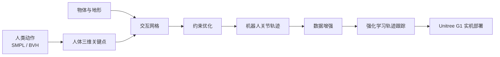

---
title: GMR 和 OmniRetarget
url: https://blog.kisechan.space/2026/gmr-omniretarget/
type: post
time: '2026-10-23T15:19:31.963Z'
---

人形机器人要做一件看起来很简单的事：**模仿人类动作**。但是因为人和机器人的身体根本不一样——腿长不同、手臂比例不同、关节活动范围不同、驱动方式不同。这就是所谓的**具身差距**（Embodiment Gap），所以这个工作做起来并不简单。

解决这个问题的关键环节叫做**运动重定向**（Motion Retargeting），把人类骨骼上的动作数据，转换成机器人能执行的关节轨迹。

人形机器人训练的整个的 pipeline 大概是：

- **数据采集**：视频动作捕捉数据等，SMPL-X/BVH
- **Retargeting**：人体关节动作对应到机器人的关节轨迹，输入骨骼位置得到关节角度
- **RL 训练**：输入参考的轨迹，输出 policy
- **Sim2Real**

GMR 和 OmniRetarget 就位于中层的 retargeting 工作，它们的输出（关节角度序列）就是喂给中层 RL policy 的参考轨迹，告诉机器人每时每刻的理想姿态应该是什么样。

## SMPL-X 与 BVH

在实际复现中，有两种主要的数据格式：

### SMPL-X（`.npz`）

SMPL-X 是一个参数化人体模型。它不直接存储关节位置，而是存参数：

- `betas`（16 维）：体型参数，控制高矮胖瘦
- `body_pose`（63 维）：21 个身体关节的局部旋转
- `global_orient`（3 维）：根骨骼的朝向
- `transl`（3 维）：根骨骼的全局位移

需要经过 SMPL-X body model 做一次前向计算，才能得到 55 个关节的 3D 位置和朝向。AMASS 数据集就用这个格式，极其紧凑。

### BVH

BVH 是纯文本格式，直接存储骨骼层级和每帧的 Euler 角数据。自包含，不需要外部模型。LAFAN1 数据集就用 BVH。

---

两种格式到了 GMR / OmniRetarget 内部会被统一处理成相同的数据结构：`{身体名: (3D位置, 四元数朝向)}`。

## GMR

论文：_Retargeting Matters: General Motion Retargeting for Humanoid Motion Tracking_

现有 retargeting 方法（PHC、ProtoMotions）把人的动作转换成机器人动作时产生大量诸如脚滑动、地面穿透、自相交、关节值突变的 artifact，RL 训练被迫用大量 reward engineering 去补偿这些错误。GMR 就是把转译的工作做好，让 RL 不用费心补偿。

GMR 有两个核心算法组件。

### 非均匀局部缩放

人和机器人的身体比例不同，GMR 不是全局等比例缩放，而是每个身体段用各自的缩放因子：

```json
"human_scale_table": {
    "pelvis": 0.9,         // root 平移缩放
    "left_hip": 0.9,       // 下身缩放 10%
    "left_knee": 0.9,
    "left_foot": 0.9,
    "left_shoulder": 0.8,  // 上身缩放 20%（不同！）
    "left_elbow": 0.8,
    "left_wrist": 0.8
}
```

缩放是对身体段相对于 root 的位置进行的：

```
脚相对 root 的位置 = (脚全局位置 - root全局位置) × scale_foot
                 = (0, 0.12, -0.90) × 0.9
                 = (0, 0.108, -0.81)

root 平移也独立缩放:
  root_new = root × scale_root = (2.0, 0, 0.95) × 0.9 = (1.8, 0, 0.855)
```

**关键设计**：root 平移和腿长用相同的 scale 因子。步幅和腿长等比缩放 → 脚的落地关系不变 → 不会脚滑动。这就是 GMR 区别于 PHC（SMPL 统一拟合）和 ProtoMotions（全局轴对齐）的根本优势。

### 两阶段 IK 优化

缩放后的目标位置再经过两阶段 IK[^1] 求解：

[^1]: 逆运动学。

- **第一阶段**（粗解）：只约束手脚位置 + 全身朝向，不管膝肘位置。给 IK 最大自由度，找到一个结构合理的初始姿态。
- **第二阶段**（精解）：所有身体段都加入位置约束，从第一阶段解出发微调，让姿态更像源动作。

另外，`configuration` 对象跨帧持久化——上一帧的解作为下一帧的初始值（热启动），保证时序平滑和快速收敛（60-70 FPS）。

## OmniRetarget

扩展到和物体/地形互动。

论文：_OmniRetarget: Interaction-Preserving Data Generation for Humanoid Whole-Body Loco-Manipulation and Scene Interaction_

GMR 只能处理平地、无交互的动作。如果人搬着箱子走、或者爬平台，GMR 不管箱子、不管地形，翻译出来手穿进箱子里、脚在平台上滑动。



### Interaction Mesh

本文的核心方法。不是让手靠近箱子，而是构建一张把人、物体、地面串在一起的 3D 网格，用 Delaunay 四面体化把所有顶点连成空间网格。优化目标不是手的位姿误差，而是网格的 Laplacian[^2] 变形能量：

[^2]: 离散 mesh / graph Laplacian coordinate。主要就是用局部邻域几何差异来约束。

$$
L(p_i)=p_i-\sum w_{ij} p_j\quad\text{（每个顶点相对邻居的偏移）}
$$

优化目标：

$$
\min||L_\text{源网络}-L_\text{目标网络}||^2
$$

当箱子被移动时，Laplacian 能量自动让手跟着箱子走，因为这个时候手和箱子的相对关系被打乱了。

### 硬约束替代软惩罚

GMR 用高权重"希望"脚不动。OmniRetarget 用硬约束：

1. 着地脚绝对不能动：$p_\text{foot}(t)=p_\text{foot}(t-1)$
2. 身体绝不能穿透：$\text{signed\_distance(A, B)} \ge 0$
3. 关节限位：$q_\min\le q\le q_\max$
4. 速度限位：$v_\min\le (q_t-q_{t-1})/\mathrm dt\le v_\max$

用 SOCP（二阶锥规划）求解，这些约束写进优化条件里。

### 数据增强

从一段 demo 自动生成 N 种场景的轨迹：

```
一段"搬箱子"的人体演示:
  → 箱子左移 20cm → 重新求解 → 新轨迹 A
  → 箱子右移 30cm → 重新求解 → 新轨迹 B
  → 箱子旋转 45° → 重新求解 → 新轨迹 C
  → 箱子放大 1.5 倍 → 重新求解 → 新轨迹 D
```

全流程产出了超过 8 小时的训练数据。

## 复现

### GMR 复现

在 macOS 上用 LAFAN1 BVH 数据，不需要 SMPL-X body model：

```bash
# 环境
conda create -n gmr python=3.10
pip install -e .

# 下载 LAFAN1 数据集
# 从 https://github.com/ubisoft/ubisoft-laforge-animation-dataset

# 运行
.conda-gmr/bin/mjpython scripts/bvh_to_robot.py \
    --bvh_file data/lafan1/walk1_subject1.bvh \
    --robot unitree_g1 --format lafan1 \
    --save_path output/walk1_g1.pkl --rate_limit
```

macOS 上 MuJoCo 可视化必须用 `mjpython` 而非普通 `python`。

产物是 `.pkl` 文件，包含 `root_pos`（3D 位置）、`root_rot`（quaternion 朝向）、`dof_pos`（29 个关节角度）。

### OmniRetarget 复现

和 GMR 不同，它的输出格式是 `.npz`（不是 AMASS 的 `.npz`，而是包含机器人 qpos 的 `.npz`）。

复现分五层：

1. 基础重定向（拿到 `*_original.npz`）
2. 数据增强（拿到 `*_augmented.npz`）
3. 质量评估（穿透/脚滑/接触保持率）
4. 格式转换（转成 RL 训练格式）
5. RL 训练（需要 Ubuntu + GPU，做不了）

前四步都可以在 macOS 上完成。和 GMR 差不多。

## 参考与注解
