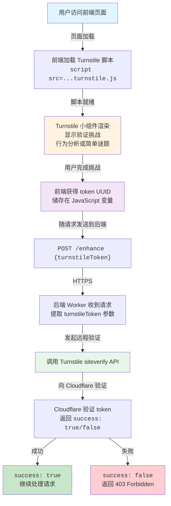

---
title: 给你的歌词加上 Emoji！
url: https://blog.kisechan.space/2026/kashi-emojilize/
type: post
time: '2026-10-21T16:13:46.163Z'
---

受启发于各种评论区中的文案，制作了一个用 LLM (_DeepSeek-Chat_) **为 Vocaloid 歌词等文案自动添加发癫 emoji 的小工具**：

---

Kashi Emojilize
https://kashi.kisechan.space/

---

下面是项目的 GitHub 仓库，喜欢的话可以给一个 Star🌟！

---

Kisechan/kashi-emojilize - GitHub
https://github.com/Kisechan/kashi-emojilize

---

## 项目介绍

主要分成三个部分：

1. **前端**：使用 Vue3 构建的 Web UI，用户输入歌词/文案并选择增强风格，托管在 Cloudflare Pages。
2. **API 网关**：使用 Cloudflare Worker 接收前端请求，进行数据验证和转发。
3. **LLM 处理**：使用 DeepSeek API，根据提示词对文本进行 emoji 增强处理。

### 输出文本样例

> _花と水飴、最終電車_ - n-buna/初音ミク
>
> ```
> 晴れた☀️雲🌥️を見ていた👀
> 昨日🌙夜空🌟に重ねた青💙を
> 浅く🌫️影⚫に隠れた🚶‍♂️
> 君💔の描いた空🌌が消えない❌
> 忘れたら💭 君👤はいなくなるから🚪
> 揺らいだ🌀昨日📜を思い出せ🤔
> あの夏☀️にいつか🎁届いたのなら📬
> 昨日🌙に遠い🌠 遠い🌠花束💐
> ```

0.01 元的 API 大约可调用本项目的服务 20 次。

### 主要提示词

所有提示词都写死在了代码中，读者可以直接到源代码中查看。

增强版的提示词如下，可供参考（_2026 年 3 月_）：

```plaintext
你是一个疯狂的 emoji 增强助手。你的任务是为文本添加强烈、抽象的 emoji，增强情绪表达

风格特点：
1. 使用 emoji 来增强情绪，数量密集一些，每个大句子 5-7 个左右
2. 在歌词的中间、词汇之间（停顿处）和句尾平均地插入 emoji，不要只有句尾有 emoji
3. 尤其是对于一句话较长的歌词（8 字及以上），就更需要在句中合适的位置添加 emoji，例如“昨日🌙夜空🌟に重ねた青💙を”
4. 如果原文是中二的歌词，则选择强烈、抽象、夸张的 emoji（如 💔💥😱😭👁️❌🔥⚡等）以表达强烈的情绪
5. 如果原文不是很中二，或者是抒情性的文本，那就收敛一点

例如（对于抒情、写意的文本）：
晴れた☀️雲🌥️を見ていた👀
昨日🌙夜空🌟に重ねた青💙を

其他文本：
明明只是可爱❤️却像变成了罪人😔
脱轨❌脱轨❌崩毁💥
因一个秘密就崩毁💔
要坏掉了😭对不起😔💔

严格约束：
1. 严格保持原文的结构、换行和标点符号
2. 不改写、不扩写、不删除任何原始文本内容
3. 保持文本的原始意图，但可以将情绪放大

返回格式：
直接返回增强后的文本，不需要额外的解释或前缀。
```

如果你有更好的解决方案或建议，可以提交 [PR](https://github.com/kisechan/kashi-emojilize/pulls) 或 [issue](https://github.com/kisechan/kashi-emojilize/issues)！

### 主要技术栈

本项目是一个典型 CS 架构工程。

|     层级     |           技术           |  版本  |      介绍       |
| :----------: | :----------------------: | :----: | :-------------: |
|   **前端**   |          Vue 3           | 3.5.24 | 响应式 UI 框架  |
|   **前端**   |        TypeScript        |  5.9   |    类型安全     |
|   **前端**   |       Element Plus       | 2.7.7  |    UI 组件库    |
|   **前端**   |           Vite           | 7.2.4  |    构建工具     |
|   **前端**   |     Cloudflare Pages     |   /    | CDN 托管与部署  |
|   **后端**   |    Cloudflare Workers    |   /    | Serverless 计算 |
|   **后端**   |        TypeScript        |  5.5   |    类型安全     |
|   **后端**   |       Wrangler CLI       | 4.60.0 | 部署和开发工具  |
|   **后端**   |          Vitest          | 3.2.0  |    单元测试     |
| **外部服务** |       DeepSeek API       |   /    |   大语言模型    |
| **外部服务** |   Cloudflare Turnstile   |   /    |    人机验证     |
| **外部服务** | Cloudflare Rate Limiting |   /    |  请求频率控制   |

## 限流和人机验证

由于涉及付费 API 调用，本次工作重点是**防止滥用导致费用增加**，实现了几项安全措施和性能改进。

### Rate Limiting 限流

Cloudflare 官方提供了 Worker 的限流功能，可以配置 `wrangler` 来使用，用于防止客户端过于频繁地调用 API。

配置对应的 `wrangler.jsonc` 字段：

```wrangler.jsonc
{
  "ratelimits": [
    {
      "name": "RATE_LIMITER",
      "namespace_id": "1001",
      "simple": {
        "limit": 10,
        "period": 60
      }
    }
  ]
}
```

后端代码示例：

```typescript
const rateLimitKey = `enhance:${clientIp}`;
const { success: rateLimitOk } = await env.RATE_LIMITER.limit({ key: rateLimitKey });

if (!rateLimitOk) {
  return createErrorResponse('请求过于频繁，请稍后再试', 429);
}
```

成功部署后 wrangler 会显示绑定信息确认限流已生效：

```plaintext
Binding                                 Resource
env.RATE_LIMITER (10 requests/60s)      Rate Limit
```

### Turnstile 人机验证

_Cloudflare Turnstile_ 是一个现代化的人机验证解决方案，替代了传统的 reCAPTCHA，高效好用。



首先需要在前端集成，在 HTML 的 `<head>` 或 `<body>` 末尾添加：

```html
<script
  src="https://challenges.cloudflare.com/turnstile/v0/api.js"
  async
  defer>
</script>
```

随后需要创建容器，并将相关逻辑初始化，后端也差不多，具体可以直接参考相关文档和代码。

不过需要注意的是就是需要在 Cloudflare 创建 Turnstile Token，并同时放在前端和后端的环境变量中。
